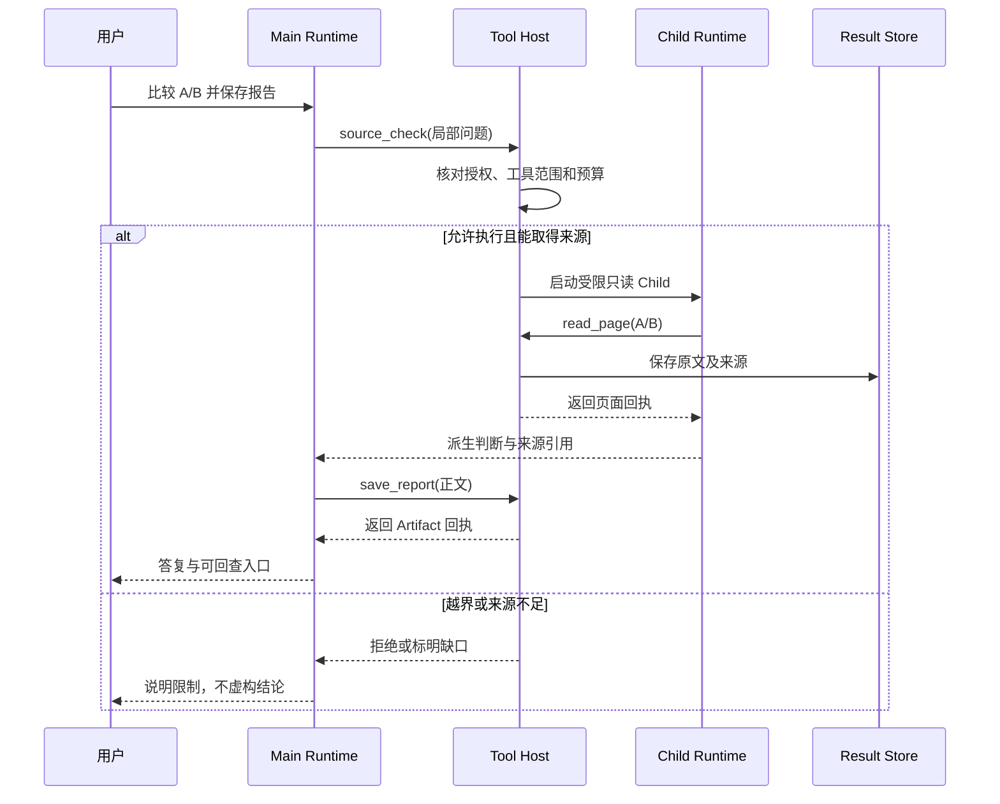
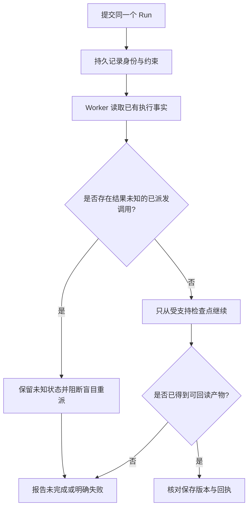

# Agent 深入：从一份报告到持续执行与专家协作

<LearningPathNav />

前两篇已经解释了 AI 怎样决定 Loop 的下一步，以及十个模块各自负责什么。这一篇往前走一步：**资料经过多个工具、任务交给另一个进程、部分工作交给另一个助手时，怎样继续完成同一件事？**

这也是 Open ETF Agent 从 v0.10 演进到 v0.15 的一条阅读主线。原来的系统设计文章与新增专家协作内容在这里合为一篇，保留原链接；[v0.10 原稿](https://github.com/hpoenixf/eff-agent-article/blob/a377164e53e5f63b7a6114d54e2635c084dfbbcd/articles/open-etf-agent-v010-system-design.md)仍可按固定版本阅读。

我们看三个具体问题：资料怎样变成报告，任务怎样持续执行，专家怎样参与主任务。它们对应独立示例，共享同一套执行基础。默认公开命令使用合成资料和脚本模拟的模型动作，实际执行工具、存储与进程交接。


## 六层能力图：深入篇新增的是交接契约

在进阶模块基础上，图中**重点突出** `source_check` 的 Main/Child 交接、Child 的受限工具、原文与派生判断的来源边界、ResultRef 的可复算链路，以及报告的实际回读。浅灰框是已经介绍过的基础模块；点击实线标签可查看固定源码。

<PanoramaViewer src="/eff-agent-article/visuals/learning-stage-maps/deep-zh.svg" label="深入六层能力图：来源证据、持续执行、Main/Child 交接与报告回读" :source-links="true" :canvas-width="2240" :canvas-height="1110">
<div class="v3-owner-map-scroll">
  <object class="v3-owner-map" type="image/svg+xml" data="/eff-agent-article/visuals/learning-stage-maps/deep-zh.svg" role="img" aria-label="深入六层能力图：来源证据、持续执行、Main/Child 交接与报告回读">
    <a href="https://hpoenixf.com/eff-agent-article/visuals/learning-stage-maps/deep-zh.svg">打开 SVG 六层能力图</a>
  </object>
</div>
</PanoramaViewer>

**不要把三种机制拼成同一次运行：** v0.15 `source_check` 专家、v0.10 ResultRef 计算、Worker 持久执行属于彼此独立的示例。L6 在这里仅表示 CLI 回读，不表示 Web UI 已交付。

## 先立三条“不断线”的主线

把一份报告写出来，和把一个可靠的 Agent 应用做出来，区别不在于多几个工具，而在于**跨越模块、进程、助手之后，有哪些事实不能丢**。


四条链分别展示需要保留的事实，不是同一条教学命令已经跑通的流水线。交付连续性是前三条落到用户体验的条件；完整连续性与断点说明保留如下。

<details>
<summary>查看完整关系与文字对照</summary>

| 连续性 | 从哪里到哪里 | 如果中途断掉，会发生什么 |
| --- | --- | --- |
| **证据连续性** | 原文 → Result → 确定性计算 → 报告数字 | 数字看似正确，却解释不清由哪两行算出 |
| **执行连续性** | 用户任务 → Session → Worker → Runtime | 进程结束后重复做事，或错误地继续旧任务 |
| **责任连续性** | Main 授权的局部问题 → Child 工具调用 → Main 采纳 | 子代理把未经许可的阅读或未经核实的总结当成结论 |
| **交付连续性** | 报告内容 → 保存回执/Publication → 用户能读到的版本 | 模型说完成了，但文件或前端仍是旧内容 |

</details>

这里的第四条“交付连续性”，是把前三条落实到用户体验的必要条件，不代表 v0.15 教学命令已经实现完整在线发布系统。下面的 v0.10 计算、Worker 和 v0.15 Child 是**分别可运行的机制例子**，我们用同一组系统问题去理解它们，而不是声称一次命令会完成全部流程。

先看一次“专家查来源并交回主任务”的概念时序。实线请求与虚线回执区分动作和结果；这是架构说明，不是按真实 Trace 逐事件导出的图。

**不用缩放，按顺序读这次协作：**

1. 用户请求 Main 比较 A/B 并保存报告；Main 向 Tool Host 发出 `source_check(局部问题)` 请求。
2. Tool Host 先核对授权、工具范围和预算，再进入以下条件分支。

**允许执行且能取得来源时：**

1. Tool Host 启动受限只读 Child。
2. Child 请求 Tool Host 执行 `read_page(A/B)`。
3. Tool Host 把原文及来源保存到 Result Store，再向 Child 返回页面回执。
4. Child 向 Main 返回派生判断与来源引用，而不是把判断当作原始资料。
5. Main 请求 Tool Host 执行 `save_report(正文)`；Tool Host 向 Main 返回 Artifact 回执。
6. Main 向用户返回答复与可回查入口。

**越界或来源不足时：** Tool Host 向 Main 返回拒绝或缺口说明；Main 向用户说明限制，不虚构结论。这个分支不进入上述成功路径。

下方原图保留各参与方及消息方向：实线表示请求或动作，虚线表示返回的回执、判断或答复。

<details>
<summary>查看完整协作时序图（可放大）</summary>



</details>

每条回执都回答不同问题：读页回执说明资料来自何处；Child 的话只是基于资料形成的解释；写入回执说明产物实际存在。**这三种证据不能用同一句“Agent 成功”替代。**

## 一、资料怎样经过计算，进入一份报告？

先看 v0.10 的小例子。一张合成表里有三行数值：**100、999、250**，币种都是 USD，数据日期都是 2026-10-01。任务比较第一行与最后一行，中间的 999 不参与计算。

最直观的做法是把 100 和 250 交给计算器。但当后面还有模型解释、报告和 CSV，这两个数字需要保留来路。

这项能力把过程连起来：**读取原表 → 选定两行 → 计算一次 → 下一轮模型、报告与 CSV 使用同一个结果。**

`read_comparison` 取得资料，Result 保存原始内容。计算请求引用这份结果，指出要使用的选区和行位置。计算器从已保存的原文中取数，得到差值 150、当前值为基准的 2.5 倍、相对增幅 150%，同时保留单位、币种和日期。

生成报告和 CSV 时，程序沿这份计算结果取值。于是，读者能从报告里的数字回到计算，再回到原来的两行资料。模型仍负责解释这些数值意味着什么。

这里的设计选择很实用：已有工具能读取、计算和保存，就补上它们之间的引用关系，让同一个结果继续往下走。[原始提案](https://github.com/hpoenixf/open-etf-agent/blob/ff5b9273ef0d239e804f61792702cd2e94174be7/openspec/changes/result-reference-consumption/proposal.md)保留了这个来路。

<details>
<summary>进一步看：v0.10 的选区与计算口径</summary>

计算请求的形状如下，真实 `resultRef` 由读取工具返回：

```json
{
  "resultRef": "读取原表后得到的结果引用",
  "selection": { "offset": 0, "limit": 3 },
  "baselineRow": 0,
  "currentRow": 2
}
```

选区需要覆盖两个操作数。只取得前两行时，第三行就不能作为已取得的输入；日期、币种或分母不符合该计算方法时，也应保持相应限制。数值部分来自原计算，自由叙述仍需结合资料判断。

[独立回读记录](https://github.com/hpoenixf/open-etf-agent/blob/ff5b9273ef0d239e804f61792702cd2e94174be7/docs/verification/result-consumption-independent.safe.json)检查原报告与 CSV；网关编码检查只说明相应材料进入了请求，不替代真实模型的理解评估。

</details>


### 让一个数字能从报告逆向走回原表

不妨从报告中的“上涨 150%”开始倒着追：报告是否引用了某次计算？这次计算是否真的使用第一行 100 和第三行 250？第三行是否属于该次已读选区，币种和数据日期是否相同？

可以把逻辑关系写成一个**概念契约**，方便评审时逐项检查；它不是 v0.10 的实际接口定义：

```text
report.claim
  -> calculation(resultRef, baselineRow=0, currentRow=2)
  -> sourceSelection(offset=0, limit=3)
  -> original rows [100, 999, 250], USD, 2026-10-01
```

这里特意保留 999：**“工具读到了 999”和“计算使用了 999”是两件事**。若把读取窗口当作运算操作数，增幅就会错；若只返回增幅却不记录行身份，则即使数值碰巧正确也无法复算。

| 边界情况 | 应有行为 | 不能做什么 |
| --- | --- | --- |
| 选区只覆盖第 0、1 行 | 视为缺少 currentRow=2 | 让模型用描述猜第三行 |
| 基期为 0 | 比率/增幅按方法标记不可计算 | 静默除以 0 或输出无限大 |
| 币种、日期或统计口径不一致 | 明示差异，必要时要求标准化输入 | 把不可比数值直接相减 |
| 结果引用不存在或资料已不在授权范围 | 停止该次计算并说明缺口 | 由模型自行编造一个结果引用 |

这张表提出的是**应用级正确性要求**，不宣称对应固定版本已经实现每一行校验。v0.10 的实际示例和独立回读记录，只能支持其确实完成的选区、计算与报告/CSV 一致性检查。模型负责解释“这个变化可能意味着什么”，不能负责凭自然语言重新创造计算事实。

## 二、提交任务的程序退出了，谁继续工作？

一个短任务可以在一次命令中完成。工作变长后，提交与执行可以分开：先登记任务，再让一个 Worker 接手它。

这个场景里，三个熟悉的模块分工如下：


提交程序与执行进程可以分开，但仍是明确选定的原任务。这里只说明原有交接机制，不承诺任意旧检查点都能恢复。

<details>
<summary>查看完整关系与文字对照</summary>

| 组成部分 | 负责什么 |
| --- | --- |
| Session | 保存任务、已有进展和执行约定 |
| Worker | 驱动一个明确选定的任务 |
| Runtime | 继续原来的模型与工具循环 |

</details>

Worker 复用 Session 已有的执行记录，再调用同一套 Runtime。[单 Run 的原始提案](https://github.com/hpoenixf/open-etf-agent/blob/ff5b9273ef0d239e804f61792702cd2e94174be7/openspec/changes/v09-single-run-worker/proposal.md)把方案收窄到这一条清晰路径，避免另建一套重复的任务状态。

这样，命令窗口关掉与研究任务的生命周期就可以分别处理。后续进程接手的是同一个任务，原来的允许范围、已用预算和截止时间一起保留。

原文的 `durable-publication` 用例展示这段交接。它与上一节的计算示例各自运行，帮助我们从两个角度理解同一套程序。

<details>
<summary>进一步看：持续执行的边界</summary>

可恢复的依据是已有执行事实和受支持的检查点。已派发但结果未知的请求不会自动重放；停止 Worker 也不自动成为用户取消。已经提交的正文与已有文件分别保留，后续任务变化不会凭空抹掉它们。

v0.10 使用 `tool-host@2`，持久化的 `tool-host@1` 快照不能由新版 Runtime 续跑或重放，包括已终结的旧 Run。升级前应让活动任务在原版本完成，或隔离保留旧代码与数据。原 Result、Artifact、Publication 的独立读取与执行恢复分别处理。[升级清单](https://github.com/hpoenixf/open-etf-agent/blob/d943dd8452e4a97fbca5e5c74537a05655e73837/docs/upgrade-guide.zh-CN.md)保留具体条件；其中合成旧标签测试不等于真实旧快照迁移验收。

</details>


### “再运行一次”为什么可能破坏正确性？

设想 Worker 发起保存报告后，进程就在收到回执之前断开。现在有三种可能：写入根本没发生、写入已经发生但回执没留下、写入失败并有记录。**进程退出**这一个表象，并不足以区分三者。

恢复流程需要先确认原任务身份、任务约束以及上次能够证明的检查点，不能根据新进程是否能启动来判断原工作是否可以安全重放。



这是**安全恢复的决策示意**，并非 v0.10 Worker 的完整状态机。一次恢复至少要区分：

| 事实类型 | 能否推导“可以重试”？ | 原因 |
| --- | --- | --- |
| 已保存且可验证的结果 | 不必重复相同效果 | 重复写入可能覆盖已有内容 |
| 有明确失败回执、且操作允许重试 | 需要重新检查前置条件 | 原授权、预算、截止时间仍然约束运行 |
| 已派发、结果未知 | **不能直接重派** | 外部效果可能已发生，重复会制造第二份效果 |
| 升级后不兼容的旧检查点 | 不允许当作新版本可恢复 | 序列化协议并非永远兼容 |

如果工具要写外部系统，工程上还应考虑业务幂等键、效果查询和补偿策略；不能靠一句“至少执行一次”推导“效果恰好一次”。这些是进一步建设方向，不能回填为当前演示版本已实现的能力。

## 三、再加一位专家，两个 Loop 怎样协作？

v0.15 增加了一个串行来源核对专家。继续用入门篇的 Atlas Notes：Main 负责比较两版指南，Child 专门查看免费导出的限制与条件。

原始资料仍然很简单：A 免费版支持 CSV、上限 120 行；B 支持 CSV 和 Markdown、上限 300 行；两版导出都需要联网。它们来自[固定的合成文档](https://github.com/hpoenixf/open-etf-agent/blob/74bd5aa455ccaeb2994eb22aa744affde660bfa2/fixtures/documents.json)。

先记住这条路线：**Main 发出核对任务 → Child 读取 A/B → 原文和核对意见回到 Main → Main 整理报告。**

### Main 先提出一个工具调用

[specialist-demo.mjs](https://github.com/hpoenixf/open-etf-agent/blob/74bd5aa455ccaeb2994eb22aa744affde660bfa2/src/specialist-demo.mjs)为 Main 准备任务和可用工具。本例选择 `source_check`，把“核对免费导出限制和共同联网要求”交出去。

从 Main 的 Loop 看，这和选择读页工具很相似：提出动作，等执行结果返回。这里的工具内部会运行一个范围更明确的助手。

### Child 带着自己的材料运行

[specialist-child.mjs](https://github.com/hpoenixf/open-etf-agent/blob/74bd5aa455ccaeb2994eb22aa744affde660bfa2/src/specialist-child.mjs)建立交接。Child 得到整体问题、本次核对要求，以及允许读取的 A/B 文档。它只有 `read_page` 工具，最终报告由 Main 组织。

[child.mjs](https://github.com/hpoenixf/open-etf-agent/blob/74bd5aa455ccaeb2994eb22aa744affde660bfa2/src/child.mjs)继续调用项目原有的 `run`。两个助手共用执行机制，各自拥有任务输入和上下文。


这是 v0.15 的一个串行来源核对专家：Child 只能读取受限 A/B 页面，不负责保存或发布主报告。默认示例使用固定脚本动作，不是一次真实模型能力评测。

<details>
<summary>查看完整关系与文字对照</summary>

| Child 回合 | 动作 | 新得到的材料 |
| --- | --- | --- |
| 第一轮 | 读取 A 版第一页 | A 的导出格式、上限和条件 |
| 第二轮 | 读取 B 版第一页 | B 的对应内容 |
| 第三轮 | 返回核对说明 | 已查看的资料与核对意见 |

</details>

每次工具结果进入下一轮输入。接入真实模型时，模型结合当前材料选择后续动作；默认示例用固定动作，让这一连接过程容易观察。

### Main 接回材料，继续自己的下一轮

Child 返回核对说明时，也把取得的原始页面交回来。可以把它想成同事递来一份调查便签，附上查过的原文。Main 既能看重点，也能结合材料形成整体报告。

这些内容作为 `source_check` 的结果进入 Main 上下文。默认示例随后选择 `save_report`，再返回最终答复：


回到 Main 后，本次 Child 工作已结束。原文与派生意见进入主任务上下文，Main 才整理并保存报告，再给出最终答复；没有新增并行专家调度。

<details>
<summary>查看完整关系与文字对照</summary>

| Main 的推进 | Child 在哪里参与 |
| --- | --- |
| 第一轮：调用 `source_check` | Child 读 A、读 B，返回说明与原文 |
| 第二轮：整理交接内容，调用 `save_report` | 本次专家工作已经结束 |
| 第三轮：给出最终答复 | — |

</details>

**AI 的任务选择、Runtime 的循环、工具的执行没有换一套；现在它们可以组织两个相互配合的任务。** Session 关联父任务与子任务，Result 保留原文，报告模块把输出留下来。进阶篇的模块在这里接成了一条可读的路径。


## 四、怎样证明 Child 没有把“派生意见”变成“来源”？

多一个助手不是多一个事实来源。Main 是整体任务的决策者，Child 只能处理明确委派的小问题。它拿到的不是“用户所有权限”，而是原任务下的一组受限工具、文档和执行额度。

在 [v0.15 固定实现](https://github.com/hpoenixf/open-etf-agent/blob/74bd5aa455ccaeb2994eb22aa744affde660bfa2/src/child.mjs)中，来源核对方法强调原文只是数据，不能因为文档里出现指令就照做；`SOURCE_CHECK_LIMITS` 明确设置 `maxRounds: 4`、`maxTools: 2`、`timeoutMs: 30000`。这限制了核对助手能够读多少、跑多久，但**额度不是访问新文档的许可证**。调用的范围还有绑定身份与工具校验，具体可从 [specialist-child.mjs](https://github.com/hpoenixf/open-etf-agent/blob/74bd5aa455ccaeb2994eb22aa744affde660bfa2/src/specialist-child.mjs)回查。

### 读懂三个不同的身份

- **原文：** `atlas-a` / `atlas-b` 的特定版本和页码，包含可检验的句子，是来源事实。
- **Child 输出：** “已核对免费导出限制、两个版本均要求联网”，是派生判断，可能遗漏某个限制，因此应保留来源标识。
- **Main 报告：** 把 Child 结果和实际页内容综合为可阅读产物，负责说明证据是否覆盖最终结论；最终责任不会因委派而消失。

比如 Child 只读到了 A 页，就声称“B 的免费版本也需要联网”，即使这句话碰巧符合完整合成资料，**该次执行仍缺少 B 页的证据**。正确做法是保留部分完成状态或限制说明，而不是因为语言合理就提升证据资格。

### 子代理是隔离手段，不是可靠性的自动证明

把 `source_check` 绑定成一个工具调用，有两个好处：Main 仍只需要认识一个有限的 Tool 接口；Child 则可用专门的任务说明运行自己的 Loop。但代价也很实在：需要校验父子 Run 身份、委派来源、同一原 Grant、调用 ID、子任务预算和回交内容，防止把别的任务的材料拼到当前报告。

若没有这些检查，子代理越多，**错误归属、重复阅读和来源丢失**反而越容易出现。公开 v0.15 只演示一个串行来源核对专家，不应把它理解为任意并行专家调度平台。

## 五、把三个示例变成可验收的工程契约

回到我们最初的问题：跑出一份 Markdown，不等于端到端正确。一次 Agent 研究至少要分别观察**动作有无执行、原始事实有无保留、最终产物有无回读**。

| 检查层 | 故意制造的故障 | 应观察什么 | 它不能证明什么 |
| --- | --- | --- | --- |
| 参数与权限 | 让 Child 读未获准的第三份文档 | Tool Host 明确拒绝，无越权来源进入 Result | 不代表模型以后不会提出越界动作 |
| 数据与计算 | 选区排除 currentRow，或传入不可比分母 | 受控失败/缺口，不产生伪精确值 | 不代表所有金融统计方法均正确 |
| 持久恢复 | 写入效果已派发，但确认信息丢失 | 保留未知，不静默再次执行 | 不代表所有旧 Run 都能恢复 |
| 子代理交接 | Child 只有 A 页，没有 B 页 | Main 能区分派生摘要与原文、缺口 | 不代表 Child 的自然语言推理永远准确 |
| 报告与交付 | 保存成功后 UI 仍取到旧版本 | 文件、版本、回执和用户可见内容分开核对 | 不代表保存回执等于用户已经看到 |

表中后几项是**完整应用应补的验收场景**，不是声称它们已经包含在 v0.10 或 v0.15 的全部自动化测试里。真实模型执行还要另行验证：fixture 通过只能说明这些机制与示例数据在既定条件下工作，不能作为通用语义正确率或真实业务可用性的证明。

更进一步，在生产系统里不建议仅靠重试次数判断可靠性。应把失败归属到具体交接：模型的动作格式、Host 的权限检查、Result 的来源、Worker 的持久事实、Child 的范围、Artifact 的回执，或者 UI 的版本选择。定位到正确责任后，修复通常比继续调 Prompt 更可控。

## 六、把工程机制接回一次用户体验

从前端视角看，用户只想知道“报告好了没有”。但一个可靠的界面至少要把三个状态区分开：**研究正在进行**、**服务端已保存一个可阅读版本**、**当前界面已显示这个版本**。

若用户刷新页面，前端应凭稳定任务身份重新获取对应报告，而不是凭旧 SSE 片段猜测最终结果；若后台尚未完成，不应把上一份报告当成这次新任务的完成回执。这一段属于六层全景中的交付与界面契约，**不是说命令行专家示例已经交付了 Web UI**。

对全栈工程师来说，这也解释了为什么后续需要 Publication、History 和 UI 的独立设计：模型生成的是候选内容，持久化系统承认某一版内容，交付通道与界面再让人真正看到它。谁接纳、谁保存、谁展示，各自有可核查的事实。

## 六、在同一份 v0.15 代码上体验主线

沿用[入门篇安装好的 v0.15 环境](./agent-in-15-minutes.md#自己跑一次五分钟体验)，使用一个新的专属目录：

```bash
node src/specialist-cli.mjs run --session runs/deep-specialist-v015
```

终端会给出实际的 `runId`。把它填入下面的命令：

```bash
node src/specialist-cli.mjs read --session runs/deep-specialist-v015 --run RUN_ID
```

先看 `child.summary`、`sources`、`report.text`：分别是专家说明、取得的页面和报告正文。默认报告会列出核对说明和两版原文，适合对照交接过程。已经跑过进阶篇的专家示例，也可以直接使用那个目录与 `runId`。

读源码时按四个入口走：**[specialist-cli.mjs](https://github.com/hpoenixf/open-etf-agent/blob/74bd5aa455ccaeb2994eb22aa744affde660bfa2/src/specialist-cli.mjs) → specialist-demo.mjs → specialist-child.mjs → child.mjs**。先弄清谁把什么交给谁，再进入 `runtime.mjs`。

<details>
<summary>复现原 v0.10：计算结果与独立 Worker 两个示例</summary>

以下保留原文的固定版本。另建目录，避免与上面的 v0.15 工作区混用；Node.js 26.11.1 可对齐该历史验证环境。

```bash
git clone https://github.com/hpoenixf/open-etf-agent.git open-etf-agent-v010
cd open-etf-agent-v010
git switch --detach ff5b9273ef0d239e804f61792702cd2e94174be7
npm ci --ignore-scripts --no-audit --no-fund
npm run build
node dist/src/cli.mjs --case result-consumption --output runs/article-v010
```

沿实际输出目录查看报告、来源清单与 CSV。Worker 示例使用另一个新的 Session 目录，连续执行：

```bash
node dist/src/session-cli.mjs submit --session runs/article-worker --run original-example --case durable-publication
node dist/src/session-cli.mjs work --session runs/article-worker --run original-example
node dist/src/session-cli.mjs publication --session runs/article-worker --run original-example
```

这个示例的 30 秒截止时间从提交开始计算。它展示提交进程退出、独立进程执行、原正文读取；原有恢复条件见[Worker 用例](https://github.com/hpoenixf/open-etf-agent/blob/ff5b9273ef0d239e804f61792702cd2e94174be7/test/worker-process.test.mjs)。默认示例离线运行，安装依赖可能访问 npm。

</details>

## 七、从三条不断线的主线，走到六层全景

现在把全部内容放进一张更大的地图。**这里的六层是请求交接视角，不是六个必须依次执行的服务，也不表示每个演示版本都具备全部能力。**


按“任务身份 → 动作与工具 → 可交付版本 → 实际可见”定位责任。六层是交接视角，不是每个历史演示版本都已具备的能力清单。

<details>
<summary>查看完整关系与文字对照</summary>

| 六层 | 这一层要回答的问题 | 本文的例子与关键边界 |
| --- | --- | --- |
| **L1 任务输入与触发** | 谁提出“比较 A/B”，何时开始？ | 用户请求是任务起点；周期触发属于更完整的应用 |
| **L2 身份、会话与上下文** | 这个 Run 属于谁，能用哪些历史与文档？ | Session 的任务身份、Context 投影、原始 Grant |
| **L3 Agent 决策与运行** | 下一步做什么，是否需要 Child？ | Main/Child 共享 Runtime 机制，动作提议不等于授权 |
| **L4 工具与领域能力** | 谁取得原文、谁计算 150%？ | Tool Host、ResultRef、确定性计算和可复算来源 |
| **L5 结果发布与交付** | 哪个报告版本已被确认保存并可交付？ | Artifact 与回读；Publication/History 是更完整的交付治理 |
| **L6 用户界面** | 用户实际看到了哪个 Run 的哪个版本？ | CLI 先学会读回，Web UI 再处理刷新、进度和错版问题 |

</details>

回头看，进阶篇介绍的十个模块负责提供能力，深入篇问的是**能力之间交接什么、失败如何判定、恢复时相信什么**。六层全景再扩展到整个系统：不只是读文档和保存报告，还有 Direct/Research/Coord 分流、异步任务、跨层 Owner、观测与最终用户体验。

接下来读[**《从一次提问到答案可见：ETF Agent 六层调用全景》**](./017-prompt-to-answer-six-layer-panorama-v3.md)。建议先只顺着 L1 → L6 路线阅读，再按兴趣放大 Main/Child、工具结果和 Publication 等关键交接。**不要把图背下来；用它定位责任和验证证据。**

[返回进阶](./agent-ten-modules.md) · [当前开源入口](https://github.com/hpoenixf/open-etf-agent) · [English](../en/articles/open-etf-agent-v010-system-design.md) · [工程文集（欢迎 Star）](https://github.com/hpoenixf/eff-agent-article)
