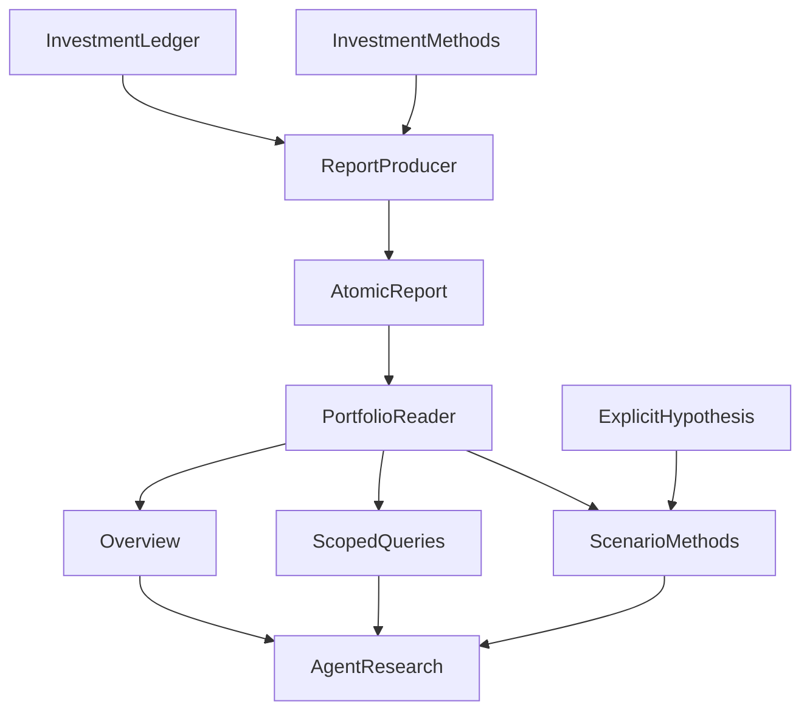

# 把个人持仓接入 Agent：我们怎样设计一个只读金融 MCP

**只读金融 MCP 不等于只能把持仓数字转成 JSON。它可以帮助投资者计算“如果调整会怎样”，但必须始终分清：什么是当前账户事实，什么是假设方案，什么才是实际成交。**

用户问“科技仓位占多少”，需要的是指定日期、指定报告中的真实组合分母。接着问“如果降低科技比例，现金会怎样”，需要的是一项带明确权重、费用和现金条件的情景计算。即使模拟结果可行，也没有授予模型替用户确认或交易的权力。

我们在 ETF Agent 中选择让 Portfolio MCP 读取根投资系统生成的原子 `portfolio-report@1`，按需提供概览、明细和登记过的指标与假设情景；业务计算仍由原领域方法承担，服务没有写入账户的工具。**关键不是把投资逻辑全部集中到一个 MCP，而是让每个数字带着原来的对象、时点、分母和使用资格进入研究。**

下文采用一个明确标注为教学构造的场景：用户要查看当前配置、定位科技基金，并试算调整目标权重之后的现金与约束。文中的代码、金额与日期不代表真实个人账户或已完成的交易。

## 一、工具背后，先要有一份可以解释的账户事实

我们的根投资系统已经负责持仓、现金、确定性计算和用户确认，并将这些结果整理为 `portfolio-report@1` 报告。Portfolio MCP 消费这份报告，不在每次回答时分别打开持仓文件、现金文件和旧建议，再临时拼一份新的账户状态。

这里的“原子报告”首先是一份以共同报告身份交付的快照，其中某些部分仍可能缺失。它也可能包含不同业务日期：持仓有快照日期，基金有净值日期，报告有生成时间。把它们放进一个文件，并不会让这些日期自动相等；它解决的是多个相关部分可以被一起识别、校验和读取。

读取器从获准目录寻找规范命名的报告文件，检查路径和结构，保留报告标识、证据版本、生成时间、快照日期，并计算文件内容哈希。后面的工具因此能够回答“这组数来自哪份报告”，而不只返回一串脱离上下文的金额。



图中的连线表示数据依赖。根投资系统形成报告，读取器生成不同查询所需的视图；情景方法还需要额外的明确假设。研究取得这些结果后继续解释，图里没有从研究回写投资账本的通路。

我们曾经在报告生产者和 Agent 读取器之间重复定义整份数据结构，后来抽出了共享的结构合同和解码器。但双方保留了各自的校验：根系统允许表达“快照日期未知”的报告，Agent 读取器需要可用日期，因而仍会拒绝它。

这是一个很实际的取舍。**共享字段定义，可以减少结构漂移；消费资格仍要由消费者判断。** 若直接把报告生产模块引入读取器，还会带入文件写入和投资计算依赖。最终共享的是不带这些副作用的合同，而读取器继续保有日期和视图完整性的要求。

## 二、用户问概览时，先给他一个真正的概览

回到第一个问题：“我的整体配置怎样？”

早期的无参组合查询会返回完整持仓，以及定投、预算、执行等较宽的上下文。用户只是想看整体配置，模型已经收到逐只基金、份额、净值和无关的决策字段。我们希望减少这种默认披露，同时让模型有一个稳定的配置总览。

因此，`get_portfolio_overview` 提供受限的展示视图：组合总额、八个展示分组及必要的分类信息。它使用根报告已有的展示口径；未知类别有明确位置，重叠的风险标签也不会被当成互斥分组相加。整个账户报告继续留在服务内部，工具只取得当前问题需要的投影。

当前概览还会返回少量有证据的基金关系候选，帮助后续研究找到值得查看的对象。这些候选可以包含基金代码，所以“概览”不意味着完全没有产品身份。它的边界是：**不默认展开全量持仓、份额、净值和所有决策段，同时保留继续研究的入口。**

这次改造有一个值得保留的真实教训。最初，我们已经让 MCP 返回了受限概览，但实际应用同时注入了直接数据源和 MCP Host。另一条上下文装配路径仍然优先使用完整报告，模型最终看到的内容绕过了新概览。只测试 MCP 返回值，无法发现这个问题。

后来的受控回归覆盖了实际双注入入口，才把默认模型上下文调整为受限视图。这个案例说明，数据最小化必须走到真正的消费位置；一份正确的工具结果，不能证明应用最终用了它。

当然，概览也有代价。模型想进一步分析，需要再取明细；如果默认返回的信息过少，又会让每次研究都变成机械翻页。因此我们按问题组织工具，而没有把每个字段拆成一个独立调用。

| 用户当前需要 | 工具入口 | 返回内容的重点 |
| --- | --- | --- |
| 了解整体配置 | `get_portfolio_overview` | 总额、展示分组、覆盖与少量关系线索 |
| 查看某只基金或一组持仓 | `get_fund_position`、`get_portfolio_holdings` | 明确产品或组合范围内的持仓事实 |
| 判断产品之间的关系 | `get_portfolio_relationships` | 联接关系、跟踪指数与已有成分重叠证据 |
| 查询指标或比较假设方案 | `query_portfolio_metric` | 登记方法、输入范围、时点和计算结果 |

## 三、从概览到明细，让每个数字带着范围回来

用户接着问科技部分。“科技”可能横跨多个配置分组，模型需要先明确这次指的是某个分组，还是跨基金的行业暴露，再选择相应查询。当前 `get_portfolio_holdings` 也允许返回完整组合；当问题确实需要逐只分析时，全量读取是合理能力。默认概览与按需明细服务的是不同问题。

下面以纳斯达克分组中的一只教学基金说明明细接口。假设报告的可配置组合总额为 100,000 元，其中虚构基金 `900001` 持有 1,000 份，该快照使用的净值为 12 元。单只基金查询的输入可以是：

```json
{
  "fundCode": "900001"
}
```

下面摘取返回结果中与理解有关的字段，省略完整协议字段和另行返回的展示投影。数值仅用于说明当前接口的含义：

```json
{
  "status": "available",
  "analysis": {
    "fundCode": "900001",
    "name": "教学科技基金",
    "category": "nasdaq",
    "shares": 1000,
    "nav": 12,
    "value": 12000,
    "weight": 0.12,
    "view": {
      "query": { "kind": "fund", "fundCode": "900001" },
      "snapshot": { "asOf": "2026-10-18", "freshness": "fresh" }
    }
  },
  "provenance": {
    "reportId": "demo-report-2026-10-18",
    "evidenceVersion": "demo-v1",
    "snapshotDate": "2026-10-18",
    "authority": "report-snapshot"
  }
}
```

这里的 12% 使用根报告的组合总额作分母，并非这只基金在科技分组内部的比例。`fresh` 表示满足当前配置的读取新鲜度条件，具体快照仍是 10 月 18 日，不能把它改写成“今天的持仓”。

展示金额也有明确来路：当前实现用同一份报告中的份额乘净值，再计算展示权重。它没有到行情服务抓取一个更新价格，悄悄替换账户估值。这样，模型解释的是所读快照；需要研究最新市场变化时，可以另外取得市场证据，说明两者的时间差。

对话中的多次读取也不应默认视为同一个快照事务。当前工具分别读取可用报告，如果期间产生了新报告，后一次结果可能已经更新。跨结果比较需要核对报告身份与日期；教学例子统一选用一份快照，只是为了把机制讲清楚。

### 条件变化一：同一个名字，可能对应不同基金

用户说“那只科技基金”时，工具不能凭名字相近选择一个产品。单项名称查询遇到多个匹配会报告歧义，要求进一步明确身份；批量查询则保留匹配候选及歧义标记。不存在的基金有自己的不可用结果，不会被伪装为零持仓，也不必让批量中的其他基金一起失败。

### 条件变化二：持仓列齐了，关系证据仍可能缺失

两只基金可能是联接与目标产品，也可能跟踪同一指数，还可能只有部分底层公司重叠。这几种关系需要不同依据。

因此关系查询分别记录持仓范围是否完整、关系证据是否完整。即使全部持仓行都已返回，缺少成分资料的产品仍然不能被判为“没有重叠”。这让模型可以先说明已知关系，再指出哪部分需要继续查资料；一个工具层面的成功状态，不会替金融结论补上缺失前提。

## 四、只读服务为什么仍然可以计算方案

第三个问题是：“如果降低科技比例，会怎样？”**只读约束保护的是账户状态和外部副作用，不是禁止对获准的快照做计算。** 一份假设方案可以展示买卖差额、费用和现金缺口，却不能被写回真实持仓，更不能被解释成用户已经同意执行。原业务方法负责计算定义，MCP 只提供有范围的读取和调用入口。

MCP 的[工具注解规范](https://modelcontextprotocol.io/specification/2025-11-25/schema#toolannotations)将 `readOnlyHint` 定义为工具是否修改其环境的提示，并明确这些注解只是提示，不能保证服务实际行为。我们的工具声明只读，具体保证仍来自服务只接入读取能力、调用明确的领域方法，以及不提供账本写入和交易入口。一个布尔字段不能代替这些实现。

当前 `query_portfolio_metric` 允许查询登记过的指标。每个指标带有公式版本、来源字段、允许的维度和新鲜度要求；结果区分报告快照与确定性计算。模型不能通过临时发明一个指标名称，让服务执行一段任意投资公式。

调仓情景走同一个查询入口，但会进一步调用已有的组合情景方法。研究先读取 `portfolio.rebalance.context`，取得报告及当前策略的身份、组合分母、现金角色和缺少的情景条件，再给出明确假设。

“降低一点科技比例”还不是足够的计算输入。当前方法要求完整目标权重、费用假设、预算，以及卖出所得在该情景下能否用于买入。目标需要覆盖现有基金，符合当前已确认的配置范围；它并不承担替用户选择最优权重或自动引入新产品的任务。

情景请求还绑定报告标识、证据版本、报告内容哈希及策略身份。执行时会与本次实际读取的内容比较。如果模型构造假设之后报告更新了，绑定不一致就会被拒绝，避免把旧持仓上的目标直接套到新账户状态上。这是一个具体的版本检查，仍不意味着整段聊天自动锁定一份报告。

条件满足之后，方法可以计算买卖差额、费用、现金缺口和配置约束。即使结果为 `feasible-under-assumptions`，输出仍明确保留 `targetAuthority: "hypothesis"`、`stateChanged: false`、`executionEligibility: "unknown"` 和 `executionAvailable: false`。这组字段描述的是“在这些假设下算得通”，没有产生交易事实。

账户事实、派生结果和确认状态因此需要分别解释：

| 读到的内容 | 可以说明什么 | 仍然缺少什么 |
| --- | --- | --- |
| 持仓与现金快照 | 指定报告和时点中的账户状态 | 快照之后的账户变化 |
| 指标、建议或情景结果 | 明确方法与输入下的派生结果 | 用户确认及实际执行事实 |
| 已确认的定投计划 | 该计划已处于相应确认状态 | 实际成交、资金扣划与后续变更回执 |

例如，`get_dca_plan` 读取的是建议；`get_execution_status` 读取已确认计划及其当前或最近已知状态。后者名称中有 execution，也不能把计划行翻译成“这些基金今天已经买入”。工具描述需要把这种容易混淆的含义直接说清楚，输出身份则为后面的解释保留依据。

## 五、资料变旧或不完整时，查询应该怎样继续

金融数据不会整齐地同时更新。账户上传、基金净值、日报计算各有时间安排，QDII 还可能有更晚的净值披露周期。因此可用性、日期、估算状态和覆盖率需要分别表达。

### 条件变化三：能展示的估值，未必能用于当前调仓

如果报告里有带标签的估算持仓，概览可以把已知信息和估算覆盖交给模型解释。当前调仓情景则要求实际、完整、可对应的持仓依据，以及有效的策略和现金约束。它不能因为概览能显示一个金额，就自动取得同样的计算资格。

类似地，某个历史日期没有精确匹配的快照时，查询不能悄悄改用最近一天，再把请求日期照抄回来。用户可以改为研究现有日期，或者接受明确的资料缺口；数据服务应当保留这一差别。

局部失败也要停留在它影响的范围。我们曾在受控链路中复现：后续读取的现金预算变旧，导致此前有效的持仓总额也被消费端清成未核验状态。修复后，独立持仓事实可以继续呈现，过期现金仍被限制；但同一字段失效或报告身份变化时，相关资格仍需撤回。

这项修复发生在结果消费与发布资格管理中，Portfolio 服务为它提供清楚的报告身份、范围和字段来路。双方的配合使“局部资料不足”能够被准确表达，避免一项失败让整份研究无话可说，也避免过期数据借其他有效结果继续流通。

## 六、只读金融 MCP 最值得守住的三个边界

**它的价值不是让 Agent 知道更多数字，而是让账户事实、假设计算和实际操作不再被一段流畅回答混成一回事。**

下一次设计个人投资数据接口，可以用三个问题检验：

1. **事实从哪里来？** 持仓、现金与估值是否来自同一份有身份的报告？名称、份额类别、日期、快照分母与新鲜度是否保留？
2. **这次计算是什么？** 指标的真实方法版本、完整目标权重、费用与现金条件是否明确？报告变化后，旧情景绑定能否阻止被误用于新快照？
3. **有没有改变真实账户？** 只有计算结果的 `feasible-under-assumptions` 仍是情景，不是批准、下单或成交；必须由原授权与执行流程结算后续效果。

读取层需要承担报告校验、视图定义与消费资格的维护成本，但不应因此获得记账、确认或投资决策权。当前实现与受控测试覆盖了这些边界的部分工程路径，真实对话能否稳定给出有价值的配置分析仍需另外观察。

**让 Agent 可以研究“如果”，同时保证“已经发生”只有真实账本和执行回执才有资格宣布。**

## 继续阅读

- [从接上 MCP 到真正用上工具：Agent 的接入链路怎样构建](https://hpoenixf.com/eff-agent-article/articles/mcp-host-from-discovery-to-consumption)
- [一个金融数据 MCP，为什么长成了研究决策系统](https://hpoenixf.com/eff-agent-article/articles/mcp-market-responsibility-retrospective)


<!-- agent-article-sync:guidance:start -->
## 延伸阅读与交流

欢迎到[独立阅读站](https://hpoenixf.com/eff-agent-article/)，结合目录、架构图和前后篇连续阅读。

系列文章与图文资料整理在 [GitHub 仓库](https://github.com/hpoenixf/eff-agent-article)。如果这篇文章对你有帮助，欢迎点个 **Star** 支持，也欢迎通过 Issues 交流问题。
<!-- agent-article-sync:guidance:end -->
