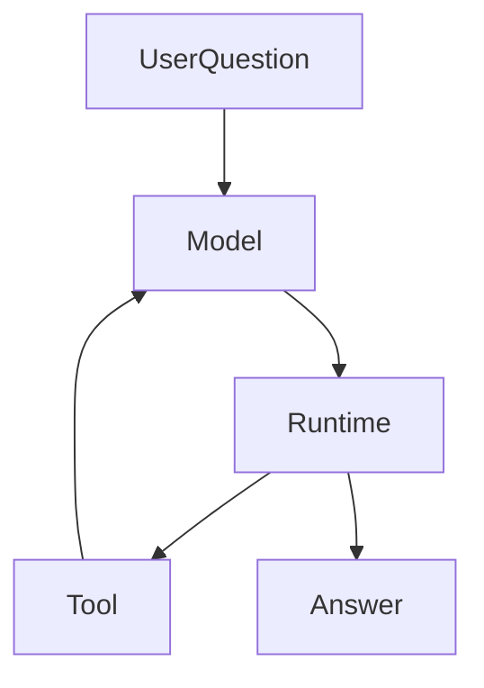

# 别再让模型当状态机：一次 Agent 协议减负实践

**让模型决定下一步做什么，让真正执行操作的程序记录发生了什么。** 这两件事分开，模型才不用一边研究，一边维护一份可能写错的系统账本。

先看一个教学示例。用户请办公助手找一间明天下午可用的会议室，并在获准后预约。模型需要理解时间、人数和设备要求；但“有没有权限预约”“房间是否订上”“是否已经扣过额度”，不能由模型写一句话来决定。这里的预约只是帮助理解的模拟场景，不是 ETF Agent 已提供的功能。

假如预约接口没有返回，模型说“应该订好了”并不能成为成功证明；说“再试一次”也未必安全，因为第一次请求可能已经生效。反过来，程序知道请求发送过，却不因此知道哪间会议室最符合用户的偏好。

这就是本文要讨论的边界：**程序已经掌握的事实，不让模型重复维护；程序没有依据判断的含义，也不靠几条规则假装知道。**

## 一、为什么会出现两份互相冲突的状态

ETF Agent 早期的研究协议让模型交回一个结构化回合，称为 `AgentTurn`。它除了提出动作，还描述缺口和完成情况。下面沿用原稿的简化示例，不代表公开 API：

```json
{
  "actions": ["search"],
  "gaps": ["还缺来源"],
  "completionClaim": false
}
```

这个设计当时有合理动机：接入工具以后，系统需要知道下一步做什么，为什么继续。但随着权限、工具列表、调用结果和发布状态不断加入，模型开始复述程序已经记录的事情。

回到会议室例子，程序记着“预约已提交，结果未知”，模型却可能输出“预约失败”。如果后续重试依据模型那一份状态，重复预约就可能发生。即使最终以程序记录为准，模型那份重复描述仍要生成、解析和纠正。

问题因此不只是 JSON 太长，而是**同一个事实出现了两个维护者，其中一个并不掌握事实的来源**。删除重复字段的理由是避免这种冲突，不能仅凭字段变少就宣称模型更聪明、成本更低。

## 二、模型提议动作，程序保留实际记录

2026 年 9 月的原生工具循环改造，把模型的任务从“描述完整运行状态”收窄为“提出合理的下一步”。程序仍然保存实际响应、调用顺序、执行结果和回执。

在教学场景里，分工可以这样理解：

| 需要回答的问题 | 谁提供依据 |
| --- | --- |
| 用户说“下午”是什么意思，还缺哪些预约条件？ | 模型理解请求，必要时澄清 |
| 哪些房间满足人数和设备要求？ | 查询工具提供事实，模型据此比较 |
| 当前请求是否有权预约？ | 授权记录与执行检查 |
| 预约有没有发生，能不能安全重试？ | 原请求身份、预约结果和执行回执 |
| 怎样把结果及不确定性告诉用户？ | 模型根据实际结果解释 |

这里把后几项统称为运行系统（Runtime）的责任，是为了与模型判断区分；不是要求一个大类重新拥有所有业务规则。预约服务掌握预约事实，资源模块掌握额度，运行系统协调这些已确认的信息。



图中，模型选择下一步，工具返回观察，程序保存执行事实。箭头不意味着模型能直接改写权限、调用结果或任务状态。

旧协议让模型维护的整轮状态可以退出，但主机保存的模型响应记录不能一起删除。项目中后者叫 `ModelTurn`：它记录一次实际响应及其调用，而不是要求模型再编写一份“世界现在是什么样”的报告。

## 三、说“可以结束了”，不等于已经完成交付

沿用原稿的简化调用名，`finish()` 表示模型认为这次研究可以结束。它不是给模型一支修改系统终态的笔。

比如，助手已经说明哪些会议室可用，但预约结果仍未知。模型可以停止继续寻找房间，系统却不能把未知预约标成成功。它需要保留原请求的实际状态，并交代哪些结果已经取得、哪些还不能确认。

研究系统还有一个容易混淆的区别：**是否继续研究、正文是否已提交、文件是否已保存，是相关但不同的事实。** 当前发布约定既接受发布工具交来的正文，也接受经过统一发布路径处理的普通助手正文；不能把“没有调用发布工具”直接当成“没有合法回答”。

原稿曾把“当前引用有效”列为结束的硬条件。按现行约定，这个说法需要收窄：坏引用、未核验的公共来源或附件容量问题，只处理相关附件并说明限制，不能仅据此丢弃独立获准的正文或否决结束。真实权限、私人来源依赖和执行身份仍须保护，不能靠删掉引用绕过。

程序能够确认“这段正文已提交”，不等于能够确认“所有问题都回答对了”。研究是否充分、资料是否支持结论，仍需要语义判断和相应评审，而不是一个完成标志自动认证。

## 四、工具列表由程序提供，选择留给模型

如果助手只有查看会议室的权限，它不应通过输出 `canBook: true` 获得预约能力。模型看到的工具应从本次已记录的授权和工具能力中准备出来，具体调用仍要核对范围。

如果用户随后明确授权预约，需要按现有准入规则接纳这项变化，再让模型基于新的可用能力决定下一步。旧响应中尚未执行的动作，不能只因“模型已经写出来了”就自动跨过权限边界。

这三件事不需要让模型各维护一份：**程序记录权限，程序准备可用工具，模型选择调用哪个工具。**

在 ETF Agent 的当前约定里，同一逻辑运行沿用原已记录的授权和追加准入；不能用今天的权限表重新编写过去的执行事实。新运行需要自己的准入，具体操作仍受账户、范围、取消和资源约束。这是一项具体运行约定，不是主张所有产品都应采用相同的权限生命周期。

## 五、一个动作出错，不重做已经完成的事

假设助手已经查到可用房间，预约时却把时间参数写错了。合适的反馈是：保留查询结果，告诉模型预约参数不合法，由它判断是否修正。没有必要为了一个参数错误，重新生成权限、查询和执行状态的整套描述。

这只适用于能够独立处理的动作。若后一步依赖前一步成功，就必须尊重依赖；“局部失败”不是让所有剩余动作照常执行的借口。

同样，恢复也要使用原始记录。已确认的结果沿原身份读回；结果未知的外部操作先核对，不能把超时当成“没有发生”。支持哪些检查点、哪些中断可以继续，应由实际实现决定，而不是承诺任意崩溃后都能完美续跑。更完整的产品边界见[断线与崩溃恢复](agent-disconnect-is-not-crash-recovery-contract.md)。

## 六、别把关键词匹配升级成事实判断

另一种越界方向，是程序开始根据措辞判断真实世界。

“你的账户没有预约”可能是当前事实，也可能出现在“假设你的账户没有预约”这样的教学句子里。匹配到“没有预约”，无法替代查询记录。换一套说法就能绕过的规则，也不适合被当成授权或事实裁判。

机械检查仍然有用：日期格式、ID、JSON 语法、长度、明确的数值绑定，都可以按规则核对。但它们回答的是格式、身份或具体绑定问题，不是“这段话在语义上一定正确”。

ETF Agent 也经历过类似取舍：个人持仓应来自获准的数据读取，不能由正文关键词建立；模型说“已经调整”，不会改变投资账本。若文案与回执冲突，要处理的是解释质量，而不是把文案变成执行证明。

一条有效引用同样只能把读者带回材料。来源说 A，回答却说 B，链接再完整也不能证明 B。相关区别见[引用为什么不等于可靠](ai-citations-do-not-prove-reliability.md)。

## 七、这次演进留下了什么

下面是这个项目经历过的几种形态，不是所有 Agent 都必须走完的成熟度阶梯：

| 阶段 | 形态 | 得失 |
| --- | --- | --- |
| 提示式 Agent | 用户 → 模型 → 回答 | 入口简单，但工具与执行记录不足 |
| 结构化 Agent | 模型结构化输出 → 运行系统 → 工具 | 可以校验动作并留下实际记录 |
| 重协议 Agent | 模型每轮复述状态、权限和完成情况 | 重复记录增多，容易出现冲突 |
| 原生工具调用 Agent | 模型提议调用，程序记录实际结果 | 保留必要保护，移除模型维护的状态镜像 |

最后一种不是退回“只写提示词”。真正的权限、记录、持久化与恢复约束仍然存在，只是不要求模型替程序记第二遍账。

这也适用于对话摘要：摘要可以帮助模型继续理解，但不能悄悄改写用户的原始要求，再把改写后的版本当成原始事实。

## 下次评审，拿一个字段问到底

准备新增模型输出字段时，先挑一个具体例子：`bookingStatus` 究竟是谁知道的？如果预约服务已经有记录，就把实际结果提供给模型，不要求它再次声明。如果字段表达的是“还缺哪个条件”，那才可能是模型需要提供的判断。

再沿同一例子检查：结果未知时是否会重复预约，参数错误是否重做了无关查询，用户是否能区分“查到房间”和“预约成功”。这比数协议里少了几个字段更有用。

**让模型专注理解和选择，让程序如实保存执行事实。** 这是[原则 1](/principles#principle-1)的具体应用；各类能力应怎样分工，可继续读[模型、运行系统、工具与技能的职责](agent-model-runtime-mcp-skill-boundaries.md)。
