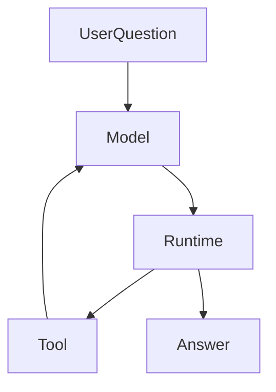

# 别再让模型当状态机：一次 Agent 协议减负实践
起初我只想做一个能辅助自己研究基金的 Agent。接上模型、工具和恢复逻辑之后，我发现最费劲的部分不是让它多会回答，而是弄清哪些事情该由模型判断，哪些事实必须由运行时保存。

一次重构之后，我把这条边界记了下来：

> **运行时已经知道的，不要再让模型维护。**

但这条原则必须和另一条一起使用：

> **运行时不知道的，不要因为能写规则，就假装它知道。**

前者删除模型维护的状态镜像，

后者阻止运行时越界成为语义裁判。系统状态仍由主机持久保存；要删掉的是模型对权限、调用结果和发布状态的重复描述。

---

## 一个严肃 Agent 里有两类复杂度

这里的场景是个人投资研究 Agent。

它可以读取授权范围内的组合、材料和公开资料，

形成研究结论，

但不能由模型直接执行投资操作。

一次简化流程是：

```text
用户提出问题
→ 模型判断下一步需要什么信息
→ 运行时按权限执行工具调用
→ 模型根据工具结果继续研究或形成表达
→ 运行时校验客观边界并发布或结束
```

这类任务同时有两种复杂度。

第一种是语义复杂度：

```text
用户真正关心什么
下一步最值得查什么
资料是否互相矛盾
是否需要澄清或补查
结论怎样解释
```

第二种是系统复杂度：

```text
工具是否存在且获准
调用是否真正执行
结果是否真实返回并落库
引用是否仍在当前范围内
发布是否已经提交
本次运行是否已进入终态
```

两者不能因为都很复杂就交给同一方。

运行时（Runtime）是主机持有的执行与状态层。

它负责授权、工具执行、持久化、证据和数值权威、恢复、发布与终态。

模型（Model）负责理解、调查、比较、提出下一步和表达。




图中的箭头不表示模型拥有运行时状态。

模型看到的是当前允许它使用的工具和已返回的结果。

主机保存的是实际发生过的调用、结果和状态迁移。

---

## `AgentTurn` 为什么会变成认知税

早期 Agent 往往从很轻的路径开始：

```text
用户 → 模型 → 回答
```

接入工具、审计和恢复后，

系统自然会想知道模型这一轮计划做什么、缺什么、能否结束。

于是出现结构化的 `AgentTurn`：

```json
{
  "actions": ["search"],
  "gaps": ["还缺来源"],
  "completionClaim": false
}
```

它在早期并非错误。

运行时可以校验动作、记录回合并据此继续执行。

问题在于协议常常持续膨胀。

随着可靠性要求增加，

状态、缺口、权限、工具列表、发布状态和完成声明都会进入模型输出。

模型于是同时做两件事：

```text
理解和研究
+
维护系统状态
```

后者往往只是状态镜像。

例如运行时已知某项能力是否获批、某次调用是否成功、发布是否提交、运行是否结束。

如果模型还在每一轮重复输出这些信息，

系统里就有两份状态：

```text
模型描述的状态
运行时真实的状态
```

两者冲突时，最终只能以运行时为准。

因此模型那一份不是权威，

却仍需生成、解析、校验和纠错。

这就是认知税。

它至少带来三个问题：

1. 镜像会漂移：运行时拒绝了权限，模型历史却仍认为工具可用。
2. 模型注意力被协议一致性占用，而非下一步研究。
3. 任一字段失配都可能把局部问题升级为整轮重试。

字段少不等于模型一定更聪明。

更准确的判断是：

> **只有承载模型独有语义信息的字段，才值得进入模型协议。**

复杂字段还会提高组合输出正确的难度。

若把每个字段 95% 的正确率和字段间独立视为**假设示例**，

二十个字段同时正确的概率是 `0.95^20≈35.8%`。

这不是项目实测，

也不是对任何模型可靠性的结论。

它只说明：协议字段越多，越应谨慎要求模型承担彼此关联的系统状态。

### 谁拥有事实，谁维护事实

模型应该负责：

```text
用户到底想解决什么
下一步最值得查什么
搜索词如何组织
资料是否冲突
是否值得继续调查
如何解释结论
```

运行时应该负责：

```text
工具是否存在且获准
调用是否实际发生
工具结果是否返回并落库
发布是否实际提交
引用是否属于当前范围
预算和运行状态是否允许继续
```

前者需要开放语义判断。

后者是系统可以证明的客观事实。

所以原则是：

> **谁拥有事实，谁维护事实。**

模型不是数据库，

也不是权限系统。

---

## 从完整回合描述到原生工具调用

旧路径是：

```text
模型
→ AgentTurn JSON
→ 运行时解读整轮状态
```

更合适的路径是：

```text
模型
→ 原生工具调用
→ 主机固化 ModelTurn
→ 运行时执行
→ 工具结果
→ 模型
```

变化不只是在接口层使用工具调用。

关键在于模型不再描述“系统现在完整是什么状态”。

它只提出下一步的语义动作。

例如模型可以先调用：

```text
search(...)
```

读取结果后再调用：

```text
read(...)
```

或者在满足发布条件时调用：

```text
publish(...)
```

研究结束时提出：

```text
finish()
```

协议从“请描述你的完整工作流状态”，

缩为“请做你认为合理的下一步”。

### 删除 `AgentTurn` 不等于删除 `ModelTurn`

删除的是模型生成并维护的整轮状态协议。

没有删除主机持有的、持久化的 `ModelTurn` 边界。

模型一次完整响应闭合后，

主机仍需记录：

```text
本轮 ModelTurn 的内容
提出了哪些调用
调用的顺序
哪些调用已经执行
哪些结果已经落库
每次执行的回执
```

因此：

```text
模型不维护状态
≠
系统不维护状态
```

系统状态反而应更严格。

恢复依赖的是实际发生过、已落库的事实，

不是模型上次声称发生过什么。

---

## `finish()` 是结束提议，不是模型设置终态

旧协议中的：

```text
completionClaim = true
```

很容易被误解为模型宣布任务完成。

更清晰的含义是让模型调用：

```text
finish()
```

它只表示：

> **模型认为语义上的研究可以结束。**

这是一项提议，

不是写入终态的权限。

运行时随后执行终态门控，

只检查它能客观验证的条件：

```text
是否已有正式输出
当前引用是否仍有效
是否存在未结算调用
当前运行是否允许进入终态
```

运行时不应据此判断：

```text
用户的问题是否回答得足够完整
风险是否讲得足够多
反例是否已经调查充分
```

这些是开放语义判断，

不是运行时持有的事实。

因此终态门控应当严格，

但不冒充全知的语义裁判。

它可以拒绝一个客观上不能安全结束的运行，

不能借“完成检查”替模型判断答案好不好。

---

## 权限、工具可见性与能力边界

动态能力是运行时职责最清楚的例子。

假设模型当前只能看到基础工具，

却在同一响应中提出：

```text
1. 申请文档能力
2. 询问用户更多信息
```

运行时执行第一项后批准了文档能力。

下一轮可见工具可能新增：

```text
search_document
read_document
```

此时第二项旧动作不应继续跨越边界执行。

原因不是运行时认为“询问用户”在语义上不合适。

而是一个可验证的客观事实：

```text
旧工具契约 ≠ 新工具契约
```

能力获批意味着工具契约改变。

所以运行时应执行确定性的边界：

```text
能力获批
→ 工具契约变化
→ 当前响应后续动作不再执行
→ 开启下一 ModelTurn
→ 模型在新工具集合下重新决定下一步
```

旧契约下提出的动作不得跨过新契约边界。

这保护的是调用产生时的权限与工具作用域，

不是预先规定模型下一步该搜索还是该追问。

工具可见性也应按同样方式分工。

运行时根据当前用户权限、任务限制、数据源状态和已批准能力，

派生本轮真实可见的工具集合。

模型无需维护一份 `availableTools` 状态镜像。

下一次请求直接得到真实的 `tools[]` 即可。

三个概念应明确分开：

```text
权限 → 运行时持有
工具可见性 → 运行时派生
工具选择 → 模型决定
```

这既避免镜像漂移，

也使权限变化成为清晰的工具契约边界。

---

## 局部错误只应产生局部结果

重型回合协议常见的问题是：

```text
一个字段无效
→ 整个 AgentTurn 无效
→ 修复
→ 重新生成完整协议
```

但工具调用往往可以分别判断。

例如：

```text
调用 A 正确
调用 B 参数错误
```

更合理的执行方式是：

```text
A 正常执行并持久化结果
B 返回安全、可归属的错误结果
开启下一 ModelTurn
模型自行决定是否修正 B
```

这里仍允许修复，

但修复是模型面对工具结果后的普通推理。

它不是运行时隐藏的第二套整轮协议。

局部错误隔离避免为了修一个参数，

重新生成整份世界状态。

---


## 历史压缩也不能改写主机事实

同样的原则也适用于历史压缩。模型可以摘要过去的回答，但用户原始约束不应被摘要模型改写后再当作系统事实。Runtime 已经保存了原始输入，就应该决定保留或省略，而不是把事实所有权转交给另一个模型。

---

## 四阶段演进

| 阶段 | 形态 | 得失 |
| --- | --- | --- |
| 提示式 Agent | 用户 → 模型 → 回答 | 自然，但工程控制弱 |
| 结构化 Agent | 模型结构化输出 → 运行时 → 工具 | 获得校验、审计与恢复 |
| 重协议 Agent | 状态、权限和完成声明持续进入模型协议 | 系统完整，但状态镜像变重 |
| 原生工具调用 Agent | 模型提议调用，运行时持有事实 | 保留工程边界，删除模型状态镜像 |

最后一个阶段不是退回提示式 Agent。

它保留了持久化、审计、权限、恢复和终态门控，

只是不再要求模型维护这些系统事实。

---

## 运行时不应把一切写成规则

协议减负还有另一面：模型不再维护系统事实，不意味着运行时可以接管所有语义判断。**确定性实现，不等于客观判断。**

### 命中字符串，不等于识别事实

一个看似合理的规则可能这样起步：模型没有读取组合，却写了“你的组合目前没有某类资产”，于是系统匹配“你的组合”“当前持仓”“目前没有”等措辞，要求补齐组合证据。

问题在于，同一句话可能是真实断言，也可能是假设、引用、否定或教学例子。字符串匹配容易误拦例子，也容易被另一种措辞绕过。继续追加关键词和修复轮次，并不能回答更根本的问题：这条规则是否拥有判断这件事的依据？

个人持仓应来自获准读取的组合、来源身份、时间口径与状态绑定。自由文本可以解释这些事实，但不能创造权限、可信金额或持仓身份。

### 执行回执与回答措辞分开

模型写“已经替你完成了调整”，不会让投资操作实际发生。系统应查明确请求、用户确认、执行工具与真实回执，不靠“已完成”“已下单”猜测世界状态。

回执状态也不能压成“有回执就是成功、无回执就是没执行”。执行已确认、未执行、失败与效果未知必须保留各自事实；缺失回执时，不能仅凭缺失断言操作没有发生。这里讨论的是事实归属，不改变任何投资执行权限。

如果文案与实际状态冲突，需要处理的是解释质量。不能因为文案写错，就改变账本或把文字当成执行证明。

### 规则修复通过，不证明语义修正

另一种错觉是：第一轮写了当前数值，被规则拒绝；第二轮删掉数值、改成泛泛描述，规则不再命中。系统可以记录机械修复通过，却不能据此证明模型纠正了事实，也可能只是换了措辞。

同样，来源已读取、已进入模型请求、已绑定引用，只能证明追溯链存在，不能证明回答正确理解了资料。来源写 A、回答写 B，引用再完整也不能自动建立支持关系。这层问题由模型与评审判断，具体引用机制见[引用为什么不等于可靠](ai-citations-do-not-prove-reliability.md)。

### 哪些文本检查仍然合适

ID、游标、协议标记、JSON 语法、长度和明确受保护字面量，仍可做机械检查。但语法或容量问题应限制在对应字段与效果；它们不能自动取得清空独立正文、阻塞整轮收尾的权力。

审查一条硬规则时，先问输入来自谁、该模块拥有哪个效果、同义改写是否会改变判断，以及修复以后变化的是事实还是措辞。保留明确权限、作用域、数值权威与持久化约束，把资料是否支持结论、研究是否充分等开放判断交给模型。

---

## 外硬内软

一个更合适的 Agent 形态是外硬内软。

外层由运行时严格维护：

```text
权限、工具契约、作用域、持久化、执行回执、恢复、发布与终态
```

内层交给模型处理：

```text
理解、调查、比较、怀疑、补查与解释
```

严格的执行边界让系统诚实，

开放的语义空间让模型真正承担它擅长的工作。

---

## 代码评审的五个问题

新增模型字段或运行时状态时，可以先问：

1. 这个信息是谁真正拥有的，运行时能否唯一确定？
2. 如果运行时已经知道，为什么还要让模型输出状态镜像？
3. 该字段表达模型独有的语义判断，还是系统已经发生的事实？
4. `finish()` 是语义结束提议，还是在偷偷写入系统终态？
5. 恢复依据真实落库事实和执行回执，还是模型上次自报的状态？

若这些问题没有清楚答案，

协议通常已经开始变重或越界。

---

## 这次升级没有证明什么

架构边界更清楚，

不等于模型质量、成本、延迟或投资研究能力已经被证明。

协议字段减少也不能直接推出回答更聪明、研究更深或消耗更低。

这些结论需要真实样本和可比较评测。

这次改变直接说明的只有：

```text
哪些状态不再要求模型维护
哪些事实改由主机持有
哪些恢复不再依赖模型自报状态
哪些权限和发布边界可以客观执行
```

协议设计与产品效果必须分别证明。

---

这次协议减负也是[原则 1「模型负责语义，系统负责客观事实」](/principles#principle-1)的具体应用：删除模型自报的执行状态，同时保留 Host 能够客观证明的授权、回执与恢复事实；对于模型的自然语言理解，不用字符串规则冒充确定性判断。

## 最后

两条原则足以约束这类协议设计：

> **运行时已经知道的，不要让模型再维护。**

> **运行时不知道的，不要假装它知道。**

模型需要理解问题、比较材料并选择下一步；运行时需要记住哪些调用真的发生、权限是否成立、答案是否提交。把两者分清，协议才有机会变轻，系统也不会丢掉恢复所需的事实。
