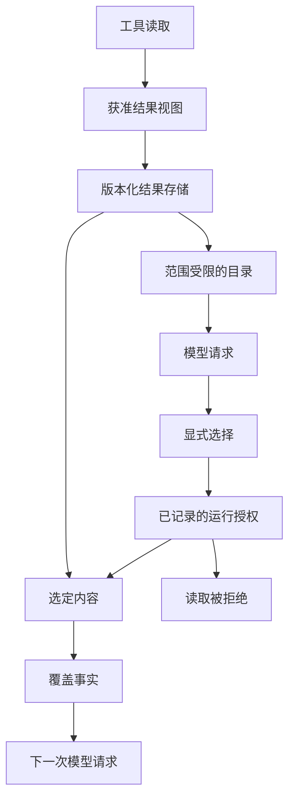

# 工具查到的数据，为什么不一定要给大模型看？

工具查回一张 120 行的表，模型这一步只需要其中三个字段。把整张表每轮都送进去很浪费；只留一个摘要，又可能丢掉之后恰好需要的例外。

当前方案把**已取得的获准结果**留在原结果仓库，让模型按版本和选区取用。难点不在“把数据存起来”，而在三个问题：少给一些时，怎样不冒称给全了；以后重读时，怎样确保还是同一份；工具已经读取成功，下一次请求却装不下时，怎样如实继续。

下面沿这条使用路径解释选择，并用三个有证据的反例说明原因：50 条在投影中变成 20 条、旧读取在后续请求里反复出现，以及两次各自合法的读取同时超过局部容量。文末保留可运行的公开切片；它验证的范围比原系统小。

<span id="一张桌面-不必摊开整个资料库"></span>
<span id="引用、授权和刷新-各自保持原意"></span>

## 1. 先把结果、目录和本次选区分开

上下文是模型这一次推理能看到的材料。把工具结果全部放进去，相当于把所有文件摊在桌面上；研究继续，新的查询和重复结果又不断占用空间。

假设用户问：“我的科技类基金是不是太集中了？”这是简化教学例子。模型先需要基金名称和金额，之后可能需要行业分布；比较调整前后的情况，又需要不同的计算输入。每一步需要的内容不一样，完整持仓不必始终跟着对话移动。

我们把数据使用分成三部分：

| 部分 | 负责什么 |
| --- | --- |
| 结果仓库 | 保存已经取得、获准使用的结果视图，保留版本、来源、取得时间和访问范围 |
| 结果目录 | 告诉模型有哪些可用材料，提供定位和选择信息 |
| 读取入口 | 按引用选择字段、记录或文本范围；获准数据也可以直接交给 Python 计算 |

目录只证明材料存在，不能证明模型已经读到正文。下面是简化示例，不是生产协议：

```json
{
  "resultRef": "positions-v1",
  "kind": "table",
  "fields": ["fundCode", "name", "amount", "sector"],
  "rowCount": 120,
  "acquiredAt": "2026-10-07T10:00:00+08:00"
}
```

需要分析集中度时，模型可以选择：

```json
{
  "resultRef": "positions-v1",
  "fields": ["fundCode", "amount", "sector"],
  "offset": 0,
  "limit": 50
}
```

这次读取的目标是所选范围，不是整张 120 行表。返回时必须说明实际范围、是否还有后续，以及本次选择有没有完整交付。模型已经知道需要哪些字段时，也可以在首次获取时提出选择，不必强制增加一次目录查询。



图中目录与正文是不同的消费路径。显式读取核对该 Run 已记录的 grant、账户/scope 与结果版本身份；同一 Run 及其恢复不重新查询当前 ACL。选区要先满足原授权范围，再由请求装配决定实际呈现哪些正文；覆盖事实不能在这一步被升级。

结果仓库保存的应是获准的数据视图。若先过滤了私人字段，却把过滤前的原始捕获放进可读仓库，模型之后仍可能通过引用把被排除的数据读回来。每次读取仍须符合该 Run 已记录的 grant，并核对账户、scope 和内容版本；新 Run 必须独立准入，不能沿用旧引用取得权限。引用只是地址，不是授权凭证。

复用获取结果与是否自动放入正文，也应采用不同策略。数据很大，不说明它稳定；工具只读，也不说明相同参数每次返回相同内容。

只有明确允许复用的查询，才根据业务参数、工具与版本、授权身份和研究范围匹配既有结果。要求刷新时重新获取，形成新版本；刷新失败保留失败事实和旧版本身份。读取一个精确版本失败，也不能偷偷重查上游，再把新数据当作原来的快照。

这几条边界共同保证：模型既能按需回到原件，也不会通过回读取得额外权限，或者在不知情时换了分析对象。

<span id="_50-条变成-20-条-问题发生在模型之前"></span>
<span id="完整-必须带着对象和范围"></span>

## 2. 50 条变成 20 条：成功回执不等于完整输入

在那次受控排查里，源端有 50 条记录，中间层的条目上限只允许 20 条进入模型输入。日志没有明显报错，模型也给出了连贯总结，但另外 30 条从未进入它的视野。

沿实际输入检查，问题落在通用投影的条目裁剪：外层 envelope 可以报告 50/50，内层却只保留前 20 条。模型根本没有机会看到尾部数据；仅要求它“不要漏掉任何条目”，无法补回不存在于请求中的内容。

我们把原来散落在读取、过滤和容量处理中的事实显式传下去。以下仍是教学结构，不是项目原样接口：

```json
{
  "requested": 50,
  "loaded": 20,
  "byteComplete": true,
  "filteredCount": 0,
  "inputComplete": false,
  "reason": "entry_limit"
}
```

这些状态应由实际处理链路产生，模型无需从文本猜测分母。需要检查的也不止数量：

| 缺口 | 为什么只看“返回成功”会漏掉 |
| --- | --- |
| 条目被截断 | 请求 50 条，只返回前 20 条，后续不知道还有 30 条 |
| 字节被截断 | 仍报告 20 条，但第 20 条正文只剩一半 |
| 解析或过滤丢记录 | 格式异常、字段缺失或转换失败被跳过，目标集合悄悄改变 |
| 记录身份不匹配 | 期待 A、B、C、D、E，实际却是 A、B、C、D、D，数量相等仍漏掉 E |

对有稳定身份的有限集合，还应核对记录身份、页游标、快照版本、范围或来源修订。可以使用 ID 集合或相应摘要，不必强制采用某一种 hash。关键是：**拿到五条，并不能证明拿到了应该拿到的那五条。**

授权过滤本身可能正确。问题在于过滤后的可读集合与原始目标不是一回事，后续不能继续沿用未经说明的旧分母。覆盖记录也不应重新披露被禁止读取的字段。

输入覆盖与回答质量需要分开：

| 层次 | 可以证明什么 | 不能顺带证明什么 |
| --- | --- | --- |
| 源集合已定义 | 已明确要处理哪份持仓、哪段数据库结果或哪几页文档 | 世界上所有相关资料都已找到 |
| 目标输入已覆盖 | 当前目标记录与字节没有被已知规则漏掉 | 模型充分利用了每条内容 |
| 回答正确 | 需要另行检查遗漏、引用、归因和推理 | 不能从 `inputComplete=true` 自动得到 |

源端与输入都显示 50 条，也不能给答案质量盖章。模型仍可能漏掉第 47 条，或者错误理解一个关键例外。

同时，**主动选择一部分，与无声丢失一部分不同**。前面的 120 行持仓表可以按 50 行一批读取；只要选择和覆盖清楚，局部读取本身没有问题。它只是不能被称作完整组合。

例如，100 个持仓读到了 80 个，系统可以回答：

> 在当前已读取的 80 个持仓里，没有发现黄金 ETF；另有 20 个持仓未读取，不能据此判断完整组合没有黄金敞口。

早期“只要不完整，就只能给草稿”的规则过于宽泛。需要限制的是断言所覆盖的对象，不是把所有句子改成含糊语气，更不是一看到 `partial` 就禁止回答。

这套覆盖语义适合持仓、数据库结果、文件清单、固定文档和 API 分页等有限集合。开放互联网搜索没有天然可枚举的全集；搜索引擎返回 20 条，只能支持“当前检索计划已执行”之类的陈述，不能证明相关知识已经完整覆盖。

## 3. 为什么不直接返回、只做摘要，或交给框架清理？

这些方案解决的问题有重叠，但不是谁替代谁。

| 做法 | 什么时候更合适 | 需要另外解决什么 |
| --- | --- | --- |
| 工具结果直接进入消息 | 小、稳定、几轮内结束的任务；实现和排错最简单 | 长结果跨轮重复，后续裁剪必须披露范围 |
| 只返回摘要或精选片段 | 只需要概览，允许丢失细节，原件另有可靠入口 | 摘要不能保留所有例外，也不证明原文已覆盖 |
| LangChain 的 `ToolMessage.artifact` | 区分模型要看的内容与应用后续要用的数据 | `artifact` 这个字段本身不定义版本存储、选区读取或授权生命周期 |
| Claude 的工具结果清理 | 使用其 API，按阈值清掉较旧工具结果，保留近期或指定工具 | 清理策略不替应用建立原件的精确读取与来源授权 |
| 获准视图 + 精确引用 + 显式读取 | 长研究会反复返回原件，且需要解释来源、版本和选区 | 要维护存储、可用性、授权、覆盖与读取成本；模型也要会选择材料 |

[LangChain 的消息文档](https://docs.langchain.com/oss/python/langchain/messages#tool-message)明确把发给模型的 `content` 与供程序使用、不发送给模型的 `artifact` 分开。这个分离很适合作为基础；这里增加的工作，是让需要重读的结果具有稳定身份和受控读取接口，而不是宣称一个消息字段做不到的事已经自动完成。

[Claude 的 context editing](https://platform.claude.com/docs/en/build-with-claude/context-editing#tool-result-clearing)在服务端按策略清除旧结果并留下占位，客户端仍保留完整历史；还可设置近期保留量与排除工具。它省去一部分请求整理工作，但应用仍要决定怎样取得原件。清理还可能使 prompt cache 的前缀失效，因此更短的请求不自动等于更便宜。

我们选择精确回读，是因为研究中一个被暂时省略的数值、日期或例外，下一步可能重新成为问题。它与摘要可以共存：摘要帮助理解，引用找回原件。代价是更多状态与可能增加的读取轮次。若每次只是几十行、单轮就能结束，直接返回往往更值得。

<span id="三种容量-分别回答三个问题"></span>

## 4. 三种容量之外，还要看两次读取能否一起装下

存储上限、自动放入上限和显式读取上限回答不同问题：能保存多少、未主动选择时给多少、主动选择时一次可取多少。早期实现曾采用自动放入 24 KiB、显式读取 128 KiB；这是当时配置，不是今天所有入口的统一容量，更不是最佳实践数值。

**“不自动给”不能变成“不允许取”。** 反过来，两次读取分别合法，也不证明它们加上用户原文、工具定义与历史以后还能装进同一个请求。

一次并发读取排查说明了两端的风险：

- 当时两个显式读取平分固定 192 KiB 池，每个只能用 96 KiB。在受控用例里，两份约 105 KB 的获准选区本来能共同放进 512,000 字节的完整输入窗口，第一份却先被较小的局部份额挡住。
- 直接扩大池又不够。备用路由可能有更小窗口，下一轮也可能加入必须原样保留的用户修正。上一轮的余量不能保证下一轮仍然足够。

当前分配依据既有输入窗口与已准备请求的必要开销计算可用总量，再在本轮显式读取之间分配，仍保留单份限制。实际发往每个路由的完整请求还要重新拟合，不能让先前估算替之后的请求担保。没有启用本地字节拒绝，也不意味着供应商窗口无限。

历史材料中还发现过三轮研究里的四次相关容量结果，但原请求余量没有完整留下，不能把这些调用一律归因于平分策略。这里能直接说明缺陷和修复的是上述受控生产装配路径，不是新增的真实模型质量对照。

<span id="读取成功以后-还要看实际模型请求"></span>

## 5. 读取成功后，请求装配还可能改变正文

“数据已取得”“引用已返回”“正文已进入本次请求”必须分开观察。当前结果选择通常应该交付正文；容量充裕时，不能又把刚请求的数据搬出去，让模型不断拿到地址。

但**软目标与真实硬容量不是同一条规则**：软目标用于少搬旧材料，不应动用最新读取保护；完整请求经过常规缩减仍超出实际路由硬界时，现行拟合器允许把最新成功读取整体换成原回执独立确认的精确引用。

这一例外有明确条件：

1. 原结果已经保存，引用、来源身份和选区唯一可核对；不能凭模型写出的 ID 或外形相似的载荷授权替换。
2. 换的是整份正文，保留选择、覆盖与“因硬容量省略”的事实，不留下半个权威数值，也不宣称模型已见省略部分。
3. 当前用户原文、原 Run grant 和持久结果不随投影改写；独立成立的已发布正文也不被这次容量失败撤销。
4. 若同一精确选区此前已被确认省略，重读后仍装不下，就返回局部 `STORED_RESULT_CAPACITY`，提示缩小范围或分页，而不是再给一次“引用式成功”。无法证明引用或没有净节省时，不能借这个分支静默丢正文。

这样既保住原件，又避免“读 A → 得到 A 的引用 → 再读 A”的无进展循环。可读，不等于这次已读；需要分页时，下一步必须真正改变选择。

另一类容量冲突发生得更早：源内容本来装得下，追加的派生字段却把结果挤大。当前投影先尝试增强结果；若超额且仍保留**同一份已经收窄的源投影**，就用它重新测量包含调用身份的最终大小；仍超额才返回 `post.result_too_large`。不能退回过滤前的原始载荷，也不能删掉选择中的几条记录冒充完整。这个取舍优先保住原来就允许读取的来源，而不是让可选解释把原件一起挤掉。

<span id="一个新发现-上下文没有超限-旧读取仍然在重复出现"></span>

## 6. 没有撞到硬上限，也可能一直在搬旧正文

一轮真实长时研究的后继输入里，Main 有 37 次 Native 请求和 20 次显式结果读取，却出现了 **279 次相同读取消息的重复携带**。这是跨请求的消息出现次数，不是额外执行了 279 次工具，也不是 Token 或费用统计。

当时的全局工具正文软目标约为 192 KiB，整轮没有触发它。这个策略原本是为了避免过早回收仍有用的内容，却无法避免较小旧结果长期跟随请求。

现行做法因此保留全局目标，再单独处理较旧的显式读取：当它们超过基于 24 KiB 自动放入量的次级软目标时，只把有唯一 Host 回执、可精确回读的旧正文换成原引用。最近两组 Native 调用不受这项提前回收影响；Child 与只收尾请求不启用这项优化。它不做语义相关性判断，不把不同来源的相似文本合并，也不删持久原件。上一节的最新读取例外仅用于实际硬容量不足，不能反过来成为日常清理理由。

没有采用“一律把全局阈值减半”，是因为那会影响所有工具结果；没有“读过一次就删除”，是因为紧接着的推理仍可能需要正文；没有先做摘要，是因为这次要减少的是重复传输，而非改变原件含义。引用和读取工具的描述也占空间，完整候选反而更大时应保留原文。

有五组读取的受控请求对照中，序列化请求减少超过 30,000 字节。这证明请求变小，不证明付费 Token、总调用量或回答错误率下降。模型若频繁重读，收益仍可能被抵消。

那轮研究的有界效率观测只留住 92 次模型请求中的 21 次请求足迹，也提醒我们：先说明采集缺口，不能用“没记录到”推断“没发生”。后续观测优先保留请求级事实；效率与内容实际可见性仍要分别检查。

<span id="新的消费形态-reviewable-不等于第二份答案"></span>

## 7. 同一份结果，还可以供人检查

结果被保存后，除了模型回读，人也可能想检查某个结论用了哪些输入、选区和来源。现有可选 Reviewable 附件（2026-10-24 已进入主干）沿这条链提供审阅：原结果与引用模块保留身份、版本和来源谱系；Publication 在最终正文转换后绑定对应 revision；History 与客户端展示已保存的审阅视图。

附件不是第二份研究答案，也不是“审阅通过才准发布”的新门禁。附件过大、读取失败或不具备当前读取资格，只降级附件；独立合法的正文仍由原发布流程保留。它解释材料与结果的关联，不认证模型结论，更不代替人工金融审查。

选择复用原身份的理由，与模型回读相同：如果面板另抄一份来源目录，正文与附件很快可能指向不同版本。接好展示链也不证明真实研究都具备充分来源，或用户已经完成有效复核。

<span id="验证要把关键记录放在尾部"></span>

## 8. 测试应让边界失败，而不是只证明小样本成功

50 → 20 的历史排查曾把通用条目上限提高到 60，解决当时 50 条规模的局部问题。不能把这个中间修复当作今天持仓完整性的最终规则。

原有 **65 条持仓、尾部含黄金**的真实 Host/模型投影回归，验证的是 **65/65 全部保留**，包括身份与精度；超过最终字节容量时返回明确大小错误，而不是成功返回前 60 条。持仓全量读取与主动选择一页，是两种不同的目标。

若为一个允许截断的通用集合设计“请求 65 条、只加载 60 条”的教学负例，则应标出缺 5 条与 `entry_limit`。它不能被写成上面持仓测试的实际结果。测试至少要分开这些情况：

| 反例 | 需要观察的结果 |
| --- | --- |
| 尾部有决定性记录 | 全量契约保住它；主动选区只声明所选范围；容量失败不伪装全集 |
| 数量相同、身份替换，或最后一条只剩半段 | 核对身份与字节，不能只数条目；过滤缺口也必须有范围 |
| 两次读取单独可装下，同时进入请求 | 观察真正序列化后的完整请求，而非只测单份读取函数 |
| 切换小窗口或加入用户修正 | 使用当前路由与内容重算；精确引用不改用户原文或持久结果 |
| 同一过大选区反复读取 | 交付真实数据页，或明确要求缩小/分页，不循环引用式成功 |
| 刷新失败、外部 Run 引用或原件缺失 | 不偷换快照、不扩大授权、不用原始未过滤数据救场 |

这些检查定位“哪份数据、哪一部分、实际收到了多少”。模型是否正确理解、引用和推理，仍是下一层的问题。

## 用公开代码比较“找到了”和“读到了”

[Open ETF Agent](https://github.com/hpoenixf/open-etf-agent)的公开 v0.4 切片把问题缩到两份合成文档：输入查询，取得候选页，实际读页，将原件保存为不可变结果，再用 `read_result` 精确回读并保存报告。查询不是装饰参数；它会改变真正进入 `read_page` 的页面。动作选择由脚本 fixture 完成，检索、结果保存、回读和报告文件则走真实实现。

使用 Node.js 26.11.1–26.x，在独立目录运行：

```bash
git clone https://github.com/hpoenixf/open-etf-agent.git open-etf-agent-results-demo
cd open-etf-agent-results-demo
git checkout --detach ecf6cb45b4062586614e83aed917c92d704cb63b
npm ci --ignore-scripts --no-audit --no-fund
npm run demo -- --case retrieve-reread --query "offline editing"
npm run demo -- --case retrieve-reread --query "Markdown"
```

首次安装可能联网，案例本身不调用远程模型。分别打开控制台所列 Run 目录中的 `manifest.json` 和 `report.md`：`offline editing` 会取得 A、B 两份文档的第二页；`Markdown` 只取得 B 的第一页，报告因此明确不声称完成了两文档比较。这里最值得比较的不是行文，而是**查询改变以后，实际取得的来源集合是否随之变化**。

在 [`src/retrieval-demo.mjs`](https://github.com/hpoenixf/open-etf-agent/blob/ecf6cb45b4062586614e83aed917c92d704cb63b/src/retrieval-demo.mjs)中，候选命中还不是可引用的原件：必须经过 `read_page`，取得来源身份和 `resultRef`，才进入后面的回读与保存。没有候选时，不会读取页面或编造比较报告。输出的失败状态应按这个缺口理解，而不是误认为“检索成功就已有答案”。

[`src/results.mjs`](https://github.com/hpoenixf/open-etf-agent/blob/ecf6cb45b4062586614e83aed917c92d704cb63b/src/results.mjs)把原始页面、来源描述和精确引用保存在同一个结果所有者中；`manifest.json` 记录报告关联的结果引用。沿着[同文档新版本用例](https://github.com/hpoenixf/open-etf-agent/blob/ecf6cb45b4062586614e83aed917c92d704cb63b/test/results.test.mjs)还可以看到：同一文档产生新版本后，旧引用仍回到旧版本，而不是改为最新内容。这与普通“按文档名重新获取”有本质区别。

<!-- open-etf-case:reread@e1b8e4edde724548fab16d8ca4b205379bfa7f30 -->
### 把候选、原文回读和报告连起来

沿固定公开快照的[CLI 入口](https://github.com/hpoenixf/open-etf-agent/blob/e1b8e4edde724548fab16d8ca4b205379bfa7f30/src/cli.mjs)，可以把“检索命中”与“实际读到原文”放在同一次可回读执行里比较。

在所链固定快照按 README 安装依赖后，运行：

```bash
node src/cli.mjs --case retrieve-reread --output runs/article-reread
```

终端返回实际 Run 的 `directory` 与保存回执；在其中核对 `report.md`、`manifest.json` 和 `run.jsonl`，看候选页怎样取得原文身份，再按原结果引用回读并进入报告。

输入是本地合成文档，检索是词法候选选择；这里不验证动态 ACL、撤权传播或真实模型的引用质量。
<!-- /open-etf-case -->

### 容量不足时，公开实现怎样取舍

[`src/context.mjs`](https://github.com/hpoenixf/open-etf-agent/blob/ecf6cb45b4062586614e83aed917c92d704cb63b/src/context.mjs)不直接删除原始历史。它为这次请求建立副本，在字节容量不足时，尝试把较早、已结算的完整调用组里的原文替换成可执行的精确回读引用。原问题和最新的完整工具组被保留；如果这样仍放不下，就明确失败，不悄悄只留一半工具结果。

这条替换也不能只看“长得像来源”。公开版本的[演进记录](https://github.com/hpoenixf/open-etf-agent/blob/ecf6cb45b4062586614e83aed917c92d704cb63b/docs/evolution/evidence-index.md)保留了一个受控反例：仅靠 `sourceId` 和哈希的捷径，曾可能把外形相似的工具载荷替换成正式原件引用。现在替换前还要求 Host 给出的匹配 `ResultRef`、真实正文哈希及完整来源身份；无法确认的载荷不因此获得来源资格。[调用链用例](https://github.com/hpoenixf/open-etf-agent/blob/ecf6cb45b4062586614e83aed917c92d704cb63b/test/research-integration.test.mjs)观察的正是下一次实际 Gateway 输入，而不仅是结果仓库是否写入成功。

这些代码可以复现本地文档范围、不可变原件与精确回读，但没有复现前文 50 → 20 的原系统故障，也不是完整的字段选区、覆盖分母、账户授权或 Reviewable 发布链。这里的容量是字节预算，不是对任意模型 token 窗口的估计。[首批真实模型记录](https://github.com/hpoenixf/open-etf-agent/blob/d075068ac99a6c798d012c46bff4fe0c33eb9979/docs/verification/live-v01-v05-first-batch.md)虽取得过结果引用，却没有执行查询驱动检索或 `read_result`；上述实验因此说明可执行机制，而不替代模型是否正确选择、使用和解释材料的评估。

把完整结果留在上下文之外，对应[原则 5「Context 是工作台，不是事实数据库」](/principles#principle-5)。模型只需按当前任务选取材料，但结果身份、选区范围、完整性与权限必须留在能被复核的原始记录中，而不是依赖它记住一段摘要。
