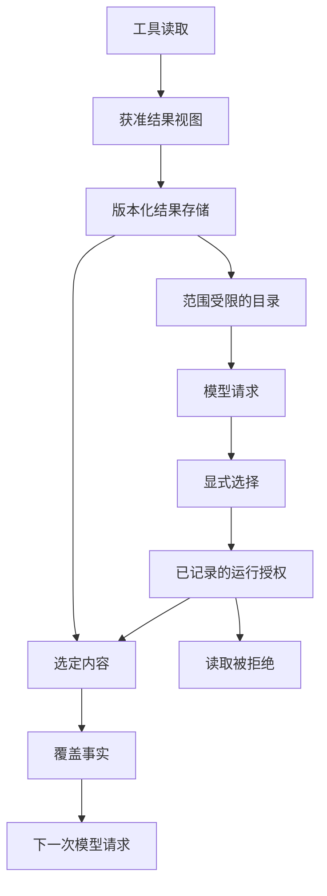

# 工具查到的数据，为什么不一定要给大模型看？

做 Agent 时，一个自然的做法是：工具查到了什么，就把结果交给模型。查持仓，返回持仓；查行情，返回行情。模型读完，再决定下一步。

研究变长以后，这个做法会同时遇到两个问题。完整结果反复进入上下文，挤占后续工作的空间；中间层为了控制容量，又可能悄悄删掉记录，让模型把局部数据当成全集。

我们在国庆期间把一部分工具结果移到上下文之外，允许模型按需读取。另一次受控排查则发现，源端的 50 条记录只有 20 条进入了实际模型输入。这两段经历回答的是同一个工程问题：**怎样让模型少搬数据，同时知道自己到底读到了什么？**

下面先解释原系统的选择与覆盖机制，再用公开代码实验查看其中已经独立实现的部分：查询驱动读页、不可变结果和精确回读。公开切片不把前述 50 → 20 历史案例算作自己的运行结果。

## 一张桌面，不必摊开整个资料库

上下文是模型这一次推理能看到的材料。把工具结果全部放进去，相当于把所有文件摊在桌面上；研究继续，新的查询和重复结果又不断占用空间。

假设用户问：“我的科技类基金是不是太集中了？”这是简化教学例子。模型先需要基金名称和金额，之后可能需要行业分布；比较调整前后的情况，又需要不同的计算输入。每一步需要的内容不一样，完整持仓不必始终跟着对话移动。

我们把数据使用分成三部分：

| 部分 | 负责什么 |
| --- | --- |
| 结果仓库 | 保存已经取得、获准使用的结果视图，保留版本、来源、取得时间和访问范围 |
| 结果目录 | 告诉模型有哪些可用材料，提供定位和选择信息 |
| 读取入口 | 按引用选择字段、记录或文本范围；获准数据也可以直接交给 Python 计算 |

目录只证明材料存在，不能证明模型已经读到正文。下面是简化示例，不是生产协议：

```json
{
  "resultRef": "positions-v1",
  "kind": "table",
  "fields": ["fundCode", "name", "amount", "sector"],
  "rowCount": 120,
  "acquiredAt": "2026-10-07T10:00:00+08:00"
}
```

需要分析集中度时，模型可以选择：

```json
{
  "resultRef": "positions-v1",
  "fields": ["fundCode", "amount", "sector"],
  "offset": 0,
  "limit": 50
}
```

这次读取的目标是所选范围，不是整张 120 行表。返回时必须说明实际范围、是否还有后续，以及本次选择有没有完整交付。模型已经知道需要哪些字段时，也可以在首次获取时提出选择，不必强制增加一次目录查询。



图中目录与正文是不同的消费路径。显式读取核对该 Run 已记录的 grant、账户/scope 与结果版本身份；同一 Run 及其恢复不重新查询当前 ACL。只有原授权范围内的选区内容及其覆盖事实进入后续请求。

## 三种容量，分别回答三个问题

大结果外置以后，很容易继续把“小结果自动返回”的限制用于显式读取。系统允许保存一份数据，模型也明确要求读取，却仍被较小的自动放入阈值挡住。

我们因此分开三个边界：

| 限制 | 回答的问题 |
| --- | --- |
| 存储上限 | 一次获准结果最多保留多少数据？ |
| 自动放入上限 | 没有显式选择时，多少内容适合直接给模型？ |
| 显式读取上限 | 模型主动要求读取时，一次最多取多少？ |

在当时的结果呈现实现中，自动放入阈值是 **24 KiB**，显式读取默认容量为 **128 KiB**，仍受实际请求剩余空间约束。这些是当时的配置，不是通用最佳值。

**“不自动给”不能顺手变成“不允许取”。** 同样，“允许取”不等于任意大的选区都能一次装下；超限时，需要明确的覆盖信息或分页，不能把截短的正文包装成完整返回。

## 50 条变成 20 条，问题发生在模型之前

在那次受控排查里，源端有 50 条记录，中间层的条目上限只允许 20 条进入模型输入。日志没有明显报错，模型也给出了连贯总结，但另外 30 条从未进入它的视野。

最初怀疑的是上下文长度、模型注意力和 Prompt。沿实际输入检查后才发现：模型没有遗漏已见材料，而是根本没有机会看到尾部数据。仅要求它“不要漏掉任何条目”，无法补回不存在于请求中的内容。

我们把原来散落在读取、过滤和容量处理中的事实显式传下去。以下仍是教学结构，不是项目原样接口：

```json
{
  "requested": 50,
  "loaded": 20,
  "byteComplete": true,
  "filteredCount": 0,
  "inputComplete": false,
  "reason": "entry_limit"
}
```

这些状态应由实际处理链路产生，模型无需从文本猜测分母。需要检查的也不止数量：

| 缺口 | 为什么只看“返回成功”会漏掉 |
| --- | --- |
| 条目被截断 | 请求 50 条，只返回前 20 条，后续不知道还有 30 条 |
| 字节被截断 | 仍报告 20 条，但第 20 条正文只剩一半 |
| 解析或过滤丢记录 | 格式异常、字段缺失或转换失败被跳过，目标集合悄悄改变 |
| 记录身份不匹配 | 期待 A、B、C、D、E，实际却是 A、B、C、D、D，数量相等仍漏掉 E |

对有稳定身份的有限集合，还应核对记录身份、页游标、快照版本、范围或来源修订。可以使用 ID 集合或相应摘要，不必强制采用某一种 hash。关键是：**拿到五条，并不能证明拿到了应该拿到的那五条。**

授权过滤本身可能正确。问题在于过滤后的可读集合与原始目标不是一回事，后续不能继续沿用未经说明的旧分母。覆盖记录也不应重新披露被禁止读取的字段。

## “完整”必须带着对象和范围

输入覆盖与回答质量需要分开：

| 层次 | 可以证明什么 | 不能顺带证明什么 |
| --- | --- | --- |
| 源集合已定义 | 已明确要处理哪份持仓、哪段数据库结果或哪几页文档 | 世界上所有相关资料都已找到 |
| 目标输入已覆盖 | 当前目标记录与字节没有被已知规则漏掉 | 模型充分利用了每条内容 |
| 回答正确 | 需要另行检查遗漏、引用、归因和推理 | 不能从 `inputComplete=true` 自动得到 |

源端与输入都显示 50 条，也不能给答案质量盖章。模型仍可能漏掉第 47 条，或者错误理解一个关键例外。

同时，**主动选择一部分，与无声丢失一部分不同**。前面的 120 行持仓表可以按 50 行一批读取；只要选择和覆盖清楚，局部读取本身没有问题。它只是不能被称作完整组合。

例如，100 个持仓读到了 80 个，系统可以回答：

> 在当前已读取的 80 个持仓里，没有发现黄金 ETF；另有 20 个持仓未读取，不能据此判断完整组合没有黄金敞口。

早期“只要不完整，就只能给草稿”的规则过于宽泛。需要限制的是断言所覆盖的对象，不是把所有句子改成含糊语气，更不是一看到 `partial` 就禁止回答。

这套覆盖语义适合持仓、数据库结果、文件清单、固定文档和 API 分页等有限集合。开放互联网搜索没有天然可枚举的全集；搜索引擎返回 20 条，只能支持“当前检索计划已执行”之类的陈述，不能证明相关知识已经完整覆盖。

## 读取成功以后，还要看实际模型请求

另一个容易遗漏的环节发生在工具返回之后。模型已经明确选择了内容，后续请求组装却可能再次裁剪，把正文换回引用，整条调用仍显示成功。

因此，工具返回值不是最后的检查点。我们区分目录、历史读取和本轮读取：

- 目录是辅助定位信息，可以按容量处理。
- 较早的读取可以收缩成原始版本与选择条件，方便精确回读。
- 本轮新选择的内容不能悄悄变成没有正文的“读取成功”。

“数据已取得”“引用已返回”“正文已进入请求”是三个独立事实。覆盖信息也必须随实际消费路径传递；前一层知道读全了，不能替最后一层证明正文仍完整。

### 一个新发现：上下文没有超限，旧读取仍然在重复出现

后来我们沿一轮真实长时研究的模型输入继续检查。那轮 Main 发出 37 次 Native 请求，期间有 20 次显式读取工具结果；在后继请求的消息里，观察到 **279 次相同读取结果的再次出现**。这里数的是消息在多个请求中重复出现，不是重新调用了 279 次工具，更不能直接换算成账单里的 Token 或美元。

原来的做法并非没有道理：只有整个工具结果工作集超过约 192 KiB 的软目标，才开始把旧正文换成可回读引用。它能避免在容量充裕时过早丢失材料。问题是，这次真实研究始终没有触发这个总量阈值，较早读取的正文仍随着多轮请求继续被携带。

新的处理没有把全局上限一律调小，也没有要求模型先做摘要，而是给**较旧、已经显式读取、并有唯一 Host 回执证明可精确重读的结果**一个更小的次级工作集目标。超过该目标时，才将这些旧正文投影为原结果引用；最近两组读取、当前结果、收尾阶段和用户原文仍然受到保护。引用同时保留原选区与覆盖信息，之后仍沿同一 Run 的授权与结果版本读取；身份不明、结果不可回读或选区无法证明时，不把正文静默丢掉。

在有五组读取的受控模型请求里，这项调整让**序列化后的请求减少超过 30,000 字节**。这是实际请求装配层的字节对照，不是付费模型 Token 节省或回答质量提升。旧材料被引用化之后，模型也可能需要再次主动读取；真实调用频率和整体成本仍需要后续观察。

还有一个旁支教训：那轮研究的有界效率观测只留下了 92 次模型请求中的 21 次请求足迹，无法完整解释重复来自哪里。后续修改优先保留请求级记录，并显式标出采集缺口，而不是用“没记录到”推断“没发生”。**让旧结果少搬一点，与知道模型实际收到了什么，必须同时验证。**

## 引用、授权和刷新，各自保持原意

结果仓库保存的应是获准的数据视图。若先过滤了私人字段，却把过滤前的原始捕获放进可读仓库，模型之后仍可能通过引用把被排除的数据读回来。每次读取仍须符合该 Run 已记录的 grant，并核对账户、scope 和内容版本；新 Run 必须独立准入，不能沿用旧引用取得权限。引用只是地址，不是授权凭证。

复用获取结果与是否自动放入正文，也应采用不同策略。数据很大，不说明它稳定；工具只读，也不说明相同参数每次返回相同内容。

只有明确允许复用的查询，才根据业务参数、工具与版本、授权身份和研究范围匹配既有结果。要求刷新时重新获取，形成新版本；刷新失败保留失败事实和旧版本身份。读取一个精确版本失败，也不能偷偷重查上游，再把新数据当作原来的快照。

这几条边界共同保证：模型既能按需回到原件，也不会通过回读取得额外权限，或者在不知情时换了分析对象。

## 新的消费形态：Reviewable 不等于第二份答案

在已保存的研究结果之上，用户还可能需要查看某项结论的证据细节、输入和范围。2026-10-24 的主干加入了**可选的 Reviewable 审阅附件**：原 A16 仍保存结果身份、版本和来源谱系；A23 在最终正文转换后，将有资格的审阅详情绑定到对应 Publication revision；A24/A25 从原 History 和客户端展示已经保存的审阅视图。

这不是一套“审阅通过才能发布”的新门禁。附件读取失败、内容过大或不再具备当前读取资格时，只降级附件；已经独立合法提交的正文仍由原 Publication 处置，不能被审阅附件的错误清空。Reviewable 展示“这些材料和这个结果如何关联”，并不认证模型结论的语义真值，也不代替人工金融审查。

机制接线已经进入主干，但提供一个可阅读的审阅面板，不等于真实研究中来源充分、引用一定支持主张，或用户完成了有效复核。它深化的是结果的**消费与检查方式**，而非创造第二个 Result Manager 或一份重复的研究事实账本。

## 验证要把关键记录放在尾部

当时把条目上限从 20 调到 60，解决了那份 50 条输入的局部问题。但只增加容量，无法验证下一次超限时系统是否仍然诚实。

我们随后准备 **65 条**记录，把关键数据放在尾部，让 60 条上限稳定触发不完整分支。检查目标包括：

| 条件 | 应保留的事实 |
| --- | --- |
| 请求 65 条，实际加载 60 条 | `inputComplete=false`，原因是 `entry_limit`，明确缺少 5 条 |
| 某条正文被字节预算截短 | `byteComplete=false`，不能只凭条目数量宣称完整 |
| 解析或过滤跳过记录 | 保留 `filteredCount` 和相应缺口 |
| 数量相等、身份不同 | 继续报告身份不匹配，不能把重复记录补成全集 |

受控验证复现了 **50 → 20** 的静默丢失：后续记录被截断，但结果仍可能看起来完整。修复后，系统能够识别这种不完整状态；这是该输入边界的验证，而非任意数据量下的完整性保证。

对于外置结果，另一些检查同样必要：大结果能读出选中内容，当前选区确实进入最终请求，刷新失败不冒充新快照，跨研究引用不能访问。大于单次容量的数据可以分批处理，但每批都要留下覆盖，最后汇总也不能抹去缺口。

这些机制让原本无声的数据缺失变得可检测，也让数据访问不再等于反复搬运全文；模型是否充分使用已见材料，仍需要在回答层另行检查。

完整结果可以留在桌面之外；模型当前只读一部分，也可以是合理选择。需要始终说清的是：**保存了哪份结果、这次选择了哪一部分、实际请求收到多少，以及当前结论能够覆盖哪里。**

## 用公开代码比较“找到了”和“读到了”

[Open ETF Agent](https://github.com/hpoenixf/open-etf-agent)的公开 v0.4 切片把问题缩到两份合成文档：输入查询，取得候选页，实际读页，将原件保存为不可变结果，再用 `read_result` 精确回读并保存报告。查询不是装饰参数；它会改变真正进入 `read_page` 的页面。动作选择由脚本 fixture 完成，检索、结果保存、回读和报告文件则走真实实现。

使用 Node.js 26.11.1–26.x，在独立目录运行：

```bash
git clone https://github.com/hpoenixf/open-etf-agent.git open-etf-agent-results-demo
cd open-etf-agent-results-demo
git checkout --detach ecf6cb45b4062586614e83aed917c92d704cb63b
npm ci --ignore-scripts --no-audit --no-fund
npm run demo -- --case retrieve-reread --query "offline editing"
npm run demo -- --case retrieve-reread --query "Markdown"
```

首次安装可能联网，案例本身不调用远程模型。分别打开控制台所列 Run 目录中的 `manifest.json` 和 `report.md`：`offline editing` 会取得 A、B 两份文档的第二页；`Markdown` 只取得 B 的第一页，报告因此明确不声称完成了两文档比较。这里最值得比较的不是行文，而是**查询改变以后，实际取得的来源集合是否随之变化**。

在 [`src/retrieval-demo.mjs`](https://github.com/hpoenixf/open-etf-agent/blob/ecf6cb45b4062586614e83aed917c92d704cb63b/src/retrieval-demo.mjs)中，候选命中还不是可引用的原件：必须经过 `read_page`，取得来源身份和 `resultRef`，才进入后面的回读与保存。没有候选时，不会读取页面或编造比较报告。输出的失败状态应按这个缺口理解，而不是误认为“检索成功就已有答案”。

[`src/results.mjs`](https://github.com/hpoenixf/open-etf-agent/blob/ecf6cb45b4062586614e83aed917c92d704cb63b/src/results.mjs)把原始页面、来源描述和精确引用保存在同一个结果所有者中；`manifest.json` 记录报告关联的结果引用。沿着[同文档新版本用例](https://github.com/hpoenixf/open-etf-agent/blob/ecf6cb45b4062586614e83aed917c92d704cb63b/test/results.test.mjs)还可以看到：同一文档产生新版本后，旧引用仍回到旧版本，而不是改为最新内容。这与普通“按文档名重新获取”有本质区别。

<!-- open-etf-case:reread@e1b8e4edde724548fab16d8ca4b205379bfa7f30 -->
### 把候选、原文回读和报告连起来

沿固定公开快照的[CLI 入口](https://github.com/hpoenixf/open-etf-agent/blob/e1b8e4edde724548fab16d8ca4b205379bfa7f30/src/cli.mjs)，可以把“检索命中”与“实际读到原文”放在同一次可回读执行里比较。

在所链固定快照按 README 安装依赖后，运行：

```bash
node src/cli.mjs --case retrieve-reread --output runs/article-reread
```

终端返回实际 Run 的 `directory` 与保存回执；在其中核对 `report.md`、`manifest.json` 和 `run.jsonl`，看候选页怎样取得原文身份，再按原结果引用回读并进入报告。

输入是本地合成文档，检索是词法候选选择；这里不验证动态 ACL、撤权传播或真实模型的引用质量。
<!-- /open-etf-case -->

### 容量不足时，公开实现怎样取舍

[`src/context.mjs`](https://github.com/hpoenixf/open-etf-agent/blob/ecf6cb45b4062586614e83aed917c92d704cb63b/src/context.mjs)不直接删除原始历史。它为这次请求建立副本，在字节容量不足时，尝试把较早、已结算的完整调用组里的原文替换成可执行的精确回读引用。原问题和最新的完整工具组被保留；如果这样仍放不下，就明确失败，不悄悄只留一半工具结果。

这条替换也不能只看“长得像来源”。公开版本的[演进记录](https://github.com/hpoenixf/open-etf-agent/blob/ecf6cb45b4062586614e83aed917c92d704cb63b/docs/evolution/evidence-index.md)保留了一个受控反例：仅靠 `sourceId` 和哈希的捷径，曾可能把外形相似的工具载荷替换成正式原件引用。现在替换前还要求 Host 给出的匹配 `ResultRef`、真实正文哈希及完整来源身份；无法确认的载荷不因此获得来源资格。[调用链用例](https://github.com/hpoenixf/open-etf-agent/blob/ecf6cb45b4062586614e83aed917c92d704cb63b/test/research-integration.test.mjs)观察的正是下一次实际 Gateway 输入，而不仅是结果仓库是否写入成功。

这些代码可以复现本地文档范围、不可变原件与精确回读，但没有复现前文 50 → 20 的原系统故障，也不是完整的字段选区、覆盖分母、账户授权或 Reviewable 发布链。这里的容量是字节预算，不是对任意模型 token 窗口的估计。[首批真实模型记录](https://github.com/hpoenixf/open-etf-agent/blob/d075068ac99a6c798d012c46bff4fe0c33eb9979/docs/verification/live-v01-v05-first-batch.md)虽取得过结果引用，却没有执行查询驱动检索或 `read_result`；上述实验因此说明可执行机制，而不替代模型是否正确选择、使用和解释材料的评估。

把完整结果留在上下文之外，对应[原则 5「Context 是工作台，不是事实数据库」](/principles#principle-5)。模型只需按当前任务选取材料，但结果身份、选区范围、完整性与权限必须留在能被复核的原始记录中，而不是依赖它记住一段摘要。
