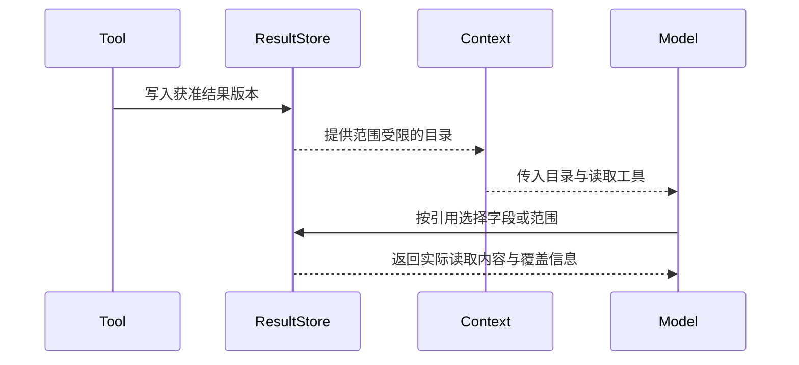

# 工具查到的数据，为什么不一定要给大模型看？

做 Agent 时，有一个很自然的动作：工具查到了什么，就把结果交给模型。

查持仓，返回持仓；查行情，返回行情。模型读完，再决定下一步。这个做法直接，也很适合最初的工具调用。

但研究任务变长以后，我们开始重新考虑一个假设：**工具取得的数据，都应该成为模型当前上下文的一部分吗？**

国庆期间，我们给投资研究助手做了一次调整：把工具结果保留在外面，模型需要时再读取。变化不在于模型突然能理解更多内容，而在于它获得了一种新的数据使用方式。

## 一张桌面，不必摊开整个资料库

上下文是模型这一次推理时能看到的材料。把工具结果放进去，相当于把文件摊在桌面上。

但研究会继续。新的查询不断带回数据，同一份持仓也可能再次被调用。如果每次都返回全文，桌面上不仅文件越来越多，还会出现重复副本。

假设用户问：“我的科技类基金是不是太集中了？”这是一个简化教学例子。

模型先需要基金名称和金额，之后可能需要行业分布；要比较调整前后的情况，又需要一组计算输入。整份持仓可以一次性交给它，但每一步真正需要的内容不同。

分析师通常先知道有哪些文件，再按问题打开相关表格。我们希望 Agent 也能这样工作。

## 最后的方案：结果仓库、目录、读取入口

这套结果工作集设计可以先理解成三个部分。

**结果仓库**保存工具已经取得、并且允许使用的数据。每份结果有独立版本，记录来源、取得时间和访问范围。

**结果目录**告诉模型当前有哪些可用材料，只提供定位和选择所需的信息，不重复携带全部正文。

**读取入口**让模型通过引用，选取需要的字段、记录或文本片段。要计算时，数据也可以直接进入获准的 Python 环境。

下面是简化示例，不是生产协议：

```json
{
  "resultRef": "positions-v1",
  "kind": "table",
  "fields": ["fundCode", "name", "amount", "sector"],
  "rowCount": 120,
  "acquiredAt": "2026-10-07T10:00:00+08:00"
}
```

模型看到的不是 120 行持仓，而是“有这样一张表”。需要分析集中度时，可以提出：

```json
{
  "resultRef": "positions-v1",
  "fields": ["fundCode", "amount", "sector"],
  "offset": 0,
  "limit": 50
}
```

读取结果要说明实际返回范围和是否还有后续，不能截掉内容后仍声称完整。模型已经知道要哪些字段时，也可以在首次获取时一起提出选择，不必强制先查看目录、再多读一轮。



目录让模型知道材料存在；显式读取才把所选内容带入本轮请求。每次读取仍要检查当前运行的权限和结果版本。

## 我们踩过的第一个坑：把不同上限混成一个上限

把大结果放在外面以后，很容易继续沿用“小结果返回”的限制。

于是出现一种矛盾：系统允许保存一份较大的数据，模型也明确要求读取，但读取入口仍按自动塞入上下文的小容量处理。数据存在，却不能顺畅地用。

我们最终分开了三个问题：

| 限制 | 回答的问题 |
|---|---|
| 存储上限 | 一次获准结果最多保留多少数据？ |
| 自动放入上限 | 没有显式选择时，多少内容适合直接给模型？ |
| 显式读取上限 | 模型主动要求读取时，一次最多取多少？ |

当前结果呈现实现中，自动放入的大小阈值是 24 KiB，显式读取默认容量为 128 KiB；读取还要受实际请求空间约束。这些是我们当前的配置，不是通用最佳值。

关键在于：**“不自动给”不能顺手变成“不允许取”。**

## 第二个坑：明明选了内容，最后却只剩引用

工具结果进入模型前，还会经过请求组装与容量调整。我们需要防止一种情况：前面已经完成了显式选择，后面却把正文压掉，只留下结果引用，整条调用还显示成功。

因此，不能只检查工具返回什么，还要检查实际提交给模型的请求里有什么。

我们的处理方式是区分目录、历史读取和本轮读取。目录是可省略的辅助信息；较早的读取可以收缩为原始版本与选择条件，方便再次读取；本轮新请求的内容则不能悄悄变成没有正文的成功。

“数据已取得”“引用已返回”“正文已进入请求”由此成为三个独立事实。

## 第三个坑：过滤过的数据，不能在存储时复活

工具原始结果有时需要先去掉不允许暴露的字段。如果结果仓库保存的是过滤前的原文，模型虽然当下看不到，之后仍可能通过引用读回来。

我们的方案是保存获准的数据视图，而不是把原始捕获直接当成可读取结果。读取引用时，还要检查当前研究范围与权限。

引用只是地址。知道地址，不等于获得访问权。

## 重复查询与刷新，分别处理

结果保存下来后，还要决定哪些查询可以复用。

我们把“是否直接给正文”和“是否允许复用获取结果”设为两项独立策略。一个结果很大，不代表它稳定；一个工具只读，也不代表同样参数每次返回都一样。

只有明确允许复用的查询，才按业务参数、工具与版本、授权身份和当前研究匹配已有结果。重复调用可以得到旧版本引用；模型要求刷新时，则重新获取并产生新版本。

刷新失败要保留失败事实和旧版本的身份。读取某个精确版本失败，也不能偷偷重查上游，再把新数据冒充原来的快照。

## 如果从零搭，先做这几件事

不必一开始就做复杂的资料管理平台。可以从一类大结果工具开始：

1. 在授权处理后，保存不可变结果，生成版本引用。
2. 给模型提供简短目录，以及字段选择或分页读取工具。
3. 把存储、自动放入、显式读取的容量分别配置。
4. 只为明确审核过的查询增加复用和刷新。
5. 检查最终模型请求，确认本轮选择确实进入了上下文。

最值得验证的场景也很具体：大结果能读出选中内容，重复查询不重复搬全文，刷新失败不冒充新数据，跨研究引用不能访问。

这次调整没有证明成本下降多少。但它让我们重新理解了“给模型更多信息”：可以改善数据的访问方式，而不必总是扩大桌面。
