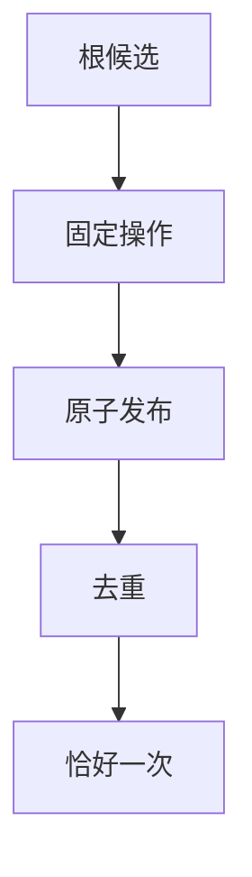
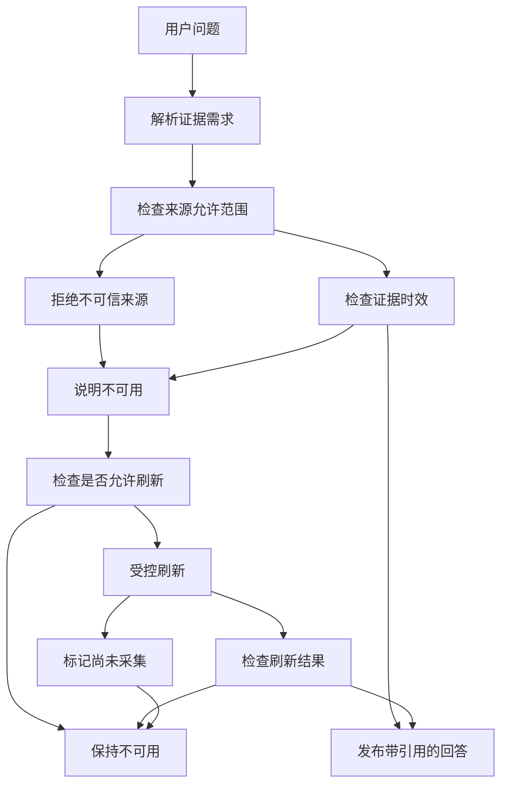

# 数据过期后，Agent 应该怎样刷新，而不是反复重试？

**资料过期以后，真正重要的不是让 Agent 继续调用工具，而是避免把旧事实重新包装成“最新结论”。** 反复请求同一个失效来源不会创造新证据；刷新只有在有明确来源、读取资格和安全候选发布路径时才有意义。

我们曾在 ETF Agent 的受控联调中遇到报告来源带出内部根目录标签的情况：`reports-1/daily-…json` 不符合获准的公开来源标识，因而被拒绝。文件名看起来像报告，并不能替代规范来源资格；保持“不可用”比为了完成回答而放宽来源规则更可靠。

**这是 2026 年 9 月 4 日的历史工程实践。** 其后现行规范保留的是根层只读刷新与候选报告的受控发布；原 Agent 自动刷新、设置入口和后台续写链已退役。下文的历史触发与小时窗口属于当时方案，**不是当前所有研究请求仍会自动刷新的说明**。文章保留那个设计转折，重点讨论架构师下一次该如何判断“旧数据、不可用与新证据”的边界。

## 一、来源被拒后，普通重试不会造出新证据

来源拒绝后，问题不在于怎样把不可用文案说得更委婉，而在于怎样取得一份新的、经过批准的证据。对同一个未批准来源重复调用，不会改变来源身份；沿用旧快照，也不能把旧事实变成当前事实。

这次机制补上的正是安全刷新路径：使用固定操作、限制数据 scope、按 scope/fingerprint/时间窗去重，并且只有验证通过后才原子发布。来源仍被拒绝或刷新失败时，系统继续保留不可用状态。

当前仍保留的根层实现把这条边界做得很具体：runner 克隆配置与账本，复用确定性计算生成隔离候选，不接入确认、执行或账本保存回调。publisher 把候选根目录和正式根目录绑定到受信配置，校验文件名、结构、生成时间与路径，再在正式目录内暂存并 rename；失败保留原报告。请求不能临时换一条根路径或放宽时间政策。

这里的原子替换解决“读到半份报告”，不等于操作系统断电后的完整持久性证明；报告生成时间通过校验，也不等于其中每条市场数据都足以支持“现在”的断言。计算、发布和结论的时间资格仍要分开看。

## 二、两个核心概念

### 2.1 来源可信度：答案从哪里来

来源可信度回答的是：这个数字或结论，到底来自哪条可信通道。不是“模型觉得合理”，而是“哪份受信数据、在什么时间、以什么口径给出”。

可信通道通常同时满足三点。第一，职责明确，只读的行情与持仓通道不混入推测。第二，时效明确，新鲜或过期都有标记，过期数据不冒充现状。第三，可回查，每条关键断言能关联到具体证据，而不是孤立文本。

在这份历史方案里，模型文本默认是建议性的、不可信的，数值与状态由 allowlist 内的受信工具输出背书。它解释的是当时的来源门，不应提升为当前所有 Native 研究必须经过同一张工具名单或同一个数值拦截器。可迁移的要求是：文本再流畅，也不能替代与断言相匹配的来源、读取资格和时间口径。

这意味着评审重点不在措辞，而在链路。先问来源是否在名单，再问口径是否一致，最后才看表达是否清晰。顺序一反，质量观就歪了。

口径一致同样关键。同一指标可能有不同统计口径，不注明口径的数字即使来源受信，也无法直接用于决策。来源、时间、口径三者缺一不可。

### 2.2 不可用：刷新流程的起点

不可用表示当前证据不能支撑目标结论。它应保留目标和缺口，但不自动触发任意检索；只有通过明确授权的刷新入口，才可能生成新证据。

## 三、主流程：拒绝、不可用、受控刷新

下面是简化后的主流程。它有三条关键分支：来源拒绝、状态降级为不可用、受控刷新后恢复。另有一条显式未采集分支，见图例说明。

### 3.1 先定义五个机制词：它们在图中何处生效

| 机制词 | 定义 | 在主流程中的挂载点 |
| --- | --- | --- |
| 候选限定 | 仅接受根层候选，不接受旁路写入 | 受控刷新入口：非候选直接拒绝 |
| 固定操作 | 变更动作类型固定且受限，不支持任意写入 | 刷新执行中：动作越界即失败 |
| 规范原子发布 | 要么整体可见，要么整体不可见，不存在半可见 | 刷新收尾：发布失败则整体回退 |
| 去重 | 按范围、指纹、小时窗口去重 | 发布前检查：命中即复用，不重复做 |
| 同会话续答幂等 | 由任务与原会话消息身份约束重复追加 | 已有受控状态转移检查；不代表真实多进程全局恰好一次 |



主图中的受控刷新节点，即展开为上面这条子链。任何一环不满足，刷新即按失败处理，回到不可用并记审计。



**关系或判断条件：**

- **CheckSourceAllowlist → RejectUntrustedSource**：否：未命中。
- **CheckSourceAllowlist → CheckEvidenceFreshness**：是：命中。
- **CheckEvidenceFreshness → ReportUnavailable**：过期或缺失。
- **CheckEvidenceFreshness → PublishCitedAnswer**：新鲜且完整。
- **CheckRefreshAllowed → RemainUnavailable**：否：通用市场问题、未验证或退出偏好等不合资格情况。
- **CheckRefreshAllowed → ControlledRefresh**：是：历史个人当前影响请求、已验证偏好开启且小时键无已验证结果；同键复用。
- **CheckRefreshResult → PublishCitedAnswer**：成功。
- **CheckRefreshResult → RemainUnavailable**：失败。
- **ControlledRefresh → MarkNotCollected**：需真实环境或超出受控窗。

这个流程的关键在于分叉点都很显式。拒绝发生在证据进入之前，不可用发生在回答生成之前，刷新发生在独立受控通道中。

任何一条分支都不会悄悄绕过。不可信标签进不来，过期数据顶不上去，刷新动作必须留在当时获准的资格边界内。

图例补充：图中的 MarkNotCollected 节点是显式未采集出口，连接线本身仍是实线。当刷新需要真实库、多进程或外部网关质量等受控窗外条件时，不硬判成功或失败，而是标记未采集并保持不可用。

当年的实际自动入口要求同时满足：已验证的个人 scope 与偏好允许自动刷新，问题询问当前市场对本人组合的影响，当前 scope/组合策略指纹/UTC 小时键没有已验证结果。通用市场问题或退出偏好不会启动任务；同键请求复用结果。因此，历史实现并不是“普通问答永不自动刷新”，也不是任意缺数据都刷新。今天旧自动入口已退役，不应从这张历史图推导出当前许可。

## 四、一次来源拒绝教会我们什么？

早期联调中，问题是内部根目录标签 `reports-1` 进入了报告来源路径，而不是一份便签写错了结论。portfolio 来源检查拒绝了这条非规范标识，不能仅因为它指向一个看似正确的报告文件就放行。

修复是让候选验证、正式发布和回读使用一致的规范来源，而不是把内部根标签补进公开 allowlist。**来源资格不是由字段名、看起来合理的文字或模型自信度决定的。** 代价是当次回答保留缺口，换来的是发布路径与对外引用身份能够一起核查。

更值得复用的工程方法，是先定位哪一步真正产生了来源事实，再验证材料如何成为可引用依据；不要在模型输出端为某个个案补一个放行条件。

## 五、从输入到结构化输出

为了让不可用可被机器处理，输入与输出都做了结构化约束。下面是教学级示意，不含任何真实数据。

```json
{
  "input": {
    "question": "当前组合状态如何？",
    "need_numbers": true,
    "need_advice": false
  },
  "evidence": {
    "source_label": "internal-note",
    "allowlisted": false,
    "trusted_hit": false,
    "freshness": "unknown",
    "source_id": null
  },
  "output": {
    "status": "unavailable",
    "numbers": [],
    "disclosure": "当前无可用受信证据，未做状态断言。",
    "next": "可触发一次受控刷新后重试",
    "audit": {
      "action_tendency": "none",
      "execution_allowed": false
    }
  }
}
```

其中 trusted_hit 的定义是：当且仅当 source_label 非空且 allowlisted 为真，trusted_hit 才为真。它是派生字段，不可手填。`need_numbers` 和 `need_advice` 是这份历史示意中的类型化输入，不表示 Runtime 可以用规则识别自由文本意图。

伪代码只有四步，优先级固定不变：

```text
trusted_hit = allowlisted and source_label in allowlist
if not trusted_hit: return unavailable
if 证据缺失或过期: return unavailable
if 数值无受信根:数字留空 + 固定披露
else: 生成带引用回答 + 审计落盘
```

上例中 source_label 为内部便签类标签，allowlisted 为假，故 trusted_hit 为假，直接走来源拒绝分支。

输入侧只关心问题是否需要数值与操作倾向。输出侧永远带状态、披露、下一步与审计。动作倾向在不可用路径下恒为无，不产生任何执行暗示。

结构化状态让客户端分别呈现数字、引用与缺口，而不是从一段流畅文字中猜测是否可用。来源命中、新鲜度和动作字段也让排查有明确入口；这里没有测量定位耗时。

不可用比例与刷新成功率可以用于发现运行问题，但不是答案质量或投资效果的替代指标。降低不可用率，既可能来自新证据，也可能来自偷偷放宽规则；审计必须能分清这两件事。

## 六、运行规则：输入、优先级、失败与安全

以下是**历史受控方案的操作顺序**，用于说明当时怎样守住不可用和候选发布边界；不是现行 Native Agent 自动刷新的开关说明。

下图是运行期的操作规则摘要。阅读顺序即执行优先级，越靠前越先判断，不可跳步。

| 维度 | 规则摘要 |
| --- | --- |
| 输入一：问题类型 | 是否涉及数值与状态；涉及则强制走证据门 |
| 输入二：证据命中 | 仅名单内通道算命中，其余视为未命中 |
| 输入三：新鲜度 | 新鲜可用，过期未知缺失按不可用处理 |
| 优先级一：来源门 | 来源拒绝优先于生成逻辑，先拦后答 |
| 优先级二：降级门 | 门未过则生成固定披露，不自由发挥 |
| 优先级三：刷新门 | 历史个人当前影响请求须经验证偏好允许，按 scope/指纹/UTC 小时键启动或复用；非合格请求不触发 |

前六条解决“何时停”。输入决定是否进门，优先级决定停在哪一步。任何一步不满足，后续步骤不再执行，直接走向固定披露。

| 维度 | 规则摘要 |
| --- | --- |
| 失败一：网关异常 | 依赖失败直接降级，不猜测不顶旧数 |
| 失败二：部分证据 | 缺关键字段即整体不可用，不拼接结论 |
| 降级一：文案固定 | 不可用文案模板化，避免误解 |
| 降级二：动作清零 | 动作倾向为无，可执行标志恒为假 |
| 安全一：只读边界 | 问答路径无执行无变更能力 |
| 安全二：审计必记 | 记录原因判定与下一步建议 |

后六条解决“停后怎么办”。失败侧保证不硬撑，降级侧保证表达一致，安全侧保证无副作用且可追溯。两组规则合在一起，才是完整闭环。

两组表描述的是当时特定状态回答的整体门控。“缺关键字段即整体不可用”不能泛化为删除其他独立、已有依据的研究事实；停止的是依赖缺口的结论。

旧设计最容易被误解的地方，是把去重、发布与续答都叫作“精确一次”。实际上，scope/fingerprint/hour 限定重复任务，候选校验与 rename 控制报告可见性，owner 与 origin 消息身份控制续答。单进程内存 fixture 能检查这些状态转移，却不能证明真实数据库竞争下的全局效果。

保留独立只读 runner 的理由也不是“聊天更轻”。普通 DCA 路径可能保存建议、现金或执行状态；复用其确定性计算可以，继承它的持久化入口却会让证据刷新越过投资边界。代价是必须单独维护候选校验与发布交接，不能把执行作业跑通当成刷新已经合格。

## 七、三个对比：什么时候该说不知道

### 案例一：过期快照 vs 坦白不可用

受信通道暂时不可达时，继续提供旧快照不一定是错误。用户若问历史时点、趋势或上一次报告，材料仍获准读取且明确标注日期，旧数据可能正是答案。问题出在用它断言当前状态，只补一句“仅供参考”并不能改变这个事实。

成熟缓存也有合理的可用性取舍：[RFC 5861](https://www.rfc-editor.org/rfc/rfc5861.html) 的 stale-if-error 允许错误期间在限定时长内复用旧响应，并要求仍能看出它已陈旧。但 HTTP 响应可返回，不代表里面的金融数字对当前问题仍有效，也不提供新的读取授权。我们保留旧报告供合适的历史问题使用，对缺少当前依据的断言则保持不可用；代价是不能用一张旧快照掩盖数据源中断。

过期场景有明确的禁用说法。禁止写“根据最新数据，当前状态为……”，因为此时并无新鲜证据。应写“暂无新鲜受信证据，未做当前状态断言，可显式重试刷新”。

### 案例二：内部便签 vs 正式拒绝

假设某个内部标签写着看似正确的结论，引用它只需一行代码。一种做法是为了通过率先放行，事后再补 allowlist。另一种做法是当场拒绝，保持不可用直到合法来源就绪。

区别不在材料叫“便签”还是“报告”，而在它实际能证明什么。便签可以记录待核假设，却不能仅凭改标签就变成当前持仓的来源。拒绝此引用，保留了去找原始依据的机会；若合法生产链后来改变，应修改有证据支撑的来源合同，而不是为这一次回答开洞。

### 案例三：猜测补全 vs 等待刷新

缺了关键字段时，应先确定哪条结论依赖它。已有来源支持的独立事实可以保留；估算若确有用途，应与事实分开说明假设，不能悄悄补进受信字段。只有原请求和当前权限允许，才进入显式刷新。

这样选择的代价是回答可能不完整，但缺口可被新证据明确解除：候选合格后发布，刷新失败则保留旧报告身份和未解决的问题，而不是把猜测存成后续研究的事实。

## 八、哪些边界成立，哪些仍需真实环境验证

在受控场景中，不可信来源不会进入引用路径，刷新只接受限定候选；校验失败时保留不可用状态，而不是把旧证据重新包装成最新结果。这是可复用的工程结论。

这里的未知指 9 月这条刷新链的真实并发、外部服务延迟和长期运行表现，不是断言后来的整个项目从未验证过 PostgreSQL。后续退役已有隔离数据库检查，证明合成旧记录保持不变；它验证的是保留历史、停止旧副作用，不是刷新在生产故障下的全球恰好一次保证。

## 九、结论：知道何时不可用，比不断重试更重要

**正确的刷新不是“让红灯消失”，而是让一份具备资格的新证据替代旧状态，同时不改变投资账本。** 复核此类流程时，优先问三件事：原资料能否支持当前时点的断言？有没有单独获准、只读且可核验的候选生成方式？候选失败后是否保留旧报告的真实版本，而不把旧数字冒充为更新结果？

2026 年 9 月的方案展示了来源拒绝、候选校验和受控发布的价值，但没有据此证明长期真实外部服务的稳定性、全局恰好一次执行或投资研究效果。后继规范明确退役了 Agent 自动刷新入口，只保留符合当前要求的独立显式刷新和只读报告路径。

**允许研究说明“不知道”，有时比再增加一次工具调用更接近可靠的金融判断。**
