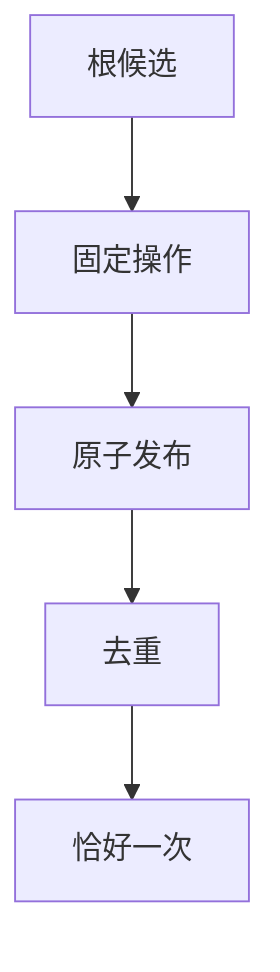
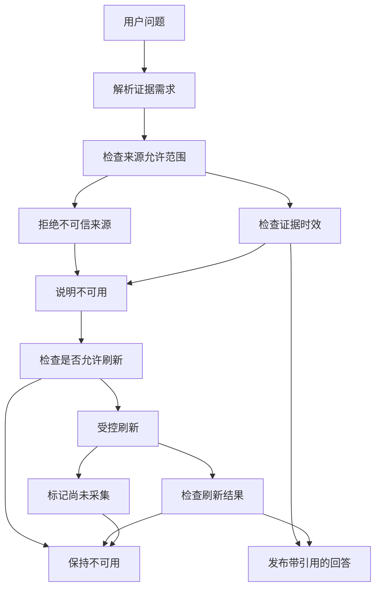

# 数据过期后，Agent 应该怎样刷新，而不是反复重试？

**资料过期以后，真正重要的不是让 Agent 继续调用工具，而是避免把旧事实重新包装成“最新结论”。** 反复请求同一个失效来源不会创造新证据；刷新只有在有明确来源、读取资格和安全候选发布路径时才有意义。

我们曾在 ETF Agent 的受控联调中遇到内部便签标签被当作可引用来源的情况。它看起来像一个正常标签，却没有证明自己是获准的金融证据。系统拒绝后保留“不可用”，比为了让答案完整而放行一个无法核实的数字更可靠。

**这是 2026 年 9 月 4 日的历史工程实践。** 其后现行规范保留的是根层只读刷新与候选报告的受控发布；原 Agent 自动刷新、设置入口和后台续写链已退役。下文的历史触发与小时窗口属于当时方案，**不是当前所有研究请求仍会自动刷新的说明**。文章保留那个设计转折，重点讨论架构师下一次该如何判断“旧数据、不可用与新证据”的边界。

## 一、来源被拒后，普通重试不会造出新证据

来源拒绝后，问题不在于怎样把不可用文案说得更委婉，而在于怎样取得一份新的、经过批准的证据。对同一个未批准来源重复调用，不会改变来源身份；沿用旧快照，也不能把旧事实变成当前事实。

这次机制补上的正是安全刷新路径：使用固定操作、限制数据 scope、按 scope/fingerprint/时间窗去重，并且只有验证通过后才原子发布。来源仍被拒绝或刷新失败时，系统继续保留不可用状态。

受控验证覆盖了证据从生成到回读的交接，以及不可信来源的拒绝与降级。它说明这些路径能够按既定规则处理，不能代替真实网关与生产环境的长期观察。

## 二、两个核心概念

### 2.1 来源可信度：答案从哪里来

来源可信度回答的是：这个数字或结论，到底来自哪条可信通道。不是“模型觉得合理”，而是“哪份受信数据、在什么时间、以什么口径给出”。

可信通道通常同时满足三点。第一，职责明确，只读的行情与持仓通道不混入推测。第二，时效明确，新鲜或过期都有标记，过期数据不冒充现状。第三，可回查，每条关键断言能关联到具体证据，而不是孤立文本。

在这个模型里，模型文本默认是建议性的、不可信的。只有经过 allowlist 的受信工具输出，才能为数值与状态背书。文本再流畅，也不能替代这条链路。

这意味着评审重点不在措辞，而在链路。先问来源是否在名单，再问口径是否一致，最后才看表达是否清晰。顺序一反，质量观就歪了。

口径一致同样关键。同一指标可能有不同统计口径，不注明口径的数字即使来源受信，也无法直接用于决策。来源、时间、口径三者缺一不可。

### 2.2 不可用：刷新流程的起点

不可用表示当前证据不能支撑目标结论。它应保留目标和缺口，但不自动触发任意检索；只有通过明确授权的刷新入口，才可能生成新证据。

## 三、主流程：拒绝、不可用、受控刷新

下面是简化后的主流程。它有三条关键分支：来源拒绝、状态降级为不可用、受控刷新后恢复。另有一条显式未采集分支，见图例说明。

### 3.1 先定义五个机制词：它们在图中何处生效

| 机制词 | 定义 | 在主流程中的挂载点 |
| --- | --- | --- |
| 候选限定 | 仅接受根层候选，不接受旁路写入 | 受控刷新入口：非候选直接拒绝 |
| 固定操作 | 变更动作类型固定且受限，不支持任意写入 | 刷新执行中：动作越界即失败 |
| 规范原子发布 | 要么整体可见，要么整体不可见，不存在半可见 | 刷新收尾：发布失败则整体回退 |
| 去重 | 按范围、指纹、小时窗口去重 | 发布前检查：命中即复用，不重复做 |
| 同会话精确一次 | 同一会话内连续处理精确一次，不多做不少做 | 去重通过后：保证会话内单次生效 |



主图中的受控刷新节点，即展开为上面这条子链。任何一环不满足，刷新即按失败处理，回到不可用并记审计。



**关系或判断条件：**

- **CheckSourceAllowlist → RejectUntrustedSource**：否：未命中。
- **CheckSourceAllowlist → CheckEvidenceFreshness**：是：命中。
- **CheckEvidenceFreshness → ReportUnavailable**：过期或缺失。
- **CheckEvidenceFreshness → PublishCitedAnswer**：新鲜且完整。
- **CheckRefreshAllowed → RemainUnavailable**：否：普通问答不隐式触发。
- **CheckRefreshAllowed → ControlledRefresh**：是：显式重试或定时采集且小时窗未超限。
- **CheckRefreshResult → PublishCitedAnswer**：成功。
- **CheckRefreshResult → RemainUnavailable**：失败。
- **ControlledRefresh → MarkNotCollected**：需真实环境或超出受控窗。

这个流程的关键在于分叉点都很显式。拒绝发生在证据进入之前，不可用发生在回答生成之前，刷新发生在独立受控通道中。

任何一条分支都不会悄悄绕过。不可信标签进不来，过期数据顶不上去，刷新动作也不可混入普通问答路径。

图例补充：虚线分支为显式未采集出口。当刷新需要真实库、多进程或外部网关质量等受控窗外条件时，不硬判成功或失败，而是标记未采集并保持不可用。

触发规则只有两类合法来源：用户显式重试，以及定时采集任务。两者共享同一小时窗口限频。普通问答永不隐式触发刷新。

## 四、一次来源拒绝教会我们什么？

早期联调时，内部注释标签一度被当作可引用来源。虽然字段形式正确，但它并不在获准来源范围内。系统根据真实来源资格把这次命中判为不可信，没有让该标签支持当前组合状态。

这里不应修成“内部来源也许有用，先放行再说”。**来源资格不是由字段名、看起来合理的文字或模型自信度决定的。** 拒绝的代价是当次回答保留缺口，好处是不会让调试备注冒充金融事实。

更值得复用的工程方法，是先定位哪一步真正产生了来源事实，再验证材料如何成为可引用依据；不要在模型输出端为某个个案补一个放行条件。

## 五、从输入到结构化输出

为了让不可用可被机器处理，输入与输出都做了结构化约束。下面是教学级示意，不含任何真实数据。

```json
{
  "input": {
    "question": "当前组合状态如何？",
    "need_numbers": true,
    "need_advice": false
  },
  "evidence": {
    "source_label": "internal-note",
    "allowlisted": false,
    "trusted_hit": false,
    "freshness": "unknown",
    "source_id": null
  },
  "output": {
    "status": "unavailable",
    "numbers": [],
    "disclosure": "当前无可用受信证据，未做状态断言。",
    "next": "可触发一次受控刷新后重试",
    "audit": {
      "action_tendency": "none",
      "execution_allowed": false
    }
  }
}
```

其中 trusted_hit 的定义是：当且仅当 source_label 非空且 allowlisted 为真，trusted_hit 才为真。它是派生字段，不可手填。`need_numbers` 和 `need_advice` 是这份历史示意中的类型化输入，不表示 Runtime 可以用规则识别自由文本意图。

伪代码只有四步，优先级固定不变：

```text
trusted_hit = allowlisted and source_label in allowlist
if not trusted_hit: return unavailable
if 证据缺失或过期: return unavailable
if 数值无受信根:数字留空 + 固定披露
else: 生成带引用回答 + 审计落盘
```

上例中 source_label 为内部便签类标签，allowlisted 为假，故 trusted_hit 为假，直接走来源拒绝分支。

输入侧只关心问题是否需要数值与操作倾向。输出侧永远带状态、披露、下一步与审计。动作倾向在不可用路径下恒为无，不产生任何执行暗示。

这种约束让前端很好处理：有数字就展示数字与引用，无数字就展示披露与刷新入口，不存在半吊子文本需要猜测。

对排查同样友好。线上问题只需看结构化字段：来源是否命中、新鲜度为何值、动作为何清零。几秒即可定位是证据问题还是生成问题。

对审计更有价值。每次回答都留下相同的字段结构，事后可以批量统计不可用比例、刷新成功率、降级原因分布。质量从感觉变成了数字。

## 六、运行规则：输入、优先级、失败与安全

以下是**历史受控方案的操作顺序**，用于说明当时怎样守住不可用和候选发布边界；不是现行 Native Agent 自动刷新的开关说明。

下图是运行期的操作规则摘要。阅读顺序即执行优先级，越靠前越先判断，不可跳步。

| 维度 | 规则摘要 |
| --- | --- |
| 输入一：问题类型 | 是否涉及数值与状态；涉及则强制走证据门 |
| 输入二：证据命中 | 仅名单内通道算命中，其余视为未命中 |
| 输入三：新鲜度 | 新鲜可用，过期未知缺失按不可用处理 |
| 优先级一：来源门 | 来源拒绝优先于生成逻辑，先拦后答 |
| 优先级二：降级门 | 门未过则生成固定披露，不自由发挥 |
| 优先级三：刷新门 | 仅显式重试或定时采集可触发，小时窗限频，普通问答永不隐式触发 |

前六条解决“何时停”。输入决定是否进门，优先级决定停在哪一步。任何一步不满足，后续步骤不再执行，直接走向固定披露。

| 维度 | 规则摘要 |
| --- | --- |
| 失败一：网关异常 | 依赖失败直接降级，不猜测不顶旧数 |
| 失败二：部分证据 | 缺关键字段即整体不可用，不拼接结论 |
| 降级一：文案固定 | 不可用文案模板化，避免误解 |
| 降级二：动作清零 | 动作倾向为无，可执行标志恒为假 |
| 安全一：只读边界 | 问答路径无执行无变更能力 |
| 安全二：审计必记 | 记录原因判定与下一步建议 |

后六条解决“停后怎么办”。失败侧保证不硬撑，降级侧保证表达一致，安全侧保证无副作用且可追溯。两组规则合在一起，才是完整闭环。

补充四条原子性规则。第一，候选证据只接受根层候选，不接受旁路写入。第二，变更操作固定且受限，不支持任意写入。第三，发布采用规范原子发布，要么整体可见，要么整体不可见。第四，去重按范围、指纹、小时窗口执行，同一会话内保证精确一次的连续处理。

受控刷新在受控窗口内观测到：根层示例六比六通过，应用层示例三十一比三十一通过。该计数是示例范围，不做普遍保证。它没有复用执行级的每日作业流，而是走独立受控通道。

触发规则重申一次：只有用户显式重试与定时采集任务能触发刷新，共享小时窗口限频。普通问答无论证据多缺，都永不隐式触发。

隔离设计值得单独强调。问答需要高频、低延迟、可重试，而资金链路需要低频、强校验、重审计。两者混用只会互相拖累，分开反而各自更稳。

去重策略也是为稳服务的。按范围限定影响面，按指纹避免重复劳动，按小时窗口防止频繁刷新。同一会话内的连续处理保证精确一次，不多做也不少做。

## 七、三个对比：什么时候该说不知道

### 案例一：过期快照 vs 坦白不可用

假设受信通道短暂不可达，手头只有一份过期快照。一种做法是拿旧数顶上，加一句“仅供参考”。另一种做法是直接返回不可用，说明缺少新鲜证据。

前者看似体贴，实则危险。用户很可能忽略后缀，把旧数当成现状。后者虽然多了一步刷新操作，却守住了时效语义。过期数据只能解释过去，不能断言现在。

过期场景有明确的禁用说法。禁止写“根据最新数据，当前状态为……”，因为此时并无新鲜证据。应写“暂无新鲜受信证据，未做当前状态断言，可显式重试刷新”。

### 案例二：内部便签 vs 正式拒绝

假设某个内部标签写着看似正确的结论，引用它只需一行代码。一种做法是为了通过率先放行，事后再补 allowlist。另一种做法是当场拒绝，保持不可用直到合法来源就绪。

前者打开了先例：今天放一个便签，明天就会放更多。后者用一次短期的不可用，换来了长期的来源纯洁性。这正是前文拒绝事件的泛化教训。

### 案例三：猜测补全 vs 等待刷新

假设证据缺了一个关键字段，但其余字段齐全。一种做法是按常识补全缺口，让回答看起来完整。另一种做法是承认缺口，触发受控刷新后再答。

前者把模型推测混入了受信断言，审计也无法区分哪句来自证据、哪句来自猜测。后者保留了可恢复性，刷新成功即可解除，失败则继续保持诚实状态。

## 八、哪些边界成立，哪些仍需真实环境验证

在受控场景中，不可信来源不会进入引用路径，刷新只接受限定候选；校验失败时保留不可用状态，而不是把旧证据重新包装成最新结果。这是可复用的工程结论。

真正的数据库并发与跨进程行为、外部服务的延迟和长期运行稳定性仍没有足够的现场证据。受控刷新也刻意与日常执行作业流分离；同一会话内的精确一次处理不能扩展为全局的 exactly-once 保证。

## 九、结论：知道何时不可用，比不断重试更重要

**正确的刷新不是“让红灯消失”，而是让一份具备资格的新证据替代旧状态，同时不改变投资账本。** 复核此类流程时，优先问三件事：原资料能否支持当前时点的断言？有没有单独获准、只读且可核验的候选生成方式？候选失败后是否保留旧报告的真实版本，而不把旧数字冒充为更新结果？

2026 年 9 月的方案展示了来源拒绝、候选校验和受控发布的价值，但没有据此证明长期真实外部服务的稳定性、全局恰好一次执行或投资研究效果。后继规范明确退役了 Agent 自动刷新入口，只保留符合当前要求的独立显式刷新和只读报告路径。

**允许研究说明“不知道”，有时比再增加一次工具调用更接近可靠的金融判断。**

