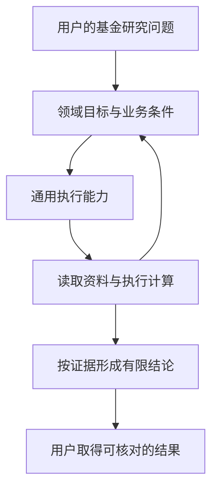
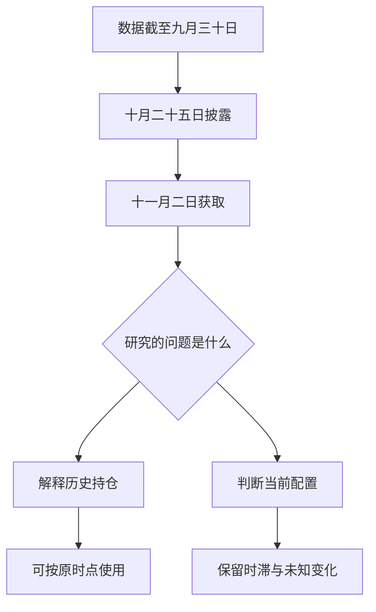
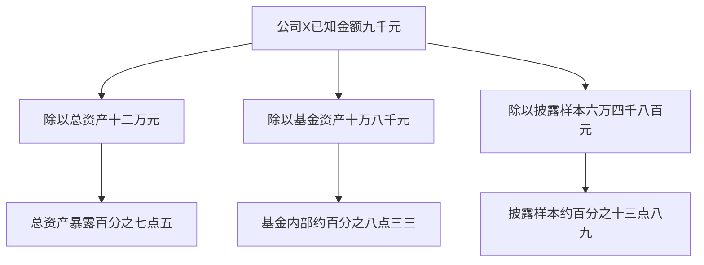
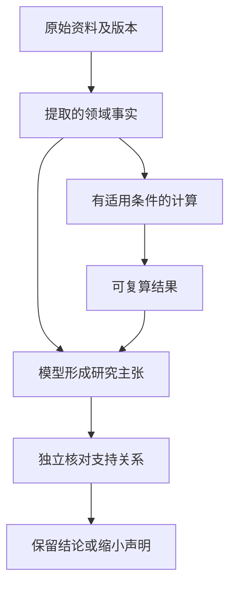
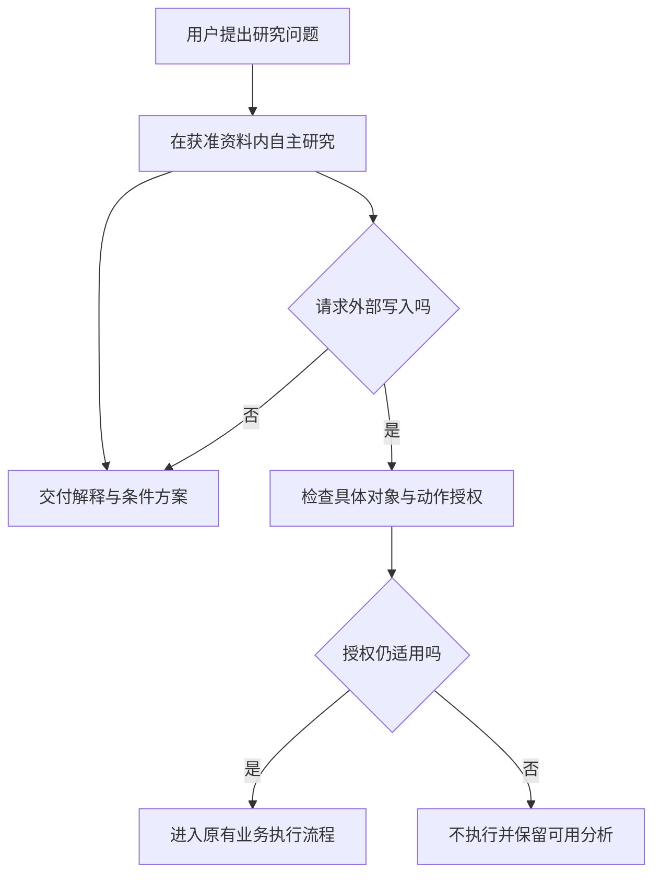
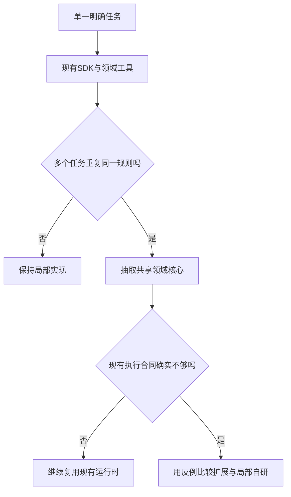
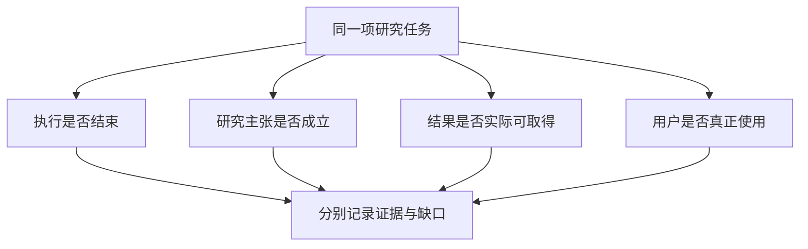

# 通用 Agent 框架之后，为什么还需要金融垂类能力？

> 原则篇｜Pi、Claude Agent SDK、LangGraph 与金融 Agent 的职责、取舍和退出条件。

当一个 Agent 已经能够搜索网页、阅读报告、执行 Python、调用子代理、保存会话，我们很容易产生一个判断：再做金融垂类框架，是否只是在成熟工具外面换了一层名字？

这个怀疑是合理的。一个系统接上行情接口、加几段金融 Prompt、注册几个基金 Skill，并不因此拥有新的架构价值。反过来，金融业务确实存在专门的事实、计算和责任问题，也不能因为通用框架功能丰富，就把这些问题当成模型会自动处理的细节。

本文的判断是：**金融领域能力通常需要建设，但独立的金融 Agent 框架并不总是需要，自研执行运行时更不是顺理成章的下一步。** 必须分别证明这三个命题，不能从“基金口径很复杂”直接跳到“所以应该重写 Agent Loop”。

下面沿一项基金组合研究展开。我们会看到金融规则怎样改变计算，证据怎样限制结论，模型自主性应当放在哪里，以及怎样选择最小可用方案。文中的资金、产品和日期组合均为教学构造，不是作者或任何客户的实际持仓；关于框架的能力描述依据文末官方文档，核对日期为 2026 年 11 月 2 日。

## 一、先把问题说完整：我们究竟在比较什么？

### 1. 四个经常被混为一谈的东西

模型、执行框架、领域能力和业务产品不是同一层对象。模型负责解释问题与生成行动；执行框架承接模型、工具、上下文和任务状态；领域能力定义基金身份、收益口径等业务含义；产品还需要账户、权限、报告、界面、运维及用户实际使用过程。

这不是要求工程代码必须分成四个目录，更不是建议增加四个服务。它只是帮助判断：某个困难究竟应该在哪一处解决。一个应用完全可以在同一进程中实现这些职责；相同职责已经被现有模块清晰表达时，不必再造一层抽象。

如果把完整金融产品与一个通用 SDK 放在同一张功能数量表里，产品通常会显得“什么都有”。但这种比较把产品自己接入的数据、业务流程和界面，全部算成了执行框架的优势，实际上没有回答应该选哪套基础设施。

### 2. Pi、Claude Agent SDK、LangGraph 各自解决什么

Pi 官方把自己定位为可扩展的轻量 Agent Harness，也就是模型工作的执行环境。它提供会话、工具与上下文等机制，并通过扩展、Skill、SDK 和 RPC 让开发者接入自己的流程。其官方说明刻意不把 MCP、子代理和权限弹窗全部做成内建功能，而是允许按环境补充；这是设计取舍，不应自动被评价为能力缺陷。[1]

Claude Agent SDK 提供 Claude Code 的 Agent Loop、工具与上下文管理，支持 Python 和 TypeScript。它还提供 MCP、权限、Hook、子代理、会话继续等能力。因此，“我们需要工具、恢复和专家分工”本身并不能构成重新开发运行时的充分理由。[2]

LangGraph 是面向有状态、长时任务的底层编排框架与运行时。确定性代码和模型驱动步骤可以在同一个图中组合，持久化与人工中断是其正式能力。把它简单描述成“只能按固定流程执行”，同样不准确；图可以编排自主研究，而不只是线性的业务审批。[3]

三者不是彼此完全可替代的商品，更没有脱离任务的唯一冠军。比较时要问：我们需要接管多少执行语义，愿意承担多少集成工作，哪些状态必须跨进程保留，哪些工具和部署环境已经由现有系统提供。

### 图 1：领域系统与通用执行能力的关系

图中回到领域目标的箭头很重要：研究不是把预先排好的工具执行一遍。新资料可能证明最初问题需要改写，或者只能回答其中一部分。执行框架使这种循环能够发生，领域能力帮助解释每一次观察意味着什么。

## 二、用同一个组合，区分“回答了”与“研究完成了”

### 1. 教学案例：三只基金、一笔新增资金

假设一个模拟组合总额为 120,000 元。A 基金占 45%，B 基金占 30%，C 基金占 15%，现金占 10%。A、B 的产品资料都明确跟踪同一个指数；C 是主动管理的主题基金。用户另外计划投入 20,000 元，并提出一个完整问题：

“我的基金是不是买重复了？新增资金怎样安排，才能降低集中度，又保留 10% 现金？请把不能确定的部分讲清楚，不要替我交易。”

这里同时存在事实识别、组合计算、条件比较和权限约束。简单回答“A、B 重复，卖掉一只”遗漏了新增资金、现金目标和不执行交易三个重要条件。相反，把所有条件都写成一大段免责声明，也没有完成研究。

合理的目标应当是：先确认已有配置的可证明特征，再判断新增资金能解决什么问题，明确需要哪些额外资料，最后交付有条件的方案比较。用户没有要求系统替他完成真实买卖，研究结果也不自动取得执行资格。

### 2. 第一个可以立即成立的结论

只要账户快照和两只基金的跟踪基准得到确认，就可以说：总资产的 75% 配置在跟踪相同指数的两只基金上。这个结论来自 45% 加 30%，属于基准层面的重复配置，不需要先穿透全部底层证券。

但它不能自动升级为“75% 资产完全重合”，更不能推出应该卖出其中某只。现金比例、复制方式、实际组合、费用和用户原有持有条件都可能影响后续判断。正确的方法是保留已成立的结论，而不是因为更深层资料缺失就把整题拒绝。

这也是金融 Agent 很容易走偏的地方：为了追求“完整”，它可能把未知部分补成一个精确数字；为了追求“安全”，又可能连已经足够支持的事实都不愿输出。两种极端都损害实用性。

### 3. 为什么这里需要 Agent，而不只是计算器

如果任务只有“45% 加 30% 等于多少”，确定性代码足够。如果任务要求根据资料可得性选择研究层次，发现 C 的披露不足，寻找可替代来源，比较降低集中度的不同路径，并据此调整问题，模型驱动的研究循环才有实际价值。

因此，领域 Agent 的独特作用不在于重新发明加法，而在于围绕目标组织证据与方法。确定性程序承接可以精确定义的运算，模型承担开放式研究和解释；两者的结合应当产生比固定模板更有用的结果，而不是更多工具调用记录。

## 三、金融事实的最小单位，不是一个裸数字

### 1. 数字离开对象、单位与分母，通常没有足够意义

假设一个工具返回“权重 8%”。我们仍然不知道它是谁对谁的权重：某只基金中的某家公司，某个账户中的某只基金，还是研究样本中的行业分类？分母可能是基金净资产、总资产、股票资产，也可能只是已经披露的前十大持仓。

即使所有数值都来自真实来源，只要分母错配，最终计算仍可能错误。最危险的情况不是数值缺失，而是数据看起来齐全，模型也能顺利算出结果，但不同字段实际上回答的是不同问题。

我们可以用“带语义的事实”代替裸数字：对象是什么，指标是什么，原值是什么，单位和尺度是什么，分母是什么，适用时点是什么，来源在哪里。不是每个字段都要复制进每个 JSON，但调用方必须能够通过明确的关系取得这些信息。

### 2. 产品身份应当服务于问题，而不是机械去重

同一基金的不同份额类别，可能共享部分投资组合信息，同时具有不同费用或分配安排。分析底层资产时可能需要识别共同组合，计算持有成本时又必须保留具体份额、渠道和适用条款。不能选一个“统一基金 ID”，就认为所有层次都可以合并。

类似地，两只基金跟踪同一指数，不等于它们是同一投资产品；两条账户记录对应同一只基金，也不等于其中一条应该被删除。去重的是研究资料、产品实体还是资金持有记录，必须先说清楚，否则去重可能把真实资本一起去掉。

这类区分属于领域语义，而不专属于 Agent。已有金融数据服务已经维护得当时，直接复用比重新创建 Agent 专属标的中心更合理。领域框架应减少调用方必须理解的细节，而不是再复制一份权威数据库。

### 3. 类型化只能阻断部分错误

把金额定义成带币种的十进制字符串，可以阻止 CNY 与 USD 被无意相加；把份额和净值区分为不同量，可以帮助检查乘法的单位关系。但正确的类型不能证明基金身份正确，也不能证明净值来自适用日期。

因此，类型系统、运行时校验、来源核对和业务解释是互补手段。任何一个都不应该被包装成“金融正确性已经解决”。尤其不能因为一个结果通过了结构化 Schema，就给整篇报告盖上可信认证。

## 四、时间不是一个过期时间，而是一组不同的问题

### 1. 数据描述的时间，与我们知道它的时间

假设一份教学报告描述 9 月 30 日的持仓，10 月 25 日披露，Agent 在 11 月 2 日读取。三个日期都是真的，但作用不同：第一个描述资产状态，第二个描述信息进入公开范围的时间，第三个描述本次系统取得资料的时间。

“今天取得的最新报告”不能被简写成“今天的持仓”。反过来，历史持仓也不因为不是今天的就失去价值；它可以用于解释当期配置、核对过去判断或构建有明确时点的研究。有效性取决于任务，而不是一刀切的天数门槛。

如果要回测 10 月 1 日能否作出某项判断，那份 10 月 25 日才披露的报告不能被当成当时已知信息。这个例子说明，保存数据截止日还不够，有时必须同时保存披露或可获知时间，才能避免把后来信息带回过去。

### 图 2：同一份资料的三个时间

### 2. 新资料出现时，不要悄悄改写旧结论

假设用户阅读报告后又导入一份纠正版持仓。新版本应该影响后续计算，但已经发布的旧报告也有自己的来源和历史意义。把底层记录直接覆盖，然后让旧报告自动显示新数字，会使用户无法知道自己当时看到的究竟是什么。

更合理的设计是把事实修订和结果修订连接起来：旧结果仍绑定旧输入，新结果绑定新输入；展示时解释两者的差异。需要重新计算的范围由真实依赖决定，而不是发现一个来源变化就把所有历史研究全部重跑。

这里的“不可变”也不是永久保留一切的命令。保存策略仍需遵守权限、数据最小化和适用留存规则。版本身份解决的是如何辨认不同事实，不等于为无限期保存私人资料提供理由。

### 3. 时间策略也要允许退出

一次性阅读公开说明书时，记录来源和版本可能已经足够，不必构建双时间数据库。只有当任务需要历史可得性、跨期观点比较或修订追踪时，额外时间语义才值得进入执行合同。

这条原则具有普遍性：解释时能够区分的概念，并不都要立即成为系统字段。先确认区分会改变哪个判断、哪项计算或哪条恢复行为，再决定是否增加结构。否则领域建模会从解决真实问题变成维护百科全书。

## 五、一个分母错误，足以让“精确穿透”失去意义

### 1. 把教学组合穿透到公司 X

继续使用前述组合。假设在已经确认的同口径资料中，A 对公司 X 的权重为 8%，B 为 10%，C 为 6%。公司 X 占总资产的已知暴露为 45%×8%＋30%×10%＋15%×6%，即 7.5%，对应 9,000 元。

这只是一项教学计算。它成立的前提包括基金权重和底层权重的定义一致、输入适用于所声明的时间、公司身份映射正确，以及不存在未经处理的重复层级。公式简单，不代表这些前提也简单。

再假设 A、B、C 可取得的底层披露覆盖分别为 60%、70%、40%。按总资产加权，已披露基金底层覆盖为 54%。现金另占 10%，剩余 36% 总资产的基金底层去向尚未由这些资料解释。

### 2. 三个看起来都合理的百分比

公司 X 占总资产为 7.5%；占基金资产为 7.5%÷90%，约 8.33%；占已披露基金底层样本为 7.5%÷54%，约 13.89%。三个算式都可以算对，但回答不同问题。

假如系统把第三个数放在“组合实际公司权重”栏中，就发生了样本归一化误用。问题不在小数精度，而在把已知样本的结构当成整个组合的结构。增加更多小数位只会让错误显得更有权威。

资料缺失也不能被填成零。零意味着我们知道没有暴露，未知意味着我们还不知道是否存在暴露。只有明确满足非负、无杠杆等假设时，才能把已知部分解释为相应下界；不能把这种教学假设推广到含衍生品、空头或净敞口的全部基金。

### 图 3：同一数值，三个不同分母

### 3. 现金目标为什么必须使用调整后的分母

原组合现金为 12,000 元。新增 20,000 元后，总资产在不考虑市场变化、费用和其他现金流的教学假设下变成 140,000 元。保留 10% 现金意味着最终现金应为 14,000 元，因此新增资金中可投入基金的是 18,000 元，而不是全部 20,000 元。

如果系统仍按原来的 120,000 元计算目标现金，就会把 12,000 元当成足额储备。这种错误不需要复杂金融知识，只需要分清“当前组合”和“调整后组合”。但在多轮对话中，新增金额、目标比例和旧快照很容易被混用。

这也是领域方法值得封装的原因：同一现金守恒与分母规则可能被问诊、再平衡、定投比较和周报重复使用。让每次模型临时生成计算步骤，难以保证这些入口长期保持相同含义。

## 六、确定性计算也可能使用了错误的方法

### 1. 正确执行公式，不等于公式适用于问题

金融 Agent 经常把 Python 当成可靠性的分水岭：只要调用代码，数字就可信了。实际上，代码可以准确执行一个错误的公式，也可以对错误的数据对象做精确计算。我们需要区分算术正确、方法适用、输入真实和结论合理四件事。

例如，某个教学基金单位净值从 1.00 变成 0.99，期间每份现金分配 0.04，且假设分配不再投资、没有其他现金流和费用调整。单期持有总回报为 3%，不是净值变化得到的负 1%。如果工具只计算净值差，即使使用无限精度也仍然答错了问题。

若分配再投资，还要明确再投资日期、价格和份额变化；存在外部资金流时，又要选择与问题匹配的收益度量。这里不需要为了文章列尽所有金融公式，只需要理解：算法名称、输入口径和适用条件是结果的一部分。

### 2. 费用需要区分假设、条款估算和实际发生

“假设费率为某个值”“依据当前适用产品条款估算费用”“账户回执显示实际扣费”是三种不同事实。第一种可以用于敏感性分析，第二种需要具体份额、渠道、持有期及有效日期，第三种需要真实执行证据。

它们不应共用一个不加说明的“手续费”字段。尤其是某些费用已经反映在净值中时，再从净值收益扣除一次可能造成重复计算；是否需要调整，应由明确的方法合同决定，而不是由模型看到“费率”两个字就自动减去。

金融规则会变化，产品条款也会修订。因此，所谓领域不变量不是“某个费率永远固定”，而是“任何费用估算都必须知道适用的条款版本与计费基础”。稳定的是判断所需的关系，不一定是关系中的参数。

### 3. 不要为统一而建立另一个金融计算中心

当不同模块已经拥有明确的方法时，统一的重点应是共同语义与结果接口，而不是把所有公式强迁移到一个全局 Manager。组合现金、收益归因、费用估算和底层暴露可以分别由最合适的维护方负责。

值得共享的可能是单位运算、十进制规则、输入引用和版本约定；不同收益窗口、费用顺序和统计方法则应该保留差异。真正重复的公式需要合并，含义不同但名称相近的方法不应该为了目录整齐而合并。

这种联邦式设计允许领域能力逐步成熟。只有一个消费者时，先在原模块修正错误；多个任务反复遇到同一问题时，再抽出深一些的公共接口。抽象应该减少调用方知识，而不是把原复杂度换成更长的配置表。

## 七、证据链应当约束主张，但不能冒充真值机器

### 1. 至少区分来源、计算与解释

基金报告中的一行数据是来源事实，程序根据数据计算出的集中度是派生结果，模型据此解释“组合对某种风险较敏感”是研究判断。三者都重要，但它们具有不同的证据身份。

子代理写出的总结也不自动成为新的原始来源。总结可以帮助主代理定位问题，但主代理需要表达关键金额或引用具体表格时，应能回到对应版本的原材料或确定性结果。不能仅仅给专家回答分配一个 ID，就让它拥有与正式披露相同的事实地位。

建立这种关系并不要求每句话都附一个巨大的证据对象。关键是保留能够支撑重要结论的最小链路：哪份资料、哪个位置、什么输入、什么方法、哪个结果，以及结论实际使用了哪一部分。

### 图 4：证据支持主张，不自动认证主张

### 2. 有链接、哈希和血缘，仍可能答错

一个链接可以指向真实网页，却不支持旁边那句话。一个哈希可以证明保存的字节没有变化，却不能证明这些字节来自正确产品。数据血缘可以完整记录计算路径，却仍然完整地记录了一次错误方法。

所以，证据系统首先提供的是可检查性，而不是正确性保证。它让人能够追问、复算和定位问题，减少错误隐藏在自然语言中的机会。把这种工程价值说清楚，比声称“全链路可信，因此研究已经可靠”更准确。

独立复核也需要独立条件。第二个模型如果只阅读第一个模型写好的摘要，可能只是重复相同错误。更有意义的复核应在必要时取得原始依据、独立算式和不同方向的反证，而不是给流畅程度打分。

### 3. 保留局部结论，比追求全局可信布尔值更有用

在组合案例中，A、B 的基准重复可以确认，C 的完整底层暴露不能确认，新增资金后的现金算式又可以独立成立。这些结论应当各守范围，而不是被压成一个“报告可信／不可信”的总开关。

实际输出可以清楚区分“已确认”“基于显式假设的情景”“仍缺资料”。必要输入不足时，相关计算不应生成虚假结果；但可选的额外检查失败，也不应自动撤销独立成立的事实。局部失败和整体交付应按真实依赖处理。

这不是放松金融质量，而是避免把质量治理做成一个过度阻断系统。用户真正需要的是知道哪些判断可以使用、哪些还需要补证，而不是看到一个看似严格、实际上解释不了原因的红色标签。

## 八、自主性要放在研究策略里，不能放在授权事实里

### 1. 模型可以决定下一步研究什么

发现 C 的持仓资料不完整后，模型可以查找基金管理人报告、比较不同披露窗口，或者判断目前只能做策略层面的风险解释。它也可以提出一个更适合的问题：先识别同基准重复，再讨论新增资金是否能降低已知集中度。

这种策略调整正是 Agent 的价值。若系统把“先查 A、再查 B、再查 C、必须得出精确重合率”写死，即使模型已经发现问题无法按原口径回答，也只能继续完成一个错误计划。

但研究策略的灵活性不意味着所有规则都由模型决定。当前用户身份、可读账户、允许发送资料的供应商、投资账本和已经授予的权限，不应因模型认为“这样更方便”而改变。

### 2. 研究、建议和执行需要区分，但不是每次都加审批

一个公开基金说明书摘要不需要先弹出交易授权框。一个只读组合分析也不应该因为出现“降低集中度”就自动启动全套交易流程。控制应该与实际动作和后果匹配，而不是与某个金融关键词绑定。

当任务涉及客户私有资料，需要检查数据访问和使用范围；当任务请求真实账户写入，需要核对具体动作的授权与有效条件。这里讨论的是工程责任分离，不是替任何地区、机构和服务类型出具法律适用结论。

“用户说了可以”还必须对应具体对象和版本。批准查看某份持仓，不等于批准发送给所有外部模型；批准某个金额的操作，也不等于后续金额改变仍继续有效。授权与动作的绑定比审批弹窗本身更重要。

### 图 5：探索可以开放，实际效果需要明确授权

### 3. Prompt 是方法说明，不是安全边界

告诉模型“只读”“不要交易”“不要泄露账户”很有帮助，但如果底层工具仍提供任意数据库写入或无限制文件读取，真正的权限边界并没有建立。模型偏离指令时，系统应当仍能限制它造成的效果。

另一方面，也不应该把所有判断都改成机械规则。比如“这份研究是否有说服力”无法被一个固定关键词检查替代。确定性程序处理可定义的授权、身份和算术；语义质量通过适当评测与复核处理，二者不能相互冒充。

## 九、持久化保存的是执行状态，研究连续性还需要额外含义

### 1. 恢复一个会话，不等于恢复一个研究问题

通用框架已经提供丰富的会话或持久化机制。LangGraph 明确区分线程内的 Checkpoint 与跨线程存储；Claude Agent SDK 也支持会话继续与分支。这些能力值得复用，而不是被垂类系统当成不存在。[2][4]

金融研究的额外问题是：恢复时仍然在回答同一个问题吗？使用哪一期资料？用户是否改变了目标？已经发布的阶段结论应保留还是修订？原来的数据授权是否仍然有效？这些含义需要应用或领域逻辑明确表达。

一个会话记录可以保存全部对话，却仍然无法区分“上周的假设”和“本周的事实”。因此，长期研究不只是更长的聊天历史，而是能够关联目标、依据、结论及其变化原因。

### 2. 不要把恢复理解成盲目重复动作

研究读取失败后重新获取资料，和对外提交指令后没有收到回执，是不同问题。后者可能已经产生效果，简单重试可能造成重复。即使是保存报告，也要区分写入前失败、写入成功但确认丢失、状态暂时未知。

LangGraph 的中断文档明确提醒，恢复时中断之前的节点代码可能重新执行，因此相关副作用需要幂等设计。这个问题不是某个框架的缺陷，而是应用需要与运行时共同承担的执行语义。[5]

金融垂类系统的贡献，应当是给具体业务动作规定身份、重试和核对方式，而不是宣称拥有一个通用的“恰好一次”开关。外部系统没有相应协议时，本地数据库保存一个成功标记并不能创造外部恰好一次保证。

### 3. 很多任务不需要长期记忆

一次性比较两份公开资料时，不保存长期偏好、不构建跨周研究工作区，可能是最好的设计。长期记忆会带来过期、冲突、权限及删除语义，应该由真实持续任务驱动。

需要持续追踪时，也优先保存有价值的稳定偏好和研究目标，而不是把每次生成的意见都沉淀成事实。过去模型说过“这只基金适合你”，不能在后续会话里无条件升级成用户已经确认的长期投资偏好。

## 十、领域能力、Skill 与框架之间，存在一道经济边界

### 1. 可以先用 Skill 解决的问题，不必立刻工程化成平台

如果某个任务主要需要一套研究步骤，例如先确认基金身份，再找报告，再选择适用指标，那么 Skill 是合适的表达。它能够让模型按任务加载方法，不必把全部领域知识塞进常驻系统提示。

如果任务的关键是一个重复使用的确定性公式，就把公式放在工具或领域模块中。工具需要的参数、单位和失败条件应当清楚，Skill 负责说明什么时候使用它。不要用一篇更长的 Skill 去代替已经能够程序化表达的计算规则。

当多个任务共享标的身份、时点口径、来源引用和结果结构，并且这些规则需要独立演进与验证时，才开始形成领域 SDK 或框架。框架是复用需求的结果，不应该成为项目启动时必须填满的目录模板。

### 2. 框架的价值，可以用删除实验来检验

设想删除某个公共模块。如果相关复杂度也一起消失，调用方更容易理解，它可能只是无价值的转发层。如果删除后，相同的费用口径和来源校验重新散落到多个入口中，那么这个模块确实在集中管理复杂度。

这个实验比“代码是否有一层 Interface”更有意义。接口的深度来自它隐藏了多少调用方本不该承担的细节，而不是类型名字有多抽象。一个只有一个适配器的抽象可能有用，但仍应承认跨运行时可移植性尚未被实际验证。

同样的判断也适用于独立部署。逻辑职责可以分离，却不必立即拆成微服务。只有部署隔离、资源调度或组织协作产生真实需求时，跨进程成本才可能值得承担。

### 3. 正常任务也会为复杂架构付费

额外机制不触发时，是否仍增加上下文、装配步骤、数据库访问和故障面？新加一个工具，是否需要同步修改多份清单、恢复协议和测试？这些是框架的正常路径成本与变化放大成本。

本文不为它们编造一个统一百分比。不同部署和任务差异很大，应该用真实请求测量。但不能因为成本尚未量化就假定不存在，更不能只展示复杂机制在极端故障中的好处，而忽略普通查询每天都承担的额外负担。

因此，合理的扩展通常应当按需启用：短任务不启动长期工作区，没有独立子问题不启动专家，现有结果足够时不重复评审，可选增强不可用时不拖住独立合法的回答。

## 十一、最强的反对意见：直接把规则写进现有框架，不就够了吗？

### 1. 是的，而且常常就是正确答案

用 Claude Agent SDK 运行研究、以 MCP 暴露基金工具，再加一个领域计算库，可以成为完整可用的方案。用 LangGraph 组织读取、计算和人工检查，或者用 Pi 扩展接入相同工具，也同样成立。

只要规则集中、测试明确、结果可核验，并不要求代码仓库里一定出现一个叫作 FinancialAgentFramework 的包。独立框架和合理业务模块之间不存在天然的价值等级，决定因素是实际复用与维护效果。

所以，本文并不试图证明“所有金融 Agent 都要自研框架”。恰恰相反：**领域复杂度证明需要领域建模，不自动证明需要新的运行时。** 谁主张增加一套执行系统，谁就需要补充执行层的独立理由。

### 2. 哪些情况才可能支持自建运行时

当已有运行时无法在实际部署条件下满足某项关键执行合同，扩展点不足，兼容层反而比局部自研更复杂，才值得认真比较。可能的条件包括特殊的模型协议、资源准入、跨进程恢复或不可替代的交付语义，但每一项都需要具体反例支持。

“我们希望控制得更细”不够具体。应当说清哪个动作、哪种故障、现有框架怎样处理、为什么不符合业务要求，以及是否已经尝试较小的扩展。否则所谓控制力只是把成熟框架的维护责任搬到了自己团队。

即使最终自建，也应把替换成本算进去：协议流式分片、取消竞态、重试、插件生命周期和状态迁移都可能长期消耗工程时间。这些工作可能有研究价值，但不能自动记为金融研究差异化。

### 图 6：从最小方案出发，而不是从平台出发

### 3. 一个反向的成功标准

如果迁移到更成熟的通用框架后，能删除大量自有执行代码，同时保持基金计算、证据与权限行为不变，这应当被视为成功，而不是技术能力退步。真正积累下来的领域能力不应依赖维持自研代码的规模。

相反，如果每次更换模型都需要重写基金口径，说明领域语义与执行细节耦合过深。垂类核心的价值在于稳定可复用的判断关系，而不是必须永远绑定某一代 Harness。

## 十二、多 Agent 的必要性，也需要单独证明

### 1. 多角色不等于多份独立信息

把同一份资料交给“多头专家”“空头专家”“风险专家”，可能产生不同措辞，也可能产生有用反证，但它并不保证信息真的独立。三个模型都依据同一错误摘要，最终投票只会增加错误的声势。

子代理最明确的工程价值通常是隔离上下文、分解可并行的子问题、使用特定工具与方法。Claude Agent SDK 官方也把这些列为子代理的重要用途。是否改善金融判断，则还需要在具体任务中测量。[6]

例如，一名专家负责核对披露时点，另一名负责复算现金与费用，第三名寻找推翻配置假设的证据，这比单纯给三个人格起名字更接近有用分工。但若主代理已经能低成本完成这些检查，分工也可能没有净收益。

### 2. 主代理不能只收取“专家说没问题”

有价值的交接应当包含专家回答了什么子问题、依据什么资料、计算采用什么方法、仍有什么缺口。主代理需要知道哪些是原始事实、哪些是专家意见，必要时可以回读关键原材料。

否则，我们只是在主代理与事实之间增加了一个无法检查的自然语言代理层。上下文虽然变短，研究责任却变模糊。专家数量越多，资料权限、预算、取消和恢复的复杂度也越高。

### 3. 把退出条件写进设计

没有独立子问题时不启动专家；资料不足时不靠更多角色弥补；评审没有发现额外错误且显著增加延迟时，回到单主代理基线。退出机制不是对高级架构缺乏信心，而是避免把某种组织形态变成必须长期支付的固定成本。

金融 Agent 的目标是更好地完成研究，不是展示一次任务能够同时运行多少 Agent。多代理改善了什么，需要与同题、同资料窗口、相近模型条件下的简单基线比较，不能只展示一次热闹的成功演示。

## 十三、评价体系要回答用户问题，而不只统计工具事件

### 1. 执行、研究、交付和采用是不同观察面

一次运行结束，说明执行器进入终态；报告保存成功，说明某些字节已经落盘；用户能够下载，说明交付链路成立；结论经独立复核，才说明在相应范围内研究质量得到支持。这些事实相互关联，却不能互相替代。

同样，用户读懂并采用一份研究，也不直接证明它提高了投资收益。投资结果受到市场与行为等因素影响，不能从工程验收推出长期回报。把不同观察面分开，不是抹杀进展，而是让每一种进展都得到准确评价。

### 图 7：四种完成，不是一条自动升级链

### 2. 评测应当包含能够改变结论的反例

组合案例至少可以加入这些条件变化：C 缺少完整持仓；A 与 B 的底层数据时点不同；新增资金变成从已有现金中划转；用户撤回某个账户的访问；费用条款不适用于该份额；报告保存后确认回执丢失。

这些不是为了增加测试数量，而是为了检查系统是否理解问题的关键条件。好的反例会改变应当输出的结论、允许的动作或交付方式。只替换基金名称而不改变研究结构，通常不足以证明方法能够泛化。

评测还应保留无答案、部分答案、外部资料不可得和评审未完成的尝试。把失败样本移出分母，只统计最终挑中的漂亮报告，会使系统看起来比实际使用体验更可靠。

### 3. 候选分数不能变成竞品胜率

内部 Scorecard 可以帮助定位能力缺口，但它的参考尺度、权重和证据阶段必须明确。把某一维度的 8.9 分解释成“达到某 SDK 的 89%”，或者解释成真实基金研究 89% 正确，都是错误推断。

四套系统如果没有在同一任务集、相同资源条件和独立评审下实际运行，就不能画出貌似精确的胜负榜。更有用的比较是说明哪些能力原生提供、哪些需要扩展、哪些已经在目标应用中验证、哪些仍然未知。

## 十四、怎样把原则变成一个可以开始的方案

### 1. 基线：一个主代理、一组只读工具、一套明确方法

从基金重复配置研究开始，先复用成熟执行框架。提供可确认产品身份的资料读取工具、一个可复算的组合计算工具，以及能够保存最终报告的产物接口。先让正常输入与关键缺失条件都得到合理回答。

这条基线应该能够输出：基准层面的重复、可计算的已知公司暴露、披露覆盖和未知部分、新增资金下的现金约束，以及仍缺的用户条件。无需先建设多角色讨论、长期记忆或全天候任务平台。

在这里，领域价值已经相当具体：用户不会把 13.89% 的披露样本权重误认成 7.5% 的总资产暴露，也不会在新增资金后继续使用旧分母计算现金。这比多出几个流程节点更能说明系统为何存在。

### 2. 增量：让真实任务推动公共能力

第二个任务加入基金对比，可能促使我们抽出收益口径与份额身份；第三个任务加入持续周报，可能需要目标、来源版本和观点变化；任务确实跨进程等待时，再强化持久恢复和阶段交付。

每次扩展都应该说明它解决了什么具体问题，也应说明可以暂缓什么。持续研究不一定需要先有自动交易；专家交接不一定需要先有无限嵌套；历史可回读不一定需要所有内容永久常驻上下文。

如果新增机制没有改善任务的完整性、可核对性或使用成本，就应当收缩。体系化不是把所有可能功能一次装齐，而是让系统能够在保留正确责任的前提下逐步成长。

### 3. 进一步自研：保留替换的可能

确有执行层缺口时，可以做局部自研，但让金融方法尽量不依赖某一种模型消息结构。来源与结果采用稳定引用，业务权限留在原系统，模型供应商适配不要复制财务公式，恢复不要悄悄重算旧报告。

实际有两个运行时消费者时，再检验抽象是否真正可移植。迁移验证关注相同输入、相同领域计算、相同权限拒绝和相同交付事实，而不是追求逐字相同的自然语言回答。

## 十五、模型越强，领域核心会消失吗？

### 1. 应当消失的，是补偿模型弱点的偶然复杂度

模型更擅长阅读表格、选择工具与理解条件后，某些分解 Prompt、冗长计划和补救步骤可能不再必要。一个健康的架构应该允许这些层被删除，而不是为了维护过去投入继续保留。

因此，“未来模型更强”是认真检查现有机制的理由。任何一层若只是在修补某代模型的局限，都需要明确的退出条件。模型升级后通过对照任务重新评估，比默认所有历史结构都应永久存在更合理。

### 2. 不会自动消失的，是外部事实和业务责任

模型能力提升不会改变某份报告的披露日期，不会让不同分母自动变得可比，也不会赋予模型本来没有的账户权限。它可以更好地识别这些条件，但这些条件的权威仍来自外部世界和业务系统。

领域核心也应随着模型进步变薄。能够交给模型处理的开放解释可以减少固定流程，已经稳定的算术与授权则继续由适当的程序承担。真正有价值的稳定性，是责任和语义清楚，而不是实现永远不变。

### 3. 垂类竞争力不等于复杂度壁垒

专有数据、经过核验的方法、实际用户问题、长期质量反馈和集成能力都可能构成价值，但不能仅凭系统很复杂就推断难以复制。一个更简单的产品若更好地回答用户问题，也可能优于功能庞大的工程平台。

同样，可公开复用的领域工具并不会因为别人能够使用就失去意义。稳定的协议、清楚的失败语义和可复算示例，能够降低其他团队构建正确系统的成本。工程价值与封闭程度没有必然关系。

## 结语：先证明领域价值，再证明框架价值

回到那位模拟用户。他真正需要的不是知道我们用了 Pi、Claude Agent SDK 还是 LangGraph，而是弄清 75% 的同基准配置意味着什么，7.5% 的已知公司暴露采用了哪个分母，为什么还有 36% 的底层去向未知，以及新增 20,000 元之后怎样保留所要求的现金。

系统需要在资料不足时继续寻找证据，也需要在证据确实不足时缩小结论；需要把可确定的计算做好，也需要承认方法之外仍有判断；需要允许研究灵活展开，同时不把这种灵活性变成访问权限或执行权的扩张。

通用框架已经承担了大量执行复杂度。金融领域能力的任务，是让这些执行围绕正确对象、适用方法和可核对的结论工作。领域框架只有在这些能力需要跨任务复用时才有意义，自研运行时则还要通过另一轮成本与替代方案检验。

**最值得保留的不是自研代码的数量，而是更换模型、工具或运行时之后，仍能清楚解释、独立验证并持续改进的金融研究能力。**

---

## 参考资料与继续阅读

[1] [Pi 官方：定位、扩展、会话与明确未内建的能力](https://pi.dev/)。本文描述的是官方机制与设计选择，不是针对特定版本运行的横向性能测试。

[2] [Claude Agent SDK overview](https://code.claude.com/docs/en/agent-sdk/overview)。Agent SDK、直接 API Client SDK 与托管 Managed Agents 是不同产品，不混作同一个能力包。

[3] [LangGraph overview](https://docs.langchain.com/oss/python/langgraph/overview)。关注有状态编排与确定性／模型驱动步骤的组合。

[4] [LangGraph persistence](https://docs.langchain.com/oss/python/langgraph/persistence)。区分线程状态与跨线程存储。

[5] [LangGraph interrupts](https://docs.langchain.com/oss/python/langgraph/interrupts)。恢复与副作用幂等需要应用共同设计。

[6] [Claude Agent SDK subagents](https://code.claude.com/docs/en/agent-sdk/subagents)。上下文隔离、工具限制和并行化不自动证明投资判断改善。

[7] [Anthropic：Building effective agents](https://www.anthropic.com/engineering/building-effective-agents)。从最简单可用方案开始，复杂度应由实际收益支持。

本系列的工程篇：[从通用 Harness 到金融研究系统：ETF Agent 的四方架构对照](./etf-agent-framework-comparison-panorama)。更广泛的业务地图见[金融 Agent 全景](./financial-agent-system-panorama)。

欢迎在 [Agent 工程文集](https://github.com/hpoenixf/eff-agent-article) 提交讨论，也可以 Star 留存；公开教学实现见 [Open ETF Agent](https://github.com/hpoenixf/open-etf-agent)，其演示范围不等于私有研究系统的全部能力。
