# 架构图册

VISUAL ATLAS / 15 SVG DIAGRAMS

下面的架构图来自已经公开的[六层全景文章](./articles/017-prompt-to-answer-six-layer-panorama.md)，适合按主题浏览。图示保留原文的核对时点，现行模块职责可结合[架构地图](./architecture.md)阅读。

## 全景

## 研究和委派

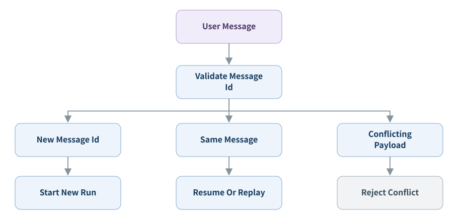
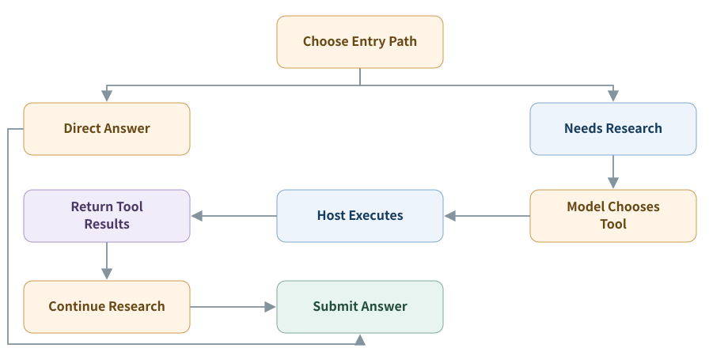
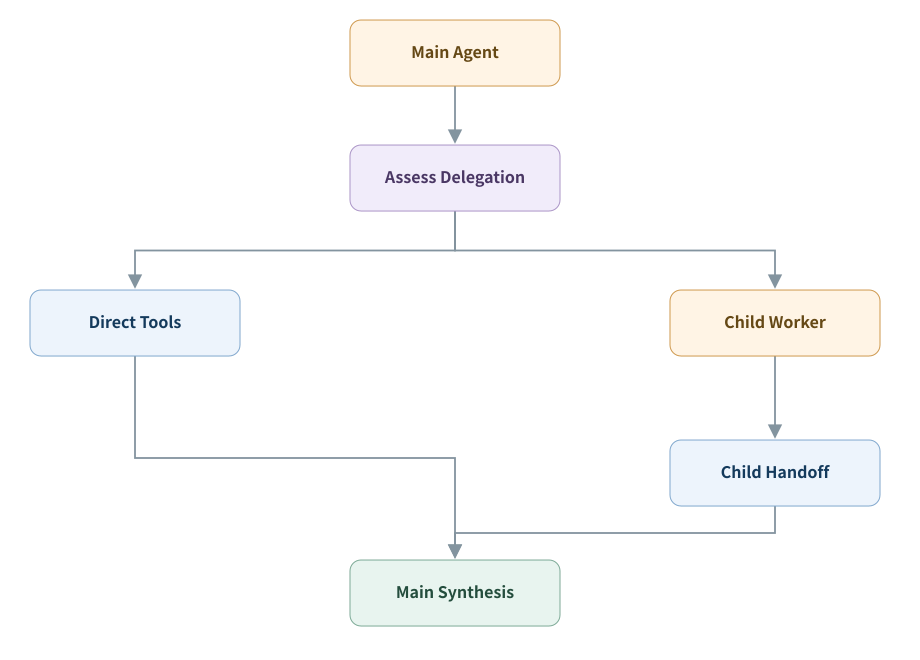

## 上下文与执行

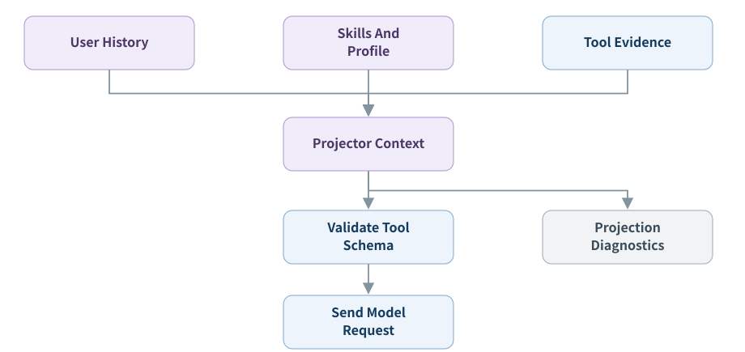
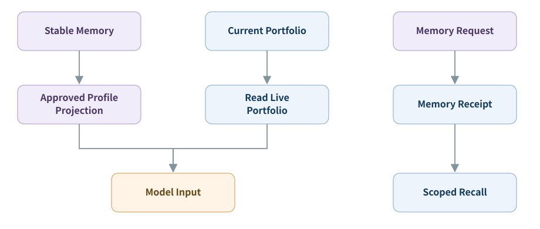
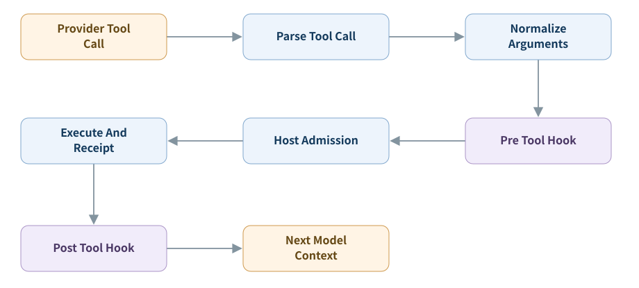
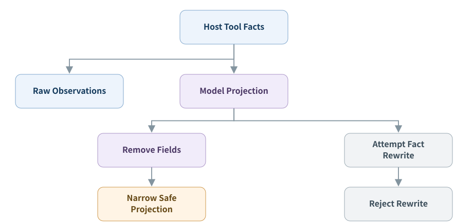

## 证据、计算与交付

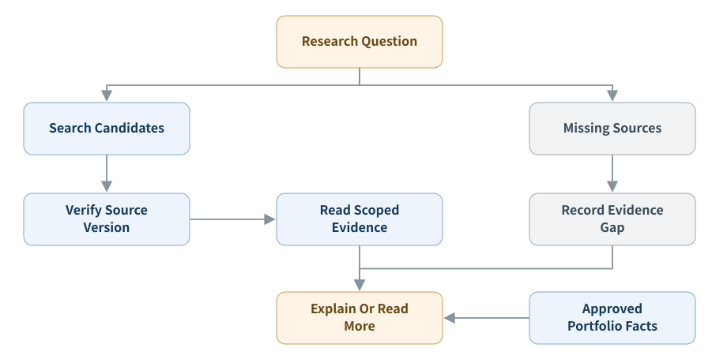
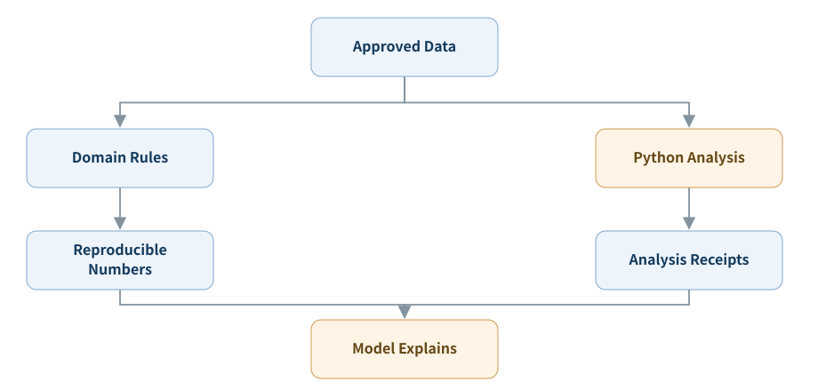
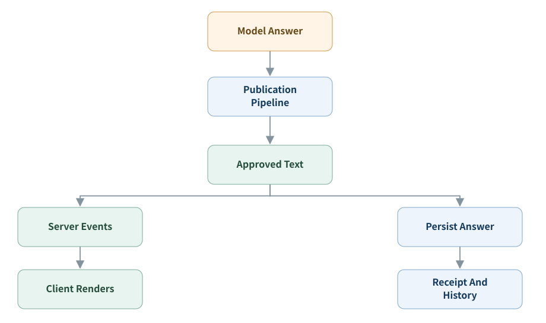
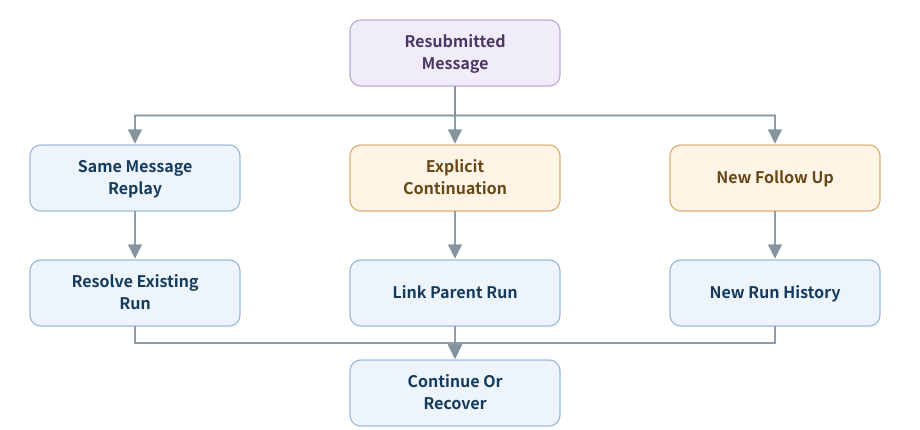

## 控制、观测与验收

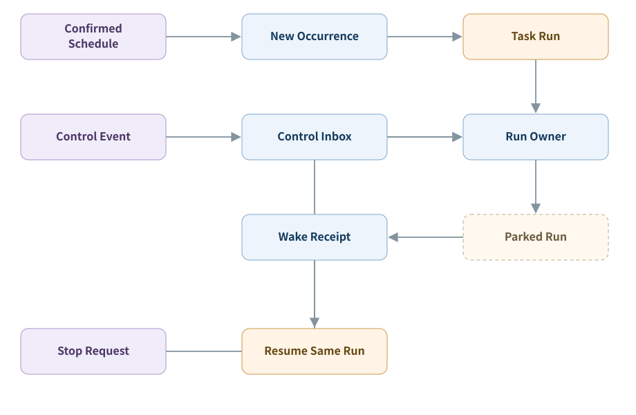
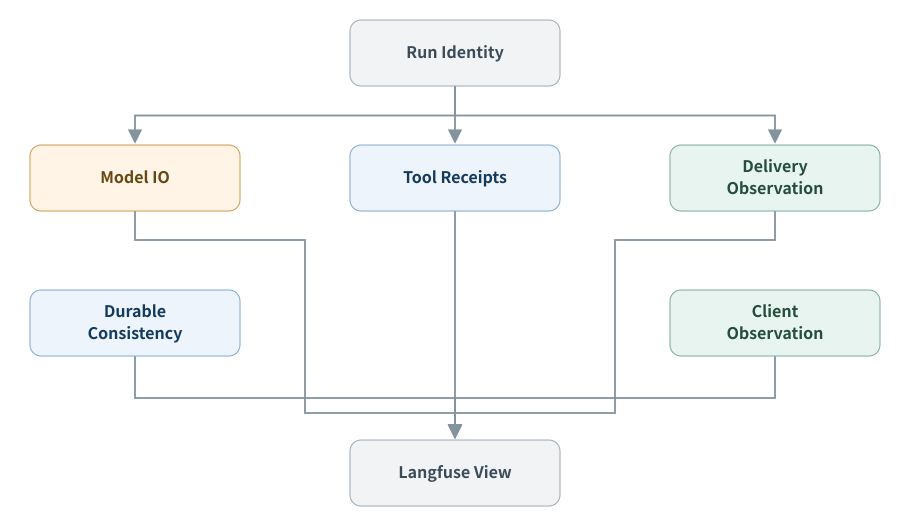
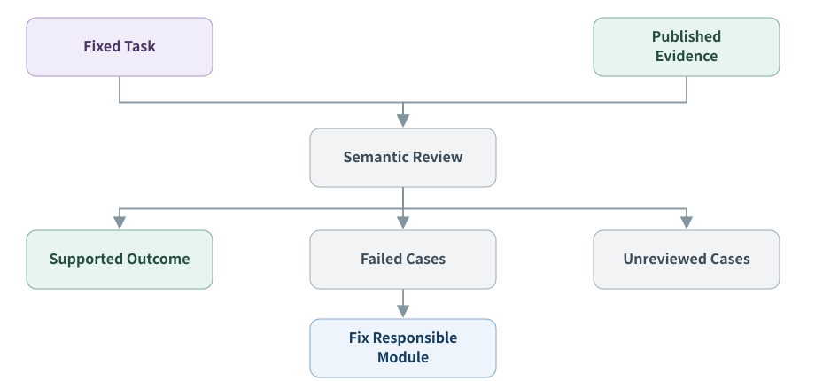

图文版 HTML 的原始文件保留在[公开仓库 visuals](https://github.com/hpoenixf/eff-agent-article/blob/main/visuals/017-prompt-to-answer-six-layer-panorama/index.html)，避免再维护另一份不一致的正文。
