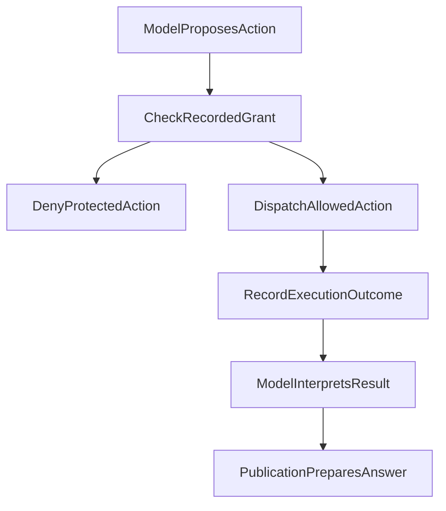

# 011 Models Understand; Code Authorizes

A user says, “That fund looks good; I could buy a little.” The model may understand the user's interest and propose a research direction. The sentence does not establish how much money is in the account, or prove that a trade has happened.

An investment research assistant handles three different activities: interpreting the user, developing an analysis, and producing controlled effects. The model can explain a question, choose research methods and propose actions. The system must use real identity, granted scope and execution records to determine whether a concrete action is allowed and whether it actually occurred.

That is the useful meaning of “build brakes first”: **keep permissions and ledger facts where they can be checked, while letting the model research freely within its granted scope.** It does not require every answer to pass through a fixed checklist, or imply that code can determine whether every sentence is correct.

This article incorporates the ledger and confirmation examples from *Why an Agent Needs Brakes Before Intelligence*, and aligns older statements with the October 2026 Run authorization contract. The teaching scenarios below are not real trading incidents. Research capability also does not establish that a live trading channel has been enabled.

## 1. Interpretation Can Produce a Proposal, Not Permission

An earlier design tried to express intent interpretation, research planning and execution arrangements in one heavyweight Intent v2 object. That proposal was withdrawn. Its fields and fixed workflow are no longer the authorization basis.

The useful question it left behind was how to separate the model's interpretation from actions the system actually permits.

“The user seems to want to buy,” “this material looks public,” and “the model thinks the evidence is sufficient” are interpretations or judgments. They can influence a research route, but cannot replace account identity, resource scope, tool admission or an actual execution receipt. Passing a schema check does not turn a structured field into an authorization mechanism.

The system therefore checks **the concrete action proposed by the model**: which resource it would read, which tool it would call, which account it would affect, and whether it fits the granted scope. Code does not need to classify the user's prose as “safe,” “confirmed” or “investment advice” and then manufacture permission from that label.



Actions outside granted scope are denied before dispatch. An admitted action can still fail during execution, and its receipt must preserve the actual outcome. The model can interpret success or failure; answer delivery has its own records. No stage can announce that a later stage succeeded on its behalf.

## 2. Authorization Follows a Run; Execution Conditions Remain Separate

A Run is one logical research execution. The current contract uses the Host's recorded Run grant as its permission authority: initial admission establishes source and tool scope, and later reads, analysis, publication, suspension and recovery within that Run inherit the grant.

This differs from the old wording that permission should be looked up again on every use. **An existing Run does not revoke an earlier grant because an external permission table changes, or clear previously authorized material during recovery based on a current ACL.** Explicit additional grants can extend scope. A new Run needs its own admission; an old conversation, cache or receipt does not automatically supply permission.

Execution checks still apply. Each action must match its account, scope, Run, tool and source identities, and respect the relevant resource budget, explicit cancellation and execution state. Checking an action against a recorded grant is different from querying current permissions again.

| Changed condition | Required handling |
| --- | --- |
| The same Run resumes after suspension | Restore the original grant and execution records without querying current ACLs again |
| A request targets a resource outside the original grant | Use the existing additional-admission path; a model declaration cannot expand permission |
| A new Run wants material read previously | Obtain that new Run's own grant; past exposure cannot substitute for it |
| A file is missing, content identity differs, or computation fails | Report the availability or execution problem rather than relabeling it as revoked permission |
| Budget is exhausted or the user cancels | The relevant lifecycle rules constrain subsequent effects without inventing success |

Tool registration, model visibility and permission to execute are also distinct. The tool surface can narrow because of phase, admitted capability or resource constraints. Seeing a tool proves neither execution nor success; having no tools available does not automatically prohibit a general explanation. Exposure records describe what the model actually received. They do not grant or shrink permission.

This design makes an explicit tradeoff: stable authorization throughout one research execution and its recovery. New-Run admission remains independent, as do account and scope isolation for the original Run. It is not a mechanism for immediate revocation during an existing Run.

## 3. Missing Information Restricts the Actions That Depend on It

If the user says “look at this” and the available context does not identify an object, the model should explain what is missing and ask. It must not guess a fund and then use real query results to substantiate the guess.

But “clarification needed” does not mean “zero tool calls everywhere.” Authorized material may already identify the object, or the question may require only a general explanation. A missing purchase amount can prevent an amount calculation without preventing access to public product documentation.

Whether to read more, explain first or ask is a task-dependent model judgment. Code checks the resource, identity and arguments of the concrete call. Restrict the affected action while allowing independent research to continue.

Personal holdings and research documents also require distinct permissions. A user denying access to a private portfolio does not automatically prohibit access to already-authorized research material. Permission to read a report does not grant access to accounts, plan confirmation or trade execution. Capability intersection means an action must meet all applicable objective constraints; it does not mean the model maintains an object whose completed fields automatically admit the action.

## 4. Units Times NAV: Analysis Must Not Rewrite the Ledger

One concrete rule from the earlier “brakes” article matters more than a general reliability slogan: **units held are a portfolio fact; a monetary value is derived from those units and the corresponding NAV.**

The following data is a synthetic teaching example:

```json
{
  "holdingTruth": {
    "shares": 1000,
    "currentNav": 1.234,
    "holdingValue": 1234.0,
    "formula": "holdingValue = shares * currentNav"
  },
  "forbidden": "shares != staleAmount / newNav"
}
```

Suppose the account still holds 1,000 units. When a new NAV arrives, the system can recompute the holding value. It must not divide an old monetary value by that new NAV to infer a different unit balance. Distributions, splits or changes in reporting dates can invalidate that reverse calculation. An actual change in units requires its own ledger basis.

Now suppose a cross-border fund's NAV report is delayed. The appropriate response is to preserve known units, record the NAV date and describe valuation limits, rather than make units fluctuate with each daily estimate. Fresh market prices cannot automatically update a month-old account snapshot either.

Freshness, account identity and calculation basis must therefore remain explicit. Missing data may still allow an explanation of the method or a clearly labeled hypothetical scenario. It does not justify presenting assumed amounts as current account facts, or granting investment execution authority from them.

## 5. Confirming a Plan, Instructing Execution and Observing Execution Are Different

“That looks good; I could buy it” might be an evaluation or an invitation to discuss further. Positive wording alone cannot advance an account's execution state.

Even when the user clearly agrees to a plan, **agreement does not mean a trade occurred**. An explicit execution instruction is still only a prerequisite. Whether dispatch was permitted and execution completed requires records from the relevant execution path. A research system cannot substitute its own published prose for those facts.

| Established fact | What may be recorded | What it does not establish |
| --- | --- | --- |
| The model proposes an allocation direction | A proposal for discussion or a hypothetical scenario | Current holdings have changed |
| The user confirms a plan | The user's confirmation of that plan | A trade was submitted or filled |
| The user issues an explicit execution instruction | A request to process under the identity, permission and confirmation contract | Execution will necessarily succeed |
| The execution path obtains an actual receipt | The operation and status established by that receipt | Fills, returns or other effects beyond its evidence |

Unconfirmed suggestions must not alter portfolio estimates. Hypothetical scenarios discussed in conversation must remain separate from account facts. The table explains different facts; it is not a four-label state machine that can execute trades, or proof that the read-only research path discussed here has order-placement capability.

Clarify when necessary, focusing on missing execution conditions. The system should neither trade automatically based on tone nor require trade confirmation merely to inspect ordinary information.

## 6. Source Identity and Citations Do Not Substitute for Answer Quality

In the research loop, the model proposes tool actions, the Host records actual calls and results, the context layer prepares material for the next turn, and Publication accepts ordinary assistant prose and explicitly submitted answers. These handoff records support traceability. They do not establish correct understanding.

Controlled personal numeric bindings can originate only from authorized Portfolio results. An identical number on a webpage, in a user message or in the model's self-assessment does not acquire personal ledger authority. The model can discuss user-provided numbers while retaining that identity; it cannot turn them into Host-verified account fields.

Likewise, source existence, obtaining an exact passage, that passage supporting a claim, and that claim answering the question are different properties. No universal “trusted root” or `sourceVerified=true` can certify all research conclusions.

Missing public citations, malformed references or insufficient attachment capacity are handled locally under the publication contract, preserving independently authorized prose with a source limitation notice. A private source absent from the original Run grant is a real permission issue. Removing its citation marker cannot erase the underlying dependency. **The same Run and its recovery use the original grant; this does not reintroduce permission revocation during the Run.**

For example, when only a search lead has been obtained for a report, the answer can describe that lead or continue reading within granted scope. It must not invent quotations or page numbers. Missing page numbers should not become a blanket reason to reject an entire answer, either. Whether a particular conclusion is supported still depends on the material actually available.

The [Publication article](/articles/019-agent-answer-publication) explains delivery mechanisms, while the [citation reliability article](/articles/ai-citations-do-not-prove-reliability) covers the relationship between claims and sources. This article focuses on their authorization handoff.

## 7. Two PDF Routes Cannot Certify Each Other

The same distinction applies to document reading. Statement import and research PDF reading serve different consumers:

| Route | Principal output | What success does not establish |
| --- | --- | --- |
| Statement import | Units, amounts and records for ledger reconciliation | Research retrieval or page-image understanding is working |
| Research PDF reading | Passages, quotations, tables or page images as research material | Statement units are trustworthy, the account is authorized, or the research conclusion is correct |

In a teaching scenario, every unit in a statement could reconcile without establishing that a separate research report was retrieved correctly. Each route retains its own results and gaps instead of borrowing the other's passing status.

The old article reviewed selected provider-free PDF page-image contracts on October 11, 2026. At that time, the local contract was closed, rendering remained disabled by default, and real visual quality and production enablement still needed separate acceptance. That is a historical evidence window, not a claim that all documents have been verified today. The [PDF article](/en/articles/024-agent-pdf-from-text-to-evidence) covers the reading mechanisms.

## 8. The Judgments Retained After Consolidation

| Question | Judgment used in this article |
| --- | --- |
| Does understanding the user permit execution? | Interpretation produces a proposal; identity, the Run grant and the execution contract govern concrete actions |
| Does missing information stop everything? | Do not fabricate a target as evidence; restrict dependent actions while preserving independent work |
| Does every call query current permissions again? | Check the original Run's granted scope; the same Run and recovery do not repeat current-ACL queries, while a new Run has independent admission |
| Do complete fields and citations prove correctness? | Assess structure, source identity, semantic support and delivery separately |
| Can a confirmed plan be recorded as executed? | Preserve confirmation, instruction and execution receipts separately; hypothetical scenarios do not rewrite account facts |
| Can one document route certify another? | Each retains its own evidence scope; success is not promoted across routes |

This consolidation corrects wording against existing ledger invariants and the current Run authorization and publication contracts, while preserving the original evidence boundaries. It did not rerun production tests or introduce claims about model success rates, cost or investment returns.

The model can keep adapting its research route. The system needs stable records of what it was permitted to do, what it actually did, and which effects have not occurred. Keeping those facts separate makes each operation explainable as capabilities expand.
