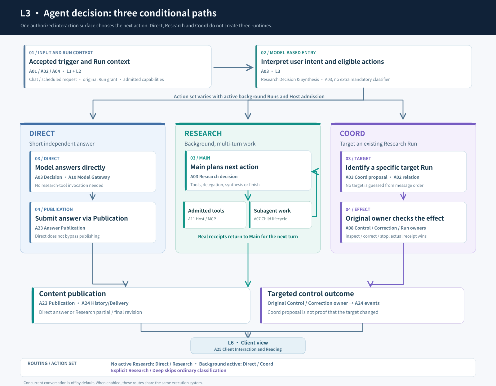
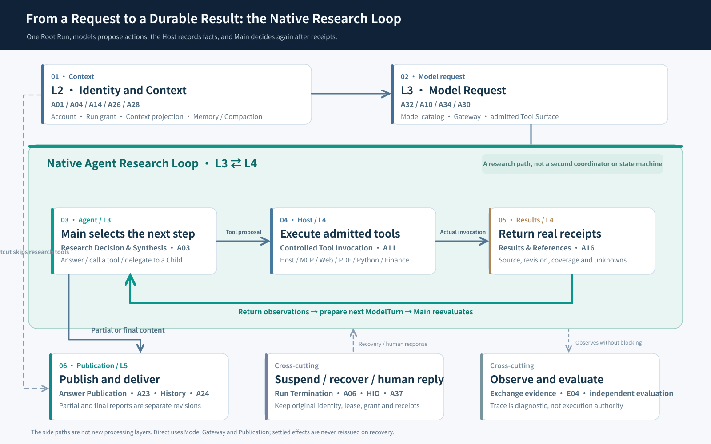

# From a Question to a Visible Answer: ETF Agent's Six-Layer Request Lifecycle · V3

> **Architecture snapshot: October 25, 2026.** This edition reinterprets V2 against the 43 capability owners reviewed on October 24 and the Native Runtime, concurrent conversation and delivery contracts on main. It is a **reader's map of a request**, not six processes, a one-way stack or a new authority hierarchy. Bounded engineering verification, real-model research quality and production enablement are separate facts.
>
> **Earlier editions remain intact:** [V2: continuous collaboration](/en/articles/017-prompt-to-answer-six-layer-panorama) · [V1: original Chinese overview](/articles/017-prompt-to-answer-six-layer-panorama-v1) · [Original illustrated archive](https://hpoenixf.github.io/eff-agent-article/visuals/017-prompt-to-answer-six-layer-panorama/v1.html)

## 1. One user question, six processing concerns

A user asks: “Analyze the industry concentration and currency exposure of my fund portfolio.” The UI appears to do one thing: send, then display an answer. Internally, the system must separately establish **which input or scheduled event initiated work; whose Run and eligible context it belongs to; what the model decides; which tools or effects must execute; which answer revision was accepted and delivered; and what the client actually rendered**.

The earlier six-layer story grouped architectural capabilities. Background Research, Coord, subagents, HIO, model routing and timed delivery made that structure harder to follow, and reduced subagents to an aside in the entry stage. V3 instead follows the familiar story of entering a URL and tracing the result to the browser. Branches and loops are enlarged only where needed.

  <object class="v3-owner-map" type="image/svg+xml" data="/eff-agent-article/visuals/017-prompt-to-answer-six-layer-panorama/diagrams/v3-owner-map-en.svg" role="img" aria-label="ETF Agent six-layer map: 43 clickable capability owners">
    <a href="https://hpoenixf.github.io/eff-agent-article/visuals/017-prompt-to-answer-six-layer-panorama/diagrams/v3-owner-map-en.svg">Open the interactive SVG owner map</a>
  </object>

**Interactive navigation:** Select any solid Owner chip to open its dedicated article, or its Owner detail when no dedicated article exists. Dashed notes are not standalone modules. Scroll horizontally or open the full-size SVG below; the [owner index](#capability-owner-links) offers the same destinations.

[Open the scalable SVG map](../../visuals/017-prompt-to-answer-six-layer-panorama/diagrams/v3-owner-map-en.svg): nine reading groups with 43 distinct Owner tags; research/financial tools and identity/authorization share grouped columns.

The figure contains six horizontal request-processing bands and vertical capability bars. **Each solid chip is a real Owner; its name is primary and its ID is an index. Every dashed workflow note names the Owner(s) it derives from. Dashed column headings are reading groups, not modules.** The labels show actual capability names, not cryptic Owner IDs. Reuse across layers does not duplicate authority.

| Stage | Core question | Hand-off |
| --- | --- | --- |
| **L1 Task Inputs and Triggers** | What starts the Agent's work? | Message, report request, scheduled task or personalized-research trigger |
| **L2 Identity, Conversation and Context** | Whose task is it, is it allowed and what may it see? | Verified subject, stable Run identity, original grant, eligible context and methods |
| **L3 Agent Decision and Runtime** | Direct answer, research or coordinate? | Text, research action or targeted control proposal |
| **L4 Tools and Domain Capabilities** | Who performs external reads, calculations or effects? | Receipts, material, derived results and gaps |
| **L5 Publication and Delivery** | Which revision was accepted, saved and sent? | Publication, SSE/History, notice or artifact |
| **L6 User Interface** | Which Run and revision appeared? | Readable answer, status and follow-up controls |

The input composer and model picker also belong to L6, but L1 accepts more than chat: an already accepted Task occurrence may trigger work without a new chat message. L2 validates its identity, Run and grant. The numbering is an explanatory walkthrough, not a requirement to mint a new Run.

## 2. L1 Task Inputs and Triggers — research need not begin in chat

L1 is **where a unit of Agent work originates**, not an authentication layer. Someone may send a message, explicitly request a weekly or daily report, or have a previously confirmed schedule reach an eligible occurrence. Each enters the same execution system rather than starting a separate scheduler-driven Agent implementation.

| Input or trigger | Supported capability | Hand-off from L1 |
| --- | --- | --- |
| **Chat or explicit Research/Deep request** | Client input and conversation submission | Original message and explicit work intent |
| **On-demand weekly or daily report** | User-triggered report and personalized research | Chosen method, original input, date/context candidates |
| **Scheduled, recurring or qualified conditional task** | Original Schedule / Task owner | Task identity, occurrence and accepted trigger facts |
| **Followed topics** | Saved Follow strings and daily research selection | Explicit topic preferences as eligible context |

A critical distinction: **following a topic does not by itself start unattended monitoring**. The subscription-to-daily-digest MVP is still an implementation plan; it is not an already-enabled push product. Similarly, report generation support is not evidence that every report has an admitted timed trigger.

All inputs converge on the original Task/Conversation, Run, grant, budget, Main/Child and Publication owners. Different triggers must not introduce another execution engine.

## 3. L2 Identity, Conversation and Context — validate the trigger and prepare the Run

**[Account Identity](https://hpoenixf.github.io/eff-agent-article/visuals/owner-architecture/index.html#owner=A01)** validates the actual subject, scope and trustworthy origin of the accepted trigger; a scheduled occurrence retains its confirmed task/account binding rather than bypassing authorization. **[Conversation Admission and Continuation](https://hpoenixf.github.io/eff-agent-article/visuals/owner-architecture/index.html#owner=A02)** then creates or reuses a message and Run. Ordinary follow-up, same-message replay, explicit Continue and an existing background task are four distinct relationships. Conversation identity is not the same thing as one execution's identity.

**[Run Authorization and Capability Admission](/en/articles/011-model-understands-code-authorizes)** binds the originally permitted sources and tools. Account Identity answers *whose task this is*; Run Authorization answers *what this Run may use*. Both have independent Owners in L2, and no input path bypasses them. Same-Run recovery preserves the established grant, rather than asking a newly generated summary to reauthorize facts.

**[Context Projection and Fitting](/en/articles/tool-results-outside-model-context)** assembles the actual model request from admitted history, tool results, provenance and token limits. **[Long-Term Memory](/en/articles/026-agent-memory-forget-durable-effects)** supplies separately governed records and preferences. **[Main Context Compaction](/en/articles/agent-main-run-context-compaction)** selects, summarizes and commits eligible settled historical turns; its summary does not become a new tool receipt. **[Action Reminder Coordination](https://hpoenixf.github.io/eff-agent-article/visuals/owner-architecture/index.html#owner=A15)** offers advice about resource or context pressure, never an extra budget or permission.

**[Skill Methods and Resources](https://hpoenixf.github.io/eff-agent-article/visuals/owner-architecture/index.html#owner=A12)** provide versioned techniques. **[Plugin Admission and Lifecycle](/en/articles/020-agent-extension-host-smartphone)** controls which reviewed extension generations can be loaded; **[Lifecycle Events and Hook Execution](/en/articles/agent-multi-ecosystem-hook-execution)** runs bounded callbacks at the appropriate seam. None of these may independently grant data access or alter business facts.

L2 is revisited before further ModelTurns. Reassembling context is not the same as restarting a Run or minting a new grant.

## 4. L3 Agent Decision and Runtime — choose a branch, then iterate

The model participates in interpretation here. **[Research Decision and Synthesis](/en/articles/adaptive-research-python-workbench)** can propose Direct, Research or Coord, but only from the action set allowed by the current authorized conversation snapshot and effective resource configuration. These are conditional branches, not three universal choices.

[Open the full-size L3 routing diagram](../../visuals/017-prompt-to-answer-six-layer-panorama/diagrams/v3-entry-routing-en.svg)

### 4.1 Direct — still uses a model Gateway, but can skip L4

“What does industry concentration mean?” can be answered directly. **[Model Catalog and Routing Configuration](https://hpoenixf.github.io/eff-agent-article/visuals/owner-architecture/index.html#owner=A32)** identifies valid models, provider mappings and declared capabilities; **[Model Invocation and Request Configuration](/en/articles/agent-provider-architecture-and-admission)** binds and actually sends the model request through its Gateway; **[Provider Capacity Admission](/en/articles/agent-provider-admission-capacity-lease)** handles shared supply limits. **[Run Resource Management](/en/articles/agent-runtime-constraint-governance-v2)** accounts for the separate Run budget.

A model selected in the UI does not determine the provider URL or grant an extra tool. Deep approval is a Run resource effect, not a model switch. Requested reasoning effort belongs to an individual model invocation; it does not prove how the provider internally reasoned. Direct can skip Web/PDF/Python or investment tools, **but still uses the proper Publication owner**.

### 4.2 Research — Main and subagents jointly do the work

For source-grounded portfolio analysis, Main selects another read, computation, comparison, delegation or synthesis after observing real prior results. The existing Native Loop retains the AgentTurn → ActionRuntime → CompletionGate semantics. A new generic Supervisor, Coordinator or Graph runtime would merely recreate orchestration that the project deliberately retired.

**[Child Execution Lifecycle](/en/articles/agent-subagent-context-specialization)** is a central execution capability: bounded Child identity, model requests, status, retry, cancellation, result binding and handoff. Web, PDF, Python and expert-perspective children can share that mechanism. Main decides whether to delegate and ultimately synthesizes user-facing content; a Child does not own a second Root budget, investment ledger or public publication right.

A Child reading an original report and Main reading only that Child's summary are different evidence-consumption facts. The handoff must preserve actual source and result identities, including gaps and partial results, rather than silently promoting the summary to verified primary evidence.

**Zoom in: why Research is a loop, not a one-way six-stage pipeline**

[Open the full-size loop illustration](../../visuals/017-prompt-to-answer-six-layer-panorama/diagrams/v3-native-loop-en.svg)

The central loop is **Main chooses an action → Host executes → real receipts/results are returned → Main chooses again**. Main may delegate a bounded task to a Child; the Child submits local results and source references, while Main decides whether to investigate further or synthesize. **One iteration is not the same as a completed Run.** Valid partial text may already pass through Publication while Research is still running.

The three lower paths are not sequential phases: **Publication** owns content revisions, **Recovery/HIO** manages safe suspension and continuation under the original identity, and **observation/evaluation** explains failures from independent evidence. These concerns cannot grant each other authority merely because they touch the same Run. Direct still uses the model Gateway and Publication; it only skips research tools.

This preserves V2's central Native Loop insight but names the Context, Agent, Tool, Result, Publication and recovery handoffs according to the revised six-stage view.

### 4.2.1 Why research continues, changes course, waits, or finishes

The diagram shows **one model turn, action, and observation**. The same architecture can also be read at three time scales. These are explanatory perspectives, **not three nested schedulers**.

| Time scale | Who chooses the next step? | What must remain distinct? |
| --- | --- | --- |
| **Within a turn: observation-driven work** | Main reads a settled Host result and decides to search again, compute, delegate to a Child, or answer | A successful tool call is not a completed research question |
| **Within a Run: research judgment** | Main may revise or reopen working questions after contradictory evidence | `researchNeeds` are model-authored working notes, not certified evidence coverage or a completion/publication gate |
| **Across time: durable continuation** | Existing Recovery, Control and HIO owners park, wake and correct under the original identity; explicit Continue starts a linked Run after termination | Previous receipts, grants, budgets and committed text are not newly authorized facts |

Suppose a user asks whether a fund's sector concentration has changed. An article **reposted today** may summarize holdings whose data cutoff was months earlier. Main must distinguish the reposting date, original disclosure date and underlying `as-of` date. It may consult the original disclosure, qualify the historical data, or explicitly say the change is unknown; it should not label an old portfolio snapshot as current holdings. The existing [A36 temporal-semantics owner](/en/articles/agent-temporal-semantics-market-calendar) supplies a separate time contract, but normal end-to-end research acceptance is still open. This example illustrates a desired judgment, not proven automatic financial accuracy.

Finishing also involves distinct decisions: **Main** judges what to investigate and how to explain remaining uncertainty; **CompletionGate and Publication** own legal termination, resource limits, partial content and actual delivery. A terminal Run does not certify the financial conclusion, and a `resolved` working item does not certify task completion. Children, reviewers and peer perspectives remain optional collaboration, not mandatory outer loops.

For a full mechanism-level walkthrough and the remaining acceptance gaps, see [A Research Agent Needs More Than Tools: Model, Harness, and Loop](/en/articles/etf-agent-model-harness-research-loop).

### 4.3 Coord — targeted control, not a third Agent engine

If Research A is already running and the user says “Add currency risk to that analysis,” a new short interaction may propose Coord. It must bind an authorized target Run and an inspect/correct/stop proposal. **[Durable Control Events](/en/articles/agent-control-events-durable-owner-adoption)**, the original Correction/Continue/Termination owners and their receipts still decide what actually happened. Ambiguous targets trigger clarification, not a guess at the last Run.

In the initially qualified concurrency setup, ordinary Entry offers **Direct/Research without an active background Research**, and **Direct/Coord with one active background Research**. This is the authorized action set, not a global hasBackground classifier. Explicit Research/Deep may bypass ordinary route classification but must still pass background, scope, provider and resource admission.

Coord consumes a short-interaction allowance and may also publish an independent answer. Accepting its message is not evidence that A has incorporated a correction. The real target owner must record the effect.

## 5. L4 Tools and Domain Capabilities — from proposed call to receipt

A model's “I'll look that up” is only a proposal. **[Model Capability Presentation and Tool Surface](/en/articles/agent-model-capability-presentation-tool-surface)** checks what tools the model actually sees against the admitted execution surface. **[Controlled Tool Invocation](/en/articles/agent-tool-lifecycle-and-model-input)** validates arguments, dispatches the action and settles an observed receipt. **[MCP Service Connectivity](/en/articles/mcp-host-from-discovery-to-consumption)** owns discovery, connection and protocol transport. Neither protocol discovery nor tool visibility grants new permission.

**[Web Research Reading](/articles/021-agent-web-research-from-search-to-deep-reading)**, **[PDF Reading](/en/articles/024-agent-pdf-from-text-to-evidence)**, **[Knowledge Retrieval](https://hpoenixf.github.io/eff-agent-article/visuals/owner-architecture/index.html#owner=A20)**, **[Research Material Assets](https://hpoenixf.github.io/eff-agent-article/visuals/owner-architecture/index.html#owner=A17)** and **[Isolated Analysis](/en/articles/agent-python-compute-workbench-evolution)** can be assembled as needed. The five B-class financial capabilities are folded into one **Financial Tools** family for the diagram: market evidence, authorized investment facts, deterministic calculation, ledger/confirmation and atomic reporting. **[Temporal Semantics and Market Sessions](/en/articles/agent-temporal-semantics-market-calendar)** and **[Exact Numeric Operations](https://hpoenixf.github.io/eff-agent-article/visuals/owner-architecture/index.html#owner=A33)** are other opt-in tools.

Evidence and computation are not a universal fourth stage through which every answer must pass. These are optional capabilities of L4. Research can call them repeatedly; a simple Direct answer can omit them entirely.

Two facts must remain distinct even in the simplified diagram. **[Research Results and References](/en/articles/tool-results-outside-model-context)** preserves ResultRef identity, derivation and source lineage across model turns and publication. **[Investment Ledger and Confirmation](https://hpoenixf.github.io/eff-agent-article/visuals/owner-architecture/index.html#owner=B04)** protects real financial changes: model advice cannot replace applicable user confirmation and business authorization.

### 5.1 Four handoffs that are easy to confuse

A research failure often starts when success at one seam is mistaken for success at another. Consider a fund-document task:

| Handoff | What is actually established | What remains unproven | Primary responsible capability |
| --- | --- | --- | --- |
| **Model → Gateway** | A request returned text or a proposed tool call; completeness is checked against the actual protocol | Half-returned tool arguments are executable, or the provider used the requested internal reasoning effort | Model Invocation and Request Configuration |
| **Tool discovery → Host** | MCP discovered and described a tool; Host still checks current arguments and Run Grant | Discovery alone granted this user permission to invoke it | MCP Connectivity, Controlled Tool Invocation, Run Authorization |
| **Search hit → Source reading** | RAG found an attributed candidate excerpt or PDF reader located a page | The entire report and all conditions or missing pages have been checked | Knowledge Retrieval, Research Assets, PDF Reading |
| **Tool receipt → Next model turn** | Python or a remote tool returned an identified, versioned result with provenance | Execution proves financial methodology is suitable, or a Child summary equals Main reading the original source | Research Results and References, Context Projection |

A further extension constraint matters: **a post-tool Hook may narrow what the model sees, but must not silently replace surviving numbers, provenance or their original paths with fabricated facts**. A local Hook rejection does not own termination of the entire Run.

When date, coverage or financial methodology is insufficient, Partial or Unknown may be the accurate result. The model interprets gaps, deterministic financial computation owns domain formulae, and Numeric performs only explicitly contracted arithmetic. None automatically certifies the other.

## 6. L5 Publication and Delivery — generating is not committing

**[Answer Publication and Preparation](/articles/019-agent-answer-publication)** owns answer previews, revised content, accepted commits and their receipts. Direct, partial Research publications and final reports share this rule. **[Private Artifact Storage and Sharing](/en/articles/agent-html-evolution-challenges)** owns separately authorized downloadable file bytes and revisions. **[Conversation Events and Historical Delivery](/en/articles/agent-asynchronous-research-time-bound-delivery)** owns ordered SSE events, replay and background notifications.

Model text, accepted preview, committed body, server delivery event and browser rendering are five distinguishable facts. A well-written candidate is not evidence of user-visible delivery; failure of a later tool does not erase an independently committed earlier answer.

Background Research can continue while foreground messages are answered, publish partial results and deliver a final report later. Time promises such as at/by, research completion and actual notification are separate records. Sending a notice must not rerun research or mint a second report identity.

### 6.1 “Continue” can mean three different things

| User-visible situation | Correct system behavior | What must not be substituted |
| --- | --- | --- |
| **Research is still running in the background** | The original Run continues and may publish partial or final text; a new short question gets its own Run | Automatically cancel earlier Research or reuse one global `busy` flag |
| **A Run is safely parked for a real dependency** | The original Control/Recovery path claims a valid wake under its fence, retaining budget, grant and settled receipts | Redispatch completed tools or refresh the deadline for more budget |
| **The original Run is terminal and the user explicitly continues** | Conversation/Continue prepares a related new Run with lawfully inherited context and authorization | Pretend the new study was always the same still-running Run |

This is also why **Run termination, committed text, notification and browser rendering** are four different facts. Observability must use the corresponding real receipts, not one `completed` value or the last Trace span.

## 7. L6 User Interface — show the right Run and the right revision

**[Client Interaction and Reading](https://hpoenixf.github.io/eff-agent-article/visuals/owner-architecture/index.html#owner=A25)** owns the composer, timeline, citations, cards, background research panel and ordered event/History consumption. A single global busy boolean or the last message in an array cannot explain concurrent Runs.

Research A may remain active while Direct B completes first. B's answer must not overwrite A's publications, and History refresh must reconcile per Run and Publication revision. A displayed answer-preview is not yet a durable commit; server-sent content does not itself prove browser rendering or user reading. L5 owns the legitimate publication; L6 owns client presentation.

## 8. Three messages, three routes

First the user explicitly requests a background source-backed portfolio study. L1 receives the input; L2 authenticates and admits Research A, recording its grant and task identity. L3 Main plans and may delegate PDF reading or Python transformations. L4 returns actual tool and source receipts. L5 publishes a partial and later a final result, shown under A's panel by L6.

Next the user asks “Why does sector concentration matter?” Short interaction B can produce a Direct response without waiting for A or inventing access to A's private, unreleased work. It publishes under B's own identity.

Then the user says “Add FX exposure to A.” Short interaction C proposes Coord. Once the original target owner has accepted the correction, A adopts it at a lawful safe point under its original identity and resource constraints. If A has already terminated, C cannot pretend the old Run changed; the user may explicitly Continue with a related new Run.

This experience has scoped engineering evidence, but **concurrent-conversation mode is disabled by default in production configuration**. Initial short/background concurrency is configured at 3/1 and is also subject to aggregate scope and Provider capacity. Multi-target data structures do not certify production multi-background execution.

## 9. Vertical capability bars may span stages, or break

The horizontal view says *when a concern occurs*; Owner identity says *who owns the underlying fact or effect*. An Owner may legitimately participate in several stages. No diagram cell grants another stage the right to rewrite its facts.

**Account Identity** and **Run Authorization** are primarily L2 capabilities. Run Authorization begins there and is consumed when L4 tools and L5 protected publications need it. **Long-Term Memory**, **Context Projection** and **Main Compaction** mainly sit in L2, but may contribute to later L3 model requests. **Model Catalog** and **Gateway** primarily support L3, even though the user chooses a model via L6.

**Child Execution Lifecycle** spans L3 collaboration and L4 tool use. **Research Results and References** connect tool results to L5 delivery. **Publication and Delivery** mostly live in L5 and feed L6. Continuous or interrupted vertical bands visualize these touch points rather than imposing a new call sequence.

## 10. Recovery, governance and observation are cross-cutting—not more numbered layers

**Recovery** owns durable continuation, sealed ModelTurns, committed receipts and lease/fence facts used by the Native execution lifecycle. Resuming after process loss must preserve original identity and avoid reissuing settled tools and publications. Run control, resource management, authorization, Child execution, Publication and History keep distinct ownership; no new all-purpose Recovery Manager is proposed.

**Run Authorization**, **Run Budget**, **Provider Capacity**, **Content Trust** and **HIO** supply constraints and interactions where required. HIO has completed scoped local Stage A–D provider-free verification, but production Human Park remains disabled by default. The fact that the model asked, the user replied and a protected business effect was actually accepted must not collapse into one status.

**[Research Exchange Evidence Capture](https://hpoenixf.github.io/eff-agent-article/visuals/owner-architecture/index.html#owner=E04)**, Langfuse tracing and independent evaluation provide observation and feedback, not authority to publish, terminate or approve investment effects. A successful request, correct tool invocation, persisted publication and grounded financial conclusion have different evidentiary requirements.

## 11. What this diagram explains—and what it does not

V3 tells a reader how a question reaches the UI, why Direct may bypass research tools, why Main and subagents are central, and where model selection, Gateway, memory, compaction, authorization, tools, delivery and rendering sit. Background work can outlast an immediate foreground answer without introducing another pipeline.

The illustration is **not** the full call graph, deployment topology, authoritative owner map or a live-quality report. Related modules are grouped into readable vertical families and B-class financial owners are presented as one Financial Tools family. Their distinct contracts still live in the original Owner registry.

V1 and V2 remain available as historical snapshots of real design evolution. **V3 changes the reading model, not execution authority: six request-processing stages, a repeating Agent/tool loop, conditionally admitted Direct/Research/Coord branches and reusable capabilities across stages.**

---

## Appendix: the 43 capability owners by primary stage {#capability-owner-links}

The original capability Owner registry is authoritative for effects and facts. This appendix assigns each to one primary stage for orientation, and shows other stages it touches without inventing parent authority.

### L1 · Task Inputs and Triggers

| ID | Capability owner | Other stages |
| --- | --- | --- |
| A09 | [Scheduled Tasks](/en/articles/agent-autonomous-scheduled-research) · [Owner details](https://hpoenixf.github.io/eff-agent-article/visuals/owner-architecture/index.html#owner=A09) | L2, L3, L5 |
| A27 | [Daily Personalized Research](https://hpoenixf.github.io/eff-agent-article/visuals/owner-architecture/index.html#owner=A27) | L2, L3, L5 |

### L2 · Identity, Conversation and Context

| ID | Capability owner | Other stages |
| --- | --- | --- |
| A01 | [Account Identity](https://hpoenixf.github.io/eff-agent-article/visuals/owner-architecture/index.html#owner=A01) · [Related reading](/en/articles/011-model-understands-code-authorizes) | L1, L4 |
| A02 | [Conversation Admission and Continuation](https://hpoenixf.github.io/eff-agent-article/visuals/owner-architecture/index.html#owner=A02) · [Related reading](/en/articles/agent-veto-authority-and-run-termination) | L1, L5, L6 |
| A04 | [Run Authorization and Capability Admission](/en/articles/011-model-understands-code-authorizes) · [Owner details](https://hpoenixf.github.io/eff-agent-article/visuals/owner-architecture/index.html#owner=A04) | L1, L3, L4, L5 |
| A08 | [Durable Control Events](/en/articles/agent-control-events-durable-owner-adoption) · [Owner details](https://hpoenixf.github.io/eff-agent-article/visuals/owner-architecture/index.html#owner=A08) | L3, L5 |
| A12 | [Skill Methods and Resources](https://hpoenixf.github.io/eff-agent-article/visuals/owner-architecture/index.html#owner=A12) · [Related reading](/en/articles/agent-model-runtime-mcp-skill-boundaries) | L3, L4 |
| A13 | [Plugin Admission and Lifecycle](/en/articles/020-agent-extension-host-smartphone) · [Owner details](https://hpoenixf.github.io/eff-agent-article/visuals/owner-architecture/index.html#owner=A13) | L3, L4 |
| A14 | [Context Projection and Fitting](/en/articles/tool-results-outside-model-context) · [Owner details](https://hpoenixf.github.io/eff-agent-article/visuals/owner-architecture/index.html#owner=A14) | L3 |
| A15 | [Action Reminder Coordination](https://hpoenixf.github.io/eff-agent-article/visuals/owner-architecture/index.html#owner=A15) · [Related reading](/en/articles/agent-subagent-context-specialization) | L3 |
| A26 | [Long-Term Memory](/en/articles/026-agent-memory-forget-durable-effects) · [Owner details](https://hpoenixf.github.io/eff-agent-article/visuals/owner-architecture/index.html#owner=A26) | L3, L4 |
| A28 | [Main Context Compaction](/en/articles/agent-main-run-context-compaction) · [Owner details](https://hpoenixf.github.io/eff-agent-article/visuals/owner-architecture/index.html#owner=A28) | L3 |
| A35 | [Content Trust and Security Policy](/en/articles/agent-content-trust-prompt-injection) · [Owner details](https://hpoenixf.github.io/eff-agent-article/visuals/owner-architecture/index.html#owner=A35) | L3, L4 |
| A37 | [Durable Human Interaction (HIO)](/en/articles/agent-durable-human-interaction-response-adoption) · [Owner details](https://hpoenixf.github.io/eff-agent-article/visuals/owner-architecture/index.html#owner=A37) | L3, L5, L6 |

### L3 · Agent Decision and Runtime

| ID | Capability owner | Other stages |
| --- | --- | --- |
| A03 | [Research Decision and Synthesis](/en/articles/adaptive-research-python-workbench) · [Owner details](https://hpoenixf.github.io/eff-agent-article/visuals/owner-architecture/index.html#owner=A03) | L2, L4, L5 |
| A05 | [Run Resource Management (Deep)](/en/articles/agent-runtime-constraint-governance-v2) · [Owner details](https://hpoenixf.github.io/eff-agent-article/visuals/owner-architecture/index.html#owner=A05) | L2, L4, L5 |
| A06 | [Run Continuation and Termination](/en/articles/agent-veto-authority-and-run-termination) · [Owner details](https://hpoenixf.github.io/eff-agent-article/visuals/owner-architecture/index.html#owner=A06) | L2, L5 |
| A07 | [Child Execution Lifecycle](/en/articles/agent-subagent-context-specialization) · [Owner details](https://hpoenixf.github.io/eff-agent-article/visuals/owner-architecture/index.html#owner=A07) | L2, L4 |
| A10 | [Model Invocation and Request Configuration](/en/articles/agent-provider-architecture-and-admission) · [Owner details](https://hpoenixf.github.io/eff-agent-article/visuals/owner-architecture/index.html#owner=A10) | L2 |
| A29 | [Lifecycle Events and Hook Execution](/en/articles/agent-multi-ecosystem-hook-execution) · [Owner details](https://hpoenixf.github.io/eff-agent-article/visuals/owner-architecture/index.html#owner=A29) | L2, L4 |
| A30 | [Provider Capacity Admission](/en/articles/agent-provider-admission-capacity-lease) · [Owner details](https://hpoenixf.github.io/eff-agent-article/visuals/owner-architecture/index.html#owner=A30) | L2 |
| A32 | [Model Catalog and Routing Configuration](https://hpoenixf.github.io/eff-agent-article/visuals/owner-architecture/index.html#owner=A32) · [Related reading](/en/articles/agent-provider-architecture-and-admission) | L1, L2 |
| A34 | [Model Capability Presentation and Tool Surface](/en/articles/agent-model-capability-presentation-tool-surface) · [Owner details](https://hpoenixf.github.io/eff-agent-article/visuals/owner-architecture/index.html#owner=A34) | L2, L4 |
| E04 | [Research Exchange Evidence Capture and Readback](https://hpoenixf.github.io/eff-agent-article/visuals/owner-architecture/index.html#owner=E04) · [Related reading](/en/articles/agent-tool-lifecycle-and-model-input) | L4, L5 |

### L4 · Tools and Domain Capabilities

| ID | Capability owner | Other stages |
| --- | --- | --- |
| A11 | [Controlled Tool Invocation](/en/articles/agent-tool-lifecycle-and-model-input) · [Owner details](https://hpoenixf.github.io/eff-agent-article/visuals/owner-architecture/index.html#owner=A11) | L2, L3 |
| A16 | [Research Results and References](/en/articles/tool-results-outside-model-context) · [Owner details](https://hpoenixf.github.io/eff-agent-article/visuals/owner-architecture/index.html#owner=A16) | L3, L5 |
| A17 | [Research Material Assets](https://hpoenixf.github.io/eff-agent-article/visuals/owner-architecture/index.html#owner=A17) · [Related reading](/en/articles/024-agent-pdf-from-text-to-evidence) | L2 |
| A18 | [Web Research Reading](/articles/021-agent-web-research-from-search-to-deep-reading) (Chinese original) · [Owner details](https://hpoenixf.github.io/eff-agent-article/visuals/owner-architecture/index.html#owner=A18) | L3 |
| A19 | [PDF Reading](/en/articles/024-agent-pdf-from-text-to-evidence) · [Owner details](https://hpoenixf.github.io/eff-agent-article/visuals/owner-architecture/index.html#owner=A19) | L3 |
| A20 | [Knowledge Retrieval](https://hpoenixf.github.io/eff-agent-article/visuals/owner-architecture/index.html#owner=A20) · [Related reading](/en/articles/027-rag-revocation-publish-replay) | L3 |
| A21 | [Isolated Analysis](/en/articles/agent-python-compute-workbench-evolution) · [Owner details](https://hpoenixf.github.io/eff-agent-article/visuals/owner-architecture/index.html#owner=A21) | L3, L5 |
| A31 | [MCP Service Connectivity](/en/articles/mcp-host-from-discovery-to-consumption) · [Owner details](https://hpoenixf.github.io/eff-agent-article/visuals/owner-architecture/index.html#owner=A31) | L2, L3 |
| A33 | [Exact Numeric Operations](https://hpoenixf.github.io/eff-agent-article/visuals/owner-architecture/index.html#owner=A33) · [Related reading](/en/articles/031-fintech-data-time-and-reproducible-numbers) | L3 |
| A36 | [Temporal Semantics and Market Sessions](/en/articles/agent-temporal-semantics-market-calendar) · [Owner details](https://hpoenixf.github.io/eff-agent-article/visuals/owner-architecture/index.html#owner=A36) | L2, L3 |
| B01 | [Market Evidence Collection](/en/articles/mcp-market-responsibility-retrospective) · [Owner details](https://hpoenixf.github.io/eff-agent-article/visuals/owner-architecture/index.html#owner=B01) | L3 |
| B02 | [Investment Fact Reading](/articles/portfolio-mcp-readonly-investment-data) (Chinese original) · [Owner details](https://hpoenixf.github.io/eff-agent-article/visuals/owner-architecture/index.html#owner=B02) | L3 |
| B03 | [Deterministic Investment Calculations](https://hpoenixf.github.io/eff-agent-article/visuals/owner-architecture/index.html#owner=B03) · [Related reading](/en/articles/031-fintech-data-time-and-reproducible-numbers) | L3 |
| B04 | [Investment Ledger and Confirmation](https://hpoenixf.github.io/eff-agent-article/visuals/owner-architecture/index.html#owner=B04) · [Related reading](/en/articles/030-fintech-from-research-to-investment-advice) | L6 |
| B05 | [Atomic Report Production](https://hpoenixf.github.io/eff-agent-article/visuals/owner-architecture/index.html#owner=B05) · [Related reading](/articles/portfolio-mcp-readonly-investment-data) (Chinese original) | L3, L5 |

### L5 · Publication and Delivery

| ID | Capability owner | Other stages |
| --- | --- | --- |
| A22 | [Private Artifact Storage and Sharing](/en/articles/agent-html-evolution-challenges) · [Owner details](https://hpoenixf.github.io/eff-agent-article/visuals/owner-architecture/index.html#owner=A22) | L4, L6 |
| A23 | [Answer Publication and Preparation](/articles/019-agent-answer-publication) (Chinese original) · [Owner details](https://hpoenixf.github.io/eff-agent-article/visuals/owner-architecture/index.html#owner=A23) | L3, L4, L6 |
| A24 | [Conversation Events and Historical Delivery](/en/articles/agent-asynchronous-research-time-bound-delivery) · [Owner details](https://hpoenixf.github.io/eff-agent-article/visuals/owner-architecture/index.html#owner=A24) | L2, L6 |

### L6 · User Interface

| ID | Capability owner | Other stages |
| --- | --- | --- |
| A25 | [Client Interaction and Reading](https://hpoenixf.github.io/eff-agent-article/visuals/owner-architecture/index.html#owner=A25) · [Related reading](/en/articles/agent-progressive-answer-coherence) | L1, L2, L5 |

Engineering navigation E01–E03 is not counted among these 43 production-capability owners. Each owner's specification and verification evidence remain the source for implementation, scoped testing and production availability.

**Two judgments run across all six stages:** [Model judgment must not replace recorded execution authority](/en/principles#principle-1), and [the user's actually delivered result is the measure of completion](/en/principles#principle-8). Generated text, committed answer content and what the client can read require separate checks; a stage cannot certify the whole task by succeeding locally.

[V2 architecture](https://hpoenixf.github.io/eff-agent-article/en/articles/017-prompt-to-answer-six-layer-panorama) · [V1 original Chinese edition](https://hpoenixf.github.io/eff-agent-article/articles/017-prompt-to-answer-six-layer-panorama-v1) · [Owner gallery](/en/gallery) · [GitHub engineering library](https://github.com/hpoenixf/eff-agent-article)
