# From a Portfolio Question to Continuous Collaboration: ETF Agent’s Six-Layer Architecture · V2

<section class="flagship-hero" aria-label="Six-layer architecture field guide">
  

    
ARCHITECTURE FIELD GUIDE · ESSENTIAL READ 01

    
Understand how an Agent researches, acts, delivers and continues collaborating.

    
Not six isolated pipelines: one Native Agent Loop supported by clearly owned capabilities. Start with the system picture, follow the actual handoffs, and then study the principles.

    

      <a href="#native-agent-loop">Explore the research loop ↓</a>
      <a href="#six-layer-map">Jump to a layer ↓</a>
      <a href="/eff-agent-article/en/principles">Explore architecture principles ↗</a>
    

  

  

    
<strong>6</strong>system perspectives

    
<strong>40+</strong>capability owners

    
<strong>26</strong>core handoffs

  

</section>

> **Architecture snapshot: October 24, 2026.** A self-contained explanation of six architectural layers, more than forty capability owners and twenty-six core responsibility handoffs. It incorporates concurrent research, accurate tool presentation, evidence, computation, durable human interaction and recovery.

[Essay catalogue](/en/catalog) · [Capability architecture gallery](/en/gallery) · [Background research experience](/en/articles/agent-background-research-collaborative-experience)

Consider a **synthetic** request: “Which industries dominate my funds, and how much do their holdings overlap? Use fund documents, and identify the evidence you could not obtain.” To the user, it is a sentence. To the system, the sentence starts a chain of authenticated work, model input, tool actions, evidence consumption, calculation, publication, and later questions. A correct answer depends less on the number of features than on whether each responsibility hands off the right facts.

No owner is automatically a new process. The conversational application manages research and conversation. A read-only investment data facade provides authoritative data and deterministic calculations; monitoring collects bounded observations. The Agent’s own database does not become a replacement portfolio ledger.

<figure class="article-architecture-figure v2-overview-figure">
  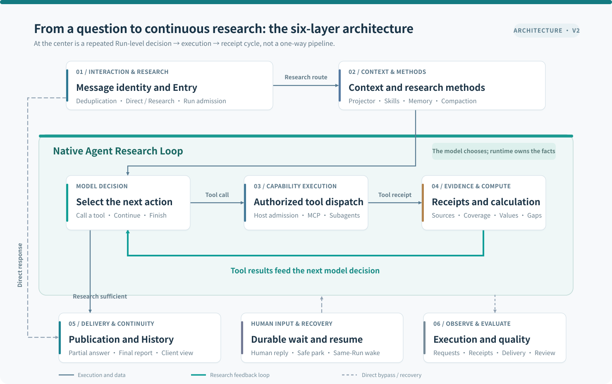
  <figcaption>Figure 1 · Six architectural layers around the Native Agent Loop: decide → execute → consume evidence → decide again.</figcaption>
</figure>

The highlighted return arrow is the **Native Agent Loop**: the model decides the next action, the Host executes it, and source-backed tool results return for another model decision. Only a sufficiently researched answer exits to Publication. A Direct response bypasses the research loop but uses the same publication system. Human waiting, recovery and observation support the Run without replacing this loop.

| Layer | Main question | What it explains |
| --- | --- | --- |
| 1. Interaction | Which message and Run should proceed? | Identity, Entry, Native Loop, resources and Child |
| 2. Context | What does the model actually receive? | Projection, Skills, Memory and compaction |
| 3. Execution | Does a proposed tool have permission to run? | Gateway, MCP, Host and Hooks |
| 4. Evidence | What do data and calculations support? | Retrieval, documents, arithmetic and Python |
| 5. Continuity | What did the user receive and what resumes? | Publication, Control, HIL, Recovery and History |
| 6. Evaluation | What happened, and was it useful? | Tracing, replay and quality review |

## Six-layer reading map: explore the handoffs

You do not need to memorize all forty-plus owners. Read each layer in order, or jump straight to the [Native research loop](#handoff-03), [parallel foreground/background Runs](#parallel-runs), [financial calculations](#handoff-15), or [durable human interaction](#hil-loop).

<section class="architecture-layer-index" aria-label="Jump to one of the six architecture layers">
  <a href="#layer-1">01 / SYSTEM LAYER<strong>Interaction & research</strong><small>Message identity and native execution</small></a>
  <a href="#layer-2">02 / SYSTEM LAYER<strong>Context & methods</strong><small>What the model actually receives</small></a>
  <a href="#layer-3">03 / SYSTEM LAYER<strong>Capability execution</strong><small>How tools are authorized and dispatched</small></a>
  <a href="#layer-4">04 / SYSTEM LAYER<strong>Evidence & computation</strong><small>What is sourced, complete and reproducible</small></a>
  <a href="#layer-5">05 / SYSTEM LAYER<strong>Delivery & continuity</strong><small>Publication, recovery and human interaction</small></a>
  <a href="#layer-6">06 / SYSTEM LAYER<strong>Observation & evaluation</strong><small>Trace actual outcomes and investigate errors</small></a>
</section>

## Capability owners: how more than forty modules contribute

The public owner gallery currently recognizes **41 capability owners**. The durable Human Interaction Owner is an evolving design and implementation seam, so “more than forty” is a practical label, not an eternal inventory. **Six layers are an explanatory map, not six services. Twenty-six numbered topics are a reading route, not the module count.** Peripheral capabilities still belong to the system but need not crowd every paragraph.

| Reading group | Independent capability owners | Responsibility for effects |
| --- | --- | --- |
| Admission and research | Identity, Conversation, research decisions, Run grants | Actor, messages, scopes and research semantics |
| Execution and resources | Run resources and Deep, Child, termination, Provider admission and tools | Request usage, leases, execution and finish state |
| Model selection | Model catalogue and request configuration | Permitted model routes and selected reasoning options |
| Methods and extensions | Skills, plugins, MCP connection and Hooks | Guidance, package generations and execution callbacks |
| Context | Projector, Main compaction and action reminders | Actual model input, committed summaries and reminders |
| Research materials | Result references, assets, Web, PDF, retrieval and Python | Sources, versions, read coverage and analysis |
| Control and delivery | Durable Control, scheduled tasks, Artifact, Publication, History and client | Commands, occurrences, storage and rendered output |
| Memory and observation | Long-term Memory, daily research and trajectories | Personal context and execution records |
| Human interaction | HIO plus original Correction, Recovery and Continue | Durable question/reply routing without copying grants |

## Layer one: conversation identity and research control

Users can retry a send, ask a small question, correct a long analysis or stop a background run. These actions cannot all be inferred from the most recent visible message.

**Figure 2 · Message identity: replay, new Run or conflict**

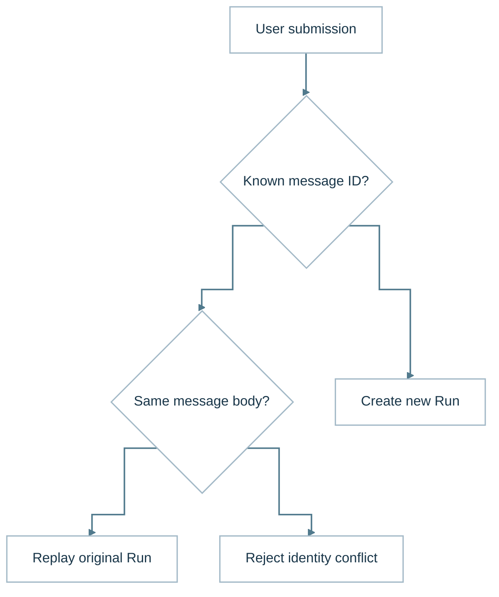

**Figure 3 · Entry and native research loop**

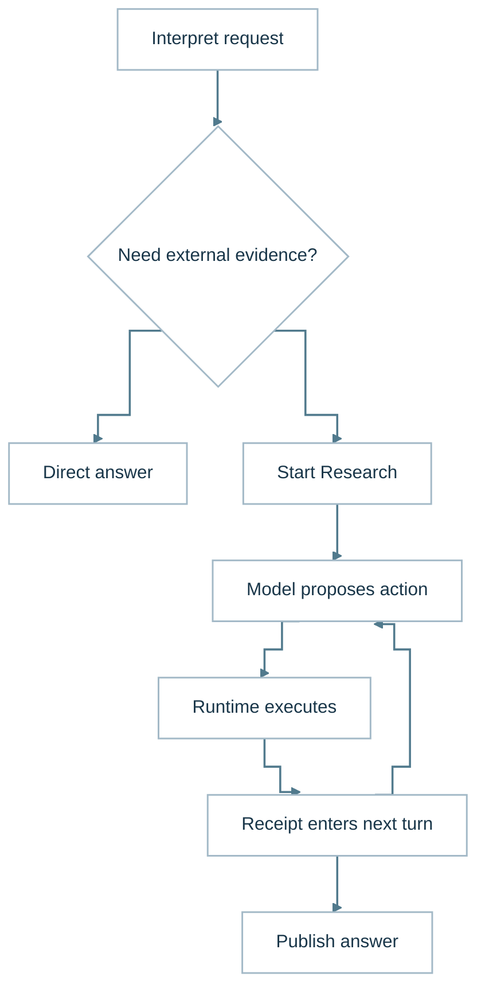

| Mechanism | Input and output | Value of the separate responsibility |
| --- | --- | --- |
| Message identity | Authenticated message to linked Run | Replay rather than duplicate work |
| Entry | Question to Direct or Research | Keep easy questions on a short path |
| Native Loop | Action proposals and receipts to next turn | Let the model reason without owning execution facts |
| Run resources | Allowance and actual usage to admission | One accounting source across retries and children |
| Action reminders | Resource facts to advice in a dispatched prompt | Advice cannot silently change quotas |
| Root-owned Child | Selected subtask to evidence-bearing handoff | Main retains final answer ownership |

### 01. Conversation and message identity

The Conversation stores exchanges; a Run is an execution instance with its own tool receipts and publication. A stable client message ID lets the server recognize a retry. The same identity and same body lead to a replay or recovery of the original Run, whereas a reused identity with different content is rejected. Account and scope admission happens in code before the model can examine private holdings.

### 02. Entry selects work, not a simplistic topic label

“What is industry concentration?” can be Direct. “Calculate the concentration of my actual funds from their latest reports” needs Research. Entry receives the question and bounded authorized context, then selects a structured short answer or a research route. A directory describing available sources is not evidence that those sources were read. Skills may initiate relevant research, but they do not grant new access.

### 03. Native research loop: propose, execute, inspect

For a complex request, the model proposes an actual action, Host and Runtime record admission and execution, and the resulting receipt enters the next model turn. The model may then read more sources, compute a comparison or publish its conclusion. It should not be asked to maintain a second authoritative ledger of whether a tool ran, how many requests were billed, or which action can be safely retried. The runtime retains these observable facts.

### 04. Run resources and Deep research

A single Run’s request count, actual usage, bounded execution time and finalization allowance have one accounting owner. Child workers, retries and recovery do not independently reset the limit. Deep is an authorized resource-mode adjustment; it is not automatically a different model, reasoning effort, or permission scope. A rejected upgrade cannot erase earlier usage or unknown effects.

### 05. Unified action reminders

Context pressure, approaching budget limits and publication constraints may be turned into bounded guidance for the model. Only a reminder actually incorporated into a dispatched model request counts as delivered guidance. A suggestion to wrap up does not itself terminate the Run, authorize a more expensive tool, or increase available budget.

### 06. Root-owned subagents

Main can directly perform a simple read or delegate a multi-step Web, PDF or Python investigation. Child subagents use their own bounded turns but derive authority from the Root. They return identified sources, read ranges, artifacts, partial answers and gaps to Main, which owns the final synthesis. A Child having read a PDF does not mean Main consumed the entire PDF; the handoff has to preserve that distinction.

**Figure 4 · Delegation: Main owns final delivery**

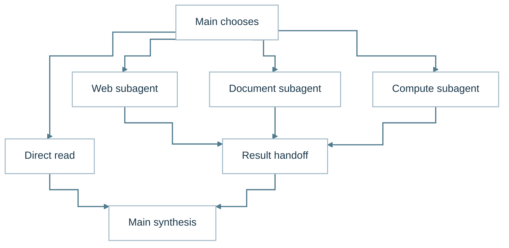

### Focus: foreground interaction and background research coexist

One long background Run can analyze the funds while a short foreground Run answers a definition question. Scope concurrency admits the appropriate class under a common bounded capacity policy. The client shows progress by Run identity rather than holding a single Conversation-wide busy flag. A correction and Stop must target the intended Run; an unrelated quick answer must not overwrite the background result.

**Figure 5 · Foreground replies alongside background research**

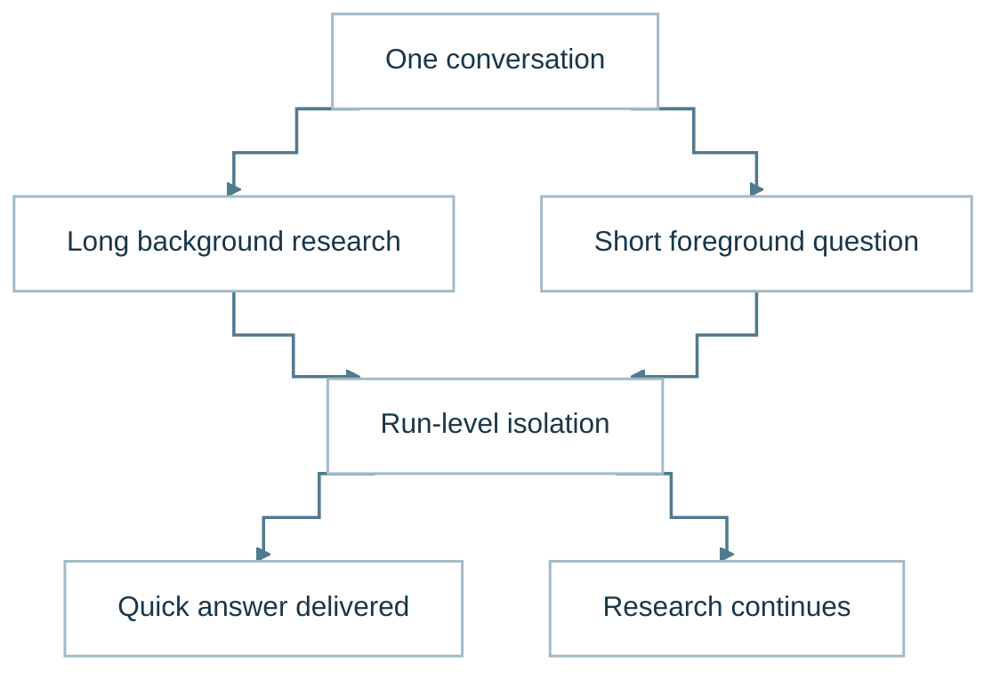

**One Conversation can relate multiple Runs, but there is still one Runtime, Host authorization model, result identity system and publication path.** That is the key architectural change, not simply raising a concurrency limit.

**Go deeper · Entry and multi-run research:** [Entry decisions (Chinese original)](/articles/022-agent-entry-from-intent-to-direct-research) · [Root-owned subagents](/en/articles/agent-subagent-context-specialization) · [Chat alongside background research](/en/articles/agent-background-research-collaborative-experience) · [Model and Runtime responsibilities (Chinese original)](/articles/agent-model-runtime-mcp-skill-boundaries)

## Layer two: context and reusable methods

Information saved somewhere in the application is not automatically information the model saw. The final transmitted model input must be inspectable separately from the surrounding repository of sources and results.

**Figure 6 · Projector: actual model input**

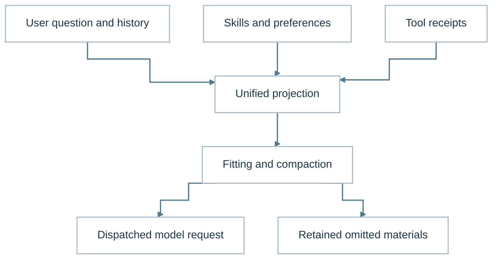

**Figure 7 · Memory versus current portfolio facts**

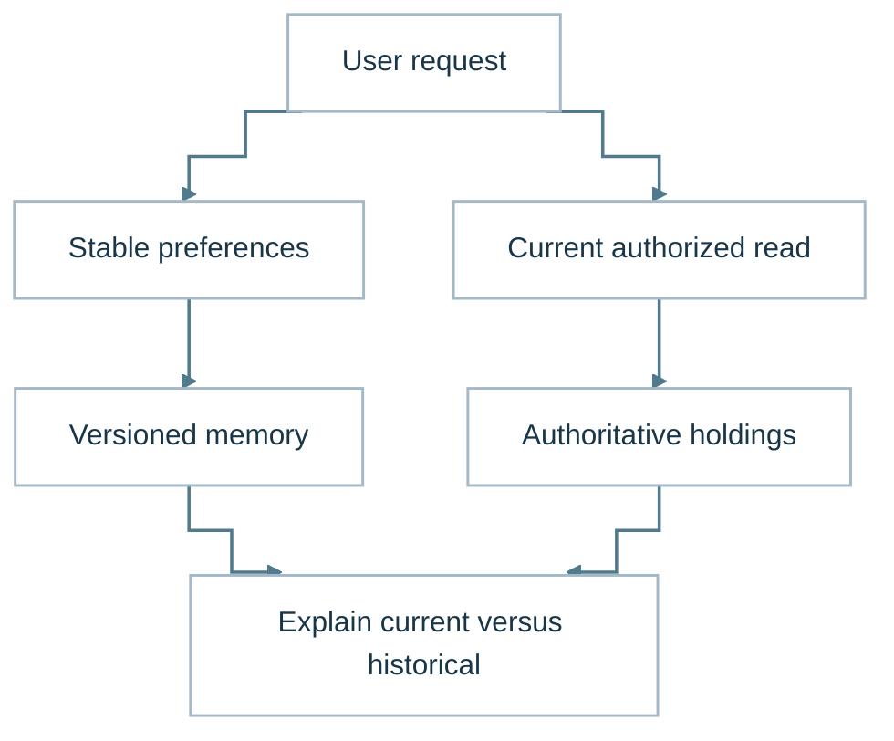

| Context material | Owner | Purpose |
| --- | --- | --- |
| Question and actual receipts | Projector | Maintain exact request and consumed results |
| Fund-research procedure | Skill | Reuse methods without extending permission |
| Stable language preferences | Profile | Adapt communication |
| Explicit save, correction and forget | Versioned Memory | Retain controlled long-term context |

### 07. Projector: what actually reached the model

The Projector assembles current instructions, the exact user question, relevant history, selected Skill guidance, tool receipts, references and the final available tool surface. Context fitting can omit or externalize material while retaining the identity of omitted sources. Main compaction commits a source-linked summary of a settled earlier range to the original checkpoint; summaries never become independent evidence or new execution receipts.

### 08. Skills provide methods, not unlimited tools

An ETF research Skill may instruct the model to confirm product identity and report dates, inspect sources, use appropriate calculation assumptions, and disclose gaps. It cannot turn a missing or unauthorized capability into an executable tool. Generic instructions belong in common guidance; domain procedures belong in Skills; concrete arguments and output formats belong in tool contracts. Extension packages also require controlled source, lifecycle and profile admission.

### 09. Memory versus actual holdings

Long-lived expression preferences should not be confused with current investment balances. Explicit save, correction and forget operations have durable versions and receipts; a later failed answer cannot undo a previously committed forget operation. Private and temporary modes must preserve their own boundaries. A recollected conversation can help phrase an explanation but is not a substitute for a fresh authorized read of the user's portfolio.

**Go deeper · Actual model input:** [Keeping tool results outside context](/en/articles/tool-results-outside-model-context) · [Main compaction](/en/articles/agent-main-run-context-compaction) · [Durable Memory effects](/en/articles/026-agent-memory-forget-durable-effects) · [Principle 5: Context is a workbench](/en/principles#principle-5)

## Layer three: capability discovery, admission and execution

The tool may be installed, registered with MCP, described to a model, admitted for a Run and finally executed. Each is a separate fact. A tool name in a prompt is not an execution receipt.

**Figure 8 · From proposed tool to actual invocation**

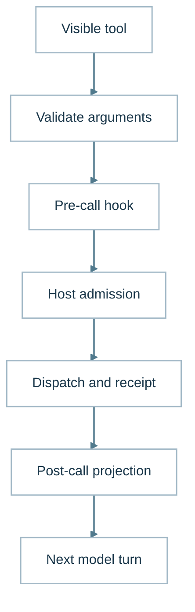

**Figure 9 · Post-call hooks narrow, never replace facts**

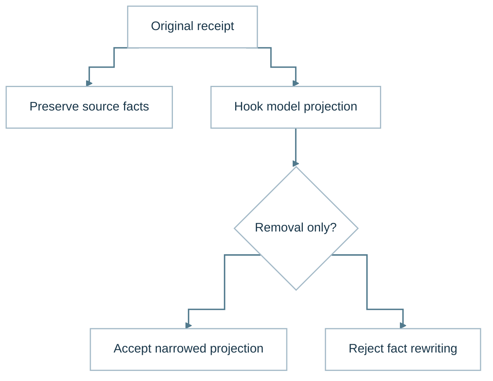

| Execution seam | What changes there | What it must preserve |
| --- | --- | --- |
| Gateway | Transport and protocol conversion | Observed stream and interruption |
| MCP and Host | Discovery, validation and dispatch | Grant, tool identity and source |
| Pre-call Hook | Local action decisions | Normalized arguments and Host rules |
| Post-call Hook | Narrow model-visible results | Unchanged retained facts and provenance |
| End Hook | Observe the conclusion | Termination and publication ownership |

### 10. Model Gateway and provider requests

Gateway normalizes different provider protocols, streams and tool-call argument encodings. A partial response cannot be treated as a complete authorized action. Provider admission controls shared concurrency and endpoint lease; the Run resources owner controls the execution's own consumption. The configured model catalogue determines eligible routes while the model-call owner binds requested settings, including supported reasoning effort.

### 11. MCP, Host and actual Tool Surface

The MCP owner handles service connections, discovery, schemas, protocol transport and close behavior. Host validates the concrete Run and tool invocation. A34 guards the actual tool synopsis and final model-visible tool surface against mismatch with admitted capability contracts. Discovery does not imply the model saw a tool; visibility does not imply the action passed Host authorization. The real invocation also needs valid parameters, permission, reservation and a settled receipt.

### 12. Hooks and plugins with limited authority

Pre-call hooks may block a particular invocation; post-call hooks may remove details from a model-visible projection. They cannot replace a source, timestamp or amount while retaining the same field path as though the tool returned it. Original receipts stay intact. The extension owner manages package admission and profile lifecycle, while hook execution manages callbacks and local errors. Neither acquires Root termination or Publication ownership.

**Go deeper · Capability contracts:** [MCP from discovery to use](/en/articles/mcp-host-from-discovery-to-consumption) · [The final Tool Surface](/en/articles/agent-model-capability-presentation-tool-surface) · [Content trust and prompt injection](/en/articles/agent-content-trust-prompt-injection) · [Tool lifecycle and model input](/en/articles/agent-tool-lifecycle-and-model-input)

## Layer four: source evidence and reproducible calculation

Retrieval, document reading, financial definitions, exact arithmetic and sandboxed exploration solve different problems. The synthetic portfolio question needs all of them to establish a credible sector overlap explanation.

**Figure 10 · From retrieval hit to consumed evidence**

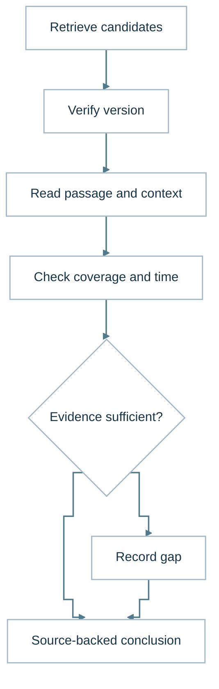

**Figure 11 · Separate source, formula and computation**

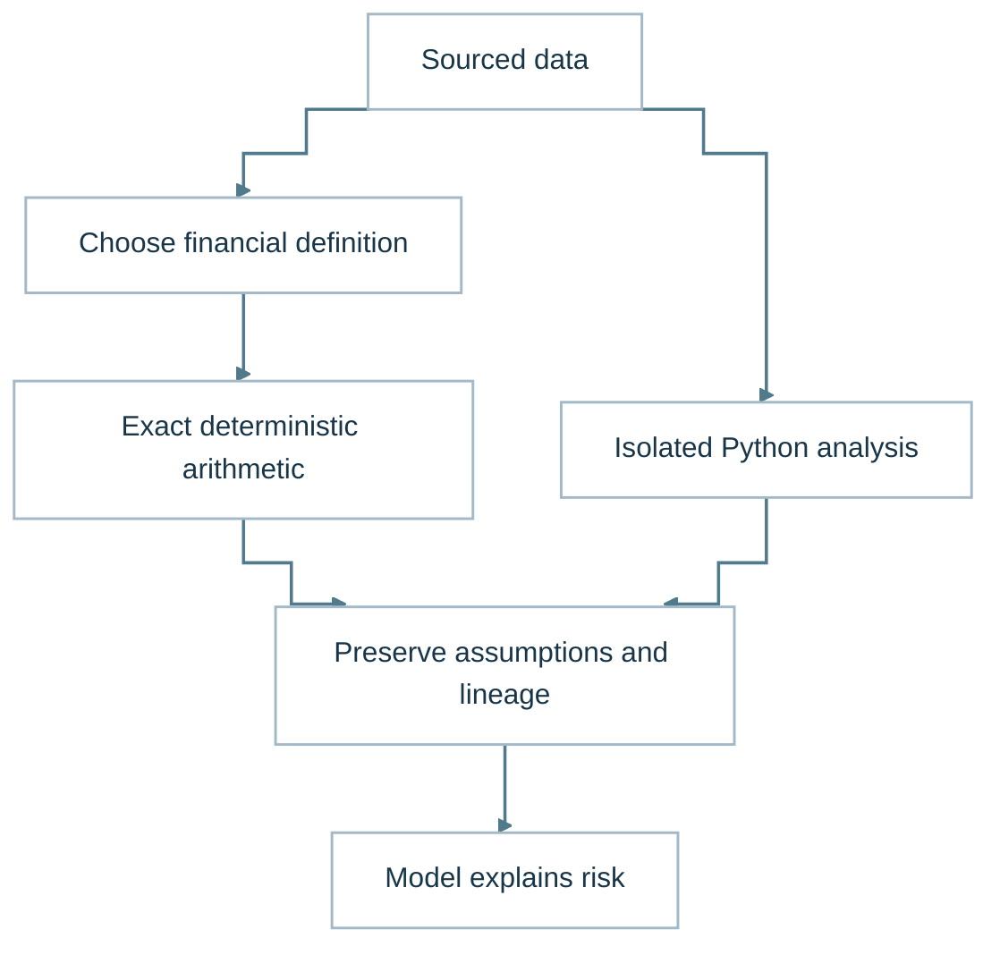

| Activity | Output | Supported inference |
| --- | --- | --- |
| Retrieval | Source-bearing candidate passages | Where to read next |
| Document reading | Consumed ranges and versions | Exactly what was inspected |
| Financial arithmetic | Inputs, method and reproducible output | Correct value for the selected formula |
| Isolated analysis | Work products with assumptions | Executed exploration, not investment authority |

### 13. Retrieval identifies candidate material

Lexical and semantic retrieval can locate passages about fund objectives or industry concentration. A similar product name, older share-class prospectus or truncated snippet can still be the wrong evidence. Candidate passages must preserve source and version. A35 keeps external Web/PDF/tool content in the status of *data*: instructions embedded inside a document do not become Host or system authority.

### 14. Web, PDF and research assets enable continued reading

Search hits are starting points. Real reading requires document identity, exact consumed ranges and the ability to continue into adjacent sections or PDF pages. A search snippet is weaker evidence than a read source passage. Page-image generation does not prove that the image actually entered a model request. Cached content and current permission to display the content are also distinct.

### 15. Deterministic finance and A33 precise arithmetic

Source and version owners establish where data came from and its effective date. Financial domain rules select the appropriate formula and units. A33 performs the bounded decimal operation under those already chosen parameters and rounding rules. Numerically exact computation cannot choose the correct denominator or validate an investment strategy. Outputs need source references, definitions and assumptions to be reproducible.

### 16. Isolated analysis and artifacts

Python is appropriate for temporary comparisons, scenario tables, plots and experimental models. Its execution receipt records that a computation took place, not that an exploratory value has become an official portfolio position. Direct HTML and files created in an isolated workbench still require the original export, publication and Artifact storage path before the user has an authenticated download.

**Go deeper · Sources and numbers:** [Web research (Chinese original)](/articles/021-agent-web-research-from-search-to-deep-reading) · [PDF evidence](/en/articles/024-agent-pdf-from-text-to-evidence) · [Financial definitions and reproducibility](/en/articles/031-fintech-data-time-and-reproducible-numbers) · [Python research workbench](/en/articles/agent-python-compute-workbench-evolution)

## Layer five: answer delivery, human interaction and continuity

The time when an answer is drafted, rendered, published, saved or read from History can differ. Partial results and background work make this distinction essential.

**Figure 12 · Visible preview versus durable publication**

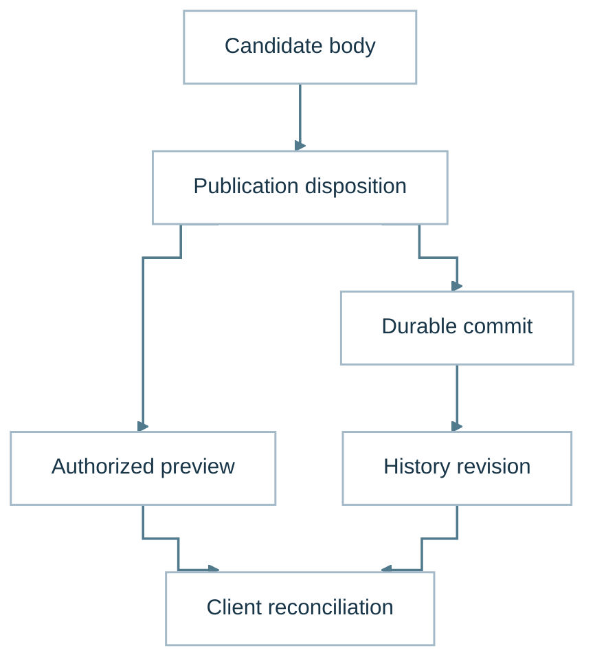

**Figure 13 · Three kinds of continuation**

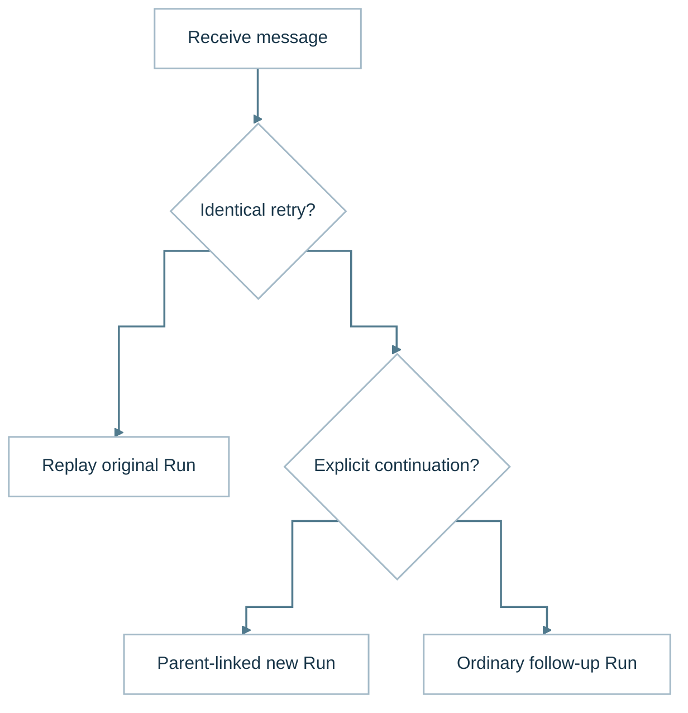

| User action | How it is handled | Why it matters |
| --- | --- | --- |
| Identical message resend | Find existing identity and Run | Do not execute the same action again |
| Resume interrupted work | Recover original receipts | Do not duplicate settled effects |
| Explicit task continuation | Create linked new Run when allowed | Do not silently reopen terminal work |
| Ordinary follow-up | Create new Run with relevant context | A new request is not a replay |
| Reply to human question | Route by exact interaction identity | Do not target whichever chat is latest |

### 17. Publication and progressive answers

Publication determines which candidate text and associated citations may become user-visible and durable answer revisions. A missing optional attachment or citation can be handled locally without erasing unrelated allowed prose. Real account authorization and sensitive-data constraints still apply to the relevant content. Progressive corrections should identify the part being revised rather than append another duplicate full answer.

### 18. Citation presentation is not evidence certification

A citation renderer converts recognized source links into readable navigation and ordered markers. The underlying source identity, grant and supporting passages are still owned elsewhere. Displaying a citation number does not mean every sentence nearby is established by the material. An unmatched citation is a limited navigation problem, not permission for a renderer to silently delete the complete answer.

### 19. History, events and frontend rendering

Provider streaming and browser delivery are different streams. The client receives approved answer, progress and terminal events, then projects them by Run and Publication revision. A visible preview may temporarily precede the durable database record; an immediate empty History read should not erase that still-authorized preview. Once authoritative History arrives, it reconciles by identity and version. The UI cannot treat a stale message array or animation as an execution fact.

### 20. Artifact access and sharing

A saved HTML report, chart or Python file has immutable identity and authenticated access rules. A sharing grant must bind the exact recipient, Run and revision and cannot simply turn a URL into a reusable download credential. Artifact failure should be reported for that effect; it does not automatically revoke an independent legitimate explanation already published as text.

### 21. Durable Recovery and idempotent retry

Recovery reconstructs sealed model turns, executed actions, unknown effects, checkpoints, grants, leases, fences and committed answer versions. It must not ask a model to invent what supposedly happened. A previously settled tool action can be replayed from its original receipt; an uncertain external effect must remain uncertain until reconciled. The original lease and fence ensure stale workers cannot publish over a newer claimant.

### 22. Durable Control versus a scheduled occurrence

An original nonterminal Run can be safely parked and then awakened through an original Control event, with its identity and budget retained. A user-confirmed recurring schedule instead creates a fresh bounded occurrence and Task Run at the scheduled time. Both reuse the existing Control system, but a wake is not a new task and a scheduled task is not infinite authorization to keep invoking a model. Automatic scheduled research does not initiate human waiting.

**Figure 14 · Durable control: wake versus new scheduled Run**

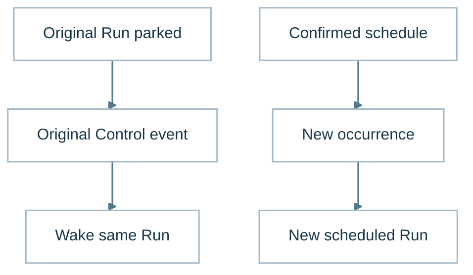

### 23. Run termination and bounded finalization

A local optional-tool failure or pressure reminder cannot decide the whole Run has failed. The original Run-level termination owner combines actual receipts, resource limits, recoverability and finalization protection before choosing an allowed closing phase. It leaves financial data, accounting, Publication and underlying transaction state with their original owners.

### 24. Follow-ups, replay and explicit continuation

An identical network retry reuses existing execution identity. An ordinary follow-up creates a new Run using selected authorized context. A user-approved continuation of unfinished or terminal work creates a linked Run under the existing Continue contract rather than silently waking a terminal record. Textual similarity never grants access to an old source, read cursor or action.

### Focus: durable Human-in-the-Loop (HIL)

A research agent sometimes needs a human answer while still being capable of independent reads and calculations. HIO is a **bidirectional owner of interaction admission and response routing**. The model proposes a question using the Native ask-user tool; HIO durably binds it to the original authenticated scope, Conversation, Run, Action, request revision and deadline. A cross-conversation inbox shows accessible pending items without assuming whichever chat is newest must be the answer target.

By default, asking is **non-blocking**. Work continues until a true dependency is reached, while the user can respond to the exact persistent request. Receipt of the user's text is different from adoption: the original Correction safe point carries it into an actual Main model input. When necessary, the original Recovery owner may safely **Human Park** an unfinished Run; Control and Scope then manage wake-up and readmission. Parking never resets consumed model usage or explicit hard deadlines.

**Figure 15 · Human interaction: request, reply, adoption and resumption**

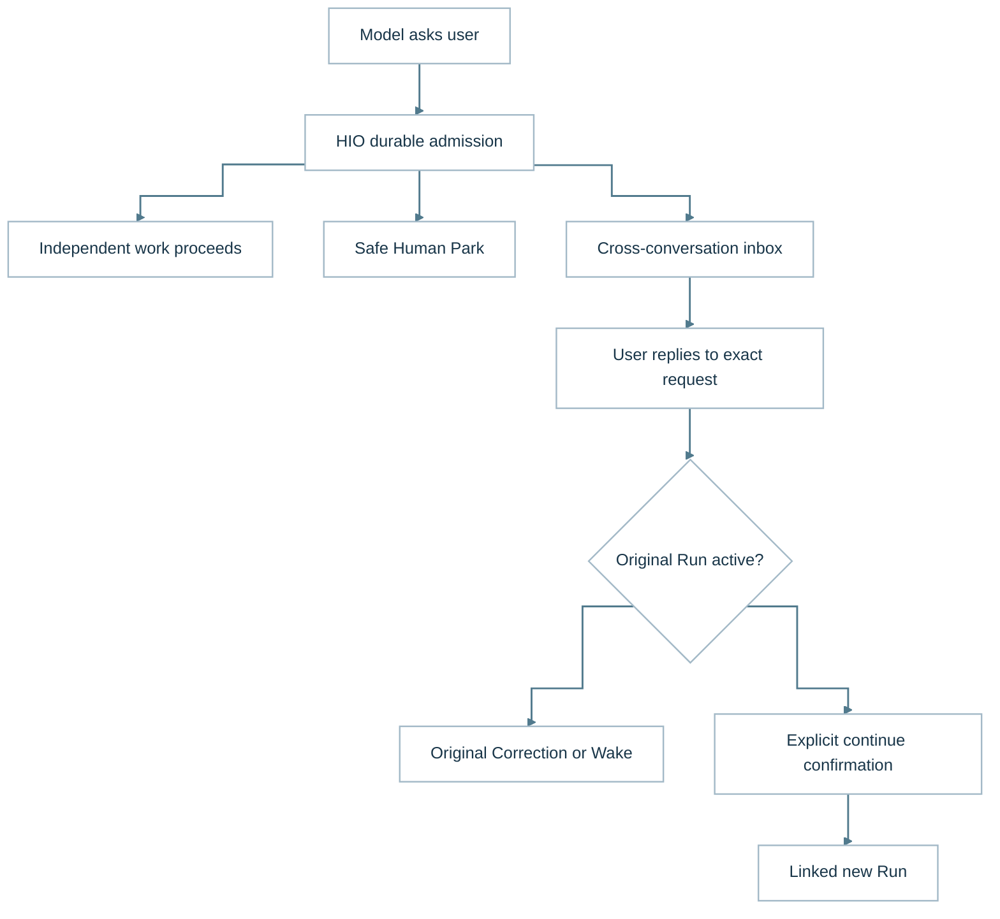

If the original Run is terminal, a late answer stays associated with the original interaction. The user must explicitly confirm **Continue Research** before the existing Continue path creates a parent-linked new Run. Stable response identity, conflict handling and lost-ack reconciliation prevent retries from creating new work merely because a button was pressed again.

The October 24 development branch already includes durable request/reply contracts, non-blocking asking, a cross-conversation inbox, original Correction/Continue routing, and opt-in Human Park and Recovery composition. Browser and PostgreSQL-path evidence covers the default non-blocking flow. Cross-process blocking qualification and later Effect, Permission and Child integration continue along the same small interface. HIO does not itself grant permission, approve changed parameters, execute an investment effect or own a second model loop.

**Go deeper · Publication and recovery:** [Publication (Chinese original)](/articles/019-agent-answer-publication) · [Progressive answer coherence](/en/articles/agent-progressive-answer-coherence) · [Background delivery by deadline](/en/articles/agent-asynchronous-research-time-bound-delivery) · [Collaborative background research](/en/articles/agent-background-research-collaborative-experience)

## Layer six: observing facts and evaluating answers

Observability spans all preceding layers; quality review asks whether the user actually got a useful, supported answer. Neither should be compressed into a single completed flag.

**Figure 16 · Observable handoffs, not one success flag**

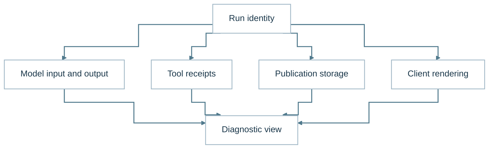

**Figure 17 · Evaluation of actual delivery**

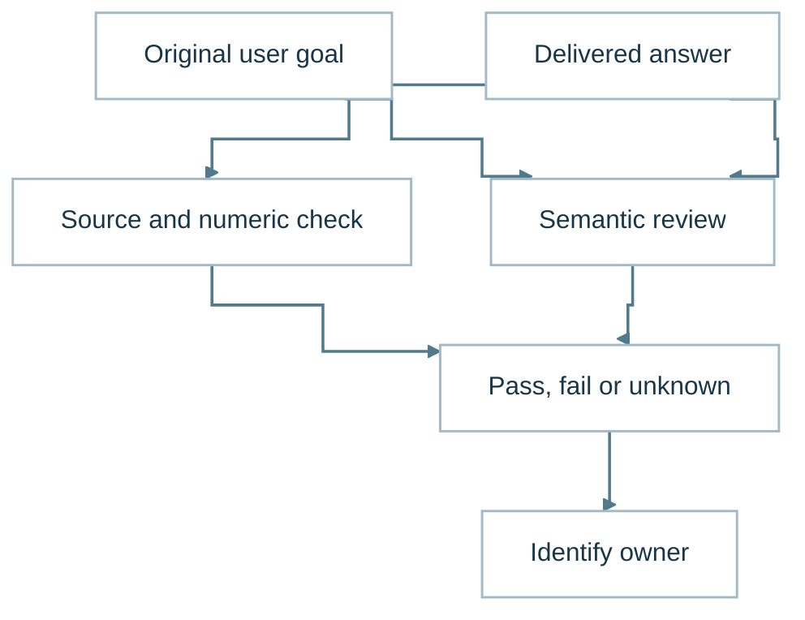

| Observation | What it captures | What it does not prove |
| --- | --- | --- |
| Generation | Candidate text | That the user received the text |
| Delivery | Transport and display evidence | That server emission equals visible rendering |
| Persistence | Durable publication revision | That the original task was fully answered |
| Consistency | Matching IDs and revisions | That the interpretation is true |
| Execution | Run and action final facts | That an answer is useful |
| Quality | Explicit semantic and numerical checks | That unreviewed cases passed |

### 25. Langfuse and trace: locate the first incorrect handoff

When a reported source seems missing, the investigator needs the actual model request, not just proof that a PDF existed in the repository. The source might not have been consumed, may have been omitted by context fitting, or may have arrived in a Child summary without the original caveat. Run-scoped model requests, tool receipts, Publication revisions and rendered-content observations expose where evidence was lost. HIL adds separate request-admitted, reply-saved, Correction-committed and Main-adopted facts.

### 26. Evaluation: compare the original question to actual delivery

An excellent candidate answer that never reached the user is not successful delivery. The sector-overlap case needs reproducible numbers and documented coverage, valid citation support, and a meaningful explanation of uncertainty. Model-judge scores may help compare semantic outputs, but they cannot replace source reading or deterministic calculation. Keep failed, partial and unknown cases in the denominator and repair the owner controlling the actual failure.

**Go deeper · Observation and evaluation:** [Langfuse and trustworthy traces](/en/articles/025-agent-langfuse-from-trace-to-trustworthy-observability) · [What green tests prove](/en/articles/honest-agent-evaluation) · [From bug loops to task convergence](/en/articles/032-ai-development-from-bug-loop-to-task-convergence) · [Principle 8: Actual user outcomes](/en/principles#principle-8)

## From V1 to V2: evolving interfaces rather than piling on controllers

The first six-layer story still explains admission, methods, execution, evidence, publishing and feedback. V2 preserves that complete journey and incorporates concurrent interaction, final tool-surface consistency, content trust, source-linked results, exact arithmetic, durable background delivery and HIL. The goal is **deeper capability behind clear contracts**, not a second manager for each newly invented feature. New work should deepen existing responsibilities where possible, introduce a truly missing owner only where needed, and remove obsolete duplicate mechanisms.

### Historical edition

[V1 (October 20, 2026): the original complete Chinese architecture story](https://hpoenixf.github.io/eff-agent-article/articles/017-prompt-to-answer-six-layer-panorama-v1)
