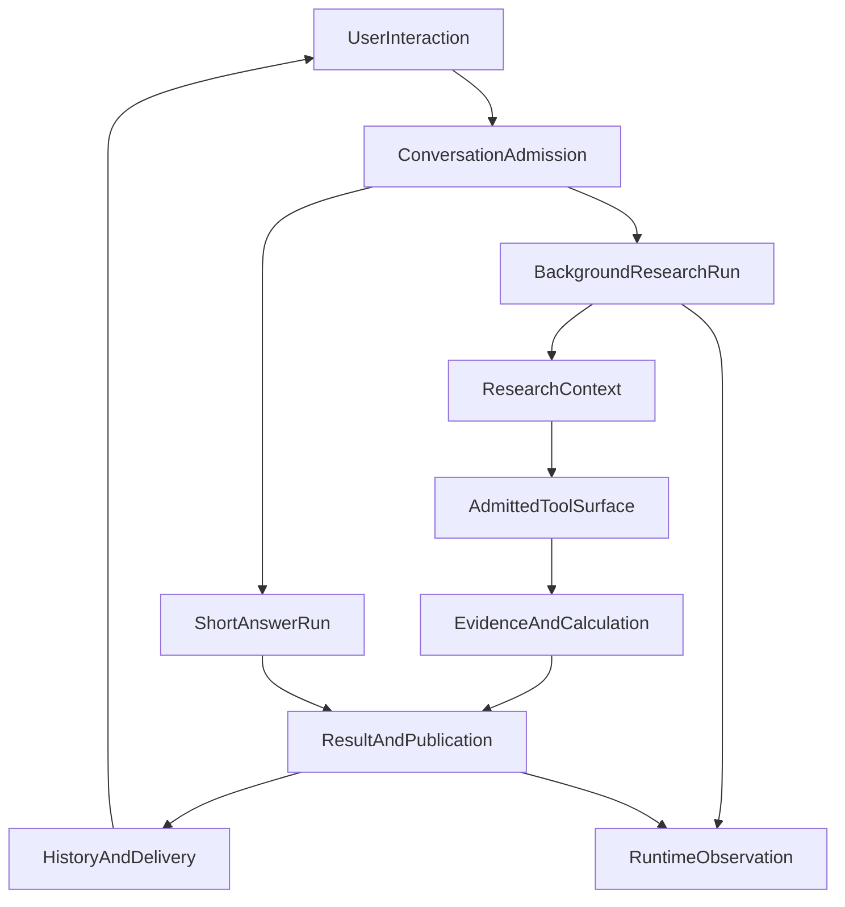
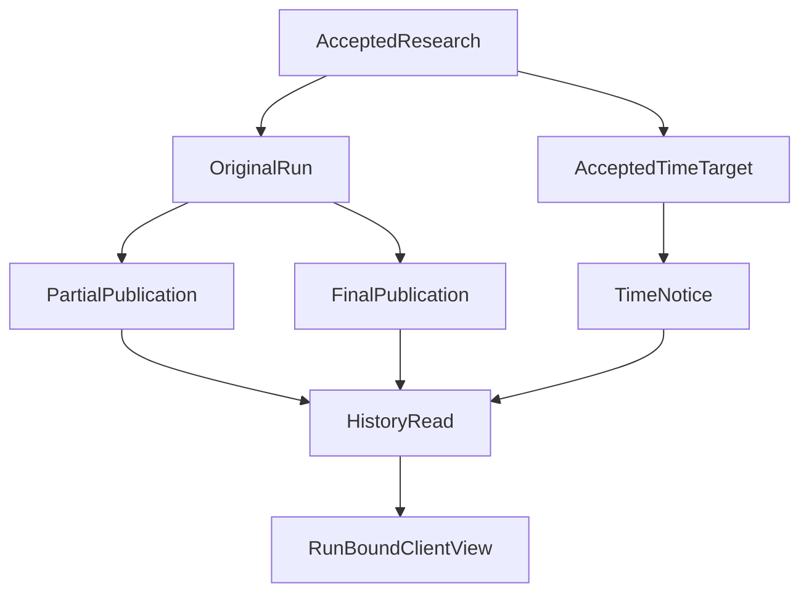
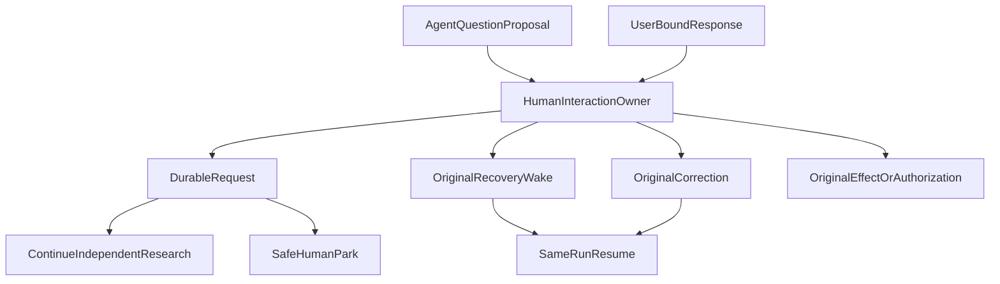

# From a Single Question to Continuous Collaboration: ETF Agent's Six-Layer Architecture · V2

> **Architecture snapshot: October 23, 2026.** This is the second version of an evolving architecture story, not a replacement that invalidates the first. It traces the move from a single research run to concurrent interaction and durable delivery. **Human-in-the-loop (HIL) is a designed, not yet implemented capability** in the current OpenSpec. Engineering acceptance, deployment, and live-model research quality remain separate claims.

[Read the original V1 architecture story](https://hpoenixf.github.io/eff-agent-article/articles/017-prompt-to-answer-six-layer-panorama-v1) · [Archived V1 illustrated HTML](https://hpoenixf.github.io/eff-agent-article/visuals/017-prompt-to-answer-six-layer-panorama/v1.html) · [Architecture owner gallery](https://hpoenixf.github.io/eff-agent-article/gallery) · [Essay catalog](https://hpoenixf.github.io/eff-agent-article/catalog)

## 1. Why V2 exists: research is no longer one foreground pipeline

V1 followed a user asking an ETF Agent to analyze a portfolio. It used six conceptual layers: interaction and research control, context and methods, capability execution, evidence and computation, delivery and continuity, and observability and evaluation. That organizing principle survives. In particular, **the model proposes research actions; code owns authorization and execution facts; publication and delivery own what actually reaches the user.**

The engineering problem subsequently changed. A portfolio analysis may need many source reads, delegated subagents, and computations. Meanwhile, the same user asks, "What is sector concentration?" They should not have to stop the larger research task to obtain a short answer. If they instead say, "Please include currency exposure in that comparison," the new input should be coordinated with the correct background run, rather than treated as an unrelated request.

The browser may close, a partial answer may already have been committed, the agreed notification time may not yet have arrived, and the full report may finish later. Those moments require different identities and different facts.

**V1 explained how one request crosses the six layers. V2 explains how multiple pieces of work share one trustworthy runtime without acquiring each other's identity, authority, or published answer.** The response is not a second Background Agent runtime, an all-purpose Coordinator model, or a duplicate permission ledger. Instead, we extend established owners and clarify their handoffs.

Consider this explicitly **synthetic teaching scenario**:

1. A user asks for an evidence-based analysis of overlapping fund-sector exposure and selects background Research.
2. While it runs, the user asks an independent conceptual question and gets a separate answer.
3. The user sends a targeted correction to the background run; an ordinary new message must not silently become a correction.
4. The research publishes usable partial results, records its actual status at an agreed time, then delivers a final result under its original identity.
5. **Future HIL scenario, not implemented:** the agent requests an investment-horizon clarification, continues independent work where possible, or parks at a safe point, without confusing a reply or approval with actual authority.

These steps are not a captured production session and do not suggest that all of the capabilities are already deployed together.

## 2. Six layers, not six processes

| Layer | What V1 explained | What V2 adds |
| --- | --- | --- |
| 1. Interaction and research control | Message identity, Entry, the Native Loop, subagents | Separate admission for background/short tasks, Run-targeted coordination, explicit Research intent |
| 2. Context and methods | Projection, Skills, Memory, compaction | Content versus instruction identity, provenance-preserving compression, authority boundaries |
| 3. Capability access and execution | Gateway, MCP, Host, Hooks | A34 checks the model-visible tool surface; A35 checks content identity at the final SDK boundary |
| 4. Evidence and computation | Web/PDF/RAG, Python, financial rules | A33 exact numeric operations separated from financial-method selection and results provenance |
| 5. Delivery and continuity | Publication, History, Recovery, scheduling | Partial publication, background views, at/by notifications, durable continuation, planned HIL |
| 6. Observability and evaluation | Langfuse, run states, quality tests | Independent physical Attempt, delivered-content, and semantic-quality evidence |

These layers are a reader's map, not a count of modules, processes, or databases. The evolving number of capability owners belongs in the [live owner gallery](https://hpoenixf.github.io/eff-agent-article/gallery), rather than becoming a fixed "truth" in a long-lived essay.

The edge returning to interaction represents a subsequent user action; it is not an endless autonomous loop. Account, message identity, Run grants, budgets, tool receipts, sources, publication, recovery, and evaluation retain their distinct owners.

## 3. Layer one: from "the chat is busy" to Run-bound work

In the V1 foreground story, a request often led to one orderly sequence of research and an answer. A simple interface can use `busy` or `activeRunId` to decide whether input is allowed. Once background research coexists with short answers, that singleton assumption causes unrelated user intentions to collide.

The concurrent interaction profile admits **short interactions and background Research into different capacity classes**. Its initial controlled configuration admits up to three short interactions and one background research run. Aggregate scope capacity, the original per-Run budget, and Provider concurrency leases still apply independently. These are not interchangeable pools. The new profile is **disabled by default**; scoped PostgreSQL and browser acceptance does not demonstrate a public production rollout.

Entry does not introduce a mandatory extra classifier. With no background task, the available branches are Direct/Research. With background work under the initially qualified configuration, they become Direct/Coord. Explicit background Research or Deep intent can use the existing direct-to-Research preparation path. Actual approval of Deep resources remains with the original budget owner.

Three superficially similar forms of "continue" require distinct treatment:

- **A new short question** gets its own Run and answer, not the background task's most recent assistant message.
- **A correction or Stop** targets one identified, authorized Run, never whichever message happens to be newest.
- **Reconnection or an identical message retry** returns to the existing Run and receipts. Unknown external dispatch cannot be presumed not to have occurred.

This changes the frontend architecture as much as the runtime. Answers can complete out of order. A History read can replace a temporary message row. An older snapshot may arrive after a newer one. Rendering must be bound to Run identity, Publication revision, and ordered events, rather than the end of a message array or a global loading flag.

The scoped engineering work exercised these boundaries with browser and PostgreSQL paths, **not natural-language routing quality, multi-background production qualification, or sustained live concurrency**.

[Deep dive: continuing to chat during background research](https://hpoenixf.github.io/eff-agent-article/articles/agent-background-research-collaborative-experience)

## 4. Layer two: supplying material does not grant it authority

Main may need portfolio facts, Web and PDF extracts, Python results, subagent summaries, user context, and previously committed answer blocks. A14, the context Projector, assembles and fits this request while preserving source identity. A28, Main compaction, selects settled earlier turns, adopts a proposed summary, and commits the relevant checkpoint. A26, Memory, owns durable personal-memory updates and forgetting. Collaboration between these capabilities does not make their underlying facts interchangeable.

Compression is more than a token-saving device. A summary may retain a conclusion but lose its source or assumptions. Recovery must not turn that summary into a newly authenticated tool receipt. Externalized tool results, durable result references, and model-input projection each keep separate identities; the system may need to retrieve the actual source again.

V2 also introduces **A35, the content-trust and instruction-identity boundary**. Web, PDF, Child, or Memory content may be analyzed, but it does not thereby become a new user request, and cannot be promoted to a Host system instruction. Its first implemented phase verifies bounded structural identities at the final SDK request boundary. That structural defense does not prove immunity against semantic prompt injection carried in an otherwise valid message.

The core design principle is not to stuff every available document into context. **The model should have a traceable account of where content came from, while the runtime must not pretend to know whether that content is semantically sufficient or correct.**

[Main compaction](https://hpoenixf.github.io/eff-agent-article/articles/agent-main-run-context-compaction) · [A35 content trust](https://hpoenixf.github.io/eff-agent-article/articles/agent-content-trust-prompt-injection)

## 5. Layer three: a tool registered with Host must also be visible to the model

V1 described the MCP, Skill, plugin, and Hook path from discovery through admission to execution. Further development exposed another seam: proving that a tool exists in the registry does not prove that the **final model request** accurately presents the usable tools. A late Skill or Hook transformation, a stale descriptor, or a schema mutation can make the presented set disagree with what Host has admitted.

A34, **Model Capability Presentation & Tool Surface**, owns two bounded facts: the permitted Host capability synopsis in Entry, and the stable ordered logical tool surface actually presented immediately before a Research request. It consumes existing Run grants (A04), invocation contracts (A11), MCP connection/discovery facts (A31), Skills (A12), and related owner facts. **It does not maintain a new permission registry.**

An invalid final surface may cause that particular request preparation to fail. A34 cannot terminate the entire Run or erase already permitted publication. A10 still owns request serialization and physical sending; A29 owns Hook execution; the original invocation owner owns the actual tool receipt.

A34 and A35 protect adjacent but different claims. **A34 asks whether the model sees the tools Host has actually admitted. A35 asks whether trusted instructions and untrusted content retained their original identities.** Neither tells the model which investment conclusion to reach.

[A34 Tool Surface](https://hpoenixf.github.io/eff-agent-article/articles/agent-model-capability-presentation-tool-surface) · [MCP Host](https://hpoenixf.github.io/eff-agent-article/articles/mcp-host-from-discovery-to-consumption)

## 6. Layer four: provenance, financial method, and arithmetic are separate

A credible analysis of overlapping fund exposure requires more than a plausible-looking figure. Web/PDF/RAG retrieve materials; Python handles exploratory analysis; financial domain methods determine exposure, attribution, fees, and cash-flow definitions; A16 preserves result identity and derivation lineage so a report is not reduced to an unexplained number.

A33, **Exact Numeric Operations**, performs bounded operations on explicit decimal quantities: addition/comparison within a unit, bound multiplication, ratio scaling, and rounding. It can ensure that a specified calculation follows its contract. It **cannot select a financial formula, infer units, certify evidence, or authorize an investment recommendation**. Perfectly executed arithmetic does not fix an inappropriate methodology.

The architecture therefore distinguishes:

- **Source and version:** Which materials support the inputs, and when do they apply?
- **Method and assumptions:** Why is this calculation appropriate to the actual investment question?
- **Execution and reproducibility:** Does the recorded method produce the correct numeric result on its specified inputs?

A partial or unknown result is not complete evidence. A clickable citation does not establish that it supports every claim around it. Financial answers must preserve time, definitions, limits, and missing inputs rather than fill missing private portfolio facts with confident prose.

[Financial definitions and reproducibility](https://hpoenixf.github.io/eff-agent-article/articles/031-fintech-data-time-and-reproducible-numbers) · [Consuming Python results](https://hpoenixf.github.io/eff-agent-article/articles/financial-agent-python-result-consumption)

## 7. Layer five: answers, notices, recovery, and human interaction are different states

Background research may commit a useful partial body before the final report. A23 Publication owns body preparation, revision, and commitment. A16 owns result and citation identity. A24 History/Delivery owns ordered reads and notices; A25 renders the appropriate Run and Publication; A06 owns Run continuation and technical termination. **"The model drafted it," "the server emitted it," "the database committed it," and "the browser rendered it" are distinct facts.**

Async delivery also separates the user's time agreement from completion. Under `at`, a final scheduled notice cannot be delivered before the target time. Under `by`, the system records whether completion actually met the deadline. If the target arrives while only a committed partial is available, the notice may truthfully report ongoing work; a later final notice is a separate event. Notices read the original result identity. They neither rerun the model nor certify a second copy of the answer.

A report's HTML or attached file follows its own Publication, result, Artifact storage, and authenticated access path. A failed optional attachment does not authorize deleting independent legitimate prose. Durable recovery uses the original checkpoint, identity, leases, and settled effects. It reconstructs what happened rather than asking the model to invent a prettier execution history.

### Looking ahead: durable HIL as designed in OpenSpec, not yet implemented

Background research plus independent chat solves one problem. The next is **how an agent should ask the user for input or specific consent during research, keep unrelated work moving, and route a durable reply back to the correct task**.

The October 23, 2026 OpenSpec proposes one bidirectional **Human Interaction Owner (HIO)**. Its Stage A–D product work remains unfinished. The following statements are **design intentions**:

**First, asking is non-blocking by default.** The model chooses what to ask and whether a real wait is needed. A new `ask_user` request defaults to `non_blocking`; research can continue independent work or publish a scoped result without claiming that a missing answer was supplied. An outstanding optional question must not suppress legitimate publication.

**Second, waiting belongs to original Recovery.** Where the model identifies a genuine blocking dependency, HIO admits an identified request and original Recovery can park the same nonterminal Run at a safe boundary. A Root may have multiple bounded outstanding interactions but no more than one actual Human Park. Waiting does not reset model budgets, incurred cost, or explicit hard deadlines. The original Scope and Recovery owners decide when a safely parked Run may release execution capacity and whether Wake has reacquired a lawful slot and lease.

**Third, replies must be routed exactly.** A conversation card and cross-conversation pending view refer to the same durable request, identified by request version and authenticated responder. For a running task, an answer goes through the original Correction safe point. For a parked task, it flows through original Recovery/Wake to the same Run. If the target has already terminated and the answer has not been adopted, the user must explicitly confirm **Continue analysis** before original Continue may create a linked new Run.

**Fourth, questions, permission grants, approvals, and effects are not interchangeable.** HIO can eventually receive valid Permission or Effect approval proposals, but a plain "yes" is not a grant. Consent received by HIO is not proof that an original Effect owner executed the operation, particularly if its parameters changed. Child consultations are coordinated through Main. **Automatically executed Scheduled Tasks cannot initiate HIL**, even through a plugin or Child workaround.

These arrows describe **planned responsibility handoffs**, not simultaneous runtime actions. Request accepted, delivered, reply received, adopted by the original owner, and effect committed all remain separate facts. HIO deliberately does not introduce a second model loop, authorization ledger, semantic sufficiency gate, or mandatory path for ordinary Direct answers.

## 8. Layer six: observability records facts; evaluation asks whether the answer helped

Concurrent Runs, multiple delivery views, and future HIL make a single `completed` flag less informative. The chain includes model exchanges and physical Attempts, tool dispatch/receipts, Results and References, Publication revisions, History reads, client rendering, and eventual semantic evaluation. Langfuse and durable request-evidence capture help locate the first distorted handoff. They neither authorize execution nor prove that a missing trace tail means the answer was not stored.

Independent DeepEval or other semantic judging must evaluate a declared sample, the original user request, and the **actual evaluated delivery artifact**. A correct tool invocation does not certify final arithmetic. A brilliant draft that was never delivered does not count as successful user delivery. Model judging does not replace source checks, deterministic recalculation, or observed user value.

An actionable diagnostic workflow starts by identifying which Run and which publication revision reached the user. Then determine whether a failure lies in retrieval, request projection, tool-surface presentation, method selection, arithmetic, publication, notification, or semantic synthesis. Repair the owner that actually controls that fact, rather than adding another global Manager.

## 9. What really changed from V1 to V2

V1 made an important point: research, execution, provenance, and delivery do not fit into one giant prompt. V2 adds a stricter question: when we introduce background tasks, concurrency, human approvals, and time promises, **can we preserve continuity without introducing a second runtime state machine?**

Our evolution includes five related separations:

- From one foreground `busy` flag to independent Run identities within a conversation.
- From tools registered in Host to an accurate final model-visible tool surface.
- From plausible citations and numbers to separate provenance, financial methods, and exact numeric computation.
- From notifying on Run completion to recording partial bodies, time promises, final results, and client visibility independently.
- From the model merely asking and waiting to a planned single bidirectional HIO that admits interactions while original owners retain permission, effect, and recovery authority.

This costs more explicit identity, versioning, leases, and handoff discipline. It does **not** prove that a live model has become more intelligent or that the service has a production SLA. It gives the system a more precise way to evolve, retire obsolete mechanisms, and attribute observable outcomes.

**V1 remains an October 20 architecture snapshot, not a discredited old document. V2 is the October 23 engineering and design snapshot, not the final architecture.** We will update the HIL status when implementation and delivery evidence exists—not ahead of it.

[Back to V1, with its complete historical text and links](https://hpoenixf.github.io/eff-agent-article/articles/017-prompt-to-answer-six-layer-panorama-v1) · [Background research and interactive chat](https://hpoenixf.github.io/eff-agent-article/articles/agent-background-research-collaborative-experience) · [Owner gallery](https://hpoenixf.github.io/eff-agent-article/gallery) · [Engineering essay repository — stars welcome](https://github.com/hpoenixf/eff-agent-article)
