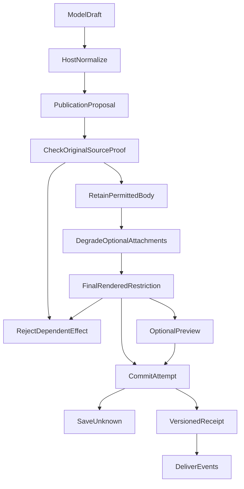

# The Agent Has Generated an Answer. Why Does It Still Need a Separate Publication System?

The model has written an explanation and the page displays it. After a reload, it disappears. Elsewhere, identical text at the same revision loses its confirmed source notice. Neither observation necessarily means that the model failed to write an answer or that the browser dropped a message. **Producing text, displaying a preview and saving that text are different events.**

Publication turns eligible candidates into facts with identities, revisions, source relationships and original receipts. This article follows the current path from input to historical readback, placing real counterexamples beside the choices they explain. The model still organizes the argument; the publication component does not judge investment conclusions.

The main discussion covers the original project's multi-block mechanism. The [fixed Open ETF Agent v0.8 implementation](https://github.com/hpoenixf/open-etf-agent/tree/2c096ce47be2161f97531170af07ef255872f8b1) extracts only single-block publication, revisions and durable readback, without preview UI, multi-block citations or dynamic source revocation. The final exercises identify this and another public snapshot separately rather than combining their evidence.

<span id="_1-a-model-having-a-body-is-not-the-same-as-the-system-having-published-it"></span>

## 1. When a Message Is No Longer Enough

For a short, one-shot answer, “model returns → save message → display” can be the simplest useful design. Research applications also need supported partial answers, further investigation and revisions to existing sections. At least five facts then matter:

| Fact | Who can establish it | What it does not establish |
| --- | --- | --- |
| The model proposes a candidate body | The sealed model turn | That the body may be disclosed |
| The candidate passes publication preparation | Publication's current validation | That it has been saved |
| A temporary preview is sent | The server's preview event | That the client received it or the database committed it |
| A versioned publication is committed | A durable Publication receipt | That the browser rendered it, or that the article is correct |
| The client receives and displays it | Delivery and DOM observations for that version | That the user read or accepted it |

A separate Publication component is not a claim that streaming protocols are immature. Transport does not own the body's business facts. [SSE event IDs and reconnection](https://developer.mozilla.org/en-US/docs/Web/API/Server-sent_events/Using_server-sent_events) help clients resume events; they do not define “this revision is saved” or establish that a person saw it.

| Approach | When it fits better | Why this system needs more |
| --- | --- | --- |
| Stream directly, then save the final message | Short, disposable answers where intermediate loss is acceptable | The last model outcome cannot alone represent earlier committed sections and revisions |
| Save before displaying | Every visible body must have a durable receipt; waiting for the write is acceptable | A simpler boundary; this system also wants earlier first-section display, so it has an explicitly unsaved preview |
| Save the body and pending event in one transaction | A database update must reliably notify downstream consumers | Addresses database/message dual writes, but still needs body identity, sources and client version merging |
| Preview plus versioned Publication | Content appears early, changes later and survives reconnects | Requires handling unsaved-content loss, revision conflicts and preview/receipt merging |

A [transactional outbox](https://docs.aws.amazon.com/prescriptive-guidance/latest/cloud-design-patterns/transactional-outbox.html) is the established third approach: commit the business fact with its pending notification, while consumers handle duplicates and ordering. Here, body, versions and current delivery event also stay in the original transaction. This can coexist with early previews. A post-commit notification exception cannot reclassify a confirmed write as failed, nor establish successful delivery.

[Event sourcing](https://learn.microsoft.com/en-us/azure/architecture/patterns/event-sourcing) may fit a domain that needs broad historical reconstruction, at the cost of event evolution, replay and queries. This design needs a narrower body-version and receipt boundary. An event table alone does not make the whole system event-sourced.

<span id="_2-two-body-entrances-one-publication-owner"></span>
<span id="also-check-who-can-stop-a-candidate-reaching-publication"></span>
<span id="display-normalization-must-not-rewrite-original-input"></span>

## 2. Two Entrances Preserve the Original Identity

There are two current body entrances: ordinary Assistant Text explicitly normalized by the gateway, and `send_answer_part`. The latter takes complete Markdown and, when needed, a current Host-issued `replaces` target. The model does not maintain source versions, numeric lanes, text offsets or runtime state. A model turn containing tool calls may also contain ordinary prose.

Each entrance has its own candidate identity, then reaches the same Publication component. This is a teaching illustration, not real holdings, source identifiers or the underlying wire payload:

```text
Entrance A: ordinary model prose
  “This round has first confirmed the portfolio allocation. Here is the independently answerable part…”

Entrance B: send_answer_part
  markdown: “This fund's current weight must be interpreted in light of the report date. [[cite:complete Host citation]]”
  replaces: <optional, current publication ID issued by the Host>

Host:
  Establish an in-run identity for each candidate → validate → prepare → publish
```

Raw protocol frames, hidden reasoning, Entry routing output and unclosed tool arguments do not become candidates merely because they resemble an answer. Distinct bodies are not deleted by semantic similarity; exact duplicates have a separate rule.

One easily missed failure was that direct Publisher checks passed while the Native entrance rejected control characters, display length or an empty `replaces` before Publication saw them. The relevant check is whether **both the problematic candidate and a later independent body reach the original disposition owner**, not just whether a low-level function passes. Original tool identity, sealing and total intake capacity remain enforced. The owner of an invalid revision rejects that effect; a peripheral filter must not swallow all prose first.

NUL exposed a second distinction: text cleaned for in-memory display does not establish that the original arguments can round-trip through PostgreSQL in their original representation. The current approach stores recoverable original JSON text in existing fields, reuses mechanical normalization for display and dispatch, and performs no extra decoding on readback. Otherwise, the screen may look correct while the sealed identity has changed. Historical real-database checks separately covered original-input round trips, cleaned display, saving and readback through a new connection.

<span id="_4-two-layers-of-validation-mechanical-validity-does-not-establish-the-argument"></span>
<span id="local-degradation-does-not-relax-real-authorization"></span>
<span id="_8-after-unifying-structure-reclaim-peripheral-body-disposition-authority"></span>
<span id="the-first-round-unified-structure-the-second-reclaimed-decision-authority"></span>

## 3. Degrade Bad Attachments Without Erasing Real Dependencies

Publication uses a shared `AnswerBlock` structural contract parsed by runtime, publication, recovery, and conversation projection. Internal blocks may contain text or tables, roles, and controlled bindings; the ordinary model writing entrance does not have to maintain these structural facts itself.

The first layer handles the candidate's **extractable body and mechanical structure**: it extracts readable portions from explicit text or table content and normalizes optional roles, annotations, and bindings supplied by the model. Peripheral modules must not each become another body judge. Format normalization must not erase substantive dependency identities; if no body can be safely extracted, it must not invent one.

The second layer handles **the real eligibility of a publication effect**: do the current Run, account, source, content, and revision identities support this block's preview, commit, or replacement? This is stricter than “the JSON passes the schema,” but rejection must target the affected effect rather than escalating every attachment defect into failure of the entire answer.

**Citations require original eligibility.** Writing `[[cite:...]]` does not automatically grant citation rights. The model must use the complete identity actually issued by the Host, resolved against the currently available evidence view. A search hit, a source name guessed by the model, or a shortened identifier cannot masquerade as material that has been read and authorized. A valid citation only establishes the binding mechanism; it does not prove that the material supports the whole inference.

**Controlled numbers require original bindings.** For values such as portfolio figures that require deterministic sources, the Host issues controlled numeric handles, then renders values into the answer according to the current version, scope, and source. An invalid handle is not arbitrarily guessed into some other value. Conversely, ordinary literal numbers or derived ratios computed by the model are not universally barred from publication simply because they lack controlled handles. They may be treated as ordinary prose, but **they do not automatically receive per-value correctness certification**.

**Source notices belong to specific publication blocks.** With no valid inline citations, or only some confirmed citations, the system can attach `sources_unverified` or `sources_partial` to that block. This does not make the entire answer unreliable, and a source notice alone must not mark an execution as interrupted. A committed source notice is bound to the block's revision and body identity. Legacy formats or mismatched bindings retain unknown status rather than defaulting to “risk-free.”

### Say Which Effect a Local Error Changes

| Problem encountered | How Publication and the original factual owner handle it |
| --- | --- |
| An inline citation is absent, invalidated, or exceeds attachment capacity | Degrade only the corresponding link/marker and retain the source notice. A body with independent authorization remains displayable. Citation degradation does not erase actual private-source dependencies. |
| A numeric handle cannot be confirmed, or bindings for the same placeholder conflict | Show `[value missing]` at that position. Valid values are still rendered from the Host's originals; ordinary literal numbers gain no certification. |
| The model labels private material public, or writes “the trade has been executed” | Model labels and prose do not change source permissions and cannot constitute a trade receipt. Real protected-source or execution effects are rejected by their original owner. |
| Only candidate A in a batch depends on a denied private source | Reject A's protected publication effect. Do not let A's failure delete independently authorized B. |
| `replaces` has no valid target, encounters a version conflict, or exhausts the revision allowance | Do not produce a durable replacement; retain the original committed version. An invalid target cannot become a new insertion. Section 5 identifies the implementation gap between drafts and quota enforcement. |
| Required source, content-identity, or inherited-dependency proof is missing | Reject the corresponding protected effect. Do not delete dependencies just to make a body displayable. |

Consider a synthetic example: the model submits two explanatory blocks. A misspells a public-material citation, but its text does not depend on unauthorized private material. B really does refer to an unauthorized private report. A can be delivered with an unverified-citation notice; B must be rejected. The system must neither swallow A because of A's bad citation nor allow B merely because A is deliverable.

**Capacity, too, is a body-disposition concern, not a second veto for peripheral layers.** Within the original sealed-input/transport byte limits, bodies exceeding 60,000 display characters now reach Publication, which retains a bounded readable prefix and explicitly marks truncation. Citation targets and controlled amounts must not be cut into misleading half-valid values. This does not mean oversized text can be published completely and losslessly.


Citation capacity follows that order too: establish eligibility, then retain at most eight valid references in original order. Eight unknown IDs must not displace one eligible reference that follows them. With nine eligible references, the ninth still degrades locally. No source access is granted by that rule.

Why not let every layer “check once more”? A historical synthetic reproduction through production functions supplied 65 valid history records; a peripheral policy retained only 64 and labeled the first “citation source cannot be verified.” A count policy had acquired source-authority semantics. Elsewhere, the underlying publisher retained safe siblings, but an outer adapter threw because the batch was not entirely successful, erasing partial success. **A shared Schema does not imply a single disposition owner.**

Publication therefore owns body disposition while surrounding components provide original facts. The Host still owns source authority, storage owns versions and concurrent writes, and execution needs real receipts. This neither centralizes every business permission nor deletes private dependencies to make text visible.

The 60,000-character boundary also explains why history must not be rewritten as “it always worked this way.” An earlier contract rejected 60,001 characters; a later contract chose bounded display degradation within the total intake limit. Explaining today's truncation should preserve that changed choice, not retroactively declare the old assertion an omitted test.

<span id="_3-publication-s-main-flow-preparation-preview-and-commit-are-different-actions"></span>

## 4. Why Required Restrictions Run After Rendering

Removing peripheral body vetoes does not mean skipping approved redaction requirements. One real counterexample had correctly filtered raw Markdown, only for a rendered citation label to restore text that must not be disclosed. The check was correct about the input it saw, but placed at the wrong boundary.

Preparation now extracts the candidate, applies approved candidate revisions, validates original sources and content identity, renders citations and controlled values, and then applies necessary restrictions to **the final rendered body**. Only that result may reach preview or persistence.



The diagram has three kinds of branches:

- Invalid original sources, identity or required inherited relationships reject the affected protected effect; independent blocks are checked separately.
- Optional attachment defects degrade locally. A required restriction that fails, times out or requests approval cannot fall back to unrestricted original text.
- Successful final preparation may preview first or commit directly. Without a confirmable database receipt, saving remains unknown or failed; no versioned receipt is invented.

Advice, revision authority and required restrictions are different permissions. Advice can contribute context; a revision needs explicit `publication:revise`, and a necessary restriction needs `publication:restrict`. A generic `required` flag or `tool:intercept` does not grant either. Existing reviewed generations, the Hook registry and bounded execution supply authority and runtime limits. An unbound arbitrary Host callback does not acquire body authority here.

Repeated processing creates another risk: run redaction for a preview and again for saving, and the two results may differ. The short-lived preparation memo binds the original Run, scope, body, replacement target, registry and invocation identity. Preview and save reuse the final result instead of treating rendered text as fresh input. Changed identity or rendered bytes cannot reuse an old approval; restriction output cannot mint new citation or numeric authority.

The historical raw-only redaction failure was exposed by real PostgreSQL checks and led to the final-rendering restriction. That establishes this exposure boundary. It does not also prove that every Hook can be preempted or replace real-model quality evaluation.

<span id="_5-a-block-has-three-key-coordinates-identity-revision-and-display-position"></span>

## 5. Revisions Need Three Coordinates, Not the Last String Received

A block has separate identity, version and position:

| Coordinate | Role | Why it cannot be omitted |
| --- | --- | --- |
| `publicationId` / block identity | Identifies “which section is being changed” | Prevents a revision from being appended as a new section |
| `revision` | Identifies the section's content version | Prevents old events from overwriting new content |
| `deliveryOrdinal` | Identifies its position within the answer | Preserves the original order when revising a section |

This is a conceptual example, not actual SSE fields or database records:

```text
Initial commit: A, revision=1, deliveryOrdinal=2
Revise the same section: A, revision=2, deliveryOrdinal=2
Add a section: B, revision=1, deliveryOrdinal=3
```

The corresponding **synthetic internal publication event** is neither model input nor the complete outer SSE format:

```json
{
  "type": "answer_block_published",
  "id": "synthetic-section-A",
  "revision": 2,
  "deliveryOrdinal": 2,
  "content": {
    "type": "text",
    "text": "This comparison describes only differences in the example material; the report dates still need checking."
  }
}
```

The original transaction preserves old-revision audit information, advances the current version and replaces the current delivery projection in the same position. Two versions of A must not become two conclusions. Identical identity and revision with different bodies is a protocol conflict, not “last arrival wins.”

Exact deduplication is intentionally narrow: only byte-identical text with unchanged source/dependency bindings and notices, still supported by the original Run grant and receipt identity, can return `unchanged` and reuse the receipt without a new revision, delivery event or quota charge. Semantic similarity does not qualify; neither does changed Markdown whitespace. A later ACL change does not refresh or shrink an existing Run grant. An out-of-grant source, mismatched binding or unknown body identity cannot reuse a receipt merely because the text matches.

**Replacement quota still has a specification/implementation gap.** Defaults are two modifications per block and eight per Research; new independent sections do not consume this modification quota. The current Spec requires quota to limit durable replacement only: independently authorized drafts should remain explicitly unsaved previews when a target or quota cannot admit the write. The inspected production path, however, still checks and reserves modification allowance before constructing previews, and a failed save does not release an already-visible reservation. Some invalid targets also fail during preparation. Thus, “an over-quota draft remains visible” is not established as implemented, and the old preview-quota behavior must not be presented as the final design goal. Neither permits an invented replacement receipt, deletion of the saved version or silently turning invalid `replaces` into insertion.

History offers an even more direct lesson. In one real-model run, `send_answer_part(replaces)` returned accepted and the preview contained the full new article, yet Recovery retained the old body. A noncanonical Factory fallback supported commit but lacked replacement coordination. The earlier attribution that “the model only wrote process, not an answer” had to be withdrawn: accepting a proposal is not a durable replacement. The fix reused original target coordinates and Recovery's atomic write rather than adding a prose-quality gate.

<span id="_6-real-problem-one-a-same-revision-preview-once-obscured-a-committed-receipt"></span>

## 6. Faster Previews Must Admit They May Not Be Saved

Sending `answer-preview` after preparation can shorten the wait for a first section. Saving before display is simpler, but makes every visible body wait for the transaction. This path chooses the former, so users may temporarily see undurable content. A failure must stay explicitly unsaved, not become a fabricated commit reconstructed from cache after reload.

The October 11, 2026 regression explains why merging cannot compare text alone. Live previews and committed candidates had the same revision, but the live map obscured durable source metadata. Identical words did not give the two records equal authority.

```text
Newer legitimate preview > older committed version (for current temporary display only)
Committed receipt of a revision > preview metadata of that same revision
An independently applicable history-display/retention denial > visibility of affected material
```

The first line allows a newer preview to occupy the active view temporarily. The second preserves the same revision's real source and version facts. The third is a separately justified historical-display or retention constraint, not a fresh generic ACL lookup for the same Run. Historical transaction, stable Run grant and independent present display restriction are separate questions.

This reuses original candidates and receipts rather than introducing another permission-state system. It cannot resolve earlier parallel timeouts or establish improved real-model writing. A failed preview callback may still leave the original save path able to continue under cancellation, deadline and execution checks. If notification fails after commit, the body remains saved while client display still requires actual delivery evidence.

<span id="_7-real-problem-two-the-database-committed-but-the-runtime-log-was-not-finished"></span>

## 7. History Reads Saved Effects Without Taking Over Execution

Suppose A's Publication transaction has committed its body, source bindings, version and delivery event, but the process exits before Runtime finishes its journal. Replaying only the journal can incorrectly conclude that A does not exist. Recovery should query the original Publication by Run, block and receipt, not ask the model to write it again.

Readback still has strict boundaries:

1. At ingress, verify the reader against the original Run account and scope.
2. Validate body, version, event and source relationships under the original grant. If B inherits A's sources, B's direct citations are insufficient.
3. Retain independently verified blocks and use existing delivery channels. Applicable historical-display or retention restrictions affect the relevant material.
4. Keep Runtime terminal state, publication commit and client display separate. Missing incidental journal details do not automatically veto the original receipt.

Missing required source proof is not safe access; a source set verified to be empty is not completely unknown either. Unverifiable original content, an out-of-grant source or a valid independent display denial must not fall back to an unprotected cache.

A more surprising failure needed no crash: A was saved, B was a preview, and an active lease made execution recovery return pending. Empty History then erased A from the page. **Being unable to take over execution does not prevent reading committed content.** The current committed reader obtains no new lease, wakes no model and invents no commit for B. An active page may keep B explicitly unsaved; a cold page restores only real committed versions.

These historical observations remain separate: actual Next/Chrome checks used a Memory fixture; new-connection checks used real isolated PostgreSQL. They were not one browser-plus-PostgreSQL-restart experiment. The earlier October 11 authenticated-app and isolated-PG restart evidence was another exercise covering the commit/journal gap and original-receipt recovery, not proof of a newly completed end-to-end acceptance.

Another counterexample involved a redundant Knowledge-binding query that hid independent committed prose when it failed. Recovery exception handling also manufactured a failed terminal state. The solution reused the canonical reader's verified recursive bindings and removed the duplicate query and unauthorized terminal write, rather than adding a compatibility layer. Real cancellation, authorization denial and execution fences remain authoritative.

Reading an old answer is also not recalculating today's portfolio. Historical prose retains its original identity; a new Run requires independent admission, and separately obtained historical excerpts meet their own read conditions. Dates, units and current numeric eligibility remain financial-calculation concerns.

A saved body, a later research failure and unknown client reception can all be true. If publication committed but its tool receipt was lost, query the original identity rather than relabeling uncertainty as rejection and retrying blindly. An independent display constraint changes present visibility, not the historical transaction or original Run grant.

<span id="reducing-the-three-coordinates-to-a-runnable-example"></span>

## 8. Observe Identity, Revisions and Recovery in the Public Slice

You do not need a full chat UI to observe these constraints. The public [Session implementation](https://github.com/hpoenixf/open-etf-agent/blob/2c096ce47be2161f97531170af07ef255872f8b1/src/session.mjs) puts body revision and current delivery position in the same SQLite transaction: a single Host answer block retains its identity and position, while explicit replacement advances only its revision. Even an identical body can reuse a receipt only after the original Run and Host bindings are checked. If the text is unchanged but the binding changes, explicit replacement is still required.

The following local example, run on Node 26.11.1, uses synthetic replies and real SQLite and needs no model account. See the [main entry point](https://github.com/hpoenixf/open-etf-agent/blob/main/README.md) for subsequent development; reproduce this mechanism using the fixed commit below:

```bash
git clone https://github.com/hpoenixf/open-etf-agent.git
cd open-etf-agent
git checkout 2c096ce47be2161f97531170af07ef255872f8b1
npm ci --ignore-scripts --no-audit --no-fund
npm run build
node dist/src/session-cli.mjs start --session runs/publication-demo --case durable-publication
# Replace run-YOUR_ID below with the runId printed by the preceding command
node dist/src/session-cli.mjs publication --session runs/publication-demo --run run-YOUR_ID
node dist/src/session-cli.mjs publication-event --session runs/publication-demo --run run-YOUR_ID
```

The `publication` in the start result is the receipt for the committed body. Running the read commands again retrieves the original body, revision, and current delivery position rather than regenerating an answer. The report file has a separate Artifact receipt; it cannot substitute for the body-commit fact. This example preserves the publication mechanism; it does not evaluate the research quality of the synthetic answer.

<!-- open-etf-case:publication@e1b8e4edde724548fab16d8ca4b205379bfa7f30 -->
### Reading Back the Body, Current Event, and Report Separately

The fixed public snapshot's [Publication CLI case](https://github.com/hpoenixf/open-etf-agent/blob/e1b8e4edde724548fab16d8ca4b205379bfa7f30/test/publication-cli.test.mjs) offers another way to observe the mechanism: separate CLI calls read the body, a specified revision, the current event, and the immutable report.

After installing dependencies according to the README in the linked fixed snapshot, run:

```bash
node --test --test-concurrency=1 --test-name-pattern='^8\.2 local CLI starts same Runtime and separately reads body, current event and immutable Artifact$' test/publication-cli.test.mjs
```

The case checks that the body equals the original answer and that the specified revision and current event point to the same Publication receipt. The report is read back by its saved identity through the Artifact owner and compared with the bytes and digest of `report.md`. The report file's identity has not replaced the body-commit identity.

The scope remains single-body-block publication, revisions, and local CLI readback. It does not include progressive browser display, an HTTP/SSE publication product layer, or validation of model answer quality.
<!-- /open-etf-case -->

### Interrupt the Actual Process and Read the Original Commit

The public single-block implementation turns the same timing window into a [reproducible process-interruption counterexample](https://github.com/hpoenixf/open-etf-agent/blob/2c096ce47be2161f97531170af07ef255872f8b1/test/publication-runtime.test.mjs#L70): the process is actually terminated after the body transaction commits but before the run-terminal checkpoint is written. Another process recovers through the original sealed proposal and obtains the original body and receipt, without adding a revision or calling the synthetic model again. This is not an in-memory snapshot standing in for a restart.

The neighboring failure branch matters too: after the body is committed, a later check may find that a required report is absent, and the Run can still fail. The earlier body remains readable, but its presence does not establish that the report was generated. [Runtime's commit positions](https://github.com/hpoenixf/open-etf-agent/blob/2c096ce47be2161f97531170af07ef255872f8b1/src/runtime.mjs) deliberately leave “body saved” and “entire task complete” at separate settlement points to preserve these simultaneously true facts.

<span id="_9-boundaries-that-remain-after-implementation"></span>
<span id="conclusion-the-model-writes-the-answer-the-system-must-own-the-publication-facts"></span>

## 9. Test Relationships That Show the Module Owns the Decision

Acceptance means more than “text finally appeared.” Several relationships must hold together:

- Problematic candidates reach Publication, independent siblings survive partial batch failure, and genuinely unauthorized effects remain rejected.
- Necessary final-rendering restrictions precede every exposure; preview and save use the same bytes, with no unrestricted fallback on failure.
- Original input round-trips through storage, revisions preserve identity and position, and exact duplicates do not produce a second effect.
- Commit/journal gaps and active pending status do not erase confirmed bodies; receipt-free drafts do not reappear as commits in cold History.
- Notification, task terminal state and publication each have their own evidence.

This echoes [John Ousterhout's discussion of modular design](https://web.stanford.edu/~ouster/cgi-bin/cs190-winter18/lecture.php?topic=modularDesign): encapsulate decisions that callers no longer duplicate. Local degradation also needs checks for failure amplification when composed; see [Google SRE: Addressing Cascading Failures](https://sre.google/sre-book/addressing-cascading-failures/).

The explanation uses a fixed implementation and separately identified historical checks. It does not claim fewer empty bodies in production or treat engineering checks as investment-semantic or reading-experience acceptance. Some early first failures remain unreconstructable. The replacement-quota/draft-preview specification gap still needs an engineering resolution.

The transferable choice is straightforward: early display, later replacement and cross-process readback can justify separating publication facts from model turns. This can be a deep module, not necessarily a service. A one-shot response often benefits more from simple save-and-return.

This applies [Principle 3, “proposal, approval, execution, and effect are different facts”](/en/principles#principle-3): the model writes, Publication owns identity and original receipts, delivery observes reception, and Runtime determines the execution outcome. **“It was seen,” “it was saved,” and “everything succeeded” must remain different facts.**
