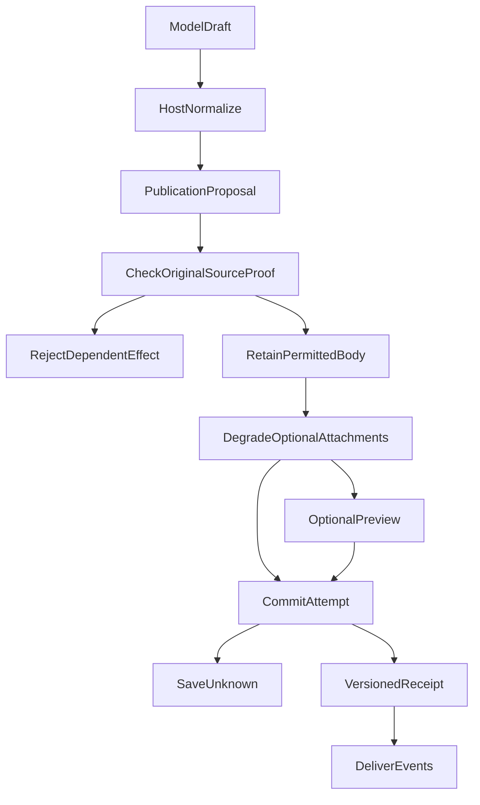

---
evidence:
  implementation: "Publication mechanism implemented (as documented here)"
  scoped: "Controlled call paths and PostgreSQL recovery cases"
  live: "User-facing rendering and research semantic quality require separate validation"
---

# The Agent Has Generated an Answer. Why Does It Still Need a Separate Publication System?

A research agent has queried a portfolio and retrieved materials, and the model has finally written an answer. The server already has the Markdown. Surely it only needs to forward that string to the browser.

Progressive answers, source revocation, and reconnection make the problem more concrete: the body may be visible but not yet saved; one section may have been committed while the next model call can still fail; a new preview and an old receipt may share a revision number but carry different source notices. Using the outcome of the last model call to decide whether the entire answer exists would erase facts that have already occurred.

An actual fix in October 2026 exposed precisely this mismatch: during duplicate-content comparison, a live preview of the same revision obscured the source status of the genuinely committed receipt. Another test, involving the authenticated application and a PostgreSQL restart, found that when Publication had committed the body but the runtime log had not yet been written, rebuilding history from that log alone lost the answer.

This article examines just one component: **why Publication—the answer publication component—cannot be merely a message sender, and how it manages candidate bodies, validation, previews, durable commits, revisions, and recovery.** It is an engineering publication mechanism, not an automatic judge of whether investment analysis is correct.

By October 2026, we had encountered a deeper problem: the model had produced a readable body, yet Runtime, Native tool parsing, or a recovery path could still reject it independently before Publication. We therefore brought decisions about **whether to retain the body, how to degrade it locally, and which publication effect must be rejected** back under Publication as far as possible. Original authorization, execution permissions, and durable receipts remain with their respective factual owners.

The main article reviews the original project's publication mechanism and its evolution. The accompanying [fixed Open ETF Agent v0.8 implementation](https://github.com/hpoenixf/open-etf-agent/tree/2c096ce47be2161f97531170af07ef255872f8b1) extracts only its single-body-block publication, revision, and durable readback mechanisms. It does not include a preview interface, multi-block citations, or dynamic source revocation; do not conflate the two capability scopes.

## 1. A Model Having a Body Is Not the Same as the System Having Published It

Early question-answering interfaces tend to collapse three events into one operation: the model returns text, the server saves a message, and the client displays it. As long as an answer can only be returned as a whole at the end, this simplification can work for a while.

Research agents, however, often need to deliver a supported partial answer, continue reading, and then revise sections already published. At least five distinct facts arise:

| Fact | Who can establish it | What it does not establish |
| --- | --- | --- |
| The model proposes a candidate body | The sealed model turn | That the body may be disclosed |
| The candidate passes publication preparation | Publication's current validation | That it has been saved |
| A temporary preview is sent | The server's preview event | That the client received it or the database committed it |
| A versioned publication is committed | A durable Publication receipt | That the browser rendered it, or that the article is correct |
| The client receives and displays it | Delivery and DOM observations for that version | That the user read or accepted it |

**The most important change is not the number of states added, but that a later stage can no longer impersonate the authority of an earlier one.**

Without a separate Publication component, if model turns or streaming transport each handled publication themselves, structural contracts, citation binding, revision identity, save ordering, and recovery decisions would become scattered across callers. Publication centralizes those shared responsibilities; it does not decide which argument is more persuasive on the model's behalf.

## 2. Two Body Entrances, One Publication Owner

This system went through a very practical interface evolution.

Initially, we represented an answer through an explicit publication action. Later, we consolidated the progressive-answer tool into `send_answer_part`: the model only submits complete Markdown and, where necessary, a still-valid `replaces` target issued by the Host. It no longer has to supply source versions, numeric channels, text offsets, or runtime state.

Later still, we realized that requiring “the model must call a publication tool before any body is allowed to appear” was also unreasonable. Ordinary Assistant Text explicitly normalized by the gateway can be a candidate answer too; a model turn containing tool calls can also contain ordinary prose. The two entrances have different candidate identities but **share the downstream Publication validation and delivery mechanisms**.

The following is a teaching illustration, not real holdings, source identifiers, or the current underlying wire payload:

```text
Entrance A: ordinary model prose
  “This round has first confirmed the portfolio allocation. Here is the independently answerable part…”

Entrance B: send_answer_part
  markdown: “This fund's current weight must be interpreted in light of the report date. [[cite:complete Host citation]]”
  replaces: <optional, current publication ID issued by the Host>

Host:
  Establish an in-run identity for each candidate → validate → prepare → publish
```

Raw protocol frames, hidden reasoning, Entry routing results, and incomplete tool arguments cannot enter the publication chain merely because they “contain something that looks like an answer.” For genuinely different bodies, the system does not use semantic similarity to delete content from one entrance; it reuses an existing identity only when the exact-duplicate rules are satisfied.

The Native tool entrance must also allow candidates to reach the publication decision owner. How it once bypassed Publication is covered in the two governance rounds below. Necessary tool identity, sealing of original arguments, and the overall intake capacity remain protected by their original owners.

The trade-off is this: **let the model decide what to write; let the Host decide whether that text qualifies as the current displayable, persistable answer.**

## 3. Publication's Main Flow: Preparation, Preview, and Commit Are Different Actions

The key mechanism can be summarized in one diagram. A temporary preview is an optional early-delivery path; not every Publication call has to send a preview first.



**Relationships and decision conditions:**

- **CheckOriginalSourceProof → RejectDependentEffect**: a real source on which the block depends is unauthorized, its identity is invalid, or a necessary inherited dependency cannot be confirmed. Reject only the affected effect; check independent blocks separately.
- **CheckOriginalSourceProof → RetainPermittedBody**: the original Run, account, source, and content identities allow the effect to enter display preparation. This does not prove the prose's reasoning correct.
- **RetainPermittedBody → DegradeOptionalAttachments**: incorrect citations, unverifiable numeric slots, and optional display metadata degrade in place rather than automatically swallowing a legitimate body.
- **OptionalPreview → CommitAttempt**: preview may precede saving; preparation may also lead directly to a commit attempt. Preview is not mandatory.
- **CommitAttempt → SaveUnknown / VersionedReceipt**: without a confirmable database receipt, the system cannot claim the content is saved. Only a committed fact can produce a versioned receipt.

In the current implementation, the publication adapter combines the current model candidate with the evidence view actually permitted for this operation, yielding a displayable body and dependency bindings. It can finish preparation before writing to the database and let the UI see `answer-preview` early; a genuine `answer-publication` must be backed by a committed, versioned fact.

The persistence path saves more than the body: within the original transaction it handles block versions, sources and dependencies, delivery events, and run constraints. Normal commits, revisions, and recovery reuse this owner. A temporary preview appearing on screen must not be disguised as a successful database write.

To reduce the wait for the first section, the current path allows early preview delivery and subsequent save settlement. That introduces a cost we have to acknowledge: **the user may see content that is not yet durably saved.** A failed save must remain a failure fact; recovery cannot treat the temporary preview as committed content. Nor can some already-visible changes be treated as if they consumed no revision allowance merely because saving later failed.

## 4. Two Layers of Validation: Mechanical Validity Does Not Establish the Argument

Publication uses a shared `AnswerBlock` structural contract parsed by runtime, publication, recovery, and conversation projection. Internal blocks may contain text or tables, roles, and controlled bindings; the ordinary model writing entrance does not have to maintain these structural facts itself.

The first layer handles the candidate's **extractable body and mechanical structure**: it extracts readable portions from explicit text or table content and normalizes optional roles, annotations, and bindings supplied by the model. Peripheral modules must not each become another body judge. Format normalization must not erase substantive dependency identities; if no body can be safely extracted, it must not invent one.

The second layer handles **the real eligibility of a publication effect**: do the current Run, account, source, content, and revision identities support this block's preview, commit, or replacement? This is stricter than “the JSON passes the schema,” but rejection must target the affected effect rather than escalating every attachment defect into failure of the entire answer.

**Citations require original eligibility.** Writing `[[cite:...]]` does not automatically grant citation rights. The model must use the complete identity actually issued by the Host, resolved against the currently available evidence view. A search hit, a source name guessed by the model, or a shortened identifier cannot masquerade as material that has been read and authorized. A valid citation only establishes the binding mechanism; it does not prove that the material supports the whole inference.

**Controlled numbers require original bindings.** For values such as portfolio figures that require deterministic sources, the Host issues controlled numeric handles, then renders values into the answer according to the current version, scope, and source. An invalid handle is not arbitrarily guessed into some other value. Conversely, ordinary literal numbers or derived ratios computed by the model are not universally barred from publication simply because they lack controlled handles. They may be treated as ordinary prose, but **they do not automatically receive per-value correctness certification**.

**Source notices belong to specific publication blocks.** With no valid inline citations, or only some confirmed citations, the system can attach `sources_unverified` or `sources_partial` to that block. This does not make the entire answer unreliable, and a source notice alone must not mark an execution as interrupted. A committed source notice is bound to the block's revision and body identity. Legacy formats or mismatched bindings retain unknown status rather than defaulting to “risk-free.”

### Local Degradation Does Not Relax Real Authorization

The most important part of this consolidation is not a new kind of check, but separating **attachment defects, content disposition, and rejection of real effects**:

| Problem encountered | How Publication and the original factual owner handle it |
| --- | --- |
| An inline citation is absent, invalidated, or exceeds attachment capacity | Degrade only the corresponding link/marker and retain the source notice. A body with independent authorization remains displayable. Citation degradation does not erase actual private-source dependencies. |
| A numeric handle cannot be confirmed, or bindings for the same placeholder conflict | Show `[value missing]` at that position. Valid values are still rendered from the Host's originals; ordinary literal numbers gain no certification. |
| The model labels private material public, or writes “the trade has been executed” | Model labels and prose do not change source permissions and cannot constitute a trade receipt. Real protected-source or execution effects are rejected by their original owner. |
| Only candidate A in a batch depends on a denied private source | Reject A's protected publication effect. Do not let A's failure delete independently authorized B. |
| `replaces` has no valid target, encounters a version conflict, or exhausts the revision allowance | Reject this modification and keep the original committed version. An invalid revision target must not be rewritten into a new insertion. |
| Required source, content-identity, or inherited-dependency proof is missing | Reject the corresponding protected effect. Do not delete dependencies just to make a body displayable. |

Consider a synthetic example: the model submits two explanatory blocks. A misspells a public-material citation, but its text does not depend on unauthorized private material. B really does refer to an unauthorized private report. A can be delivered with an unverified-citation notice; B must be rejected. The system must neither swallow A because of A's bad citation nor allow B merely because A is deliverable.

**Capacity, too, is a body-disposition concern, not a second veto for peripheral layers.** Within the original sealed-input/transport byte limits, bodies exceeding 60,000 display characters now reach Publication, which retains a bounded readable prefix and explicitly marks truncation. Citation targets and controlled amounts must not be cut into misleading half-valid values. This does not mean oversized text can be published completely and losslessly.

“Unified” does not mean moving all permission checks into Publication. The Host still supplies true source and scope facts; storage still guarantees versions and concurrent modifications; execution still depends on actual receipts. What is unified is **the authority to decide how candidate bodies are published**, not every business authority.

Put differently, Publication can answer “may this content be published under the current contract?” It cannot replace researchers or independent evaluations in answering “is this investment analysis correct?”

## 5. A Block Has Three Key Coordinates: Identity, Revision, and Display Position

Progressive answers are not just strings repeatedly appended to a page. They are more like a collection of revisable, recoverable answer blocks:

| Coordinate | Role | Why it cannot be omitted |
| --- | --- | --- |
| `publicationId` / block identity | Identifies “which section is being changed” | Prevents a revision from being appended as a new section |
| `revision` | Identifies the section's content version | Prevents old events from overwriting new content |
| `deliveryOrdinal` | Identifies its position within the answer | Preserves the original order when revising a section |

This is a conceptual example, not actual SSE fields or database records:

```text
Initial commit: A, revision=1, deliveryOrdinal=2
Revise the same section: A, revision=2, deliveryOrdinal=2
Add a section: B, revision=1, deliveryOrdinal=3
```

Representing “revise A” as a structured fact yields the following **synthetic internal publication event**. It is neither model input nor the complete outer SSE transport format:

```json
{
  "type": "answer_block_published",
  "id": "synthetic-section-A",
  "revision": 2,
  "deliveryOrdinal": 2,
  "content": {
    "type": "text",
    "text": "This comparison describes only differences in the example material; the report dates still need checking."
  }
}
```

The database retains revision history, while the current delivery projection replaces the body in the same position rather than displaying two versions of A as two conclusions. If the client receives events with the same publication identity and revision but different bodies, it must treat that as a protocol conflict, not silently let “the last arrival win.”

To prevent repeated publication of equivalent content, the system also has an intentionally narrow exact-duplicate rule: it may return `unchanged` and reuse the original receipt only if the body is exactly identical, protected-source and dependency bindings and notices have not changed, and current authorization passes again. It creates no new revision, delivery event, or revision-allowance charge. Similar wording is not a duplicate; even a Markdown whitespace change does not qualify. After source revocation, old content cannot bypass rechecking even if it is identical word for word.

The current default revision allowance is 2 modifications per block and 8 per Research. It limits modifications to existing blocks, not the addition of new answer sections. Exceeding it rejects that modification; it should not erase earlier legitimate content or automatically declare the whole research effort failed. A failed revision and a failed initial publication are different effects: an invalid `replaces` cannot automatically become a new block, nor is the original committed body deleted because a revision failed.

### Reducing the Three Coordinates to a Runnable Example

You do not need a full chat UI to observe these constraints. The public [Session implementation](https://github.com/hpoenixf/open-etf-agent/blob/2c096ce47be2161f97531170af07ef255872f8b1/src/session.mjs) puts body revision and current delivery position in the same SQLite transaction: a single Host answer block retains its identity and position, while explicit replacement advances only its revision. Even an identical body can reuse a receipt only after the original Run and Host bindings are checked. If the text is unchanged but the binding changes, explicit replacement is still required.

The following local example, run on Node 26.11.1, uses synthetic replies and real SQLite and needs no model account. See the [main entry point](https://github.com/hpoenixf/open-etf-agent/blob/main/README.md) for subsequent development; reproduce this mechanism using the fixed commit below:

```bash
git clone https://github.com/hpoenixf/open-etf-agent.git
cd open-etf-agent
git checkout 2c096ce47be2161f97531170af07ef255872f8b1
npm ci --ignore-scripts --no-audit --no-fund
npm run build
node dist/src/session-cli.mjs start --session runs/publication-demo --case durable-publication
# Replace run-YOUR_ID below with the runId printed by the preceding command
node dist/src/session-cli.mjs publication --session runs/publication-demo --run run-YOUR_ID
node dist/src/session-cli.mjs publication-event --session runs/publication-demo --run run-YOUR_ID
```

The `publication` in the start result is the receipt for the committed body. Running the read commands again retrieves the original body, revision, and current delivery position rather than regenerating an answer. The report file has a separate Artifact receipt; it cannot substitute for the body-commit fact. This example preserves the publication mechanism; it does not evaluate the research quality of the synthetic answer.

<!-- open-etf-case:publication@e0a6a29b7474a19c18b169c0e4a7eb0eb614504d -->
### Reading Back the Body, Current Event, and Report Separately

The fixed public snapshot's [Publication CLI case](https://github.com/hpoenixf/open-etf-agent/blob/e0a6a29b7474a19c18b169c0e4a7eb0eb614504d/test/publication-cli.test.mjs) offers another way to observe the mechanism: separate CLI calls read the body, a specified revision, the current event, and the immutable report.

After installing dependencies according to the README in the linked fixed snapshot, run:

```bash
node --test --test-concurrency=1 --test-name-pattern='^8\.2 local CLI starts same Runtime and separately reads body, current event and immutable Artifact$' test/publication-cli.test.mjs
```

The case checks that the body equals the original answer and that the specified revision and current event point to the same Publication receipt. The report is read back by its saved identity through the Artifact owner and compared with the bytes and digest of `report.md`. The report file's identity has not replaced the body-commit identity.

The scope remains single-body-block publication, revisions, and local CLI readback. It does not include progressive browser display, an HTTP/SSE publication product layer, or validation of model answer quality.
<!-- /open-etf-case -->

## 6. Real Problem One: A Same-Revision Preview Once Obscured a Committed Receipt

The regression case of October 11, 2026 shows particularly clearly why “the body is the same” is insufficient.

At the time, runtime maintained live candidates and committed candidates. Duplicate detection looked for the same currently visible body, but in the early comparison, the live mapping could obscure a durable receipt with **the same revision number**. Even with identical text, the genuinely committed source status could therefore be lost.

The model had not suddenly written a bad article. We had put records with two different levels of authority into the same candidate pool without clearly defining precedence within the same revision.

The corrected rule can be simplified to:

```text
Newer legitimate preview > older committed version (for current temporary display only)
Committed receipt of a revision > preview metadata of that same revision
Current source denial > visibility of an old preview or old receipt
```

The second line is especially important: a committed receipt carries database-confirmed source and version facts. A preparation-stage preview cannot retroactively give it a status that “looks clean.” The third line reminds us that **a historical commit genuinely occurring does not mean a revoked source may still be displayed today.**

The fix kept the original candidate and receipt ownership rather than introducing another publication-state or permission system. Committed facts still outrank same-revision previews. Earlier parallel timeouts and real-model quality problems, however, cannot be solved by changing receipt precedence.

## 7. Real Problem Two: The Database Committed, but the Runtime Log Was Not Finished

A more difficult timing window lies between the durable commit and the runtime log.

Suppose answer A's Publication transaction has committed, including its body, source bindings, and delivery receipt. The process then exits before the Runtime journal records the corresponding state. Rebuilding only the journal after restart could incorrectly conclude that “A does not exist.”

Correct recovery does not ask the model to write A again, nor forcibly mark the old preview saved. Instead:

1. Read the protected body from its original Publication owner using the original Run, block identity, and committed receipt.
2. Check inherited dependencies among the current account, sources, and blocks. If B refers to A's sources, checking only B's apparent direct citations is insufficient.
3. Send portions still eligible for display through the existing history-snapshot and delivery channels. Portions whose permissions cannot be confirmed, or have been revoked, remain protected.
4. Keep recording Runtime's original execution terminal state, Publication's commit fact, and whether the client displayed it independently.

There is a further nuance: an old receipt lacking fields for current source-status eligibility does not mean its sources are confirmed safe. But a source set genuinely verified to be empty must not be confused with a completely unknown one either.

Later work also brought **selection of the original published body for history display and active replay** back under Publication. It uses original Run authorization, protected body and event identities, and actual source relationships to decide which blocks remain readable. Damage to one block's original content or permission proof should not obscure other independently verified blocks. Missing incidental Runtime journal details no longer automatically justify rejecting all original bodies again. Conversely, if original content cannot be verified or real source permission is denied, recovery still cannot fall back to an unprotected cache or assemble a historical answer that merely “looks right.”

This also avoids an unnecessary re-evaluation: **reading an old answer is not rerunning today's portfolio investment calculations**. Historical prose may retain its identity from that time under its original display authorization. New analysis or execution still requires current data and permission checks; a historical commit cannot grant authority over today's numbers.

On October 11, 2026, the authenticated application, isolated PostgreSQL, and restart path actually exposed and verified this class of recovery gap. The fix included reading the original protected receipt, rechecking inherited sources, and preserving the unknown semantics of legacy source notices.

The public single-block implementation turns the same timing window into a [reproducible process-interruption counterexample](https://github.com/hpoenixf/open-etf-agent/blob/2c096ce47be2161f97531170af07ef255872f8b1/test/publication-runtime.test.mjs#L70): the process is actually terminated after the body transaction commits but before the run-terminal checkpoint is written. Another process recovers through the original sealed proposal and obtains the original body and receipt, without adding a revision or calling the synthetic model again. This is not an in-memory snapshot standing in for a restart.

The neighboring failure branch matters too: after the body is committed, a later check may find that a required report is absent, and the Run can still fail. The earlier body remains readable, but its presence does not establish that the report was generated. [Runtime's commit positions](https://github.com/hpoenixf/open-etf-agent/blob/2c096ce47be2161f97531170af07ef255872f8b1/src/runtime.mjs) deliberately leave “body saved” and “entire task complete” at separate settlement points to preserve these simultaneously true facts.

## 8. Why a Later Failure Cannot Erase an Earlier Commit

The opening question should now be clearer.

Suppose A has been committed, and a provider fails while the model continues researching B. The system can record all of the following:

```text
A: committed at revision=1, readable under current authorization
B: not committed; the reason still needs investigation
Run: failed or partial, recorded according to its original execution terminal state
Client: whether it actually received A, recorded according to the corresponding delivery evidence
```

These four lines are not contradictory “success” and “failure” claims. A's historical commit is real, and so is B's failure; whether the user received A still needs proof from the delivery chain. A later failure cannot undo A's transaction into “it never happened,” but A's existence equally cannot be packaged as “the entire user task is complete.”

Specifically, the publication effect of `send_answer_part` and the model tool receipt are two independent settlement points. When publication has committed but writing the receipt fails, the system cannot simply relabel the round a “known publication rejection” and blindly retry the original side effect. Recovery should establish the settled effect through its original identity while retaining unknown status for execution that remains uncertain.

Source revocation, conversely, is not “an ordinary later failure.” It changes **current display eligibility**: the original commit remains auditable, but bodies affected by revocation must not continue to be disclosed to new clients merely because they were once successfully published.

One easily overlooked boundary must also remain: the server emitting `answer-publication` proves only its own delivery action. Browser reception, DOM commit, history snapshots, and actual user reading each have their own observation point. No single clock or receipt can sign for every stage.

## 9. Why the Same Publication System Needed Two Rounds of Governance

After centralizing the mechanism, we still have to ask: can callers bypass it and independently decide that a body disappears? That is the additional lesson from the two earlier publication-governance reviews.

### The First Round Unified Structure; the Second Reclaimed Decision Authority

The first governance round separated body, citations, saving, and task state, but it had not reclaimed body-disposition authority at every entrance. Subsequent production-path reproductions exposed candidates hidden by peripheral filters.

In a synthetic reproduction using production functions on October 15, 65 legitimate history records resulted in only the most recent 64 being displayed; the first was replaced by “citation source cannot be verified.” The count policy had actually acquired the power to hide content, while the error message misrepresented the cause as a source problem. In another reproduction, underlying publication retained safe blocks from a batch, but the outer adapter threw because the batch had not succeeded completely, erasing partial success again.

Both examples exposed the same issue: **sharing a Schema can still leave multiple body decision-makers in place.** The second round therefore removed peripheral candidate filtering and the unresolved-publication-rejection set rather than extending an error-code list of “continuable” cases.

### Also Check Who Can Stop a Candidate Reaching Publication

After one round of engineering validation passed, rechecking the Native tool entrance still found that control characters, display length, and an empty `replaces` could stop a candidate before Publication. Generic argument processing and hooks could also become a second body judge.

New production-entrance checks used a scripted model gateway to send a problematic candidate followed by an independent body, then observed whether publication preparation received both proposals. An invalid revision should reach the original decision owner and have that modification rejected, while independent content remains deliverable. Long text within the legitimate intake limit should be truncated to display capacity, not swallowed wholesale by a peripheral layer.

There was a real contract change here: the first round classified 60,001 characters as input that should be rejected; only the second changed this to display degradation within the overall intake boundary. The new contract must not be projected backward to claim that the old assertion necessarily missed coverage. What matters is who rejects, which effect is limited, and whether other bodies survive.

### Display Normalization Must Not Rewrite Original Input

The NUL character also exposed a persistence problem: being displayable after in-memory cleanup does not mean the original arguments can be stored in PostgreSQL in their original representation. Decoding the stored string further changed the sealed identity as well.

The final approach stores recoverable original JSON text in the existing fields, reuses mechanical normalization for display and dispatch, and does not apply extra decoding on readback. Real-database checks separately observed original-input round trips, cleaned display, saving, and history readback through a new connection.

“Text finally appeared on the page” is insufficient acceptance for this kind of problem. We must also check that the candidate reaches the sole disposition owner, original arguments survive persistence round trips, and the same publication facts can be read back after restart.

Modularity is valuable because it encapsulates decisions that callers no longer duplicate; compare [John Ousterhout's discussion of modular design](https://web.stanford.edu/~ouster/cgi-bin/cs190-winter18/lecture.php?topic=modularDesign). Degradation itself can introduce failures, so its layer and compositional behavior need checking; see [Google SRE: Addressing Cascading Failures](https://sre.google/sre-book/addressing-cascading-failures/). This article does not claim that these changes reduced the rate of empty bodies in production.

## 10. Boundaries That Remain After Implementation

The current implementation has centralized candidate-body normalization, source and version validation, local degradation, and publication receipts in Publication. Controlled production call paths and PostgreSQL recovery checks cover uninterrupted independent bodies, committed versions not being overwritten by old previews, rejection of invalid sources, and history readback of saved content.

Publication answers **who has authority to publish and how publication facts are recorded**. Research quality and reading experience are evaluated by their respective stages.

This mechanism has costs: separate preparation and commit stages; revision identities, persistent events, source relationships, and preview/receipt merge rules to maintain. Unifying body-disposition authority also requires examining Native entrances, runtime, hooks, and recovery reads for hidden duplicate vetoes. It should not be understood as “every chat application must copy a heavyweight publication service.”

The first exceptions in some earlier runs still cannot be fully reconstructed from historical records, so those records cannot explain every instance of “no body.”

The transferable criterion is simpler: **if content may appear early, be revised later, recover across processes, and depend on revocable material, then “writing an answer” and “publication facts” deserve separation. The implementation may be a deep module or a separate service.**

This applies [Principle 3, “proposal, approval, execution, and effect are different facts”](/en/principles#principle-3): a model's candidate body is not the same as Publication accepting and committing it and producing a recoverable publication receipt. Recording preview, commit, and actual user reception separately prevents later failure from erasing an effect already established.

## Conclusion: The Model Writes the Answer; the System Must Own the Publication Facts

Looking back on this evolution, I am increasingly reluctant to treat an agent's output as a continuously growing string.

The model organizes the explanation. Publication owns candidate-body extraction, necessary local degradation, and publication disposition, turning permitted content into recoverable committed facts with identities, revisions, and source bindings. Delivery transports and displays those facts. Runtime determines how this research run ends. Real authorization and execution authority remain with their original owners. They should cooperate, but they cannot impersonate one another.

**In one sentence: useful content may reach the user early, but “it was seen,” “it was saved,” and “everything succeeded” must not become the same fact.**
