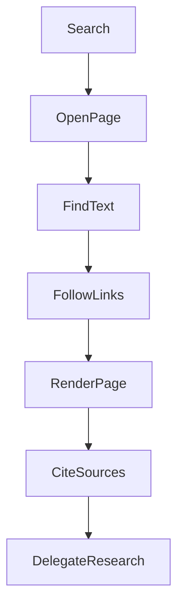
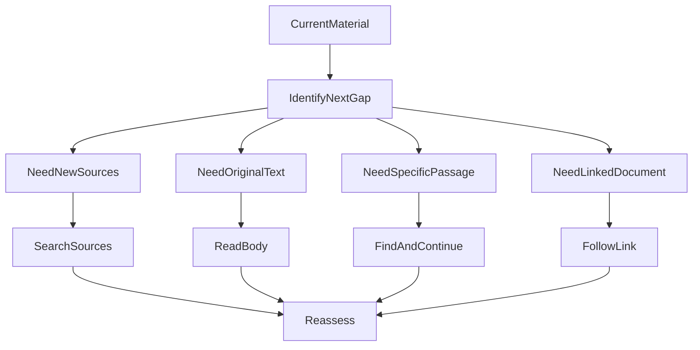
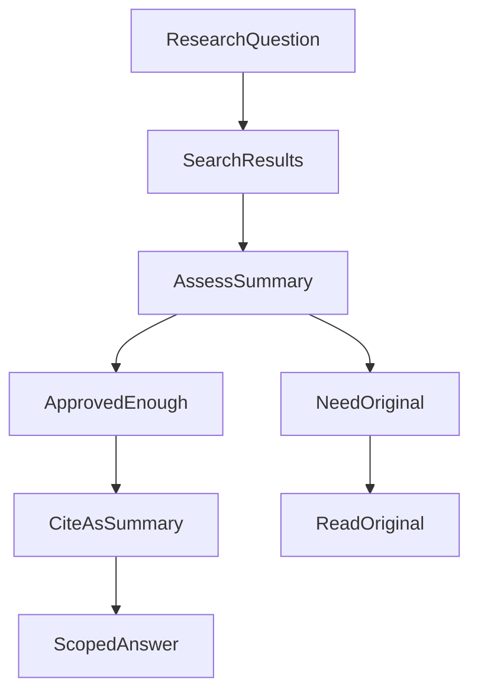
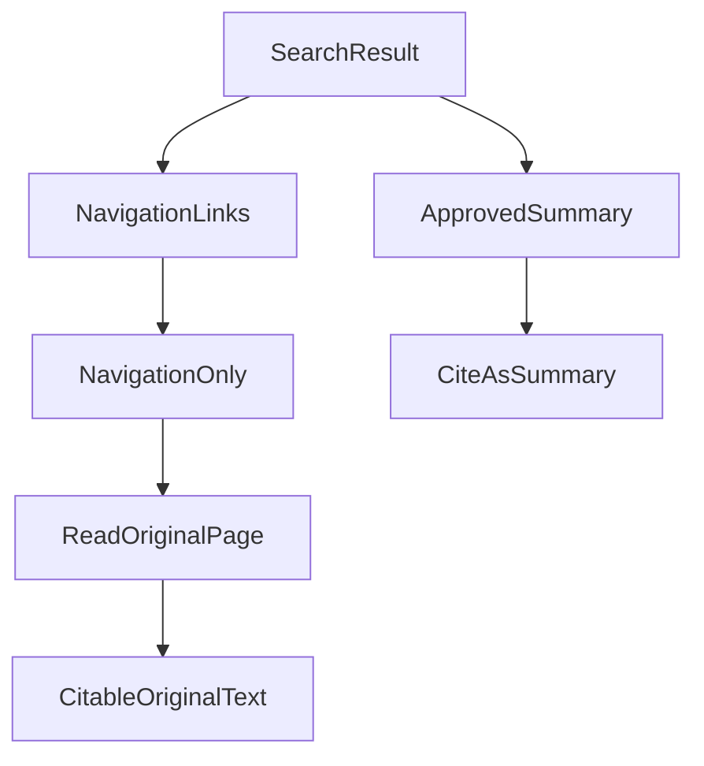
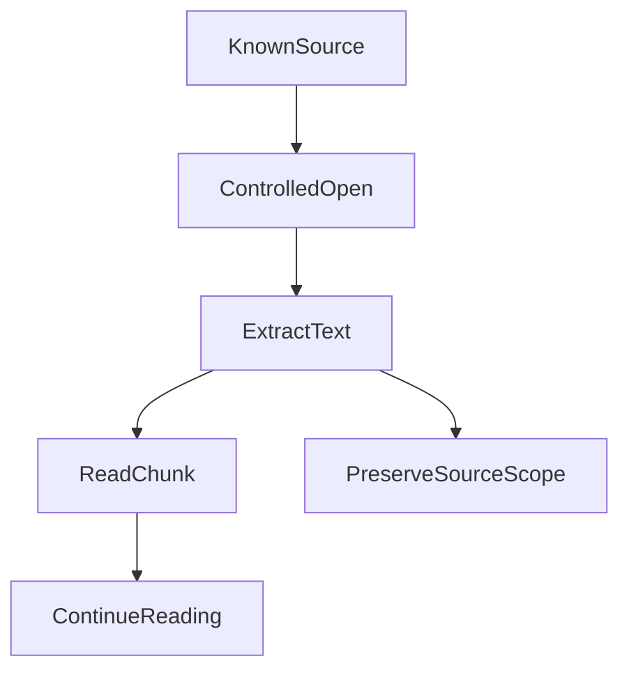
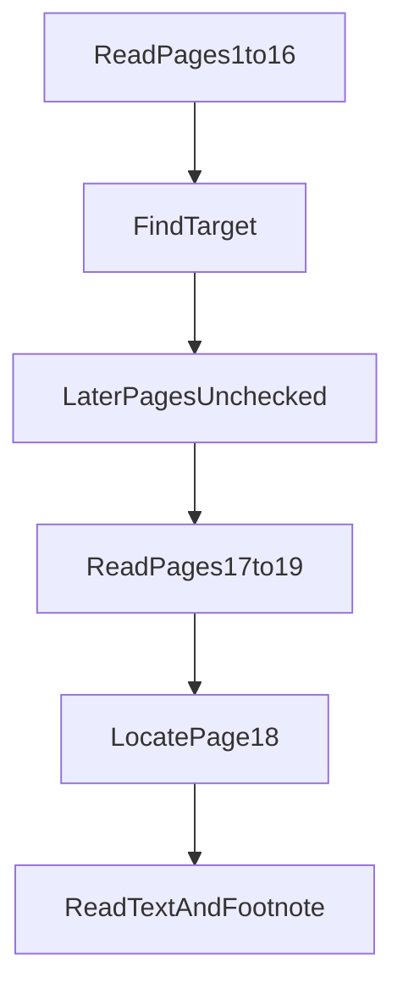
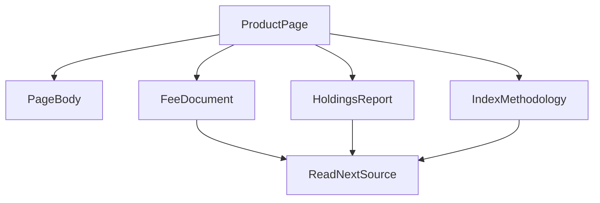
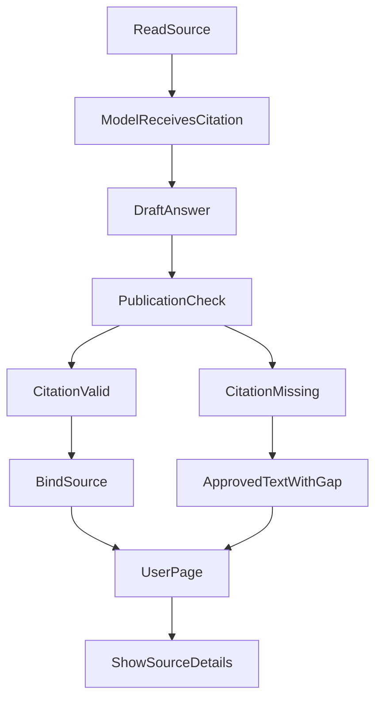
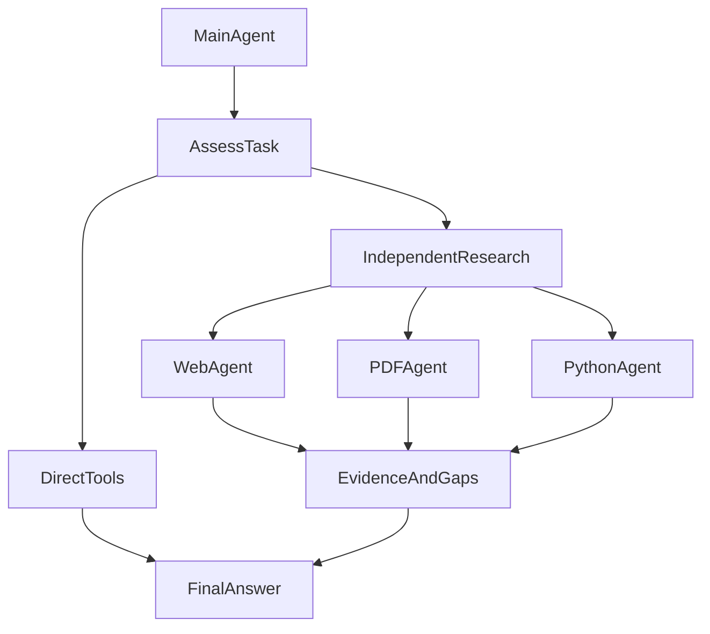

# From Finding Pages to Reading Further: How We Taught an Agent to Browse the Web

Two ETFs invest in similar markets. The user wants to compare fees, index methodology and portfolio concentration.

Search quickly finds their official websites, but not necessarily the answers. Fee conditions may live in another notice, index rules on the index provider's site, and holdings in a periodic report. Even after opening the report, the decisive footnote may be on an unread final page.

Ten more searches may help less than following one existing link. **Web research is not primarily about opening more pages. It is about identifying the current gap and retaining a place from which reading can continue.**

The current system supports search, reading, in-page find, link following, governed rendering and source delivery. This diagram is a capability index, not a mandatory sequence. Static pages need not launch a browser, and single-page questions need not launch a subagent.

The ETF comparison is a teaching example. Dated or specific failures below refer to their historical observations; they do not combine into an accepted end-to-end ETF comparison on the current version.

## 1. Identify the Gap Before Choosing the Action

| What is already available | What is missing | Appropriate action |
| --- | --- | --- |
| A question without sources | A useful entry point | Search |
| An official site, product-catalogue link or admitted user URL | Original content | Read the registered source instead of searching for the same address |
| A long report | A particular passage | Find, then read around the match |
| A link to a fee notice or holdings report | A related document | Select the discovered link and read it |
| Enough material for a bounded statement | Explanation and delivery | Answer within that scope rather than continuing for the sake of tool calls |

There is no fixed order. The model judges which gap deserves more work; the Host owns source identity, access conditions and resource limits. Neither invocation counts nor returned characters certify evidence sufficiency.

The server manages search-provider selection, caching and bounded fallback. Provider availability is not network permission, and a cache hit does not give a new Run the permissions of an earlier task. For the model, the important distinction is whether the result supplies a lead or actual support.

### A Snippet Can Help Without Becoming Original-Source Verification

An authorized search snippet actually supplied to the model, with a valid citation, can support a limited statement labeled as a search summary whose original page has not been read. A snippet may establish the gist of a news item without another page request merely for completeness.

For ETF fees, missing share class, effective date or measurement basis still requires the source. Allowing snippet citations preserves useful information when the original page is temporarily unreadable; it does not promote the snippet into the whole document.

Navigation and evidence remain separate even when they point to the same URL:

A link identifies a possible next stop. A snippet identifies what a provider returned. A read passage identifies the original text covered by that operation. The existence of a link does not establish that the full document was read.

## 2. Return a Passage and a Position, Not Merely “Success”

Browse operates on registered source references through `read` and `find`. Sources can come from search, discovered document links, a validated product catalogue, or a public HTTPS URL in the authenticated original user message. A user-supplied URL does not require a synthetic search just to obtain a reference. Arbitrary model or page text cannot borrow that original-user identity.

A read retains source and content identity, extraction method, time metadata, actual coverage and continuation position. Returning text does not establish complete page extraction, or guarantee that every byte will fit into the following model request.

One historical failure made this concrete: a generic MCP sanitizer reduced webpage text to roughly 500 characters, while insufficient static extraction could still appear successful. The interface returned a string, but the needed evidence was not in it.

The current design separates what the network acquired, what extraction produced and which slice was returned. An unfinished slice can continue without rediscovering the source. Extraction also retains headings, lists and table relationships where possible. For holdings research, keeping a company paired with its weight matters more than the raw character count.

Raising one global length limit cannot solve the entire problem. Downloaded bytes, parsed content, read slices, tool serialization and model input have independent boundaries. A complete upstream page does not remove downstream capacity limits. Output must disclose truncation or uncovered ranges instead of presenting the opening paragraph as the whole document.

## 3. Find Locates; Continued Reading Obtains the Evidence

After acquiring an annual report, another web search for “tracking error” may simply return the same file. In-page `find` locates text within reusable material. It is neither another web search nor automatic semantic understanding of the entire report.

A match should provide a readable location. The next step is to examine its context: the period, definition and qualifications surrounding the number. A few matching words do not replace that context.

In an early real 19-page PDF check, the initial read covered only the first 16 pages. Subsequent legitimate search issued a page-18 locator, and continued reading obtained the target material and page-19 endnotes. The current path has larger bounded extraction capacity, but the old counterexample still establishes the distinction: **not found in the examined range is not the same as absent from the document.**

HTML find uses the retained text snapshot. For PDFs whose authorized source bytes remain available, search can expand the examined page range within its budget without downloading the same file again. The match locator identifies where to read; the find cursor identifies where to continue searching. They are not interchangeable.

Changed file content, invalid source references or exhausted capacity must produce the corresponding unavailability or coverage result. An old cursor cannot point silently into new bytes. The mechanism supports reuse; it does not establish a measured latency or token saving for whole research tasks.

## 4. Do Not Clean Away the Next Document

An article extractor tries to remove sidebars, navigation and clutter. Research may need exactly the “download fee schedule” link outside the article body.

An October 2026 test reproduced this failure: article and table text reached the result, but a supporting-document link outside the article did not become a followable source. Cleaner text had broken the research route.

The current design separates **body extraction** from **candidate-link discovery**. Candidates come from the original page structure and are bounded before source relationships are registered. Selection triggers the next read; discovery does not automatically fetch every link.

The product page, fee document, holdings report and index methodology are simplified examples. A link remains a lead, not an acquired document or proof of relevance.

In-page navigation uses a match location. Cross-page navigation uses a registered source bookmark. The Host resolves the actual address and checks source relationships and access conditions; the model does not guess URLs or maintain click coordinates. Duplicate targets, depth, counts and deadlines are bounded rather than turning into an unlimited crawl.

Official PDF links from a product catalogue exposed the same handoff gap. A structured tool had already returned the address, but not an identity Browse could consume. The fix belongs at that handoff, rather than requiring another search for the official document. A controlled path subsequently followed such links directly, while later answers still showed redundant searching and over-expansion. Connecting tools does not automatically fix research strategy.

## 5. Default Rendering Is a Conditional Additional Read

Static HTML may contain only a shell, or it may contain useful text while JavaScript supplies more. After source admission, current default Browse can attempt governed rendering in either case:

- Static extraction has an empty body.
- The parsed DOM contains executable JavaScript, including applicable inline, external and module scripts.

JSON, LD+JSON data scripts and script-like text in comments do not trigger it. Executable scripts are a signal to attempt another read, not proof that static text is incomplete or that rendering will produce an answer.

~~~mermaid
graph TD
AllowedPage["Admitted HTML"] --> StaticExtraction["Static extraction"]
StaticExtraction --> RenderCondition{"Empty body or executable JS?"}
RenderCondition -- No --> StaticReading["Read static content"]
RenderCondition -- Yes --> GovernedRender["Lazy governed rendering"]
GovernedRender --> RenderSuccess["Valid non-empty result"]
RenderSuccess --> NormalReading["Existing evidence path"]
GovernedRender --> OptionalFailure["Optional capability failure"]
OptionalFailure --> StaticAvailable{"Independent static body available?"}
StaticAvailable -- Yes --> StaticWithWarning["Retain static body with warning"]
StaticAvailable -- No --> Unavailable["Report unavailable"]
GovernedRender --> TerminalFailure["Access refusal, cancellation or timeout"]
TerminalFailure --> OriginalOutcome["Keep original failure"]
~~~

The default composition lazily shares the reviewed renderer; static-only reads do not initialize Docker. The model does not select separate browser actions, and the service does not automatically download an image. The deployment still needs the original supported, fixed execution environment. PDFs and plain text retain their own reading paths.

The isolated container does not receive unrestricted network egress. Page resources pass through the existing Host reader with HTTPS, DNS, public-IP, redirect, source and capacity checks. Login requirements, paywalls, CAPTCHAs and explicit refusals do not disappear by switching to rendering.

### Two Non-Obvious Trade-offs

**Acquiring a script does not guarantee correct browser execution.** A historical bridge dropped CORS response headers: the cross-origin module had been fetched but the browser refused to execute it. The repair preserved upstream browser policy instead of adding wildcard CORS or admitting an entire CDN. Later controlled real-browser checks covered both permitted-CORS execution and the missing-CORS non-execution case. Receiving HTTP bytes alone could not prove either outcome.

**A failed render does not necessarily invalidate static text.** Optional initialization, availability, size or cleanup-uncertainty failures can leave independently admitted, nonempty static evidence available with a warning. Cancellation, deadlines, TIMEOUT and protected access refusals retain their original outcomes; they are not generic “fallback success” cases. A local parser, renderer or helper-process failure should also not erase unrelated evidence already held by the research task. Specific failure-isolation checks do not establish recovery from every native crash.

A real public dynamic-page observation showed rendered text reaching the next model request. The same observation found that the first author's name and tags were absent from the text projection, and the model disclosed that gap. This establishes a useful partial path, not universal website readability or complete extraction.

### Acquisition Failure and Missing Rendered Content Are Different Branches

When explicitly configured, an eligible native page-acquisition failure can also enter one governed DeepSeek Fetch fallback. That addresses failure to obtain material; rendering addresses already-acquired HTML that may need script execution. Native or cache success does not add a Fetch call. TLS, authorization, 403/429, extraction refusals, deadlines and capacity constraints do not become bypass opportunities. Vendor content cannot certify the final redirect URL or publication date on the system's behalf.

## 6. Why Not Let a Full Browser or Scraping Service Handle Everything?

These approaches are not mutually exclusive. The choice depends on required actions and acceptable boundaries, rather than maximizing tool size.

| Approach | Strong fit | What remains to be supplied |
| --- | --- | --- |
| Static extraction such as Readability | Article text from an existing DOM without launching a browser for ordinary pages | Attachment discovery, dynamic material, table relationships and coverage |
| Browser automation such as Playwright | Interaction, screenshots, waiting for state and more complex page operations | Product-specific action permission, controlled resource egress and source facts |
| A scraping service such as Firecrawl | Markdown, HTML, links and other representations through a unified interface | Provider boundaries, cost and failure semantics, plus integration with the application's Run and evidence contracts |
| This system's source-reading path | Search, read/find, discovered links and bounded rendering under existing grants, budgets and citations | Maintaining extraction and rendering infrastructure; it does not cover arbitrary login, form or transaction flows |

[Mozilla Readability](https://github.com/mozilla/readability) focuses on article extraction and documents precautions for untrusted content. [Playwright Page](https://playwright.dev/docs/api/class-page) supports page navigation and interaction. [Firecrawl Scrape](https://docs.firecrawl.dev/features/scrape) exposes multiple content representations and optional page actions. This is a requirements comparison, not a same-task performance experiment conducted by this project.

We retain a narrow reading path because research needs to know where material came from, which part was read and how to continue. It does not necessarily need every clickable element exposed to the model. Optional provider Fetch also shows that external services are not categorically excluded; they must connect to the original identity and resource owners rather than introduce a second access policy.

## 7. Reading Material and Delivering Inspectable Sources Are Separate

A successful read, model exposure, exact citation binding and source display beside the current answer are different facts.

Historical failures occurred at different points in that path:

| Symptom | Actual problem | Current response |
| --- | --- | --- |
| A navigation ID is treated as read original text | Source layers were confused | Distinguish navigation, delivered snippets and actual passages |
| The model copies only a citation prefix | Exact identity is lost during generation | Supply complete copy-ready markers instead of guessing prefixes |
| Numeric substitution shifts citations and truncates nearby text | Publication text transformation | Recompute positions against final display text |
| A valid citation appears only as “structured source” | UI assumes a public URL | Provide inspectable details without inventing a homepage link |
| An unsuccessfully loaded conversation shows old sources | Display state belongs to another target | Bind sources to the current answer and revision, rejecting stale state |

One real repaired sample used all 37 issued citation markers in full and displayed citations in the current answer. It remains one successful sample, not a guarantee against later shortening. Earlier invalid citations could reject submissions; current public-source citation gaps preserve independently permitted prose where possible and disclose the missing attribution instead of erasing the entire answer.

A valid citation still does not certify correct interpretation. Historical answers also contained internally contradictory numeric explanations despite valid citations. Web reading preserves inspectable material and coverage; evaluating the answer requires the actual question. See [Why Citations Alone Do Not Prove Reliability](ai-citations-do-not-prove-reliability.md) for the complete citation mechanism rather than upgrading these browser and display observations into financial correctness.

## 8. Delegate Exploration Without Dropping Its Sources

An ordinary tool call is enough to read a known page. Comparing several sources or repeatedly navigating long reports may justify an independent branch: one task checks fees and applicability, another locates holdings, and Main retains the original question and final argument.

Web, PDF and Python can use the same subtask execution mechanism. This does not require all three roles on every question or promise parallel execution. They still use the original admitted tools; delegation does not expand permission.

A subtask should return findings, supporting material, actual coverage, artifacts and unresolved issues. Historical handoffs omitted a completed Main read, and generated page images also had to be checked for actual inclusion in the Child request. **Having a result does not prove the next participant received it.** Subtasks therefore receive the necessary objective, restrictions and selected material rather than the entire Main conversation; adopted conclusions must remain traceable.

Independent context can separate exploration detail, at the cost of another handoff, context assembly and potentially repeated acquisition. Whether delegation is worthwhile depends on task results and overhead, not on turning every tool into an Agent.

## 9. Continue the Research, Rather Than Grow the Call Count

For the ETF comparison, a reasonable final state might be: fee conditions have been read, index methodology checked, and holdings cover a particular reporting period. The answer compares within those limits and explains what remains missing. It need not read every page, but finding the official site is not enough to declare the question settled.

When building similar capabilities, inspect five connections first:

1. Can existing sources be read directly without another search?
2. Do read and find retain actual coverage, content identity and continuation positions?
3. Does body cleanup preserve necessary attachment discovery without automatically fetching everything?
4. Do optional acquisition or rendering failures remain local while genuine access refusals retain their meaning?
5. After handoff and delivery, can the user still inspect the specific support beside a conclusion?

These mechanisms make continued research and honest limitation statements possible. They have not jointly established an accuracy, latency or token-saving percentage; deeper reading can also cost more. Evaluate whether the target material was obtained, the critical passage actually arrived, the conclusion is supported, and unfinished work is clearly disclosed.
