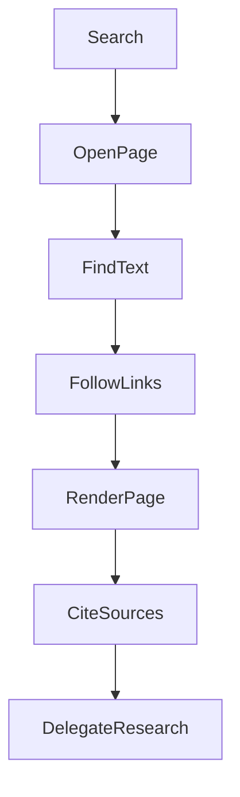
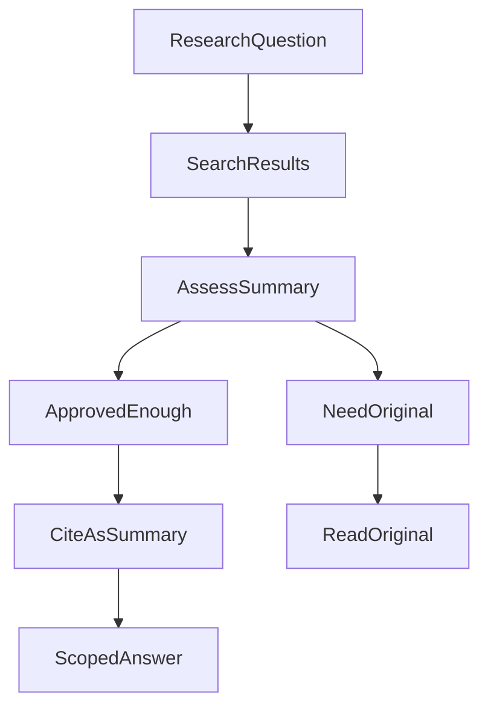
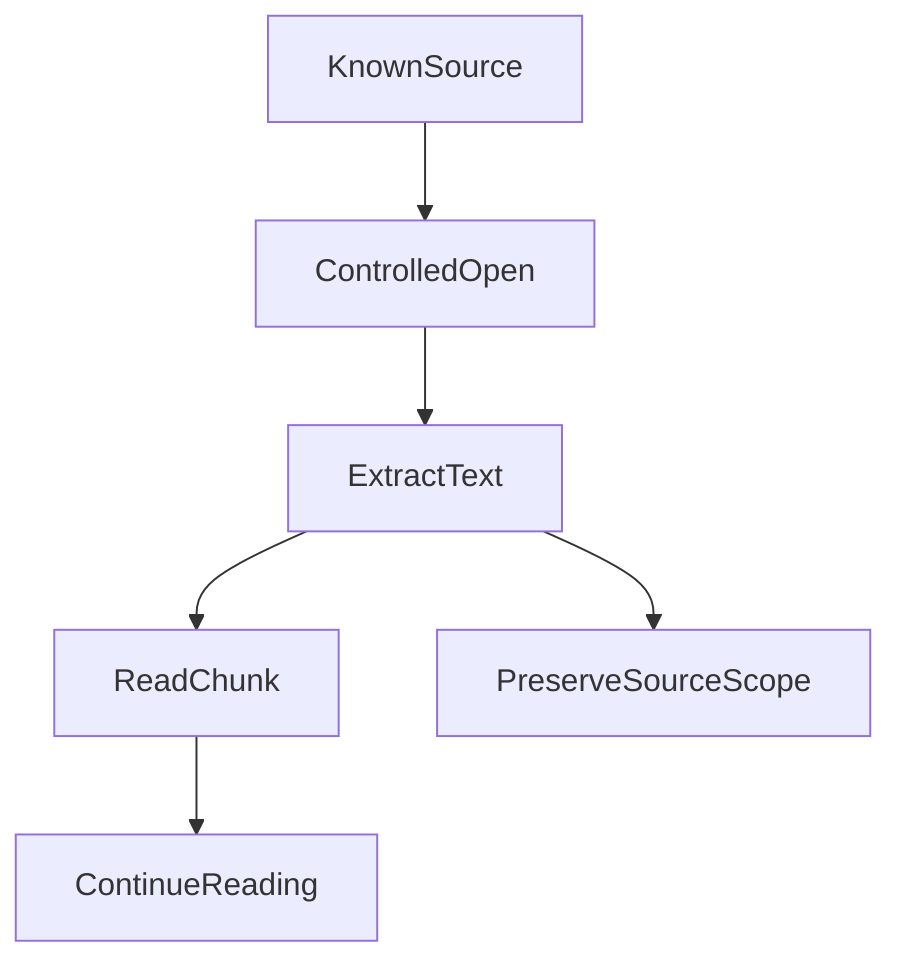
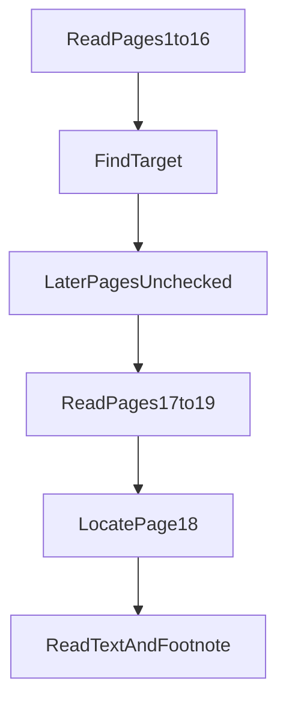
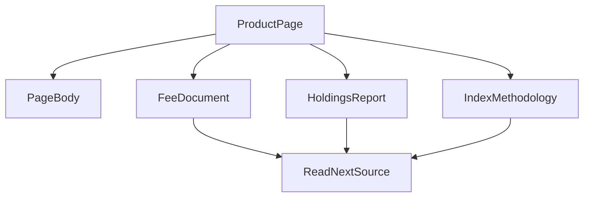
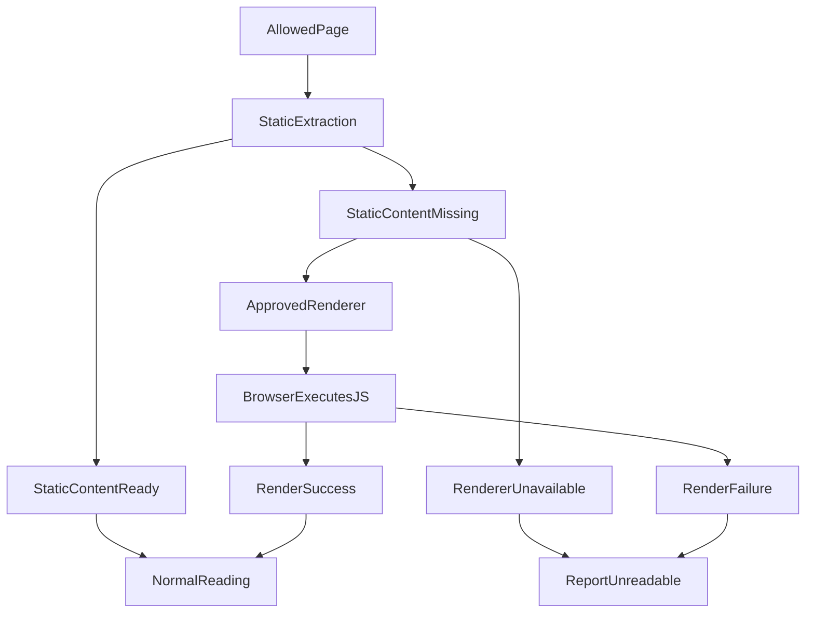
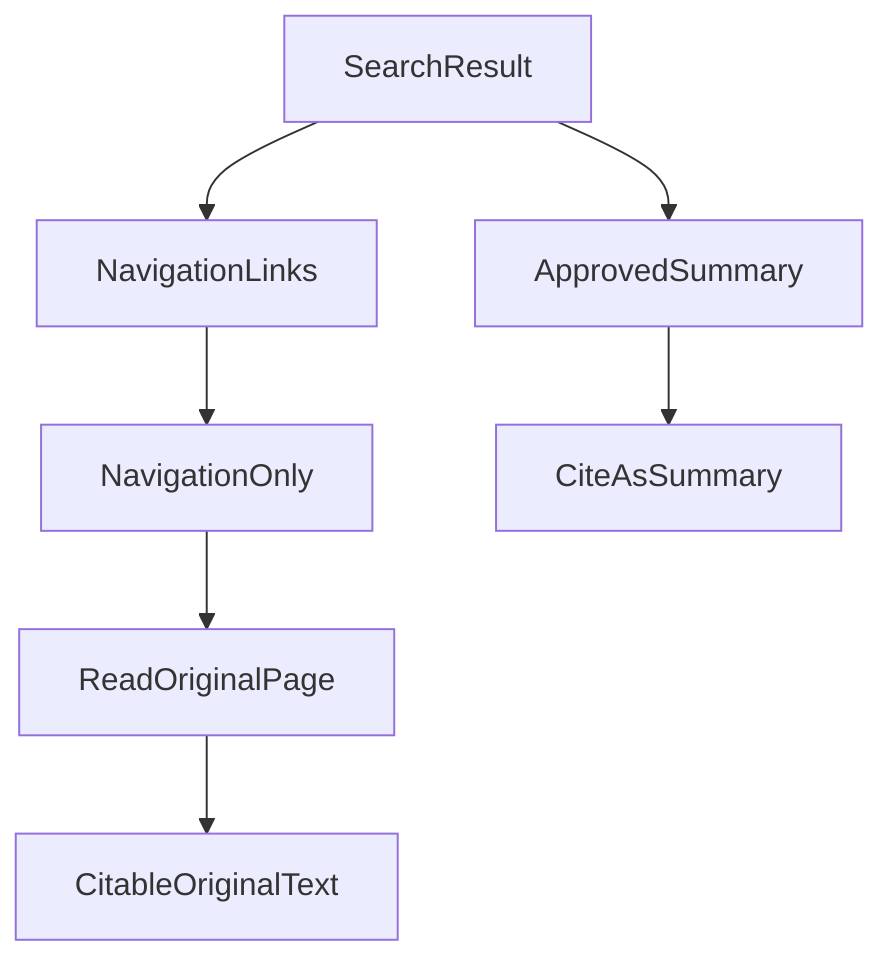
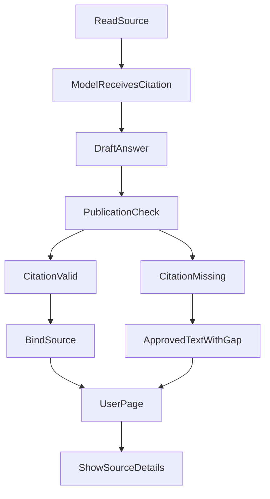
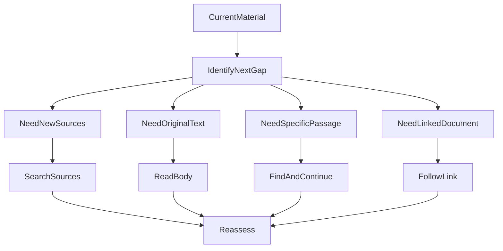
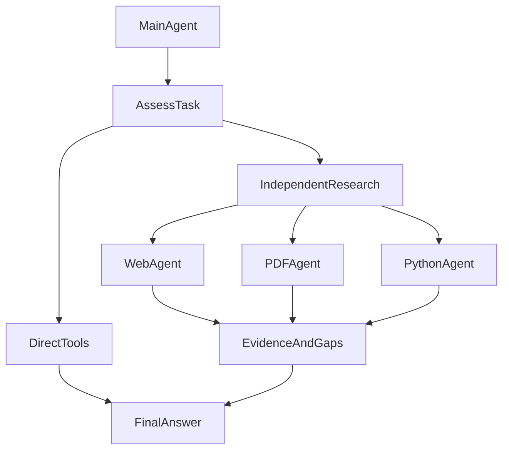

# From Finding Pages to Reading Further: How We Taught an Agent to Browse the Web

When we first connected ETF Agent to the web, the first problem we solved was search: find materials relevant to the user's question, then let the model organize the results. Later, we added page access, in-page search, link following, and dynamic rendering. We also began addressing an equally important question: how to cite the material we found correctly for the user.

More recently, these capabilities have gradually been connected to subagents so that complex research can be divided up when useful. But the goal throughout has remained the same: not to build an all-encompassing browser, but to let the agent keep reading along a trail of clues and ultimately deliver a supported answer.

**There is a long way between finding relevant webpages and using them to complete research.**

Consider a simplified research question:

> Two ETFs invest in similar markets. How do their fees, index construction methods, and holdings concentration differ?

Search might find product pages, but the fee explanation lives in another document, the construction rules come from the index provider, and the holdings details are buried in periodic reports. Even after finding those documents, the model may not have received the passages it actually needs.

What we needed was not merely more search results, but a sequence of reusable reading actions: **discover material, open it, locate content, follow links deeper, run the page when necessary, and finally give users the actual basis for checking the answer.**

**First, the overall evolution:**

This diagram shows capabilities being added over time. **It does not mean every research task must pass through all the steps in order.** An ordinary static page, for example, needs no browser launch, and a simple question needs no subagent.

## 1. Search First Answers “Where Should I Look?”—Not the Entire Research Question

The early implementation depended heavily on a particular search service. We gradually consolidated it into an independent search entrance with normalized results and source information, while the server managed provider selection, caching, and bounded fallback. The model poses research questions; it does not also have to manage search-service credentials and switching rules.

The value of this step was separating “finding material” from any one provider's interface. Search results still have their limits, however: titles and links indicate where an answer might be, and snippets provide partial information. They are not the entire original text.

Nor does this mean every search result must be opened again.

**The current implementation allows authorized, displayable search snippets with valid citations to support statements explicitly attributed to snippets. It does not allow them to be described as verified against the original text.** Only when key details are missing, sources conflict, or specific rules need checking should the agent continue to the page.

For example, an actually returned snippet may be enough for an initial account of a news item. When comparing fund fees, however, if the snippet omits the share class, applicable date, and fee basis, the agent needs to find the original text.

The direction of further development was therefore not “search several more rounds every time,” but helping the agent determine whether the next gap calls for a new lead or for the details behind an existing one.

From the agent's perspective, there are two reasonable paths after search:

Whether the original needs reading depends on the question. Whether a snippet qualifies for citation still depends on actual delivery and source permissions.

## 2. Adding Page Access: Going Beyond Search Snippets

Once page access was available, the agent could choose a discovered source, obtain its body, and then decide whether to continue the research. Search and reading became distinct actions: one discovers candidates, the other obtains content.

We retained two main entrances: search and browsing. The browsing tool handles materials through “read” and “find” operations, without requiring the model to learn separate access methods for “a webpage found by search” and “an attachment discovered on a page.”

**The core change in access capability** can be expressed as a short chain:

For a research task, preserving “which passage was read” and “where that passage came from” matters as much as obtaining page content itself.

### Pitfall One: The Tool Reported Success, but the Model Received Only the Beginning

We encountered a very concrete problem in the early implementation: after the tool layer's generic redaction processing, a webpage body was truncated to roughly 500 characters. In another case, static extraction could obtain insufficient body text yet still be represented as successful.

From the interface's perspective, the tool ran and returned a string. From the researcher's perspective, the information actually needed might never have reached the model.

This led us to distinguish the questions: was page access successful, was the body extracted, how much content was actually returned, and which portions remain unread?

Page reading can now return bounded body excerpts together with a continuation position. An incomplete first read does not require throwing the same question back at the search engine. Body extraction also preserves structures such as headings, lists, and table rows rather than merely trying to produce a large block of text.

For research, keeping “a company” together with “its corresponding weight” is more meaningful than the total number of characters returned from a page.

**The benefit of this step is giving the agent a chance to check original material while knowing how far it has read, instead of treating an article's opening as the whole article.**

## 3. Adding In-Page Search: Once You Have the Document, Stop Searching for It Again

As documents get longer, “open and read” alone is insufficient.

Suppose the agent has an annual report, but the user only cares about its tracking error. Searching the entire web again may simply return the same report; repeatedly sending the whole report to the model may not be more useful than locating the relevant passage directly.

People usually do something simple: use Ctrl+F to find a keyword, then read the context.

We added that action to the same browsing capability. The agent can look for keywords in a source already read and still reusable, obtain matching excerpts and reading positions, and then open the surrounding body. **This is text location, not another web-wide search and not semantic retrieval that automatically understands the entire article.**

For example, after finding “tracking error,” the next step should not merely extract the matching number. It should read the paragraph: which period does it describe, what measurement basis does it use, and are there qualifications?

### Pitfall Two: Not Finding It on Earlier Pages Does Not Mean Later Pages Lack It

PDFs made this problem especially apparent.

In one reading check against a real PDF, the initial read covered only the first 16 pages. Only after checking later pages did we obtain the target content on page 18 and the endnote on page 19. The file had 19 pages in total, and the key content happened to be outside the initial reading range.

If find can cover only the initially extracted portion, the model can easily misstate “no match in the current range” as “the document contains no such information.”

The relationship between find and continued reading becomes clearer using that actual 19-page PDF check:

**A match locates; reading obtains the evidence.** When the search range is incomplete, no match does not mean the information is absent from the entire document.

HTML already read now uses a retained text snapshot for find. For a PDF whose authorized original bytes are still held, find can also inspect later pages within the budget without downloading the same file again. A match position is for jumping to a reading location; a continuation position for find is for expanding the search range. They are not interchangeable.

The benefit can be stated precisely: **locating and continuing within the same still-valid material does not require repeating network discovery and download.** Whether that reduces total task time and token use still depends on how the model uses the results next.

## 4. Adding Link Following: Useful Material Is Often One Level Deeper

If in-page search answers “where in this material is the answer?”, following a link answers “where might the material point to an answer?”

Return to the ETF comparison. A product page may not directly list every fee and construction rule, but it may link to fund documents, index methodology, and holdings reports. An agent that can only read the first page may reach the correct official website and still stop just outside the real answer.

### Pitfall Three: Cleaning Up the Body Removed the Way to Continue Research

During deep-reading tests in October 2026, we found that the article and tables made it into the result, but supplementary-document links outside the article did not become followable sources.

Body extraction was intended to remove navigation and noise. But the attachment entrances needed for research are not necessarily inside the “clean body.” A region irrelevant to reading a conventional article may be crucial to continuing an investigation.

We therefore separated body extraction from link discovery.

The following **illustrative structure** of fund product material explains cross-page exploration. It is not a complete directory of any real website:

Keeping only the page body could previously miss fee-document links, holdings reports, and index-methodology entrances. The body and candidate links are now preserved separately. **A link is only a lead to the next stop; the actual content obtained after access is the material.**

The current implementation collects candidate links from the original page structure while generating readable body text. Material entrances outside the body can be retained as bounded candidates. After the model selects one, the system performs the next page read rather than automatically downloading every link on the page.

### The “Navigation” We Support Is Not Arbitrary Browser Operation

Two kinds of navigation need to be distinguished.

**In-page navigation** reads a target passage in the same material using a position returned by find. **Cross-page navigation** selects a discovered link and opens another source.

For cross-page navigation, the system registers discovered links as “material bookmarks available in this research task.” The model chooses a bookmark; the system resolves the real address and checks access conditions. The model need not guess URLs or maintain click coordinates.

Search results and material links within webpages can therefore reuse the same reading method. Link following is bounded by depth, count, and time, and duplicate targets do not generate new navigation references indefinitely. A page pointing to a file does not mean its contents have been read or can be treated directly as facts.

This capability primarily enables continuous access between materials. It is not login, form-filling, order placement, or arbitrary click automation.

### Pitfall Four: The System Had Official Document Links, but the Agent Kept Searching

Later product-catalog integration exposed another problem: a structured query had already returned official PDF addresses, but those addresses had not been converted into source references the reading tool could use. The agent had a lead but could not connect it to the next reading action.

After we connected this gap, validated product-catalog sources could enter the existing reading chain directly. There was no need to manufacture another search merely to “make the reading tool recognize it.”

The corresponding checks have shown a path from product query directly to official documents. Subsequent answers still included over-expansion and repeated searches. The next optimization is the model's judgment about when to stop searching and start reading.

**This matters: search went from being the only entrance to being one of several material entrances. When an existing lead is usable, research need not restart from the search box.**

## 5. Adding Dynamic Rendering: The Page Opens, but the Body Has Not Appeared

By this point, the agent could search, open, find, and follow links deeper. Static reading still encounters a class of pages, however, where the downloaded HTML contains only a shell and the body appears only after JavaScript runs.

For the user, this is an ordinary webpage. For a static reader, it may forever say “Loading.”

We therefore added optional page rendering without replacing all static reading with a browser. Local static extraction still comes first. Dynamically generated content is attempted only when the body is insufficient, source permissions allow it, and the application explicitly integrates an approved renderer. Enabling search does not automatically enable this path.

The **static-first, dynamic-fallback** choice looks like this:

The aim is not “use a browser for every page,” but to provide an additional reading path for pages needing JavaScript when the conditions are satisfied.

The original Source reading path now uses rendering as a **governed default fallback**. It starts only when static content is insufficient and source permission, network/resource limits, cancellation and timeouts permit it. A failed render may leave legitimate static evidence available; when nothing is readable, the result remains unavailable. This is neither a browser for every search nor a way around access controls.

### Fifth Trade-off: A Failed Renderer Must Not Fail the Whole Research Task

One integration case retrieved a script but lost upstream CORS response headers in an intermediate bridge, leaving that script unable to run. An isolated browser may execute the page and return the DOM, but external resources must still follow the original controlled reading path. Producing a body must not require weakening a site's access conditions.

Later bounded process checks reinforced the broader boundary: DOM parsers, renderers and helper processes should report their own failures rather than let asynchronous errors escape into the entire research task. Other legally acquired evidence must remain usable. **An optional reading capability should expand the chance of obtaining evidence, not the task's failure domain.** Those checks cover named process and error paths, not every possible native crash.

On controlled public dynamic pages, the agent did retrieve JavaScript-generated text and deliver it to subsequent model input. That establishes a useful path, not universal website reliability.

## 6. The Last Mile: We Found the Material, so Why Can the User Still Not See the Right Citation?

At this stage, we encountered another easily overlooked problem: **the agent being able to open a page and find a number is not the same as the user being able to inspect which material it cited.**

Initially, we focused on whether sources could enter the research context. As answers began to be published in parts, revised, and reloaded from history, citations became an independent delivery chain: the model must actually see the source, use the correct citation, have it bound to the current source by the publication system, and finally have the webpage show it alongside the corresponding answer.

### Pitfall Six: Being Able to Navigate to a Source Does Not Mean It Supports a Conclusion

In early research diagnostics, we saw the model put search-result identifiers, or reading identifiers not yet eligible for citation, directly into an answer as formal citations. At that time, the publication system rejected such submissions.

These counterexamples helped us separate two facts more clearly: “this material can be accessed further” and “this content has been obtained and can serve as evidence for an answer.” Navigation and citation are recorded separately. The system does not treat an entire document as read merely because the model wrote a link.

That rule later changed again. **Not treating a search result as read original text does not mean all search snippets are uncitable.** We subsequently allowed snippets actually supplied to the model and permitted for display to serve as limited evidence labeled “Search snippet · Original not read.” Otherwise, a temporarily unreadable original page could also make a useful snippet unusable.

The change did not relax factual requirements. It clarified levels of information: a snippet can support only what it actually contains, not impersonate verification of the original.

We gradually clarified two distinct source levels:

The diagram deliberately separates “navigation leads” from “text actually obtained.” They may point to the same URL but cannot replace one another.

### Pitfall Seven: The Model Received the Complete Citation but Copied Only Its First Few Characters

Another recurring problem was that the system supplied a complete citation, yet the model copied only its first few characters. The material was not lost, and the citation was present in context, but the identifier written into the answer no longer matched the original source.

From what users saw, this was easy to misdiagnose as “the source was not found” or “the webpage did not show the citation.” The problem actually occurred when the model generated the answer.

Rather than having the system guess the source from a few characters, we improved citation guidance and provided complete markers for the model to copy directly. In one real test after the fix, all 37 citations generated by the model matched complete system-issued identifiers, and the webpage displayed the current answer's citations.

This is only one successful sample, not a guarantee that the model will never shorten a citation again. It nevertheless offers a practical lesson: **instead of repeatedly saying “please follow the rules,” make the correct action easier to perform.**

### Pitfall Eight: The Citation Was Valid, but the User Saw Only Plain Text

This may have had the greatest impact on the experience. A review of historical answers found some with no public sources at all and some with citations shortened by the model. Another answer already used valid complete citations, yet the frontend displayed only the words “structured source,” with no way for the user to inspect further.

The original source sidebar was designed mainly around webpage links and could not naturally display structured data with no public URL. A valid source reached publication but became uninspectable plain text in the interface.

We subsequently bound source display to **the current answer and its revision** instead of maintaining a global source list. Public webpages or PDFs can link to real addresses; structured sources with no publishable URL provide inspectable descriptions rather than a guessed homepage link. The frontend must also handle numbering, touch and keyboard inspection, body replacement, and reloading. One browser acceptance check even found that selecting a new session that failed to load left the old session's answer and sources under the new title. Citation ownership clearly extends beyond Markdown formatting.

Another problem occurred during publication: replacing numeric markers with their displayed values changed the text length, but citations retained their old positions, truncating nearby body text as well. The fix recalculated citation positions against the final text. This was not a model failure; our own text processing damaged the content.

The citation's second journey happens **between answer generation and display**:

Early versions rejected publication for incorrect citations. When public-source citations are insufficient today, the system retains authorized prose where possible and marks citation gaps separately. **Citation validation cannot replace frontend acceptance of whether the user can actually inspect the source.**

### A Citation Does Not Guarantee a Correct Conclusion

Having worked through this chain, we distinguish several facts more clearly: a page was found; a particular passage was actually read; the model received it; the citation bound successfully; and the user can open or inspect the source. These stages must cooperate but cannot replace one another.

In particular, **a real, correctly formatted citation only helps establish source attribution. It does not automatically prove the model interpreted the data correctly.** We have also seen answers with legitimate source citations but contradictory numerical interpretations. That requires a separate answer-quality check, not simply more citations.

The most immediate user benefit is not “a few more little numbers after the answer.” It is being able to inspect, beside a specific judgment, whether the statement comes from a search snippet, a public webpage, a PDF, or a structured source without a public URL. When a source becomes unavailable, the system should preserve a clear local notice where possible rather than emptying an entire supported passage.

Looking back, quite different failures occurred at different positions in the citation chain:

| Observed symptom | Actual bottleneck | Approach developed afterward |
| --- | --- | --- |
| Search results treated as read original text | Source reading scope | Distinguish navigation, snippets, and actual body text |
| The model shortened a complete citation to a prefix | Model writing | Provide complete, copyable citation markers |
| Displaying numbers shifted citations and truncated text | Publication text transformation | Reposition against the final displayed text |
| Valid citations appeared only as plain text | Webpage display | Support source descriptions both with and without URLs |
| Old sources appeared after switching sessions | Frontend state ownership | Bind sources to the current answer and revision |

A single instruction to “add more citations” cannot solve all these problems.

## 7. As Capabilities Grow, the Model's Actions Should Stay Simple

Looking back at this evolution, we have added many underlying capabilities. We do not want the model to face an ever-growing collection of disconnected tools.

Web research still centers on “search” and “browse”: search discovers sources; browse reads, finds, continues reading, and opens the next discovered material. Dynamic rendering is an underlying reading method used when conditions are met, not an extra browser suite the model has to operate.

Within a research process, these actions can be understood as:

**Discover sources → read content → locate target passages or follow links → continue research with new material → organize the answer and citations.**

From the model's perspective, what matters is determining **the next information gap**, not invoking every tool in a fixed order:

If the available material is sufficient to answer the question, the agent can compose the answer. It need not continue exploring just to call more tools.

Whether to keep finding, follow a link, or begin answering is a judgment the model makes from the task and the content actually obtained. The system does not declare “the evidence is sufficient” from keywords or character counts.

Nor is this a fixed workflow that must run end to end every time. A simple question may stop at a search snippet; a known document may be opened directly; a long document may be searched before close reading; attachments may require navigation; optional dynamic rendering is considered only when static content is insufficient.

We want each action to respond to a clear gap: missing sources or missing body text? A missing passage or a need for the next document? Only then can adding tools become better research rather than merely more calls.

## 8. Going Further: Letting Subagents Share Complex Research

As search, reading, and citations became connected, the next question changed. It was no longer “do we have this tool?” but “should the main agent handle every detail itself?”

A direct tool call is enough to read a known page. But comparing multiple materials, repeatedly locating passages in reports, or writing calculation code and correcting errors can consume many conversational rounds of local exploration. We therefore began assigning independently tractable portions to subagents, letting the main agent remain focused on the user's question and the final answer.

### What Has Been Implemented So Far?

Web research, PDF reading, and Python analysis are now connected to the same subagent execution mechanism. The main agent can delegate tasks, inspect progress, and stop subtasks. Subagents use the existing authorized tools and return findings, evidence, artifacts, and unresolved questions. The main agent still organizes the final answer.

These are not three disconnected systems. A PDF discovered during web research can be read further; PDF research that needs to check the original site can access relevant webpages. Simple single-page reading, locating a specified passage, and ready-made calculations can still use tools directly without first creating a subagent.

In the ETF comparison above, “establish fees and their effective conditions” could go to one subtask, “locate holdings details in the report” to another, and calculations on data already obtained to Python analysis. This is an illustration of division of labor, not a fixed pipeline that must launch three roles for every question.

On-demand delegation is better understood as a branch than as a pipeline every task must traverse:

Delegation changes only the execution method: **the main agent remains responsible for organizing the pieces into one checkable answer**. It does not imply that all three roles always launch or necessarily run in parallel.

### Delegation Must Not Lose the Sources We Worked to Preserve

A subagent cannot merely return “I checked it, and this is the conclusion.” Otherwise, the main agent sees less process but also loses the basis for checking the conclusion.

We continue to preserve actual material, reading scope, and result provenance during handoff. In historical debugging, completed reads by the main agent were once omitted from the handoff. For page images, we also have to verify that they actually enter the subagent's model request, not merely that an image was generated. **Having a result does not mean the next participant has received it.**

Subtasks therefore receive only necessary goals, constraints, and selected material, not a copy of the entire main conversation. When the main agent uses returned findings, their evidence must remain traceable. Controlled paths exist for these execution, handoff, and recovery mechanisms. Whether multiple agents are worth launching, however, should still be judged by their actual task outcomes and overhead.

### The Next Priority Is Whether Delegation Is Genuinely Useful

Further work will first test this collaboration in real fund comparisons and portfolio reviews: do simple questions still take the direct path, can complex branches proceed independently, is material already obtained searched for again, and do final citations remain inspectable?

Continuation of long tasks and on-demand review will likewise be expanded only after considering the benefits and costs of actual use. We want to establish “when is delegation worthwhile?” before extending the roster of roles, rather than wrapping every tool in an agent.

**The goal is not for several agents to each write a report. It is for them to collaborate on the same question and deliver one answer with a clear through-line to the user.**

## 9. The Real Benefit: Research No Longer Has to Restart Again and Again

The value of this round of capability building is not a longer tool list. It is that previously disconnected stages are now joined.

Relating the capabilities to changes users can perceive:

| Capability | New possibilities in user research |
| --- | --- |
| Search | Proactively discover materials and relevant sources |
| Page access | Inspect original text beyond snippets |
| In-page find and continued reading | Locate target passages in long documents more readily |
| Cross-page navigation | Continue toward attachments, reports, and related pages |
| Dynamic rendering | Read some JavaScript pages under reviewed conditions |
| Citations and display | Inspect the specific sources used in an answer |
| Subagent | Divide complex research when useful and deliver a unified result |

**Materials can be read more deeply.** Behind search snippets are originals, behind originals are attachments, and within long documents are passages that can be located further. In specific tests and diagnostics, we recovered entrances to supplementary documents outside the body and brought official materials returned by the product catalog into actual reading.

**Existing work can be reused.** In-page find and continued reading of the same authorized PDF reuse current material rather than downloading it every time. The model can focus subsequent actions on what is missing instead of repeatedly restarting the initial search. Reuse is implemented; the next optimization is when the model chooses its research actions.

**Unread and absent are easier to distinguish.** Snippets, body excerpts, find matches, and pages not yet checked are no longer treated as the same “material obtained.” The model can therefore state its reading scope explicitly instead of writing “not present” when it means “not read.”

**Material is easier for users to review.** Beyond the evidence already read, we have connected citation identities, answer revisions, and frontend display. Supported content can point back to the right webpage, PDF, or structured description rather than leaving only an internal identifier in tool logs.

We do not yet have enough consistent samples to translate these changes into accuracy, average elapsed time, or token-saving percentages. More complete reading may also mean more text, longer reasoning, and higher runtime costs.

The next evaluation therefore cannot merely count searches or characters read. It must also ask whether the target material was obtained, key passages were actually read, citations can be inspected by the user, the question was answered, and unfinished parts were clearly explained.

The real change from search to deep reading is this: **the agent no longer has only the choice of “find a few results and answer.” It can follow existing leads and carry the research forward.**

From search snippets to original passages, then attachments and subtasks, growing capabilities still leave two practical questions: what did the agent read next, and which materials support the final conclusion? Execution records can establish whether tools are connected. Whether the answer is useful must still be evaluated against a concrete research task.
