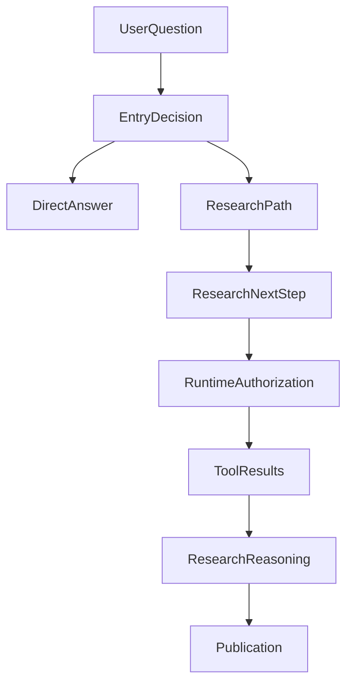
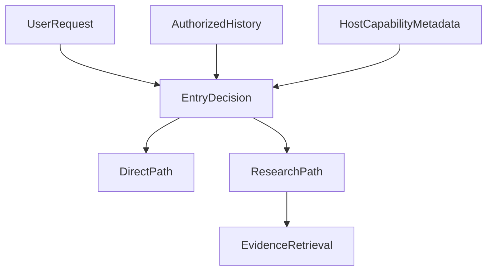
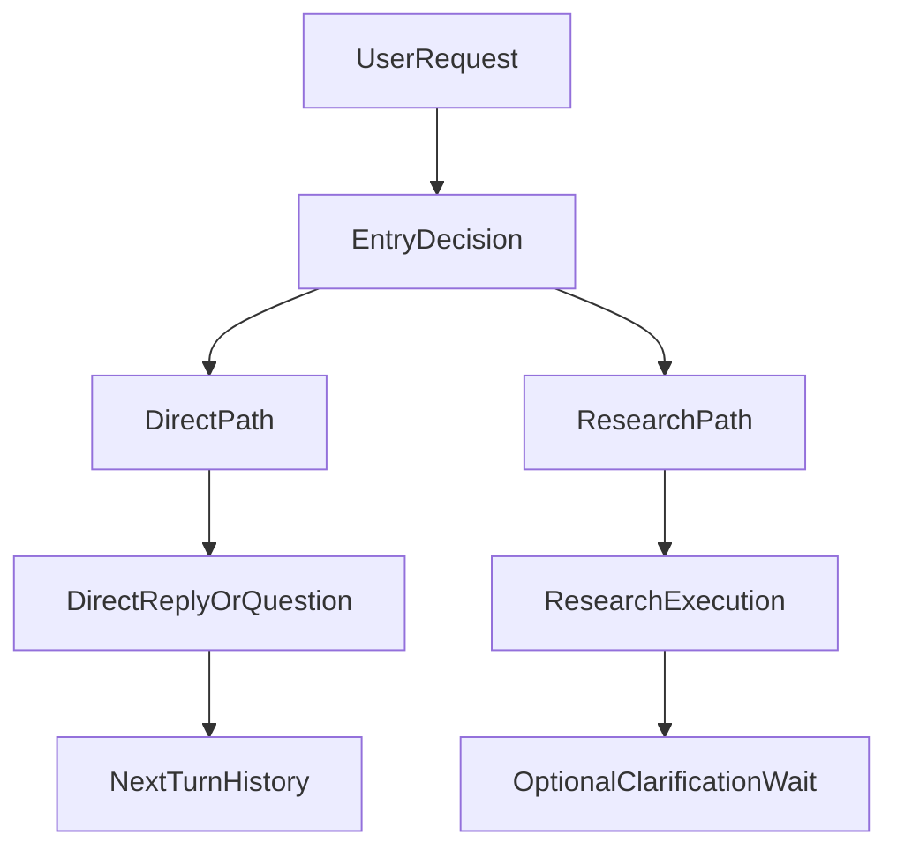
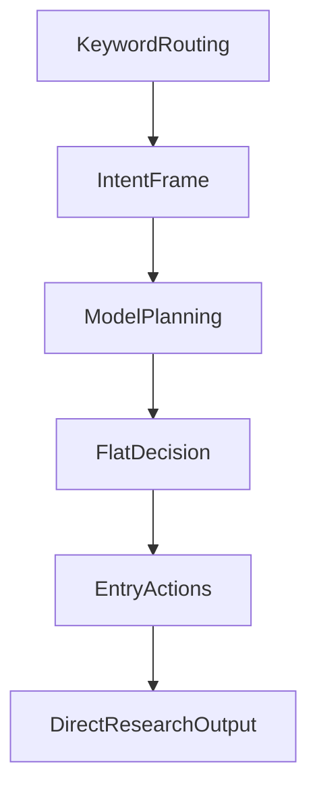
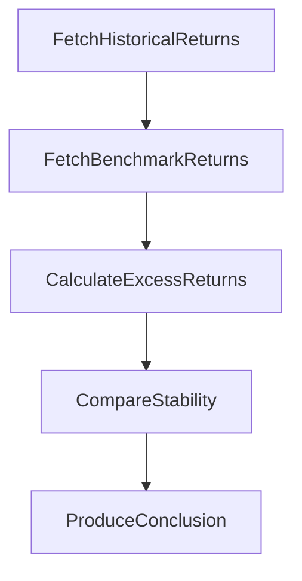
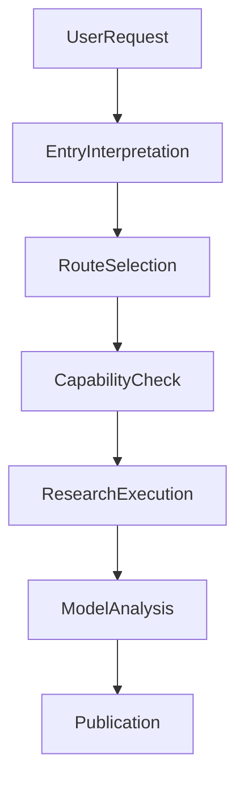

# Why Did We Keep Making the Agent's Entry Simpler?

### Small decisions, sufficient context, and execution facts a model cannot supply

“What is an enhanced index fund?” can usually be answered directly. “Which of my two enhanced index funds had more stable excess returns over the past three years?” requires material, comparable periods, authorization and calculation. Both mention funds, but their execution needs differ.

Entry handles that distinction. We once packed intent, entities, time, research plans and completion conditions into the entrance, and also tried native tool actions for routing. The useful reduction was not to reach a single `if`: **let the model make the limited decision needed now, while the actual execution owners establish permission, capacity and results.**

This article starts with current behavior, then uses real counterexamples to explain the choices. Older Intent and action protocols are design evidence, not live compatibility paths. This follows [Principle 6, “Use the minimum sufficient mechanism”](/en/principles#principle-6) and [Method 1, “Choosing new capabilities”](/en/principles#method-1): what irreplaceable fact does another mechanism protect, and what cost does it impose on ordinary requests?

<span id="from-intent-and-planner-to-direct-research-the-evolution-of-an-agent-entry-architecture"></span>
<span id="_4-why-did-we-ultimately-return-to-structured-output"></span>
<span id="_8-how-simple-is-our-entry-now"></span>

## 1. Ordinary Entry Today: One Decision, Not the Whole Investigation

For an ordinary new request, Entry sees the original request, permitted history and limited Host context. Direct can handle explanations, ordinary follow-ups and faithful transformations that need no external verification. Current external facts, personal holdings, necessary document reading or requested computation when the analysis capability is available require Research.

The core Direct shape is:

```json
{
  "kind": "direct",
  "markdown": "指数增强基金通常在跟踪指数的基础上，尝试获取超额收益……"
}
```

Research can request currently available scopes:

```json
{
  "kind": "research",
  "scopes": ["fund"]
}
```

When no additional scope is needed, `scopes` can be omitted:

```json
{
  "kind": "research"
}
```

Here `fund` is illustrative, not a scope every Host must offer. Omission does not grant every tool. After Host acceptance, Research chooses its next step within original permissions, budgets and actual results; Direct goes to the existing answer-handling path.



**This diagram describes the ordinary Direct / Research core, not every current interaction mode.** Concurrent conversations derive their protocol from the Host snapshot's `availableActions`. Where coordination is available, `coord` proposes inspect, correct or stop for an unambiguous listed active task. A short interaction may not offer Research; Sidecar is Direct-only. Visible actions still do not prove admission or successful control. A valid explicit Skill, an original-owner-prepared Continue, and certain explicit research entrances also need not ask ordinary Entry to rediscover the route.

The common principle is ownership, not permanently having two fields: the model proposes what to do now; the Host determines what this execution may actually do.

<span id="_5-why-did-a-simpler-entry-receive-more-input"></span>
<span id="entry-should-know-which-capabilities-exist-without-executing-them-in-advance"></span>
<span id="a-real-case-why-did-a-blurry-pdf-not-enter-research"></span>

## 2. Why Does Smaller Output Need Better Input?

If a user asks for return correlations and an exported chart, Entry may answer “I cannot do that” when it cannot see the admitted analysis or export capability downstream. Sending every request to Research is an expensive remedy. Running a complete investigation before routing defeats the purpose too.

Ordinary Entry uses bounded discovery:

| Input | What it helps Entry determine |
| --- | --- |
| Current request and permitted history | What the user is actually asking |
| Portfolio access level | Whether certain personal-data read access is currently authorized |
| Analysis capability availability | Whether a path exists for further calculation and export |
| Authorized document catalog | Whether research materials are available for further reading |
| Limited discovery information for extension tools | Whether a suitable capability exists for Research to use |

`portfolioAccess: details` describes access, not existing or already-read holdings. A document ID and version locate material; they do not put its body into the model. Extension descriptions are discovery, not tools callable in Entry. Analysis and export availability are separate: being able to export a file does not automatically mean Python is available.



Discovery lives in the original Host message with count and byte limits, and cannot displace the user's original text. The implementation fits bounded extension-tool and authorized-document entries, sampling current discovery after asynchronous context preparation. Metadata disclosure itself must be authorized; a later read check does not make the earlier catalog exempt. A failed read must not be represented as a successful empty catalog.

This supplies more context than the last sentence alone, at lower cost than prefetching holdings, quotes and every document for each greeting. The tradeoff is incomplete discovery: absence cannot casually mean the system has no such capability. Ordinary Entry also does not acquire a full Skill-method catalog. A user-selected explicit Skill follows its own admitted entrance.

### The Blurry PDF: Better Routing Did Not Finish the Research

In an actual PDF diagnostic, Entry selected Direct without reading a page image. Code showed that Research had a document index while Entry lacked the same bounded discovery. That establishes a context gap, **not the sole cause of the model's routing choice**.

After the existing authorized catalog was exposed, one live first request selected Research and actually read a page image. Reliable transcription still failed, and the task ended partial / request-budget-exhausted. Discovery, reading, model selection and answer quality require separate evidence. We did not preload the PDF body or images, or add another PDF classifier.

<span id="structured-output-does-not-mean-trusting-the-model-completely"></span>
<span id="_7-a-smaller-protocol-does-not-eliminate-model-errors"></span>
<span id="an-irrelevant-field-sent-a-valid-direct-answer-into-research"></span>
<span id="an-upstream-parser-rejected-a-long-answer"></span>
<span id="a-structural-error-should-not-arbitrarily-become-a-research-task"></span>

## 3. Valid JSON Is Not Yet an Executable Decision

Provider output constraints can reduce formatting errors. Local handling must still inspect actual finish events, one structured object, fields, the current action set and real admission. This fragment is not a Research decision:

```text
{"kind":"research","scopes":
```

Unexpected tool events are not accepted as a structured proposal either. “Complete” is also more precise than one finish label: the current adapter can retain **actually complete, parseable text satisfying Direct's conditions** with `finishReason=length`. Truncated Research does not get the same acceptance. Accounting for an ordinary model response that really occurred also cannot be erased by a later local parse failure.

### How Did a Valid Answer Trigger Repeated Research?

A historical diagnostic contained a roughly 340-character Direct answer with an irrelevant extra `null` field. The old handler rejected the object, then entered Research and repeated searches. The model had answered; an unused annotation had gained veto power over useful text.

The **ordinary Direct path** now consumes `kind=direct` and nonempty `markdown`, neither granting authority through extra annotations nor rejecting the valid core because of them. Offline replay of the original failure can finish with one Entry and zero Research calls. The scope matters: current coordination and `conversation-entry-snapshot@2` paths still require strict Direct schema validation. Ordinary projection is not a universal permissiveness rule.

A second real failure occurred earlier. Publication allowed longer Markdown, but the JSON parser still used the smaller ordinary tool-argument byte limit. Final character clipping could not rescue input already rejected upstream; Chinese content made the byte/character distinction particularly visible. Entry now uses the parsing budget appropriate to its answer payload while ordinary Native arguments keep their default. Check transport, JSON parsing, body handling and publication separately rather than raising every limit together.

### Transport Retry and Malformed-Output Fallback Are Different Decisions

The current durable production path requests Entry retry allowance only for failures originally classified as retryable with runtime-owned recovery. It asks the original Store before waiting or dispatching; each physical request still needs its own model-call capacity. Optional route switching additionally requires recorded failure facts and previously qualified routes. Cancellation, owner loss or any unknown error does not become an ordinary retry merely because another attempt might work.

Malformed output takes another path. Certain missing-core-text or schema failures in ordinary production can lead to Host Research fallback; Sidecar cannot be upgraded this way. Where the conversation requires background Scope promotion, the original owner must admit the actual workload on the same Run lease. Insufficient capacity rejects the unadmitted work rather than inventing a model decision. Without a qualified Native route or durable recovery conditions, current code returns a capability limitation instead of claiming research occurred.

One specification discrepancy must remain visible. The older unified-semantic Spec still describes at most one full format repair followed by failure, and zero automatic Entry transport retries. Later resource, provider and conversation contracts, together with current production code, contain the bounded retry and specific Host fallback above. This account describes the pinned implementation; **it does not claim the old clauses and newer behavior are fully aligned, or that one format regeneration automatically takes place**.

These mechanisms protect identity and resources. They do not establish that every formatting failure deserves a long investigation. That choice still requires the original user request and routing evaluation.

<span id="why-did-we-eventually-remove-even-ask-user"></span>

## 4. Why Does an Ordinary Follow-Up Not Need a Paused Workflow?

“How should I choose?” may need only: “Are you comparing two funds, or asking about fund-selection methods?” The user can answer in the next message. With no investigation underway to preserve, a dedicated pending-question state may be unnecessary.

The old Entry-specific `ask_user` path once displayed a question but lost the history relationship needed to show it to the next turn. Fixing that relationship was possible, but gave ordinary dialogue more recovery responsibilities. Entry now asks through Direct and uses normal conversation history on the next turn. Ordinary text choices grant no tools or sources; the next turn still uses current authority.



Dedicated `ask_user` and recovery remain useful when research already has work to continue; that path decides whether waiting must block. An ordinary follow-up must not pretend the user has answered, and a research wait must not be confused with a fresh routing decision. The cost is that Entry offers no separate structured-questionnaire lifecycle. Products needing required fields, timeouts or explicit pending-question objects should build that workflow rather than pretend every question is ordinary chat.

<span id="_1-the-original-idea-understand-the-whole-task-at-the-entry-point"></span>
<span id="the-model-interpreted-the-meaning-then-code-interpreted-it-again"></span>
<span id="_3-we-even-tried-native-tool-calling-in-entry"></span>

## 5. Structured Output, Tool Calling and Intent Serve Different Jobs

### Why Not Keep Three Tools for a Single Route Decision?

We previously let Entry invoke three mutually exclusive native actions:

```typescript
direct_answer({ markdown: string })

ask_user({ questions: Question[] })

start_research({ scopes?: ResearchScope[] })
```

After removing dedicated Entry clarification, two remained for a time:

```text
direct_answer
start_research
```

A live test produced **61 identical `start_research` calls** before hitting the output limit. Research had not begun and no holdings had been read. A single SDK request was not proof that the model emitted one action. This is evidence about that historical protocol failure, not a general verdict against tool calling.

Native tools fit real operations and repeated result consumption in Research. A structured object for one limited route decision has fewer combinations of absent, repeated or conflicting actions to handle. The cost is maintaining and validating different output protocols for Entry and Research. If the entrance itself must fetch external information and act repeatedly, an Agent loop with real tool results may be more natural than wrapping it in an empty two-branch router.

[OpenAI's Structured Outputs guide](https://developers.openai.com/api/docs/guides/structured-outputs) likewise distinguishes connecting application functionality through function calling from structuring a model response. That supports choosing by responsibility; strict JSON does not establish meaning, permission or research quality.

### Intent Is Useful; Freezing All Meaning Up Front Is the Risk

The old Intent v2 approach translated natural language into an object convenient for fixed handlers. This simplified historical illustration is not the current Entry schema:

```json
{
  "domain": "fund",
  "mode": "analysis",
  "subject": "portfolio",
  "operation": "compare",
  "time": "past_three_years",
  "ambiguous": false
}
```

For a few clearly separated business categories, keywords, classifiers or structured Intent can be cheaper and easier to integrate. Open research complicates the boundary: the same “regular investing” phrase can request a concept explanation or a plan; “what did I buy before?” and “what can I buy now?” should not share a route merely because both mention transactions.

Historical semantic probes also found code reinterpreting a model's decision through entity requirements, keywords and display allowlists. An unnecessary entity requirement rejected conceptual comparisons, a natural holdings expression missed the rule, and normal Chinese paraphrases failed display validation. Two semantic judges could undo each other. Current structural, permission and source checks still matter, but should not secretly replace the model's interpretation of the user's goal.

This retained diagram summarizes design history, not stages that all run sequentially today:



<span id="the-intent-object-started-to-resemble-a-research-plan"></span>
<span id="_6-entry-should-supply-a-starting-point-not-prescribe-the-research-process"></span>

## 6. Without an Upfront Plan, How Do We Retain Complex Questions?

Retaining the user's question does not require fixing every step before reading. For a three-year excess-return comparison, this looks reasonable:



If a fund is younger than three years or has changed its benchmark, the comparison period and basis need attention first. Research can revise an advisory plan. A mandatory execution graph instead lets an early guess obstruct necessary corrections.

Larger requests can similarly be expanded into a checklist:

```text
Query fund A
Query fund B
Calculate tracking error
Compare fees
Read the portfolio
Analyze overlap
Generate an adjustment recommendation
```

Such a sequence can suit a stable business workflow. In evidence-driven research, fees, tracking error and personal holdings may have different availability. A missing private authorization should not erase independently permitted public research.

Current `researchNeeds` can carry a few useful initial questions across turns:

```json
{
  "kind": "research",
  "researchNeeds": [
    {
      "id": "fees",
      "need": "需要核对指定份额的费用与生效日期",
      "status": "open"
    }
  ]
}
```

Both the need and its status are model assessments, not evidence, permission or completion receipts. The complete original task remains authoritative, and Research revises questions using actual material. This avoids a default Planner call, at the cost of not supplying a complete fixed task graph that can be approved item by item before execution.

[Anthropic's comparison of workflows and agents](https://www.anthropic.com/research/building-effective-agents) separates fixed steps, routing and dynamic decomposition: distinct categories support specialized routes, while unpredictable subtasks motivate dynamic decomposition. We place that work in Research, where evidence and tool results exist. Stable approvals or fixed pipelines may instead benefit from an explicit workflow.

<span id="_2-the-first-shift-let-the-model-understand-and-the-runtime-own-execution-facts"></span>
<span id="looking-back-what-did-we-actually-fix"></span>
<span id="what-questions-remain"></span>
<span id="_9-a-smarter-agent-does-not-necessarily-need-a-more-complex-entry-point"></span>

## 7. Which Chain Should We Observe to Judge Reliability?

Consider one route that enters Research:



This illustrates responsibilities, not a claim that every check runs once in that exact order. Original permissions and capacity still have their checks at actual dispatch. The owners differ:

| Responsibility | More appropriate owner |
| --- | --- |
| Understand the problem the user wants to solve | Model |
| Decide whether research is needed now | Entry |
| Determine which tools are available | Host / Runtime |
| Confirm authorization to access personal data | Host / Runtime |
| Record whether a tool actually executed | Runtime |
| Revise research questions in light of new evidence | Research |
| Determine whether an answer has been submitted | Publication |
| Determine whether an answer is correct | Independent quality evaluation |

The historical failures yield reusable inspection questions:

| Actual problem | Subsequent engineering judgment |
| --- | --- |
| Entry repeatedly emitted research actions | A single-branch decision does not need a multi-action protocol |
| Ordinary clarification lost history | Ordinary follow-ups should reuse normal conversation history |
| Extra fields caused a valid Direct answer to be rejected | Consume only the fields Direct actually needs |
| A parser rejected a long answer before publication | Align parsing and publication capacity layer by layer |
| Malformed Entry fallback could bypass research capacity | Let the original Scope owner admit the actual workload without inventing a model decision |

The table's Direct field projection applies to the ordinary path qualified above, not every interaction profile. Controlled browser observations covered fallback capacity refusal and the original research finishing after release. Isolated-database and UI regressions covered admission and same-Run failure-reason readback, but the final UI repair had no fresh browser rerun and cannot be presented as fully exercised interaction. Original-response replay can prove that a particular valid answer is no longer misrouted into Research. Neither is an overall routing accuracy measurement for current requests.

More useful ongoing questions are whether simple requests trigger redundant research, whether current facts are guessed in Direct, whether mixed requests retain independently actionable work, and whether discovery informs the model without displacing its real task. The PDF's actual page read still failed to produce reliable transcription: entering the right door is not reaching the destination.

Simplifying Entry leaves unknowns to the stage that can obtain evidence. A limited proposal, sufficient discovery and the original execution owners together make routing explainable. Fewer fields or one fewer model call is not, by itself, success.
