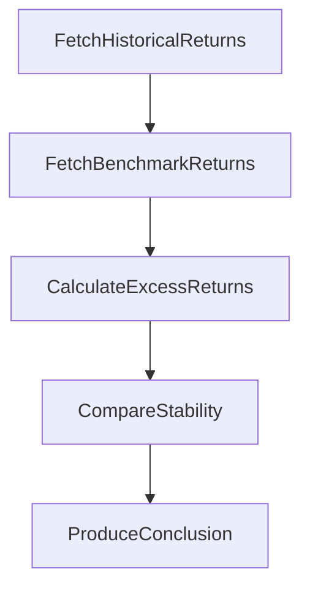
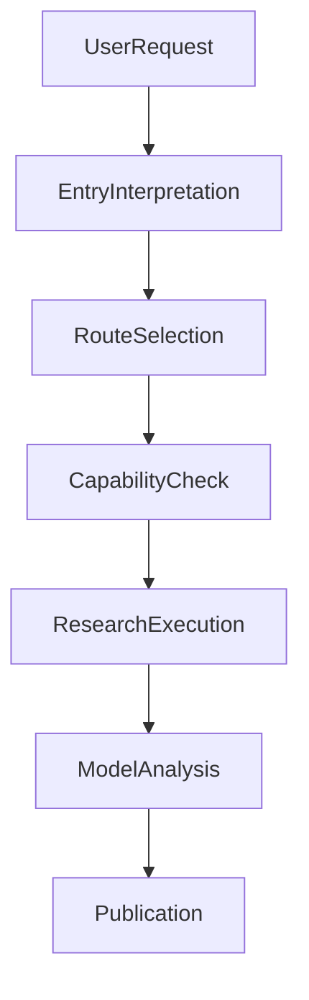
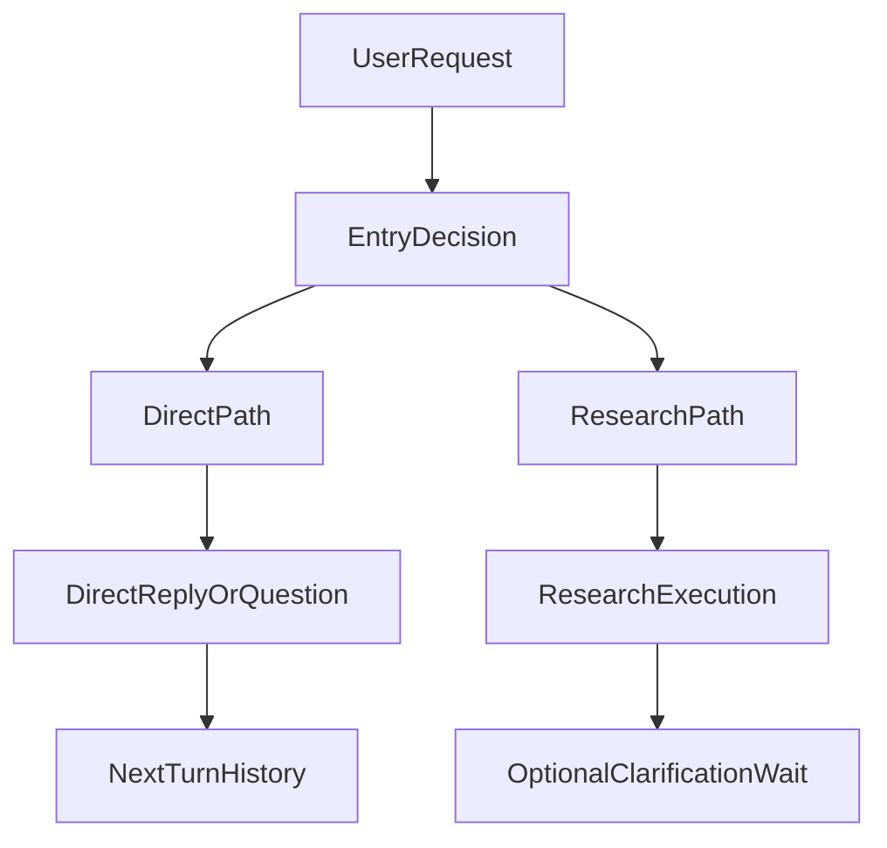
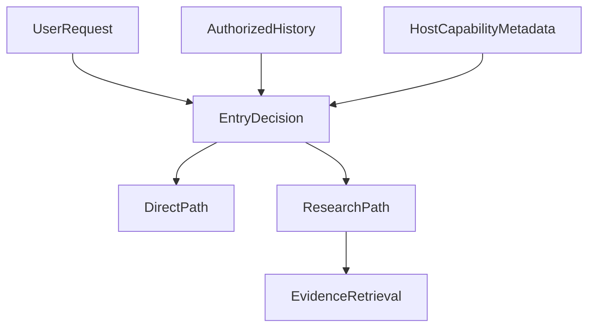
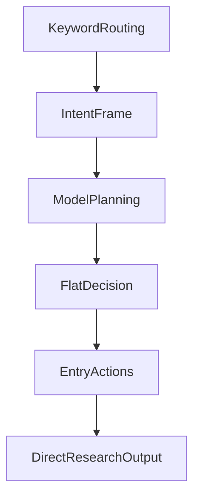
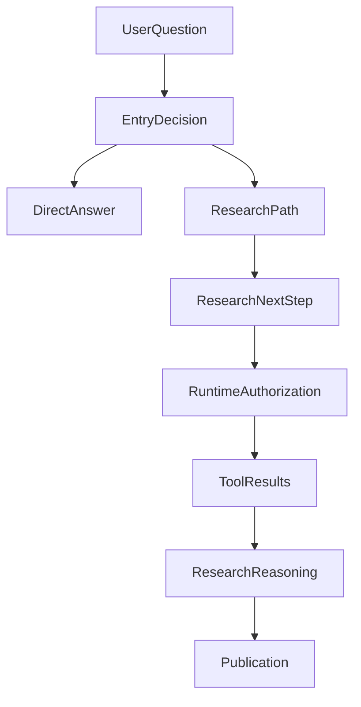

---
evidence:
  implementation: "Direct / Research routing adopted (as recorded in this article)"
  scoped: "Historical cases and observations of entry behavior"
  live: "Routing decision quality still requires validation"
---

# Why Did We Keep Making the Agent's Entry Simpler?

### From Intent and Planner to Direct / Research: The Evolution of an Agent Entry Architecture

While building ETF Agent, we spent considerable effort on a seemingly simple question:

**When a user sends a message, should the Agent answer directly or start research?**

For example:

> What is an enhanced index fund?

This usually needs no live data. The model can explain it directly.

But suppose the user asks:

> Which of my two enhanced index funds has delivered more stable excess returns over the past three years?

Now the Agent needs fund materials, a comparison period, verified historical data, and possibly calculations.

Some requests are more complex still:

> How good is this fund? Should I keep holding it?

This may involve product research, personal holdings, risk preferences, and investment advice. Seeing the word “fund” is not enough to determine which tools to call.

Initially, we wanted the entry point to be as smart as possible: recognize intent, extract entities, interpret time, split tasks, generate a plan, and choose an execution path.

As capabilities grew, the entry point grew more complex too.

After several rounds of real testing and architectural changes, however, we gradually realized:

**A smarter entry point does not necessarily make the whole Agent smarter.**

Many things we asked Entry to do could be done during research—and some belonged to the runtime instead.

Eventually, we narrowed Entry's core responsibility to two basic choices:

**Direct: the request can be answered directly now.**

**Research: the request needs the research process.**

This article is not about a new intent-classification algorithm. It is about why we progressively removed complexity from Intent and Planner, and the practical problems we encountered along the way.

In retrospect, simplifying Entry corresponds to [Principle 6, “Keep the minimum sufficient mechanism”](/en/principles#principle-6): if the model can make the semantic choice between Direct and Research, the entry point need not prewrite an entire research plan. We also used [Method 1, “Evaluating new features”](/en/principles#method-1) to ask what irreplaceable facts an extra Planner, Validator, or Gate actually protects, and how much cost it adds to ordinary requests.

## 1. The Original Idea: Understand the Whole Task at the Entry Point

The earliest ETF Agent routed requests mainly through keywords.

The approach was simple enough and useful during early development.

For example, “holdings” suggested a portfolio query, “market quotes” led to market data, and “recurring investment” led to the corresponding feature.

Natural language, however, is not always organized around keywords.

“Explain recurring investment” and “Help me create a recurring-investment plan” share a keyword but describe very different tasks.

“What have I bought before?” and “What can I buy now?” both involve trading language, but one asks about history while the other may ask for investment advice.

Negation, time, references, and compound questions are also difficult to handle reliably with a keyword list.

We therefore introduced a richer **Intent v2**.

It tried to parse a user request into a semantic object containing the task domain, operating mode, entities, time, speech act, negation, and ambiguity.

A simplified intent might look like this:

```json
{
  "domain": "fund",
  "mode": "analysis",
  "subject": "portfolio",
  "operation": "compare",
  "time": "past_three_years",
  "ambiguous": false
}
```

This is an explanatory example, not the complete protocol definition from that time.

There were good reasons for the design. For an assistant with a small set of fixed capabilities, first determining what the user wants and then choosing a corresponding process is natural. Structured intent is also convenient for testing, debugging, and auditing.

Two problems emerged later.

### The Model Interpreted the Meaning, Then Code Interpreted It Again

We wanted the model to understand the user's natural language.

In practice, after the model produced a semantic judgment, downstream code might interpret the user's meaning again through keywords, entity types, or override rules.

Examples from earlier work included:

- A conceptual request such as “Compare index funds and actively managed funds” was rejected by inappropriate entity requirements or presentation rules.
- Natural wording such as “Take my existing holdings into account” was not correctly recognized by the old keyword checks.
- Ordinary Chinese paraphrases were treated as invalid output because they fell outside a presentation-text allowlist.

These were not just model-capability problems.

**We claimed the model owned semantics, yet the system still contained another implicit semantic arbiter.**

The two did not always agree.

### The Intent Object Started to Resemble a Research Plan

As tasks became more complex, we considered adding research goals, task scope, missing information, execution actions, and completion conditions to the structured decision.

That seemed helpful for planning ahead. But there was a problem:

**Before looking up any material, the Agent often does not know what research steps actually make sense.**

For example, a request to compare two funds' excess returns over three years might produce this entry plan:



Once research begins, we may discover that one fund is less than three years old and the other changed its benchmark midway through the period.

The right next step is then to redefine the comparison interval and benchmark basis, not mechanically follow the original steps.

An entry-generated plan can be a suggestion. If the runtime treats it as mandatory, however, it can prevent the Agent from changing direction when new information arrives.

We began to reconsider:

> **Does the entry point really need to determine the entire research process in the first turn?**

## 2. The First Shift: Let the Model Understand and the Runtime Own Execution Facts

In later semantic-planning changes, we withdrew the old heavyweight intent design and tried letting the model take more direct responsibility for interpreting goals, task scope, and research direction.

At the same time, we returned objective execution facts to the runtime. This was not simply about deleting fields; it was about reallocating responsibility.

| Responsibility | More appropriate owner |
| --- | --- |
| Understand the problem the user wants to solve | Model |
| Decide whether research is needed now | Entry |
| Determine which tools are available | Host / Runtime |
| Confirm authorization to access personal data | Host / Runtime |
| Record whether a tool actually executed | Runtime |
| Revise research questions in light of new evidence | Research |
| Determine whether an answer has been submitted | Publication |
| Determine whether an answer is correct | Independent quality evaluation |

An important distinction follows:

**The model may propose the capabilities it needs, but its own output cannot create permission to use them.**

The model can decide that it needs personal holdings. It cannot make the system believe the user authorized access merely by emitting an “access allowed” field.

Likewise, the model need not predict whether every tool call will succeed. Actual execution results enter the subsequent research context.



As this division became clearer, we found that Entry no longer needed to describe every state of the research process in advance. That created the foundation for further simplification.

## 3. We Even Tried Native Tool Calling in Entry

As the Research Runtime moved to Native Tool Calling, we tried having Entry express its decision through native model tool calls too.

At the time, we designed three mutually exclusive actions:

```typescript
direct_answer({ markdown: string })

ask_user({ questions: Question[] })

start_research({ scopes?: ResearchScope[] })
```

The idea was natural: if the research stage already expressed actions through native tool calls, why maintain a separate decision protocol for the entry point?

But Entry and Research differ in an important way.

**Research can propose multiple tool calls in one model response. Entry needs to make just one branching decision.**

In real testing, we encountered a characteristic failure:

Entry emitted **61 identical `start_research` calls** in succession and eventually hit the output-length limit. Research had not actually begun, and no holdings data had been read.

The problem was excessive turn coordination at the entry point, not tool calling itself.

For an entry point that permits only one decision, a protocol capable of expressing multiple actions is not inherently simpler.

The system also has to handle missing actions, duplicate actions, conflicting actions, and output truncation that leaves the decision's completeness uncertain. The earlier the entry point sits in the flow, the more easily a protocol error can block everything downstream.

### Why Did We Eventually Remove Even `ask_user`?

This was another representative simplification.

Initially, we thought clarification deserved its own state. For example:

> Which two funds would you like to compare?

After asking, the system would enter `clarify_pending`, wait for the user, then resume the earlier task.

That design is useful when research is already underway and must wait for more information.

But consider a user who simply asks:

> How should I choose this?

The Agent replies:

> Are you comparing two funds, or asking how to choose funds in general?

That is really just an ordinary conversation.

We found that Entry's dedicated clarification path introduced extra complexity.

In some cases, the question had already been shown to the user, but the next turn failed to preserve history through the dedicated parent-child association. The model could no longer see what it had just asked.

We could have continued fixing the associations or built a more complete pending-question state. Instead, we revisited the requirement:

**Does an ordinary follow-up question at the entry point really need a separate clarification state machine?**

Our answer was no.

We removed Entry's dedicated `ask_user`. Ordinary follow-up questions became Direct text responses.

The next user message reaches Entry through normal conversation history, where the model can understand the context.

In the diagram, the Direct branch answers or asks a follow-up, reusing ordinary conversation history on the next turn. A dedicated `ask_user` and recovery mechanism remain only after entering Research and genuinely needing to wait for user information.



This change introduced no new runtime state, database column, or compatibility protocol. It removed some Entry-specific logic instead.

**Not every multi-turn conversation needs a dedicated workflow.**

## 4. Why Did We Ultimately Return to Structured Output?

After removing the dedicated clarification action, Entry briefly had only two native actions:

```text
direct_answer
start_research
```

Later, however, we returned to structured output.

This was not a return to the original complex Intent JSON. JSON would express only a bounded entry decision.

There are now two basic branches.

Direct:

```json
{
  "kind": "direct",
  "markdown": "指数增强基金通常在跟踪指数的基础上，尝试获取超额收益……"
}
```

The example Markdown says: “Enhanced index funds generally seek excess returns on top of tracking an index…”

Research:

```json
{
  "kind": "research",
  "scopes": ["fund"]
}
```

If no additional research scope needs to be requested, Research can omit `scopes`:

```json
{
  "kind": "research"
}
```

These examples show the core forms of the two branches. Optional research questions such as `researchNeeds` can provide a starting point, but Entry no longer has to generate a complete plan.

This was an important change.

Entry no longer had to tell the runtime, “Here is the order in which I will call tools, how many steps I expect, and the conditions I must meet before finishing.”

It only had to decide:

**Can I answer directly now, or do I need to enter Research?**

Actual research remains the responsibility of the Native Tool Loop.

### Structured Output Does Not Mean Trusting the Model Completely

The current model gateway can provide JSON output mode. That does not mean we can rely entirely on the provider to guarantee compliance with the local schema.

The system must still check whether a response is complete, ended normally, parses as a valid object, and contains fields that satisfy the current constraints.

For example, the model might return half a JSON object:

```text
{"kind":"research","scopes":
```

The system cannot treat the presence of the word `research` as a valid decision. Unexpected tool events or invalid research scopes likewise cannot directly produce execution effects.

One qualification matters:

**One semantic entry decision does not mean that every failure condition permits only one physical model request underneath it.**

Transport failures may trigger bounded retries, and structural errors need explicit handling.

Our goal is to avoid adding a default Planner stage merely to choose a research approach—not to promise that no retry will ever occur.

The earlier structured protocol tried to describe the whole research process. The current one describes only a bounded entry decision.

## 5. Why Did a Simpler Entry Receive More Input?

This is one of the most interesting turns in the evolution.

We kept reducing what Entry had to output, yet recent implementations give it richer necessary context than it had at the start.

That looks contradictory, but the changes address different problems:

**Reducing output avoids assigning unnecessary control responsibilities to the model.**

**Improving input gives the model enough information to make a reasonable judgment.**

Having only two basic branches does not mean Entry should see only the user's last sentence.

### Entry Should Know Which Capabilities Exist Without Executing Them in Advance

For example, a user asks:

> Calculate the return correlation between two funds and draw a comparison chart.

If Entry does not know that authorized Python analysis and export capabilities exist, it may simply answer “I cannot draw charts” or ask the user to calculate it themselves.

With limited availability information about current analysis capabilities, it can choose Research more reasonably.

We therefore gradually gave Entry several kinds of necessary information.

| Input | What it helps Entry determine |
| --- | --- |
| Current request and permitted history | What the user is actually asking |
| Portfolio access level | Whether certain personal-data read access is currently authorized |
| Analysis capability availability | Whether a path exists for further calculation and export |
| Authorized document catalog | Whether research materials are available for further reading |
| Limited discovery information for extension tools | Whether a suitable capability exists for Research to use |

This information does not mean those capabilities have executed.

For example, `portfolioAccess: details` expresses an access level, not proof that current holdings data exists.

The same applies to the document catalog.

**Knowing that a PDF exists is not the same as having read it.**



The important principle is:

**Entry may receive necessary capability-discovery information, but it should not preread all business data just to choose a route.**

The Direct branch in the diagram does not gather research evidence. Evidence is retrieved as needed only after choosing Research. Otherwise, even a simple “hello” might trigger holdings, market-data, knowledge-base, and external-service queries.

That adds unnecessary work and makes simple conversation depend on more external systems.

### A Real Case: Why Did a Blurry PDF Not Enter Research?

A recent PDF-reading test illustrates the point.

The user wanted the Agent to read a blurry PDF and extract information from it.

The old Entry did not receive the currently authorized document catalog. It chose Direct and did not actually read page images.

This was not a total lack of PDF-reader capability.

We found that Research could already obtain the relevant document information, but Entry lacked the same limited discovery data.

We connected the existing authorized document catalog to Entry's context.

We did not put the entire PDF text, let alone its page images, into Entry in advance. We supplied only the document metadata currently authorized for discovery.

In a real diagnostic run after the fix, Entry chose Research and the downstream flow did read PDF page images.

Research was still incomplete, however: the model did not reliably finish the transcription, and the task ultimately stopped after exhausting its request budget.

This case captures our new understanding of Entry:

**Providing missing entry information can fix some routing gaps, but it does not guarantee that downstream research succeeds.**

There was no need to restore a complex Planner or add a PDF-specific model decision inside Entry. We only provided existing information relevant to routing.

## 6. Entry Should Supply a Starting Point, Not Prescribe the Research Process

A user question can now contain several research needs. For example:

> Compare two funds' tracking error, fees, and underlying holdings, then consider my portfolio and assess whether an adjustment is worthwhile.

If Entry generates complete steps in advance, it might produce this plan:

```text
Query fund A
Query fund B
Calculate tracking error
Compare fees
Read the portfolio
Analyze overlap
Generate an adjustment recommendation
```

But the available material may change the research order.

One fund may have benchmark-version differences that temporarily make tracking error incomparable.

Personal holdings details may not be authorized, while public fund fees and tracking quality can still be analyzed independently.

The sensible response is not to regenerate the entire entry plan. It is to let Research choose its next step from the information actually obtained.

Entry currently allows a few initial research questions, for example:

```json
{
  "kind": "research",
  "researchNeeds": [
    {
      "id": "fees",
      "need": "需要核对指定份额的费用与生效日期",
      "status": "open"
    }
  ]
}
```

The example `need` means: “Verify the fees and effective dates for the specified share class.” These questions are initial research directions proposed by the model. They are not verified facts, execution permissions, or a task graph that must be completed in strict order.

Once research begins, the model can revise questions, add evidence, or disclose limitations based on actual results.

We now prefer to view Entry as a **research entry point**, not a controller that finishes all planning in advance.

**Entry decides whether research should start. Research decides how it should continue.**

## 7. A Smaller Protocol Does Not Eliminate Model Errors

Reducing Entry to two basic branches did not make every problem disappear.

We continued to encounter several failures worth sharing.

### An Irrelevant Field Sent a Valid Direct Answer into Research

In one real diagnostic run, the model had already generated a direct answer of about 340 Chinese characters.

It also included an extra `null` field.

The old handling was too strict and rejected the entire decision. The task then entered research, leading to duplicate searches and other failures.

A simple question became complicated research.

The question worth asking was:

**If Direct needs only `kind` and nonempty `markdown`, why should a field unused in execution be allowed to veto a valid answer?**

We changed how Direct consumes fields.

When the core conditions hold, it extracts only the fields it actually needs, without letting irrelevant extras trigger additional research.

An offline replay of the original failing response showed that a single Entry decision could complete without starting Research.

That does not mean anything the model adds is acceptable.

Ignoring irrelevant fields does not turn them into authorization, tool arguments, or business facts.

### An Upstream Parser Rejected a Long Answer

Another issue was less obvious.

Entry's Direct branch can generate relatively long Markdown. At one stage, however, its strict JSON parser still used the smaller byte limit intended for ordinary native tool arguments.

The result was that parsing rejected text the final publication layer would have accepted.

For Chinese content in particular, byte count is not character count.

This was not a model-comprehension problem. Capacity constraints across layers were misaligned.

The eventual fix gave Entry a parsing boundary suited to its own answer capacity rather than enlarging the limit for every tool's arguments.

The lesson was:

**An answer passes through model generation, protocol parsing, body processing, and final publication. Acceptance at one layer does not mean acceptance throughout the chain.**

### A Structural Error Should Not Arbitrarily Become a Research Task

Another design question still deserves attention.

When the model emits an invalid structure, the system must decide how to recover.

We want to avoid escalating a simple question into lengthy research because of an irrelevant formatting anomaly.

At the same time, the system cannot fabricate a “reasonable-looking” decision merely because parsing failed.

The current implementation still retains some paths that fall back from Entry structural errors to generic Research. The corresponding recovery behavior and specifications remain worth reconciling.

A smaller entry protocol makes the following question more important, not less:

**Which errors can be repaired locally, which must fail explicitly, and which circumstances genuinely justify entering Research?**

Research should not become the default exit for every Entry failure simply because it is a general-purpose downstream process.

### Looking Back, What Did We Actually Fix?

| Actual problem | Subsequent engineering judgment |
| --- | --- |
| Entry repeatedly emitted research actions | A single-branch decision does not need a multi-action protocol |
| Ordinary clarification lost history | Ordinary follow-ups should reuse normal conversation history |
| Extra fields caused a valid Direct answer to be rejected | Consume only the fields Direct actually needs |
| A parser rejected a long answer before publication | Align parsing and publication capacity layer by layer |
| Structural errors could trigger unnecessary research | Design error recovery separately from entry semantics |

These problems share one characteristic:

**Entry's reliability depends not only on whether the model understands correctly, but also on how much protocol we ask it to obey and how the program handles local deviations.**

## 8. How Simple Is Our Entry Now?

The overall evolution can be summarized roughly as follows:



This was not merely a move from complex to simple. It was a gradual clarification of where different techniques fit.

**Keyword rules** are appropriate for explicit, deterministic rules, but not for open-ended semantic understanding.

**Structured Intent** is convenient for engineering integration, but task understanding, research planning, and execution state should not all be packed into one object.

**Native Tool Calling** suits actual operations during Research, but is not necessarily the best way to express a single branching entry decision.

**Structured output** suits bounded decisions that require explicit parsing, but its fields should describe the current decision rather than simulate the whole runtime.

We did not abandon these techniques. We moved them to more appropriate places.



Entry makes the Direct / Research choice. Once in Research, the process continues to choose its next step from tool results. Real execution also includes recovery, budgets, cancellation, source permissions, and multi-turn context. None of that should require the model to generate a complete execution plan at the entry point.

### What Questions Remain?

For example, are simple questions incorrectly routed to Research? Are questions requiring up-to-date information answered by Direct guesses? Can complex mixed requests preserve the parts that can proceed independently?

Capability-discovery information also needs restraint. Too little, and the model may not know what the system can do. Too much, and Entry may gradually become another complex planner.

Recovery rules should also prevent a formatting failure from being mistaken for a reason to launch lengthy research.

None of these issues requires designing a more elaborate Intent again.

Instead, they suggest that **improving routing judgment while keeping the protocol small is the more worthwhile next investment.**

## 9. A Smarter Agent Does Not Necessarily Need a More Complex Entry Point

This evolution changed our understanding of Entry considerably.

Initially, we wanted it to answer many questions in advance: What does the user want? Which data is needed? Which tools should be called? How many steps are there? When is the task complete?

Later, we found that the question Entry really needed to answer could be simpler:

**Is there enough information to answer directly now? If not, should we enter a process that can gather more information, execute tools, and revise the research direction?**

A real implementation is not just an `if`, of course.

It still needs context, structural constraints, authorization checks, and failure handling. Those mechanisms should not require the model to produce a complete plan for future execution before research begins.

Research continually gathers information and revises judgments. Asking Entry to decide all the steps before it has begun reading the material is not necessarily reasonable.

For our ETF Agent, the direction has become clearer:

**The entry point decides whether to start research; the research process decides how to continue.**

That fits our current understanding of an Agent better than continually expanding an Intent Schema.

Entry ultimately keeps just one decision: answer directly or start research. After research begins, the model chooses tools, investigates gaps, or revises questions based on the materials it obtains. Entry's initial judgment does not lock in the entire route.
