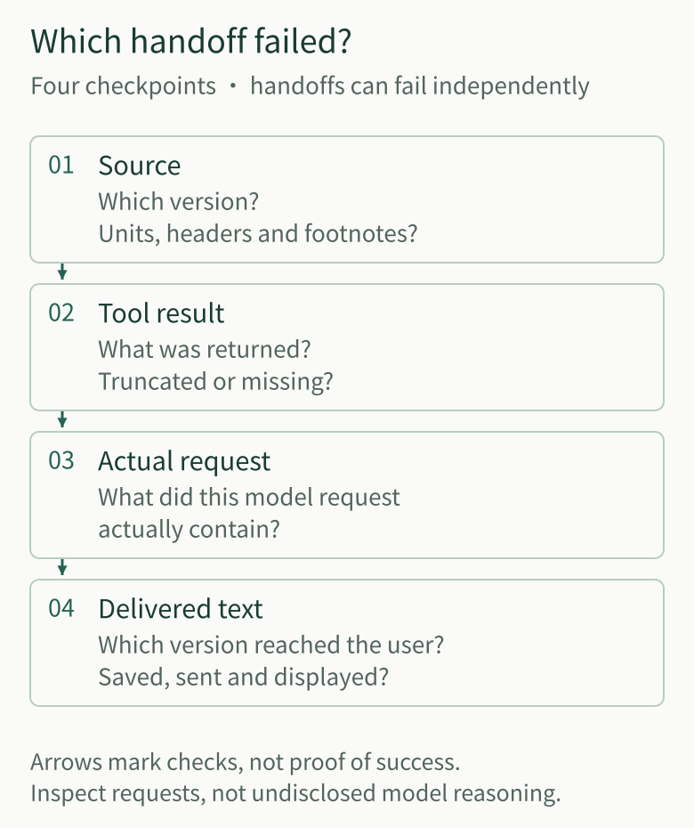
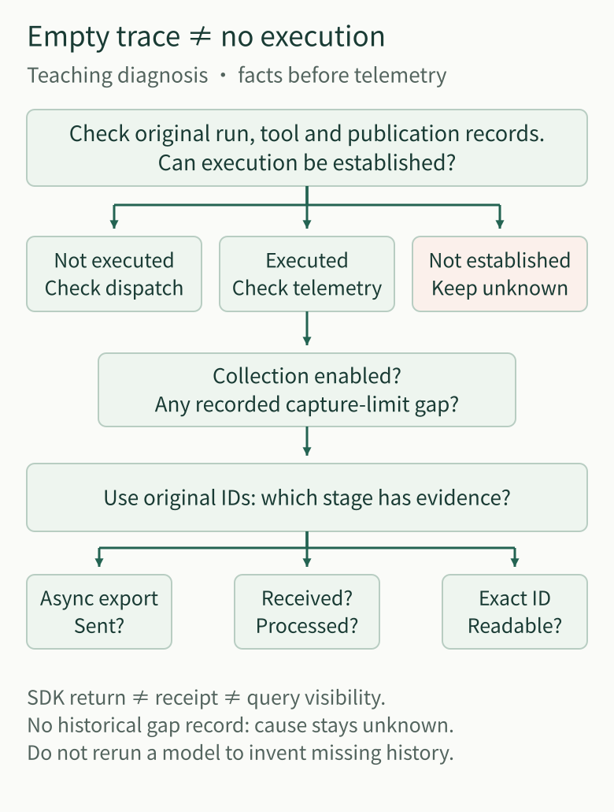
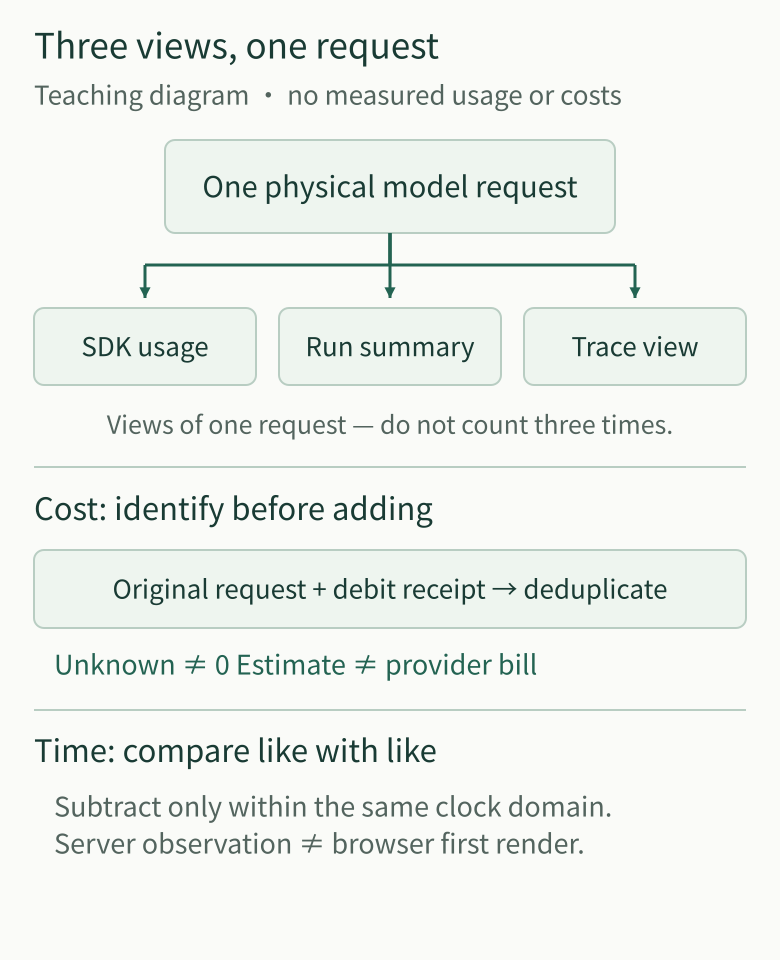

# Agent Observability Panorama: From Model Requests to Verifiable Research Facts

A fund-research answer contains a wrong number, but the Trace dashboard looks healthy: successful tools, completed calls and a retrieval duration of zero. It is tempting to blame the model. Inspect the original records, however, and **some “0 ms” values were never measured at all, while some “missing” operations really happened and were lost in the diagnostic pipeline**.

The surprising lesson is that more telemetry is not always closer to truth. The useful questions are **who measured which interval, what passed through each projection, where evidence was lost, and whether an observer has quietly been promoted into an execution authority**.

## 1. Surprise One: The Missing Trace Event May Describe an Action That Already Happened

One research request spans several different transitions: source retrieval, tool result, actual model input, candidate answer, Publication commitment and eventual delivery. A successful model call says little about which of these transitions was correct.

In one long-run investigation, the Trace lacked a publication event, but the original Publication history contained an authorized, committed answer. Treating “not in Trace” as “never happened” could cause an operator to rerun a model or effect that already completed.

Our final design leaves **execution facts with their producers**. Original Run, tool and Publication records own effects, revisions, permissions and settlement. OpenTelemetry and Langfuse receive bounded diagnostic projections correlated by Run, physical request, tool action and answer revision. Observation failures do not veto independent research or decide whether it has terminated.

This is deliberately less authority for observability, not an invitation to build a parallel state machine.

## 2. Surprise Two: Zero Milliseconds May Mean “We Never Had a Clock”

One real research readback displayed `0 ms` for 19 retrieval-stage events. The original result callbacks carried completion facts but no start timestamp. The old projection filled missing durations with zero. A separate Native diagnostic wrote `createdAt` and `completedAt` together after tool completion; subtracting those database timestamps could fabricate another zero.

**Unmeasured is not fast, but an actually measured zero is not automatically unknown either.** We now distinguish a valid measured zero, a valid nonzero interval and absence of a measurable interval. Historical rows without underlying timestamps cannot be retrospectively repaired by inference. An OpenTelemetry export span's start and end times are not inherently the business tool's execution time.

A later, explicit local measurement, `hostHandlerDurationMs`, brackets the actual Native Host handler call using a monotonic clock. It includes work, adapters and waits inside the handler, but **excludes external queueing, pre-dispatch authorization, source binding and settlement after return**. It is not pure vendor network latency.

In one real Run that ended `partial` after interruption, 77 Host lifecycle records carried this field. That establishes a measurable interval for those observed handlers, not a faster or completed research task. Parallel handler intervals overlap; summing them does not yield Run wall time. Handlers that have not completed have no finished interval to report. Define the **measurement owner and its exact start/end points** before calculating percentiles.

## 3. Surprise Three: More Captured Events Can Push Important Requests Out

Long research generates a flood of streamed provider fragments, paged reads and tool-state updates. A query can return `complete` after reading every available page even though an earlier capture limit dropped model bodies or protocol events. A subtler capacity problem occurs when lower-priority read/gap events fill the bounded observer before the next request or usage fact is emitted.

We keep bounded space for higher-value request and usage observations, report source overflow separately from query-side omission, and never interpret “no request event was returned” as “no model request occurred.” Capturing full prompts and tool payloads by default is not a solution: the research may contain private portfolios and lengthy licensed documents, and retention itself creates security and storage costs.

## 4. Why One Paid Request Can Appear in Three Different Views

The SDK, a Run summary and a Langfuse Generation can all describe the same physical model call. Sum their display rows and cost triples. Resume a task and assign the same call a new diagnostic identity, and accounting can double again.

We associate usage and cost with the **original physical attempt identity** and provider usage response, not with the count of UI rows. Conflicting amounts for the same attempt remain a conflict or unknown rather than being overwritten by the latest value. Known provider-cost subtotals are useful; they are not a complete invoice. The same discipline applies to time: the server's observation of a new save is not the user's browser first paint.

## 5. Why We Use OpenTelemetry and Langfuse Without Making Them the Source of Truth

[OpenTelemetry Trace concepts](https://opentelemetry.io/docs/concepts/signals/traces/) define spans, events, propagation and their time boundaries. [Langfuse](https://langfuse.com/docs/observability/features/token-and-cost-tracking) supplies an effective LLM-oriented inspection, token and cost interface. They prevent us from rebuilding an entire trace-search UI inside the chat application.

But their abstractions and our business contracts are not interchangeable:

| Mechanism | Valuable capability | What it does not own |
| --- | --- | --- |
| Automatic spans and platform timing | Find call trees, errors and bottlenecks | Original Handler duration, Publication commit or browser rendering may use different intervals |
| Langfuse query and dashboards | Find a research Run and compare observations | Query completeness cannot certify source capture completeness |
| **Original Run / Gateway / Publication records** | Keep execution, grants, settlement and revisions authoritative | Not a convenient trace-search UI, so they export bounded evidence through one-way adapters |

The trade-off is **reusing mature telemetry infrastructure while not allowing telemetry to become a business judge**. It requires original identity correlation, privacy controls, failure-isolated exporting and explicit treatment of missing observations.

## 6. The Operational Surprise: A Backup May Exist While Historical Research Is Unreadable

During a self-hosted Langfuse recovery, ClickHouse diagnostic system logs occupied far more storage than the business trace tables that mattered. Before cleanup, the team had to protect the existing business snapshot and metadata identity. After recovery, being able to list files and tables still did not establish usable history. The decisive check was reopening **one pre-snapshot real Run** and comparing its events, model-input records and publication history.

Successfully exporting a new synthetic probe is a different check: it establishes the new ingestion path, not recovery of old material. This turns “observability should be recoverable” into a concrete promise: **an investigator can find the original research under its original identity**, rather than merely finding a backup archive.

Unlimited retention of prompts, portfolio data and tool payloads would not be a defensible fix.

## 7. What to Do When the Next Answer Is Wrong

Begin with the answer, not the trace color. Was the original disclosure's time and unit correct? Did the tool retain the needed material? Did it enter the **actual** model request? Was the committed revision also the one sent and displayed? When one step is unobserved, name that exact gap instead of assigning a plausible root cause.

Only if latency is the problem should you compare correctly scoped Host, Gateway, Run and delivery intervals. Only if cost is the problem should you deduplicate by physical attempts and state which usage is missing.

**Our design goal is not more green traces. It is fewer fabricated business facts: telemetry helps locate an issue but never owns the action it observes.**

---

<!-- agent-article-sync:guidance:start -->
## Further Reading and Discussion

[Panorama Series](/en/panorama) · [Chinese edition](/articles/025-agent-langfuse-from-trace-to-trustworthy-observability).

[Read the Chinese original on the author's blog](https://hpoenixf.com/blog/025-agent-langfuse-from-trace-to-trustworthy-observability) · [Public engineering-article collection](https://github.com/hpoenixf/eff-agent-article) (Stars welcome).
<!-- agent-article-sync:guidance:end -->
