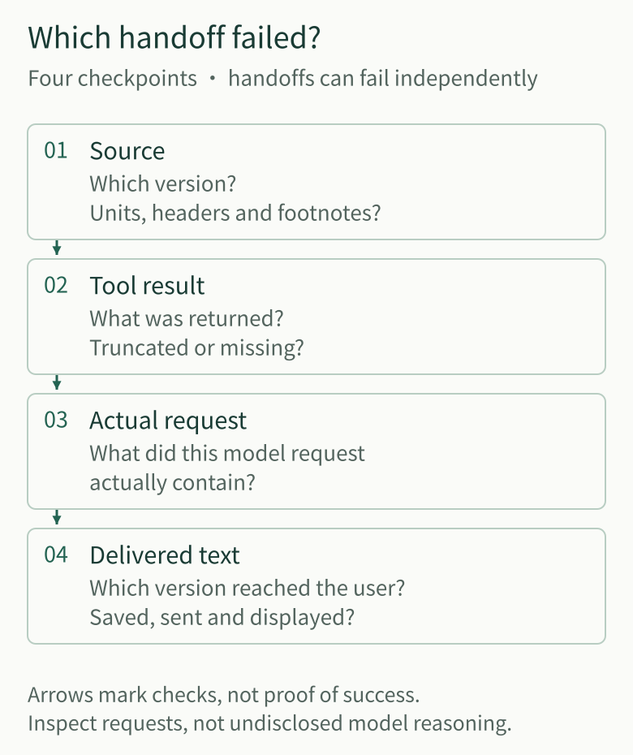
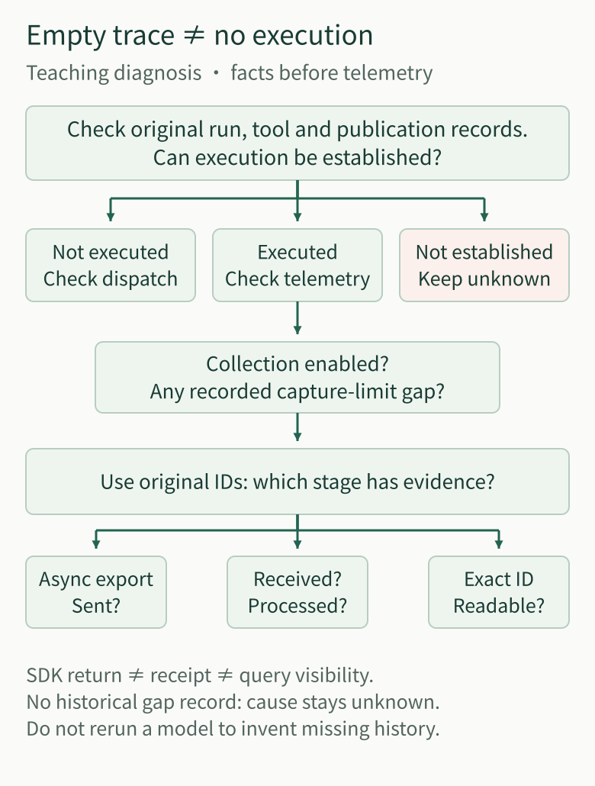
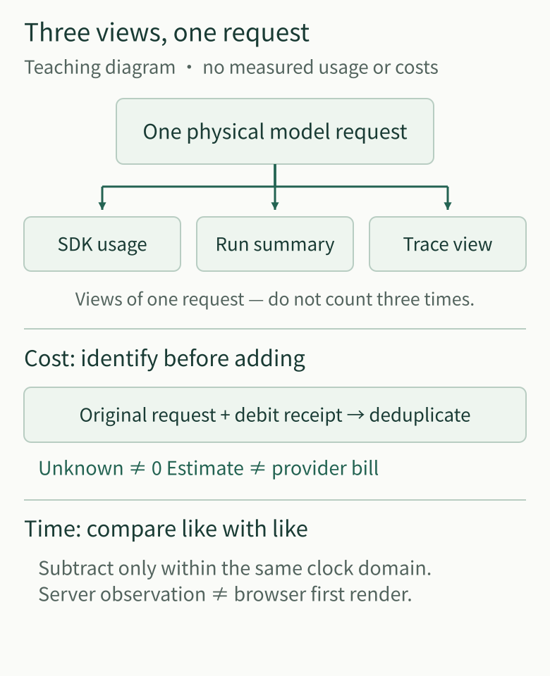

# Agent Observability Panorama: From Model Requests to Verifiable Research Facts

Start with a teaching scenario: a user asks an Agent to check the figures in an announcement and produce a report with sources. The report cites the right announcement, but the number is wrong. The API reports no error, and the tracing page is green throughout. Should we change the model, revise the prompt, or fix the reading tool?

Knowing only that “the call succeeded” is not enough to choose. The source might omit a unit, the tool might drop a footnote, or the model might receive an incomplete result—or receive it correctly but misunderstand it. Even when the model generates the right content, the user might see a different version.

**Useful Agent observability helps us find where a judgment first departed from the facts, while showing what our records still lack.** We follow this report to explain how to inspect handoffs, handle missing evidence, and check the observability tools themselves. The teaching scenario explains the diagnostic method; the separately identified engineering cases come from our actual work on the Langfuse telemetry pipeline.

## 1. Find the Four Handoffs Before Deciding What to Fix

A trace can connect model requests, tool calls, and service activity within a task. But even a complete call tree cannot replace checking the content. For the report above, four handoffs deserve inspection:

| Checkpoint | What to compare | What the comparison lets us judge |
| --- | --- | --- |
| Source to tool result | The original announcement version and relevant pages against the text, headers, units, and footnotes returned by the tool | Whether the source was appropriate and whether reading omitted something that changed its meaning |
| Tool result to model request | The complete tool result against the input actually sent to the model on this request | Whether the material was merely stored or was actually seen by the model this time |
| Model request to generated content | The actual input against the candidate answer and how the request ended | Whether interpretation or calculation failed, or the output was truncated or the request failed partway through |
| Generated content to user-visible text | The candidate answer, saved version, server transmission, and client receipt records | Whether the user obtained the same version that was checked |

*Figure 1 · Match four checkpoints by their original identities: source material, tool results, the actual model request and delivered text. Arrows mark handoffs to inspect, not guaranteed passage of content. Model output, persistence, sending and display still require separate checks.*

For example, the announcement says “amounts in ten thousand yuan,” but the tool returns only the numbers. Asking the model to “calculate carefully” does not restore the missing unit. If the tool result retains the unit but the actual request includes only a numerical summary, fix input assembly. Only when the request is complete but the answer still uses the wrong unit should the investigation turn to interpretation, calculation methods, and verification strategy. These are conditional teaching branches, not an assumed real root cause for the opening scenario.

This investigation does not require access to the model’s undisclosed internal reasoning. What we can check is the evidence it received, the content it returned, and what the surrounding program actually did. Accurate input does not guarantee a correct answer, but it helps us avoid repeatedly tuning the wrong part of the system.

[OpenTelemetry’s observability primer](https://opentelemetry.io/docs/concepts/observability-primer/) distinguishes logs, metrics, and traces: metrics help detect unusual changes across a class of tasks, traces locate waits and branches within a task, and logs add events at particular points. Here, they work together to examine the four handoffs. A richer dashboard does not certify a correct report.

## 2. Correlate the Same Action Without Replacing Execution Records with Diagnostic Copies

Before comparing two records, establish that they describe the same action. The same tool may run several times in succession, and two subtasks may read the same announcement at nearly the same time. Matching tool names and nearby timestamps do not prove that the results correspond.

We therefore correlate the user task, its execution (Run), individual model requests, tool calls, and answer versions. If the main agent delegates numerical checking to a child agent, we need to find both the research task it belongs to and that child’s own requests and results. Parent–child relationships explain ownership; original identifiers establish which occurrence corresponds to which.

Correlation does not merge responsibilities. **To establish whether a tool actually executed or a report was saved, consult the original system’s execution and persistence records. To understand how calls progressed, where they waited, or what observations are missing, consult diagnostic telemetry: runtime data automatically collected and reported for diagnosis.** These records can cross-check one another, but neither can stand in for the other.

### More Than Langfuse: Which Technologies Make Up This Pipeline?

Think of it as four layers, each with a different job:

- **Original system records: business PostgreSQL and local redacted traces.** Run, tool-execution and answer-persistence records establish what actually happened; local traces add diagnostic clues. Langfuse does not replace those original records.
- **OpenTelemetry: capture and transport.** OpenTelemetry provides common conventions for describing and correlating runtime records, plus tools to collect and transport them. Our in-process adapter organizes calls into correlated spans, with OTLP export and Langfuse processing integration for delivery. This is instrumentation inside the application, not a separately deployed OpenTelemetry Collector service.
- **Langfuse: querying and diagnosis.** Its Web application provides trace search and detail pages, while a background Worker processes asynchronous events. It helps us inspect the process; it does not decide whether a report is correct or its text has been saved.
- **Langfuse storage and queues: separate responsibilities.** A separate PostgreSQL stores platform transactional data, ClickHouse stores traces and other observations, Redis handles queues and caching, and MinIO supplies object storage. This PostgreSQL is separate from the Agent's business database, rather than one database doing every job.

See [Langfuse’s official architecture](https://langfuse.com/handbook/product-engineering/architecture) for these component roles. Readers need not deploy the whole stack first: identify the facts that need checking, then choose how to capture, query and retain them.

We initially chose Langfuse to reuse mature trace-search and detail pages rather than build another diagnostic interface inside the business chat page. It has an entry point and storage separate from the Agent. This answered “where can we inspect the process?” without making the observability platform the authority on execution facts.

During long-research readback on October 30–31, 2026, one trace had no answer-publication event, while the original publication history returned text that had actually been committed. The right next step was to inspect the saved records using the original Run identifier and access permissions—not rerun the model to produce a replacement answer, and certainly not fabricate an event that had never been captured.

This matters especially for actions with side effects: when a query finds no record, first establish whether the original action occurred. Otherwise, a missing observation can become duplicate execution through a blind retry.

## 3. Records May Be Incomplete; Gaps Must Not Masquerade as Conclusions

Saving every model input and output seems convenient for diagnosis. But research requests may contain long web pages, PDFs, and private material. Capture requires separate decisions about authorization, redaction, capacity, and retention. “We might need it for troubleshooting later” is not a reason to retain all source content by default.

The harder question is whether, after limiting content, we can still describe honestly what we observed.

An October 2026 controlled review found that our body-capture limit was **256 KiB (262,144 bytes)**: content exactly at the boundary could be retained, but one additional byte was rejected. When both input and output exceeded the limit, the read interface could even omit the entire model turn. “The body was not saved” came to look like “this call did not happen.”

Raising the limit only postpones the next overflow and increases storage and privacy costs. We kept the limit and instead recorded bounded metadata when a body could not be retained: the invocation identifier, whether the gap concerned input or output, and a cause the collector actually knew. The reader then shows the call and its gap rather than removing the whole turn.

This also requires distinguishing three cases. A captured, valid JSON `null` is an observed value. Content known to have been omitted because of a size limit is a gap with a known cause. An old record without a recorded cause remains unknown. Today’s rules cannot supply an invented explanation for yesterday’s blank space.

A query marked `complete` needs the same scrutiny: it may mean only that pagination has finished, not that every body and protocol event was captured at the source. For specific long-research samples and stage-level gaps, see [The Trace Says Complete—Why Can’t We Fully Reconstruct the Run?](agent-trace-complete-observation-gaps.md).

*Figure 2 · Investigate an empty trace against original run, tool and publication records first. Once execution is established, inspect capture gaps and asynchronous telemetry stages. Insufficient evidence stays unknown; a new model run cannot recreate missing historical evidence.*

Return to the announcement report. If this request’s input was not retained because of authorization or capacity limits, we cannot claim that “the model definitely saw the unit,” nor that it did not. Other records may still be useful, but conclusions about the actual input must stop at the evidence boundary. That is more useful for improvement than filling a gap with a plausible explanation.

## 4. The Telemetry Pipeline Can Fail Too: Verify That a Record Reaches the Query Interface

When original execution records establish that a model request occurred but its trace cannot be found, inspect capture and transmission rather than continuing to suspect that the Agent never ran.

We encountered precisely this situation: observation was enabled and the Langfuse page was accessible, yet actual requests had no corresponding records. Following transmission revealed that URL concatenation produced a double-slash path and triggered a redirect. The failure occurred in the background batch exporter, outside the alerts that watched only synchronous exceptions.

The useful lesson is not the trailing-slash fix, but an easily missed distinction: **the application handing an event to the SDK, the receiver accepting it, and the query interface reading it back are different stages.** The object storage, queue, and background Worker in [Langfuse’s official architecture](https://langfuse.com/handbook/product-engineering/architecture) explain why processing continues after acceptance.

At the actual export boundary, we added bounded, sanitized batch status, correlation identifiers, and HTTP status information permitted for recording. We then sent a synthetic event through the real capture pipeline and queried it using the same event identifier. This probe needs neither a model call nor changes to the original research records.

Diagnosis can therefore narrow the problem step by step: did the collector produce an event? Did background transmission succeed? After acceptance, is processing still pending, or did it fail? Finally, can the exact identifier be read back? If evidence runs out at a stage, stop there; an empty downstream query does not establish that nothing happened upstream.

Successful probe readback establishes that the path was reachable on that occasion. It cannot fill historical gaps or automatically prove long-term capture completeness. It does, however, provide a small, concrete self-check without requiring another large platform to monitor the monitoring platform.

## 5. Seeing One Request Three Times Does Not Mean Paying Three Times

Once report content can be checked, another common question is: “Why was this run slow or expensive?” Again, start by identifying the facts behind the records.

A request actually sent to a model service may appear in SDK usage records, a research-wide summary, and a trace page. These are different observations of one request, not rows to add together. Re-exporting old records creates no new consumption; a retry that genuinely issues another request has its own request identity.

*Figure 3 · SDK, Run and Trace can be three views of one physical request, not three billable requests. Deduplicate against the original request and debit receipt. Unknown is not zero, an estimate is not a bill, subtraction requires the same clock domain, and a server observation is not browser first render.*

We anchor metering to the original physical request identifier and its debit receipt, not to rows displayed in a chart. A zero can be recorded only when the SDK explicitly reports zero; missing usage remains unknown. Conflicting costs for the same request cannot be resolved by taking the last value and pretending the conflict disappeared.

An amount calculated from model prices should be called an estimate, not a provider invoice. [Langfuse’s token and cost documentation](https://langfuse.com/docs/observability/features/token-and-cost-tracking) likewise distinguishes imported usage and costs from values inferred using pricing. Our controlled synthetic-request path checked selected identity and usage propagation, and confirmed that sampling or export failures did not change model-dispatch counts. It was not provider billing reconciliation.

Timing requires the same care. Model return, answer persistence, server transmission, and browser display measure different stages. Only an original persistence receipt confirming a new commit on this occasion can establish when the current process observed that new commit. Reading an old answer during recovery must not count as its first save again. Monotonic clocks from different processes cannot simply be subtracted, and a server-side observation time is not the user’s first-paint time.

Comparing latency, error rates, or costs before and after a change also requires the task scope, time window, sample denominator, and number of requests with missing records. Otherwise, a chart that missed slow requests can look better than one that captured them completely.

## 6. If Diagnosis Depends on History, Require Restored Records to Be Queryable

Limited records may be enough for short-term debugging. Once we promise that a report can be investigated later, however, we must specify what is retained, for how long, and how it can be retrieved after failure. Retention and backup policies should serve that requirement rather than allow telemetry to grow indefinitely.

During a storage failure, table-level inspection found approximately 117 GiB in ClickHouse’s `system.trace_log`, compared with approximately 286 MiB of business-table data parts that needed preservation. These measure different things and cannot simply be added or used to infer a “percentage saved.” They do make the case for distinguishing system diagnostic logs from business traces first. [Langfuse’s self-hosting guidance](https://langfuse.com/faq/all/reduce-clickhouse-disk-size) also notes that built-in system log tables can occupy most of the disk space.

We first verified the existing offline snapshots of business data and metadata, then handled old system logs and retention policies within the authorized scope, instead of deleting the entire observation volume. A separate observability stack also needs explicit configuration boundaries so that inherited settings with the same names do not connect it to the wrong target.

During the subsequent isolated restore, the archive listed files, but the new instance initially could not recognize the business tables. After repairing metadata relationships in the copy, we did not stop at “the tables are back.” We selected a real historical research Run from before the snapshot and used the original reader interfaces to compare events, model inputs, turns, and publication records between the original instance and the copy. Results matched for that scoped sample.

We checked the new-write path separately by writing and reading back a synthetic event through the actual SDK and background processing pipeline. These are two different questions: **can old records still be queried, and can new records still arrive?** Recovering the old sample does not cover research performed after the snapshot, much less recreate bodies that were never captured.

When long-term readback is required, a recovery exercise should therefore end with an original research task readable again under its original identity—not merely with a backup file existing or a database starting. Short tasks need not adopt every long-term governance mechanism just to complete an observability panorama.

## 7. Return to the Report: Which Gap Should We Address First?

Revisit the wrong number at the beginning. Changing models need not be the first move:

- If the source version or unit was unsuitable, fix source selection; if the tool omitted headers or footnotes, fix reading.
- If the tool returned complete material but the actual request lacked key content, fix the input handoff. If the input was complete but reasoning or calculation still failed, examine interpretation and calculation methods.
- If the candidate answer was correct but a different version was saved or displayed, inspect delivery rather than asking the model to learn the same problem again.
- If key records are missing, establish whether capture omitted them for a known reason, transmission failed, or the cause remains unknown. Cross-check original execution records instead of presenting a guess as an incident’s root cause.

For your own system, start with one failed task. Select the records you genuinely need at these four checkpoints and correlate them using their original identities. For bodies that cannot be captured, leave a bounded, truthful description of the gap. Then verify the telemetry path with a probe that can be read back by its exact identity. Add further mechanisms only when long-term investigation, cost analysis, or more complex collaboration actually calls for them.

**The value of observability is not making every node green. It is reducing the key facts we must guess, and the wrong places we might repair, during the next investigation.** It cannot judge every answer for us, but it can make “what we know, what is missing, and where to look next” concrete.

---

<!-- agent-article-sync:guidance:start -->
## Further Reading and Discussion

[Panorama Series](/en/panorama) · [Chinese edition](/articles/025-agent-langfuse-from-trace-to-trustworthy-observability).

[Read the Chinese original on the author's blog](https://hpoenixf.com/blog/025-agent-langfuse-from-trace-to-trustworthy-observability) · [Public engineering-article collection](https://github.com/hpoenixf/eff-agent-article) (Stars welcome).
<!-- agent-article-sync:guidance:end -->
