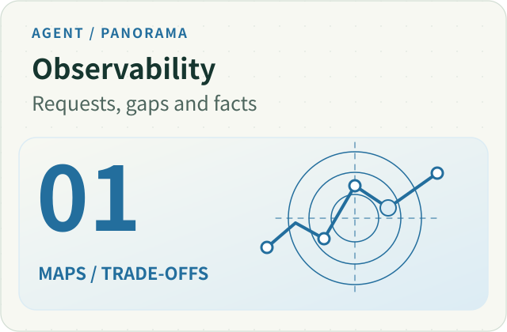
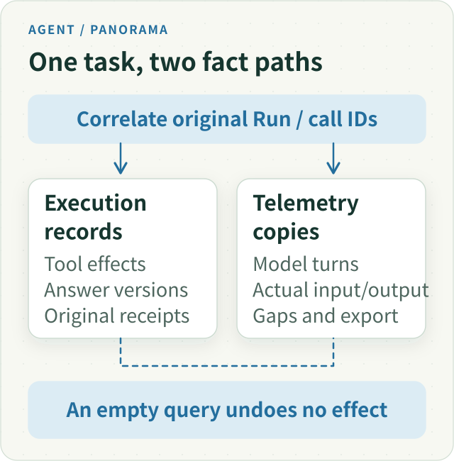
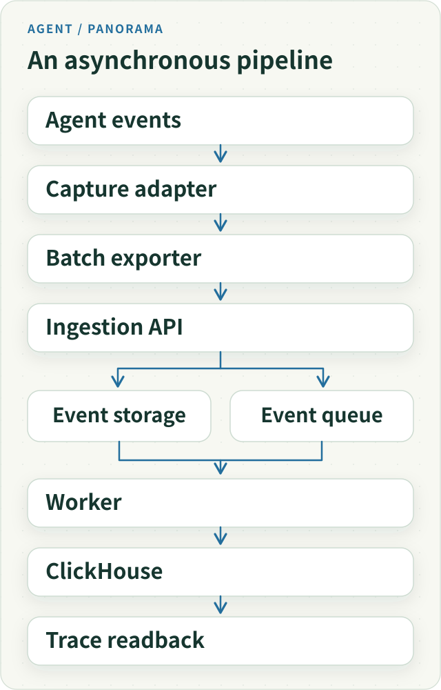

---
evidence:
  implementation: "Observability and missing-data handling implemented (as reported)"
  scoped: "Synthetic traces, focused probes and isolated restore"
  live: "Long-term completeness and live research outcomes unverified"
---

# Agent Observability Panorama: From Model Requests to Verifiable Research Facts

A user says, “The report cited that announcement, but the key number is still wrong.” Normal CPU usage, a successful HTTP response and a green trace do not explain what happened. A useful investigation connects the original material, actual model input, calculation result and outward answer from the same research task.

**Agent observability follows stable identities back to concrete facts while marking what has not been observed.** Logs, metrics and traces provide different views. Run records, tool receipts and publication history preserve the facts their respective owners record. Correlation helps diagnosis; substitution creates a more attractive misunderstanding.

We start with the map, then explain the design’s evolution. The connecting question is: **why did the model answer this way, which evidence did we retain, and where should we look next?**

## 1. Give Each Observability Signal a Specific Job

[OpenTelemetry’s observability primer](https://opentelemetry.io/docs/concepts/observability-primer/) distinguishes logs, metrics and traces. In an Agent, three questions make their roles easier to understand:

| View | Question it helps answer | Conditions that accompany it |
| --- | --- | --- |
| Metrics | How have latency, errors and resource consumption changed? | Time window, denominator, dimensions and unknown values |
| Logs | What event or error was observed at a particular point? | Original call identity, ordering and permitted disclosure |
| Traces | How did one task move across models, tools and services? | Parent/child relations, asynchronous correlation and capture coverage |

Metrics detect a class of tasks slowing down. Traces locate waits and branches in a task. Logs add detail at a failure point. None certifies the research conclusion. More detailed events do not necessarily mean more complete facts.

A task has several identities: the user task, its Run, an independent Main or Child execution, a physical model request, and particular tool calls, results and answer versions. Parent links organize them; original IDs correlate them. Nearby timestamps and matching tool names help retrieval but cannot replace identity.

*Figure 1. The paths correlate through original identities. Delayed or missing telemetry does not undo a committed tool effect or answer. Open the figure for the full vector version.*

## 2. Follow the Handoffs Behind an Answer

Consider a teaching scenario: a tool retrieves an announcement, Main delegates numerical verification to Child, then produces a report. Investigate these **independently fallible handoffs**:

1. **Source to result.** Which version, page or passage was actually read? Did the delivered material include the necessary headers, units and notes?
2. **Result to request.** Did that result reach the actual Main or Child request? A full document stored in a database does not mean the model saw it.
3. **Request to candidate.** What did the model actually return? Where did an output limit, streaming protocol problem or adapter error occur? Provider-hidden internal reasoning is outside our observable content.
4. **Candidate to delivery.** Which answer was saved, how much did the server emit, and did the client receive or display it? The most complete internal draft cannot substitute for what the user obtained.

This narrows diagnosis to source production, input assembly, model interpretation or delivery. An image that reached the request but was misread raises an interpretation question. An image that never reached it raises a handoff question. Both may look like “the model misunderstood,” but the repairs belong in different places.

Useful input/output capture does not justify recording all private material. Identity, stage and a bounded gap reason can support minimal diagnosis. Authorization, redaction, capacity and retention for raw content need separate decisions. With content capture disabled, say the body cannot be inspected; do not infer detailed input from event shells.

When we integrated Langfuse, our requirement sounded simple. A financial-research Agent might make more than a dozen model requests and invoke several tools, yet finish with only "research interrupted" visible. We needed to see the chain of events rather than infer it from scattered logs.

We deployed a standalone Langfuse instance and connected model and tool events. The first synthetic Trace appeared in its console. That seemed like success.

Real investigation soon exposed a much harder question: **displaying a Trace is not the same as reliably explaining a research Run**. Records may be truncated in the application, lost during asynchronous export, expand dramatically in storage, or remain unreadable after restoring a backup.

Our observability goals shifted from "show calls" to **knowing what was retained, where evidence went missing, and whether original facts can be recovered after failure**.

## 3. Reuse a Mature Platform, but Define What It Does Not Own

We did not build our own trace-search interface inside the chat app. We deployed Langfuse's separate Web, Worker, and storage stack. It had its own entry point and did not reuse the investment application's database.

Even this first step had operational costs. The initial PostgreSQL deployment collided with a host port. Restricting the observability database to the internal Docker Compose network resolved the conflict. A synthetic SDK event then appeared in the UI.

This established the basic SDK-to-ingestion-to-UI path. We then turned to capturing real research turns and tracking answer delivery.

We drew an ownership distinction early. The Agent's durable Run records remain the authority for execution, budgets, tool effects, and answer commits. Langfuse is a **diagnostic view** of model requests and tool operations.

The two can be cross-checked, but **a missing Trace is not evidence that execution never happened; an existing Trace is not proof that an answer was delivered**.

## 4. Longer Research Demands More Than Call Logging

Early model/tool events were easy to interpret in simple tasks. Multi-step research raised different questions: did a tool result enter the next model request? Did generated text pass Publication checks? At which point did the output diverge from its input evidence?

We extended observation from standalone function calls into an **identity-linked execution chain**: model turns within one Run, actual tool dispatches, Host result projections, subsequent model inputs, and final publication must be correlated through their original identities.

Matching by the string name of a tool or approximate timestamp is unsafe. The same tool may run repeatedly; asynchronous work can overlap. Requests and receipts need their own identities. And whether an effect truly committed is still determined by the underlying business record, not the Langfuse visualization.

This narrows "the model found the data but gave no answer" into inspectable stages. Unfortunately, it introduces another practical issue: complex prompts and tool outputs may be enormous.

## 5. Trustworthy Observation Must Record Absence, Too

We impose byte limits on captured model bodies to control storage and sensitive-data exposure. Large Web/PDF/tool inputs make those limits necessary.

An October 2026 review identified an unexpected consequence at the application-side **256 KiB capture boundary**. A serialized body of exactly **262,144 bytes** could be retained; just one additional byte caused rejection. When a body was oversized, the read projection could contain only **null**. If both input and output were absent, a rendered model-turn list could omit the entire turn even though query pagination showed the correct count.

Raising the limit would merely postpone the next threshold failure while retaining more content than our resource and privacy policy intended.

Our solution was to **bound the body while preserving bounded metadata explaining its absence**. When the collector rejects one side for size, it still records the precise invocation identity, input/output side, known cause, and limited metadata. Readers project that into an explicit missing-body record instead of making the call disappear.

We also distinguished a valid JSON **null** from an **unrecorded field**. The former is observed data; the latter is an observational gap. They must not share the same missing-value predicate.

This change made gaps visible under the existing capture limit. We have **no long-term comparative capture-rate result**, so it cannot be reported as a measured percentage improvement. Old records without missing-body receipts retain **unknown** causes; the new mechanism cannot retroactively explain them.

### A complete query is not complete capture

Readback of long research runs recorded on October 30–31, 2026 sharpened this distinction. All queries for the first 59 ended runs were labeled `complete`, yet 17 model-turn outputs were missing and 41 runs contained tool-protocol gaps. Query pagination, model-content capture, and protocol-stage coverage need separate descriptions.

One trace lacked an answer-publication event, while the original publication history returned saved text. This was an authorized readback using the original Run identity, not a reconstructed event. Missing telemetry cannot invalidate durable facts, nor justify replaying actions to improve a trace.

New protocol-gap receipts distinguish omitted provider/SDK fragments from other events without increasing existing limits. “Other” is not equivalent to execution-only events, and legacy categories remain unknown rather than zero. The detailed event-budget case is covered in [The Trace Says Complete](agent-trace-complete-observation-gaps.md); the original article remains focused on the observability system as a whole.

### Model usage and cost: Trace rows are not physical calls

Another problem arose when one physical Provider attempt appeared in Gateway SDK usage, a Run-level summary, and a Trace re-exported during recovery. Summing the display rows would count one charged request multiple times.

The October 21, 2026 resource-observability consolidation tied metering to the **original Gateway physical Attempt identity and original request-debit receipt**. Main, Child, and retry attempts each retain real physical identities. A Run summary reports the overall investigation; it is **not** another billable Generation. Replaying persisted facts reuses stable identities rather than minting more consumption.

Missing values are again critical:

- If the SDK explicitly returns **zero**, record zero.
- If tokens were **not returned**, usage is unknown, not zero.
- If duplicate records for one Attempt disagree on cost, withdraw certainty for that cost rather than accepting the latest number and adding it to totals.
- Calculating known usage from configured unit prices yields an **estimate**, not the Provider's actual invoice.

[Langfuse's Token and Cost Tracking documentation](https://langfuse.com/docs/observability/features/token-and-cost-tracking) distinguishes imported usage/cost from pricing-derived values. Our application adds a prerequisite: identify the Generations corresponding to real physical requests and establish coverage before making cross-Run totals.

A controlled **Factory → Gateway → synthetic HTTP → OTEL Exporter → Langfuse readback** chain checked original Attempt identities and usage projection for successful and failed research. It also showed that turning sampling off or failing export did not change how many model requests were actually dispatched.

That establishes scoped telemetry non-interference and metering consistency. It is not a reconciliation of real Provider invoices or long-term production cost.

### Timing needs its own clock and provenance

We also distinguished **observing a new commit in this process** from **when a body was originally persisted**.

A **commit-observed** timestamp is recorded only when the original publication receipt confirms a new commit during the present observation. Recovery replay, absent fields, or sight of an old body must not reissue a first-commit timestamp.

Durations from one monotonic clock domain are comparable. Monotonic timestamps spanning process restarts cannot simply be subtracted. A server-observed commit time also cannot be presented as browser first-paint latency.

These distinctions deliberately remove some precise-looking but unsupported performance numbers.

## 6. An Auxiliary UI Became a Data System That Needed Governance

As Langfuse started carrying real diagnostic value, we had to treat it as an independently operated data system.

One startup bug illustrated the danger of configuration leakage. Our app launcher loaded business environment variables before invoking the Langfuse Compose stack. Two configuration files looked correct, but Compose inherited a parent **DATABASE_URL** and connected the observation stack to the wrong target.

Changing one variable would not fix the class of bug. We moved the isolation logic to the child-process creation seam: read the interpolation variables actually declared by Compose, copy the parent environment, and remove values that could override the observability stack's own configuration. Startup, restart, and status queries reuse this policy rather than maintaining different hidden precedences.

Later a ClickHouse storage incident showed that even "how much disk does telemetry use?" was nontrivial.

At the time, the Docker backing file had approximately **164 GiB allocated**, and the service experienced repeated system-log and filesystem errors.

Treating the entire virtual disk as the size of business data would have created an unnecessarily massive backup prerequisite. Table-level inspection instead showed approximately **117 GiB in ClickHouse system.trace_log**, **9.7 GiB in system.text_log**, and around **286 MiB of business-table data parts** worth preserving.

Those numbers refer to **different measurement layers and must not simply be added together**. They demonstrate that ClickHouse's own diagnostic logs are distinct from Langfuse business Trace data.

[Langfuse's self-hosting guidance](https://langfuse.com/faq/all/reduce-clickhouse-disk-size) likewise notes that built-in ClickHouse log tables can dominate disk usage.

We did not delete the entire telemetry volume. We first verified offline business/metadata snapshots, then handled old system logs within the authorized scope, and adjusted bounded retention and rotation policies while preserving recoverable business records.

The operational work focused on preserving business records, controlling diagnostic-log growth, and making isolated recovery possible.

The lasting architectural lesson is that **an observability platform needs its own configuration boundaries, retention policy, and recovery verification**. It cannot be exempt from data-system governance just because it monitors another system.

## 7. A Backup Is Not Useful Until History Can Be Read Back

After the storage incident, we restored an offline snapshot into isolation. The archive listed files, but a fresh ClickHouse volume initially recognized **zero business tables**.

The absence did not mean the underlying historical studies had never been recorded. The archive had dereferenced symbolic links in Atomic database metadata and lost the original database UUID relationship.

The [ClickHouse Atomic database engine](https://clickhouse.com/docs/reference/engines/database-engines/atomic) associates table UUIDs with physical data paths. File existence alone does not prove metadata can find them.

We repaired the metadata links **only in an isolated disposable copy**, not on the original business volume. **Fourteen business tables** then became visible.

That was a start, not a complete recovery acceptance. We selected an actual research Run *before the snapshot time* and compared original versus restored data through the existing reader interfaces: **13 groups of event summaries** and the projections for model inputs, turns, publications, and invocation diagnostics matched. A different Run that occurred **after the snapshot** was explicitly outside the recovery claim.

We separately verified new ingestion with a synthetic event sent through the actual SDK, Worker, and ClickHouse path, then read it back—without invoking a paid model or modifying historical research records.

These checks demonstrate two distinct facts: a scoped sample of **previously saved history** was queryable again, and the **new ingestion path** worked in isolation. They cannot recover bodies that were never captured.

## 8. The Telemetry Pipeline Can Break, So Give It Minimal Self-Diagnostics

Another incident showed real model execution but no corresponding Langfuse record. Telemetry was configured as enabled, and the UI was reachable. Neither fact proved that the SDK's asynchronous background exporter had delivered the event.

Following the actual HTTP exchange uncovered a subtle URL bug. Base-URL serialization added a trailing slash; SDK endpoint construction appended another, producing a double-slash path and a redirect. The failure happened inside asynchronous batch export, beyond our synchronous-error observer.

We did not build another large monitoring platform for Langfuse. Instead, we added bounded, sanitized results at the real export seam: batch status, exact correlation identity, and approved HTTP status details.

A zero-model-call synthetic probe then traversed the real collector and was checked by its exact observation identity during readback.

This verified delivery for the **new probe**, not reconstruction of the earlier missing Trace. That distinction allows the telemetry system to diagnose itself without rewriting the Agent's original execution history.

[Langfuse's architecture documentation](https://langfuse.com/handbook/product-engineering/architecture) describes the asynchronous SDK/API/object-store/queue/Worker/ClickHouse stages. A successful SDK call is not the same as a record already being queryable.

*Figure 2. Event storage and the queue both participate in worker processing. SDK return, accepted ingestion and query visibility are different stages.*
This is a simplified telemetry flow, not the Agent's business state machine. Run records, tool effects, and Publication receipts remain with the original application persistence Owners.

## 9. When Is a Trace Trustworthy Enough to Diagnose?

Langfuse did not become the one true source of all Run facts. Its responsibilities and limitations became sharper.

| Evolving requirement | Capability established | Critical boundary |
| --- | --- | --- |
| See model and tool operations | Standalone platform and basic Traces | A visible Trace does not prove research completion |
| Reconstruct an investigation | Correlate Run, turns, tools, projections, and publications | Telemetry does not supersede execution receipts |
| Explain missing records | Body limits, missing-body metadata, and read projections | Uncaptured must not be represented as null content or zero calls |
| Operate telemetry long-term | Configuration isolation, system-log retention, scoped backup | TTL and service health do not guarantee full recovery |
| Diagnose after storage failure | Isolated restore, historical comparisons, new-ingestion probe | Restore preserved records, not bodies that never existed |
| Detect telemetry's own failures | Async export outcomes and synthetic readback | Empty query does not imply the Agent never ran |
| Explain usage, cost, and timing | Physical Attempts, stable receipts, estimated/unknown costs and original clocks | Run summaries, replay, and observation time are not extra calls, invoices, or first paint |

Specific engineering problems were addressed: inherited configuration was isolated; oversized bodies no longer silently hid known calls; an isolated restore recovered comparable historical records; and asynchronous-export issues could be reproduced and checked with a fresh probe.

These cases verify specific remediation paths; long-term availability, historical capture completeness, and provider invoicing remain outside their acceptance scope.

The durable principle is how to reason about an empty observation: **first establish what was recorded, where it could have gone missing, and whether it can be independently read through the original identity—then diagnose the Agent**.

Observability is not just drawing tool calls. It should help distinguish **facts that happened**, **parts not seen**, and **boundaries that must be checked next**, especially when a complex research task fails.

---

<!-- agent-article-sync:guidance:start -->
## Further Reading and Discussion

[Panorama Series](/en/panorama) · [Chinese edition](/articles/025-agent-langfuse-from-trace-to-trustworthy-observability).

[Read the Chinese original on the author's blog](https://hpoenixf.com/blog/025-agent-langfuse-from-trace-to-trustworthy-observability) · [Public engineering-article collection](https://github.com/hpoenixf/eff-agent-article) (Stars welcome).
<!-- agent-article-sync:guidance:end -->
