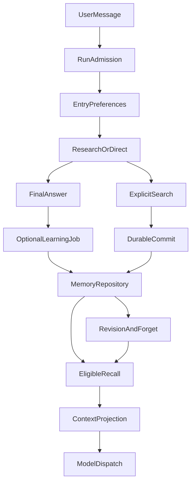

# The Full Lifecycle of Agent Memory: From Remembering Preferences to Safe Forgetting

> **Module Deep Dive · Systems Architecture.** This article concerns application-level cross-session memory, not knowledge encoded in model weights or conversation-context compaction. It draws on ETF Agent's design, code, and bounded verification available through October 2026. Synthetic examples are labeled.

Yesterday, an investment research assistant learned that a user prefers low portfolio turnover. Today, it still gives a high-frequency-trading-oriented answer. The user corrects it, but an old preference reappears in a later conversation. There is a harder failure too: the user asks the assistant to “forget it”; the database commits the forget operation, and the model's next answer fails. Should the system trust the chat window, an embedding search result, or the durable operation record?

These apparently different problems point to the same engineering fact: **long-term memory is not a table of summaries. It is a lifecycle with sources of authority, separate read and write times, correction, and revocation.**

We organize Memory into three cooperating paths: **writing, recall, and governance**. Writing decides what deserves to persist. Recall decides what is actually used in a later request. Governance decides who has authority when data expires, conflicts, or must be forgotten. These paths may join in a single research task, but they must not collapse into an ambiguous “memory succeeded” flag.

The article below explains the original system’s full lifecycle. The final section uses the runnable public slice in [Open ETF Agent](https://github.com/hpoenixf/open-etf-agent) to inspect explicit save, revision, forgetting and future-input eligibility. This single-writer file-library experiment is not the original PostgreSQL, automatic-learning or complete recall service.

## 1. The Big Picture: Three Paths, Two Authorities



This diagram shows **responsibilities, not a mandatory sequence for every turn**. Most conversations do not mutate Memory; automatic learning may be disabled. Direct does not call Memory tools. Research may perform explicit searches and commits. Whether a record can be disclosed ultimately depends on its current eligibility under the admitted account and Run scope.

There are two distinct kinds of authority.

- **The model interprets meaning.** Is a sentence a durable preference, a one-time request, or a report of a historical discussion? Does it revise an existing preference?
- **The application repository establishes durable facts.** Which account owns the record? Which family and revision are current? What source supports it? Has a save or forget actually committed?

This division allows the semantic engine to evolve without creating two competing notions of “latest memory.” ETF Agent reused its PostgreSQL Memory repository rather than letting a new vector index maintain an independent editable memory ledger.

Three things often called “memory” also need different jobs. Conversation history retains what happened in this exchange. Memory holds reusable preferences and attributed discussion history. RAG retrieves external knowledge material. All three may contribute to context, but **current holdings, NAV, trade authorization, and execution state still come from their respective authoritative systems**.

## 2. The Write Path: Synchronous Explicit Effects, Asynchronous Learning Proposals

“From now on, show the date of the data first” and “for this comparison, show the date first” look similar. They should not create the same durable effect. The first write-path decision is **whether something may be persisted**, before deciding how it should be extracted.

### 2.1 An explicit request: search, identify, commit, receive a receipt

Consider this **synthetic example**: the user says, “Remember this: whenever you compare funds, state the fee basis first.”

Research calls `search_memory` within the account scope to find an existing constraint. If a related entry exists, the tool returns a Host-issued target reference. The model may decide whether to create a preference or revise the existing family; it cannot invent a target ID. It then proposes a save or correction through `commit_memory`. The Host checks the real user source, scope, target revision, and durable operation identity.

The conceptual loop is:

```text
Explicit user request
  → search_memory (existing family or an available empty result)
  → commit_memory (save / replace / forget)
  → durable receipt (saved / updated / forgotten / conflict / unknown)
  → next Run independently checks eligibility for recall
```

The receipt supports both the user-visible acknowledgement and recovery after interruption. **The model saying “I remember” is not proof of a write.** If the outcome is unknown, it must not be reported as successful or automatically retried as though nothing happened. Recovery reconciles the existing operation identity and receipt.

A failed save should not necessarily stop a safe research answer. The current answer can still follow the user's instruction while disclosing that durable retention has not been confirmed.

### 2.2 Automatic learning: do not block the answer or fabricate consent

An explicit request to remember, correct, or forget needs a synchronous durable outcome. Automatic learning belongs **after a qualifying answer reaches a durable terminal state**. A semantic model proposes save, defer, or discard from permitted conversation material; the application validates the real user origin, category, scope, dependencies, and current revision.

Three states are important:

- **Candidate:** a proposal for review, not an active preference available for future injection.
- **Automatic:** an active record only when the relevant policy is enabled and validation succeeds; it does not pretend to be user-confirmed.
- **User-confirmed or explicitly requested:** the original confirmation or request is retained accurately; the model's paraphrase cannot turn one into the other.

In the current configuration, `MEMORY_SEMANTIC_MODE=disabled` is the default: **automatic semantic learning is off, while explicit Memory tools remain usable**. The `shadow` mode can produce observable proposals without activating them. Enabling `automatic` involves separate source, budget, and execution requirements.

Why not extract a possible preference synchronously on every chat turn? The user requested an answer, not an extra extraction-model round trip. And an unfinished answer should not silently be counted as successful learning. Moving extraction out of the response path does not itself guarantee exactly-once effects: retries still require source deduplication, revision checks, and durable effect reconciliation.

## 3. The Recall Path: A Search Hit Is Not Proof of Model Use

ETF Agent already had Memory records, candidate administration, and lifecycle APIs. But a baseline review in late September 2026 found that the normal Research path was not yet consuming the previously recalled memory content. That mattered more than choosing an embedding database: **a module being present does not mean its output reaches an actual model request**.

Today, normal mode can assemble a small eligible preference profile before the first semantic branch decision. Research can additionally use `search_memory` to find attributed discussion history. Direct does not execute Memory tools or prefetch episodic business history. Temporary mode and policy-denied runs do not perform cross-session Memory reads, writes, or learning.

Recall has to pass several independent decisions:

1. **Authorization and identity.** Does this Run have a Memory grant for the correct account? The model cannot select another person's Memory with a tool argument.
2. **Record eligibility.** Are the scope, family/revision, lifecycle status, expiration, forget state, and source dependencies still valid? A stale semantic hit must not bypass those checks.
3. **Relevance to this task.** Is the user continuing an earlier review or asking something new? Preferences and episodic histories have different admission rules.
4. **Context capacity and actual dispatch.** Ranking is not the final step. Selected candidates must still fit the bounded prompt, and a record not sent to the model cannot be counted as used.

Our defaults bound Memory to a small preference and episodic set and roughly 4,000 characters of Memory context, rather than appending an ever-growing chat transcript. Usage is counted at **actual provider dispatch**, not at search hits, UI inspection, or recovery replay.

Structured/lexical retrieval, dense vectors, and hybrid retrieval can all help discover candidates. ETF Agent's knowledge RAG already has lexical and vector channels with reciprocal-rank fusion (RRF). **That does not mean Memory currently uses the same RRF pipeline.** Memory's immediate requirements are valid provenance and genuine consumption, not a uniform-looking retrieval stack. We do not add a new Memory vector database just for architectural symmetry.

Performance follows the governing request deadline and cancellation rather than an unrelated fixed timer. If retrieval is unavailable, the safe path degrades conservatively and preserves the difference between “no records found” and “read failed.”

## 4. Governance: Correction, Forgetting, and Expiry Are Not the Same Deletion

A preference changes. “I prefer a long-term holding period” and “I need extra liquidity over the next six months” might coexist, or describe different constraints. Semantic similarity alone cannot merge them into one memory family.

ETF Agent uses **family + revision** to represent version relationships. A correction must target the currently observed revision. A stale target cannot overwrite a newer correction. The model may propose that two statements are related; the Host and repository enforce the actual compare-and-set operation.

Forgetting makes the whole family ineligible for **future model context**. Ordinary records can expire or be softly evicted by policy. An explicitly saved `response_constraint`, however, is not silently discarded by ordinary TTL/LFU cleanup. The user can still correct or forget it.

This reveals a subtle problem: old content may become unavailable while the fact that it was corrected remains worth reporting. In our October source-projection review, we found risks in both directions:

- Hiding every item associated with the old revision could hide the valid correction receipt too.
- Treating a correction receipt as permission to expose the superseded old body could revive withdrawn content.

We avoided a broad exception for historical content. The application must validate the original effect receipt, family identity, supersedes relation, and increasing revision. **It may explain that a correction occurred without reopening the old, ineligible text.**

The same rule applies to generated summaries, historical results, background jobs, and indexes. After forgetting, a new Run cannot launder the old preference back through derived context. A late learning job cannot revive the old source by assigning a fresh family ID. But “no longer used in the future” is not a promise that backups, old conversations, or material already sent to a model provider have been physically erased. Those commitments require distinct data-retention operations.

## 5. A Complete Example: From First Preference to Forgetting

The following fund-research flow is a **synthetic walkthrough of the intended branches**, not proof that every real model successfully followed these natural-language instructions.

| Time | User request or event | Expected system fact |
| --- | --- | --- |
| Run A | “From now on, state the fee basis first when comparing funds.” | A successful explicit save creates the current response constraint and a receipt |
| Run B | “Compare these two funds.” | The eligible constraint can be recalled, while fee facts still come from current sources |
| Run C | “Today, lead with the conclusion and put fees later.” | This overrides presentation for this task without silently mutating durable Memory |
| Run D | “Make conclusion-first the default from now on.” | Search identifies the family, and a successful correction creates a new revision |
| Run E | “Forget that presentation habit.” | The family is forgotten and excluded from subsequent new Runs |

The important observation is not whether the model happens to repeat a phrase from the remembered preference. The lifecycle has **four different proof points: commit, actual consumption in a new request, revision, and absence from future disclosure after forgetting**. An answer can accidentally match the preference without using Memory at all. A fluent acknowledgement can be generated even when storage failed.

For a financial agent, Memory must remain in its proper role. Risk preferences can influence explanation. Holdings come from Portfolio. NAV and fees come from current time- and definition-specific evidence. Trading permission comes from independent authorization. **Memory helps recall how the user wants to reason or communicate; it does not decide what the user owns or what the system is allowed to execute.**

## 6. The Real Failure That Changed Our Definition of Success

On October 9, 2026, an ETF Agent Memory acceptance run preserved a counterexample: **forgetting had already committed durably, but the subsequent model answer did not finish**. The planned final new-session query was therefore never executed.

Labeling the whole sequence merely “task failed” risks prompting recovery to repeat an effect that already happened. Treating the successful database commit as proof of the later model behavior would be equally wrong.

We separated the evidence: Did the repository commit and return the original receipt? Did the old revision lose eligibility? What memory actually entered the next model request? Could derived history disclose withdrawn content again? Controlled local cross-session paths produced positive evidence, but **the unfinished real-model sequence was not retroactively classified as a success**.

This illustrates [principle 3, “Proposal, approval, execution and effect are different facts”](/en/principles#principle-3): a committed Memory effect and delivery of the explanatory answer have separate states.

It also explains why conversation text alone is insufficient for recovery. The database effect may already exist even though the final “I forgot it” sentence never reached the user. The next response must reconcile the real operation, not guess again from the dialogue.

## 7. Why Not Copy a Full External Memory Engine?

Some architectures combine an asynchronous outbox, dense-plus-lexical retrieval, four-state deduplication, and temporal invalidation. Peak Lake's [Agent Long-Term Memory System](https://www.peak-lake.com/en/blog/agent-memory-system/) explains these patterns through writing, reading, and governance. That is a useful narrative and technical organization, but **each system still needs its own authority model and an evidence-based reason to add complexity**.

ETF Agent deliberately chose a narrower baseline:

| Approach | Advantage | Our current choice |
| --- | --- | --- |
| Inject the full conversation history every time | Easy to wire up | Unbounded context and weak handling of forgetting and provenance |
| Let an external vector/graph memory engine own final state | Rich semantic discovery | A possible future adapter, not a second source of authorization or revision truth |
| Application repository + bounded recall + optional asynchronous semantic proposals | Clear ownership of lifecycle, provenance, and recovery | Prioritize the current path; evaluate semantic retrieval before expanding it |

This does not make vector retrieval or temporal modeling unimportant. It means selecting them only when **measured recall misses or temporal conflicts** justify the extra queries, indexes, and lifecycle work. We should collect failed examples, candidates, actual model inputs, and user-task outcomes before choosing more infrastructure. Semantic similarity never substitutes for a user's revision authority.

## 8. What Have We Verified, and What Should We Measure Next?

As of the code and operational records used for this article, the supported local explicit save, correction, forgetting, cross-session, and PostgreSQL paths have bounded validation. A complete external live lifecycle, and sustained real-model understanding of those intentions, require separate qualification. The optional Hindsight semantic engine has not been qualified for that profile. Automatic semantic learning remains disabled by default.

The most valuable next metrics are not counts of new Memory classes or tests. They concern the lifecycle in real tasks: false candidate adoption, correct same-family revision, whether eligible records **actually reach the model**, false recall and context cost, whether forgotten text resurfaces through old summaries, and p95 recall latency in the full research request. Without real samples, we should not claim that retrieval quality has improved.

Returning to the opening question: a dependable Memory system must **provide a durable receipt when writing, enforce authorization when reading, use versions when correcting, and prevent forgotten content from returning to future use**.

Those guarantees are harder than making a model appear to remember the user. They are what make a long-lived assistant genuinely corrigible and accountable.

<!-- open-etf-agent:minimal-experiment:start -->
## 9. Run a Save–Revise–Forget Sequence in the Public Code

[Open ETF Agent](https://github.com/hpoenixf/open-etf-agent) now makes this ownership boundary independently runnable. Rather than exporting the PostgreSQL system described above, it uses an **explicitly selected, single-writer file library** to show how saves, corrections, forgetting and subsequent input relate. The preferences are synthetic and a fixed script chooses the tools; persistence, revisions and reads use the real implementation.

In [`memory-tools.mjs`](https://github.com/hpoenixf/open-etf-agent/blob/05c0dd2dc550f4f7e5da034340ff5c3159768fcf/src/memory-tools.mjs), model arguments have no “I am authorized” switch. Outside those arguments, the host binds a write intent to the library, operation, approved text hash or previous revision. [`memory.mjs`](https://github.com/hpoenixf/open-etf-agent/blob/05c0dd2dc550f4f7e5da034340ff5c3159768fcf/src/memory.mjs) durably reserves that one-use intent before publishing a new revision and updating the current index. A failure in between can leave an explicit partial effect: the intent was consumed but the revision did not complete. A failure receipt is not permission for unconditional replay.

With Node.js 26.11.1–26.x, run the fixed snapshot in a new directory:

```bash
git clone https://github.com/hpoenixf/open-etf-agent.git open-etf-agent-memory-demo
cd open-etf-agent-memory-demo
git checkout --detach 05c0dd2dc550f4f7e5da034340ff5c3159768fcf
npm ci --ignore-scripts --no-audit --no-fund
npm run demo -- --case explicit-memory --memory-library runs/article-synthetic-memory
```

Initial installation may access npm; this case makes no remote model calls after installation. Select a new synthetic library, or one with no active entries—not your actual memory directory. If the demonstration finds active entries, it refuses to continue rather than clearing them.

[`working-demo.mjs`](https://github.com/hpoenixf/open-etf-agent/blob/05c0dd2dc550f4f7e5da034340ff5c3159768fcf/src/working-demo.mjs) performs save, revise and forget in three separate Runs. Inspect `memory.receipts` in the terminal JSON: the same entry receives increasing revisions and the operations `saved`, `revised` and `forgotten`; `memory.current` is empty after forgetting. Earlier revisions remain in the library, while the final revision is a tombstone. The demonstration report subsequently saved cites newly acquired synthetic original pages, not preference records promoted into research evidence. **Readable receipts and current eligibility are the output—not a terminal sentence saying “forgotten.”**

The public implementation also addresses an easily missed input path. Removing a current search hit is not enough if old tool arguments or derived notes can reintroduce its text. When assembling the next model request, [`memory-projection.mjs`](https://github.com/hpoenixf/open-etf-agent/blob/05c0dd2dc550f4f7e5da034340ff5c3159768fcf/src/memory-projection.mjs) rechecks library, entry and revision identity. It removes bodies from stale typed memories, settled write arguments and their Hook copies, and notes dependent on stale memories. The original execution history is not rewritten. This boundary applies to identified memory dependencies; it is neither global phrase erasure nor deletion of previously exported reports.

This public slice therefore lets readers inspect **explicitly authorized durable writes, current-revision reads and post-forget input revocation**. It does not include the authenticated HTTP, PostgreSQL or automatic-learning paths discussed earlier. The [first real-model batch](https://github.com/hpoenixf/open-etf-agent/blob/d075068ac99a6c798d012c46bff4fe0c33eb9979/docs/verification/live-v01-v05-first-batch.md) did not exercise memory writes or forgetting, so its report cannot establish cross-session response quality here. Whether Runtime acted under authorization and recorded the effects remains separate from whether a model explains those facts accurately.
<!-- open-etf-agent:minimal-experiment:end -->

<!-- open-etf-case:memory@62b70d1a512ad97fc560ed0bf84351cc091ae048 -->
### Inspect the three explicit Memory receipts

To revisit save, revise, and forget at the current fixed public snapshot, run the synthetic lifecycle through its [CLI entry point](https://github.com/hpoenixf/open-etf-agent/blob/62b70d1a512ad97fc560ed0bf84351cc091ae048/src/cli.mjs).

After installing dependencies according to the README at the linked fixed snapshot, run:

```bash
node src/cli.mjs --case explicit-memory --output runs/article-memory --memory-library runs/article-memory/synthetic-memory
```

First ensure `runs/article-memory/synthetic-memory` is a new synthetic-library path or a synthetic library with no active entries, never a personal Memory directory. Terminal `memory.receipts` records save, revise, and forget; `memory.current` ends empty. Each Run's save receipt points to a readable report.

Historical revisions remain; forgetting changes future eligibility. This is an explicit single-writer file library, not automatic learning, an authenticated multi-user service, or a real-model cross-session evaluation.
<!-- /open-etf-case -->

