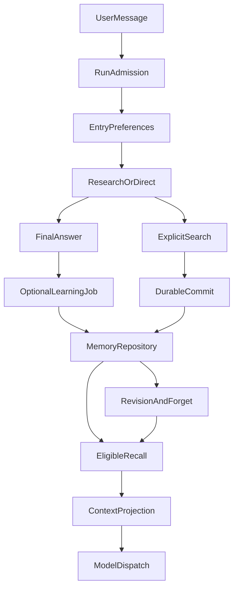

# The Full Lifecycle of Agent Memory: From Remembering Preferences to Safe Forgetting

> **Module Deep Dive · Systems Architecture.** This article concerns application-level cross-session memory, not knowledge encoded in model weights or conversation-context compaction. It draws on ETF Agent's current design and code, while retaining the bounded verification recorded through the end of October 2026. Synthetic examples are labeled.

After a user says “forget that preference,” three questions remain. Can the next request still read it? Must research that already admitted it as historical input be rewritten? If forgetting commits but the final acknowledgement never arrives, should recovery execute it again? These concern current content, historical input, and durable effects. One deletion or one model acknowledgement cannot answer all three.

These apparently different problems point to the same engineering fact: **long-term memory is not a table of summaries. It is a lifecycle with sources of authority, separate read and write times, correction, and forgetting.**

We organize Memory into three cooperating paths: **writing, recall, and governance**. Writing decides what deserves to persist. Recall decides what is actually used in a later request. Governance decides who has authority when data expires, conflicts, or must be forgotten. These paths may join in a single research task, but they must not collapse into an ambiguous “memory succeeded” flag.

The article below explains the original system’s full lifecycle. The recall section first runs a read-only consumer against an existing library. The final section uses the runnable public slice in [Open ETF Agent](https://github.com/hpoenixf/open-etf-agent) to inspect explicit save, revision, forgetting and future-input eligibility. This single-writer file-library experiment is not the original PostgreSQL, automatic-learning or complete recall service.

## 1. The Big Picture: Three Paths, Two Authorities



This diagram shows **responsibilities, not a mandatory sequence for every turn**. Most conversations do not mutate Memory; automatic learning may be disabled. Direct does not call Memory tools. Research may perform explicit searches and commits. Whether a record can be disclosed ultimately depends on its current eligibility under the admitted account and Run scope.

There are two distinct kinds of authority.

- **The model interprets meaning.** Is a sentence a durable preference, a one-time request, or a report of a historical discussion? Does it revise an existing preference?
- **The application repository establishes durable facts.** Which account owns the record? Which family and revision are current? What source supports it? Has a save or forget actually committed?

This division allows the semantic engine to evolve without creating two competing notions of “latest memory.” ETF Agent reused its PostgreSQL Memory repository rather than letting a new vector index maintain an independent editable memory ledger.

Three things often called “memory” also need different jobs. Conversation history retains what happened in this exchange. Memory holds reusable preferences and attributed discussion history. RAG retrieves external knowledge material. All three may contribute to context, but **current holdings, NAV, trade authorization, and execution state still come from their respective authoritative systems**.

## 2. The Write Path: Synchronous Explicit Effects, Asynchronous Learning Proposals

“From now on, show the date of the data first” and “for this comparison, show the date first” look similar. They should not create the same durable effect. The first write-path decision is **whether something may be persisted**, before deciding how it should be extracted.

### 2.1 An explicit request: search, identify, commit, receive a receipt

Consider this **synthetic example**: the user says, “Remember this: whenever you compare funds, state the fee basis first.”

Research calls `search_memory` within the account scope to find an existing constraint. If a related entry exists, the tool returns a Host-issued target reference. The model may decide whether to create a preference or revise the existing family; it cannot invent a target ID. It then proposes a save or correction through `commit_memory`. The Host checks the real user source, scope, target revision, and durable operation identity.

The conceptual loop is:

```text
Explicit user request
  → search_memory (existing family or an available empty result)
  → commit_memory (save / targeted correction / forget)
  → durable receipt (saved / updated / forgotten / conflict / unknown)
  → next Run independently checks eligibility for recall
```

The diagram names conceptual operations. The current wire protocol uses `save` or `forget`; a correction is `save` with a Host-issued target reference, not a separate `replace` operation.

The receipt supports both the user-visible acknowledgement and recovery after interruption. **The model saying “I remember” is not proof of a write.** If the outcome is unknown, it must not be reported as successful or automatically retried as though nothing happened. Recovery reconciles the existing operation identity and receipt.

A failed save should not necessarily stop a safe research answer. The current answer can still follow the user's instruction while disclosing that durable retention has not been confirmed.

Why place explicit operations in Research rather than add a Memory side effect to entry routing? The original requirement was to acknowledge a save truthfully in this turn. Deferring every write until after the answer cannot provide the required receipt; adding persistence to Direct expands its answer-only responsibility. Reusing Research tools, the repository, and receipts keeps interpretation and submission on the existing execution path without requiring a second semantic model to review every explicit save. The cost is research budget and latency in this turn. Searching first also cannot certify that every semantic duplicate was found.

### 2.2 Automatic learning: do not block the answer or fabricate consent

An explicit request to remember, correct, or forget needs a synchronous durable outcome. Automatic learning belongs **after a qualifying answer reaches a durable terminal state**. A semantic model proposes save, defer, or discard from permitted conversation material; the application validates the real user origin, category, scope, dependencies, and current revision.

Three states are important:

- **Candidate:** a proposal for review, not an active preference available for future injection.
- **Automatic:** an active record only when the relevant policy is enabled and validation succeeds; it does not pretend to be user-confirmed.
- **User-confirmed or explicitly requested:** the original confirmation or request is retained accurately; the model's paraphrase cannot turn one into the other.

In the current configuration, `MEMORY_SEMANTIC_MODE=disabled` is the default: **automatic semantic learning is off, while explicit Memory tools remain usable**. The `shadow` mode can produce observable proposals without activating them. Enabling `automatic` involves separate source, budget, and execution requirements.

Why not extract a possible preference synchronously on every chat turn? The user requested an answer, not an extra extraction-model round trip. And an unfinished answer should not silently be counted as successful learning. Moving extraction out of the response path does not itself guarantee exactly-once effects: retries still require source deduplication, revision checks, and durable effect reconciliation.

## 3. The Recall Path: A Search Hit Is Not Proof of Model Use

ETF Agent already had Memory records, candidate administration, and lifecycle APIs. But a baseline review in late September 2026 found that the normal Research path was not yet consuming the previously recalled memory content. That mattered more than choosing an embedding database: **a module being present does not mean its output reaches an actual model request**.

Today, normal mode can assemble a small eligible preference profile before the first semantic branch decision. Research can additionally use `search_memory` to find attributed discussion history. Direct does not execute Memory tools or prefetch episodic business history. Temporary mode and policy-denied runs do not perform cross-session Memory reads, writes, or learning.

Recall has to pass several independent decisions:

1. **Authorization and identity.** Does this Run have a Memory grant for the correct account? The model cannot select another person's Memory with a tool argument.
2. **Record eligibility.** Are the scope, family/revision, lifecycle status, expiration, forget state, and source dependencies still valid? A stale semantic hit must not bypass those checks.
3. **Relevance to this task.** Is the user continuing an earlier review or asking something new? Preferences and episodic histories have different admission rules.
4. **Context capacity and actual dispatch.** Ranking is not the final step. Selected candidates must still fit the bounded prompt, and a record not sent to the model cannot be counted as used.

**Durable retention does not mean complete injection on every turn.** The current automatic profile selects eligible preferences only, prioritizing response constraints and then recent updates. It examines at most 32 candidates, retains at most 8 records, and caps their projected JSON at 8,000 UTF-8 bytes. These limits govern the preference snapshot, not all discussion history. Oversized records are skipped whole rather than cutting a constraint in half; a later, shorter record may still fit. A second pass fits them with system text, messages, tools, and output schema into the complete request. Current user text is not shortened to accommodate Memory.

A **synthetic example** makes the distinction concrete. “State the data date first” can enter the preference profile even when the new question does not repeat those words. A long older preference may remain in storage but not enter this request. **Stored, selected for the snapshot, and actually dispatched are three different facts.** Usage observations follow actual provider dispatch, not search hits, UI inspection, or recovery replay. They do not prove that the model obeyed the preference.

For explicit history queries, default `search_memory` performs bounded local inspection. Preferences may become candidates; episodic discussions need a summary substring or exact record/family identity match, followed by source and capacity checks. A differently worded continuation may therefore miss an earlier discussion. This is not the lexical/vector/RRF pipeline already used by ETF Agent's knowledge RAG. Sharing the word “retrieval” does not make the implementations identical.

Optional semantic ranking offers another discovery path. Instead of lexically prefiltering candidates, it lets the admitted Run's model gateway select existing references from a bounded set of eligible records. This adds model calls, latency, and dependency management without removing candidate limits. One easily missed consequence is that **a candidate sent to the ranking model has participated in processing even if it is not selected**. Retaining only the winning sources would lose that fact. Eligibility is checked before and after ranking; semantic relevance does not replace revisions, provenance, or budgets. This optional path must not be described as running when semantic mode is disabled by default.

Performance follows the governing request deadline and cancellation. Unavailable retrieval remains different from an empty library; a read failure must not be disguised as an empty result that permits a new save.

### Public code: when has an existing memory actually been read?

The [fixed v0.14 implementation](https://github.com/hpoenixf/open-etf-agent/tree/a3e1059a78cf8a4f70fe89d61563980f3d24bc15) adds a consumer entry point: explicitly select an **existing, nonempty local library**, query it read-only, and let eligible current revisions reach the actual encoded Gateway request. Save, revise, forget and projection checks already existed in v0.5. This is neither a second store nor a claim that a search hit alone counts as use.

A synthetic preference makes the distinction visible. Run these steps only in a new demonstration directory, never against personal Memory. Seed it through the original authorized writer before opening the read-only consumer. The later `explicit-memory` lifecycle example forgets its entry at the end; its empty library cannot substitute for this preparation.

Using Node.js 26.11.1, the environment used for this example, obtain and build the fixed source in a new directory:

```bash
git clone https://github.com/hpoenixf/open-etf-agent.git open-etf-agent-memory-consumer
cd open-etf-agent-memory-consumer
git checkout --detach a3e1059a78cf8a4f70fe89d61563980f3d24bc15
npm ci --ignore-scripts --no-audit --no-fund
npm run build
```

This preparation **intentionally writes one synthetic memory** under an explicit intent checked by the existing owner. It does not make the read-only consumer initialize a library:

```bash
node --input-type=module <<'JS'
import { openMemoryLibrary } from './dist/src/memory.mjs';
import { sha256 } from './dist/src/source.mjs';
const library = await openMemoryLibrary({ directory: 'synthetic-library', writable: true });
try {
  const text = 'SYNTHETIC independent preference: use exact physical page identities.';
  const receipt = await library.save({ text }, { intent: {
    explicit: true, libraryId: library.libraryId, operation: 'save',
    intentId: 'independent-memory-seed', origin: 'synthetic-independent-process',
    approvedTextHash: sha256(text)
  } });
  console.log(JSON.stringify(receipt));
} finally { await library.close(); }
JS
node dist/src/cli.mjs --case memory-recall --memory-library synthetic-library --query physical --output runs
```

Inspect `memory.consumed` in the terminal result: its library, entry, revision and hash should match the saved record. `memory.requests` records each actual encoded request's hash and consumed identities. A request before retrieval does not contain that consumption record; later requests containing current content do. The result's `directory` and report receipt locate the original `report.md`. That report shows Memory identities while its research comparison still cites original synthetic sources. The library bytes remain unchanged. Runtime and Gateway encoding are real, but a fixed synthetic transport produces the responses; this is not evidence that a real model understood the preference.

Next select temporary mode and deliberately supply a library path that does not exist:

```bash
node dist/src/cli.mjs --case memory-recall --memory-library missing-library --query physical --temporary --output runs
```

The result has `memory.mode: temporary` and an empty consumption list, while the independent synthetic document task can still finish. Temporary mode takes effect before opening, scanning or reading the selected library, rather than touching it and discarding the result afterward. With Memory enabled, a missing, corrupt or symlinked library instead fails closed without creation or repair. The read-only entry exposes only search, read and list tools; it obtains neither a writer lock nor permission to save.

Compare the [read-only mode selection](https://github.com/hpoenixf/open-etf-agent/blob/a3e1059a78cf8a4f70fe89d61563980f3d24bc15/src/memory-consumer.mjs) with the [actual request consumer](https://github.com/hpoenixf/open-etf-agent/blob/a3e1059a78cf8a4f70fe89d61563980f3d24bc15/src/memory-recall-demo.mjs). Existing projection checks still remove ineligible revisions from later requests, but file-library mutation and dispatch are not one atomic transaction, and already-sent bytes cannot be withdrawn. Showing identities rather than bodies in the report is this fixture's choice, not a prohibition on other authorized Memory consumers. Use the [current project README](https://github.com/hpoenixf/open-etf-agent/blob/main/README.md) for the everyday entry point; these commands remain tied to the fixed version above.

## 4. Governance: Correction, Forgetting, and Expiry Are Not the Same Deletion

A preference changes. “I prefer a long-term holding period” and “I need extra liquidity over the next six months” might coexist, or describe different constraints. Semantic similarity alone cannot merge them into one memory family.

ETF Agent uses **family + revision** to represent version relationships. A correction must target the currently observed revision. A stale target cannot overwrite a newer correction. The model may propose that two statements are related; the Host and repository enforce the actual compare-and-set operation.

Forgetting makes the whole family ineligible for new disclosure as **current Memory** in subsequent model requests. Ordinary records can expire or be softly evicted by policy. An explicitly saved `response_constraint`, however, is not silently discarded by ordinary TTL/LFU cleanup. The user can still correct or forget it.

This reveals a subtle problem: old content may become unavailable while the fact that it was corrected remains worth reporting. In our October source-projection review, we found risks in both directions:

- Hiding every item associated with the old revision could hide the valid correction receipt too.
- Treating a correction receipt as permission to expose the superseded old body could revive withdrawn content.

The current implementation separates these materials. The next request removes ineligible old Memory tool results together with call arguments that might contain the old body. The valid new revision and update receipt are checked under their own record identities. Expected omission of superseded history is not misreported as failure to read the current Memory snapshot. Missing records, foreign scope, a wrong revision, or invalid source dependencies still fail; a `superseded` label is not a bypass. The model can explain what just happened without treating the old preference as current: **it may explain that a correction occurred without reopening the old, ineligible text.**

The same rule applies to generated summaries, historical results, background jobs, and indexes. After forgetting, a new Run cannot launder the old preference back through derived context. A late learning job cannot revive the old source by assigning a fresh family ID. But “no longer used as current Memory” is not a promise that backups, old conversations, or material already sent to a model provider have been physically erased. Those commitments require distinct data-retention operations.


**Historical reports, current Memory, and new Runs have distinct consumption rules.** Being allowed to read a report in History does not automatically authorize another research task to use it. But when the current Run has admitted a selected report through the original history owner and durably retained its exact body, selection identity, and complete source lineage, same-Run wake continues from that receipt. Forgetting a Memory source later does not turn the admitted historical report into a fresh current-Memory read. Its source identity must remain intact; removing dependencies or relabeling the report as public would be incorrect.

That choice has a cost: **forgetting does not retroactively rewrite historical input already admitted to the same Run.** It prevents the old preference from being acquired again as current Memory, and prevents a new Run from using derived history to skip its own admission. Missing, foreign, or content-mismatched historical receipts remain unavailable. A frozen grant cannot invent a report or turn one historical admission into permission for every future task.

One source identity can appear both in historical lineage and in a preference independently read for the current request. The system therefore checks the material actually being submitted, rather than exempting an entire identity because it also appears in history. Admitted historical prose retains its original identity; independently materialized current Memory still requires valid family/revision eligibility. If that current body is forgotten after fitting but before transport, the original dispatch boundary rejects the stale disclosure. It does not revoke the Run grant or erase an already valid answer.

Bounded Factory and isolated PostgreSQL observations from late October exercise this distinction: same-Run wake retains the admitted historical body and source proof, while late forgetting of independently materialized current Memory is rejected before dispatch. Inputs and gateways were synthetic. The PostgreSQL path recreated the Factory within one operating-system process, so it does not establish arbitrary cross-process recovery or real-model behavior.

## 5. A Complete Example: From First Preference to Forgetting

The following fund-research flow is a **synthetic walkthrough of the intended branches**, not proof that every real model successfully followed these natural-language instructions.

| Time | User request or event | Expected system fact |
| --- | --- | --- |
| Run A | “From now on, state the fee basis first when comparing funds.” | A successful explicit save creates the current response constraint and a receipt |
| Run B | “Compare these two funds.” | The eligible constraint can be recalled, while fee facts still come from current sources |
| Run C | “Today, lead with the conclusion and put fees later.” | This overrides presentation for this task without silently mutating durable Memory |
| Run D | “Make conclusion-first the default from now on.” | Search identifies the family, and a successful correction creates a new revision |
| Run E | “Forget that presentation habit.” | The family is forgotten and excluded from subsequent new Runs |

The important observation is not whether the model happens to repeat a phrase from the remembered preference. The lifecycle has **four different proof points: commit, actual consumption in a new request, revision, and no new acquisition as a current preference after forgetting**. An answer can accidentally match the preference without using Memory at all. A fluent acknowledgement can be generated even when storage failed.

For a financial agent, Memory must remain in its proper role. Risk preferences can influence explanation. Holdings come from Portfolio. NAV and fees come from current time- and definition-specific evidence. Trading permission comes from independent authorization. **Memory helps recall how the user wants to reason or communicate; it does not decide what the user owns or what the system is allowed to execute.**

## 6. The Real Failure That Changed Our Definition of Success

On October 9, 2026, an ETF Agent Memory acceptance run preserved a counterexample: **forgetting had already committed durably, but the subsequent model answer did not finish**. The planned final new-session query was therefore never executed.

Labeling the whole sequence merely “task failed” risks prompting recovery to repeat an effect that already happened. Treating the successful database commit as proof of the later model behavior would be equally wrong.

We separated the evidence: Did the repository commit and return the original receipt? Did the old revision lose eligibility? What memory actually entered the next model request? Could derived history disclose withdrawn content again? Controlled local cross-session paths produced positive evidence, but **the unfinished real-model sequence was not retroactively classified as a success**.

This illustrates [principle 3, “Proposal, approval, execution and effect are different facts”](/en/principles#principle-3): a committed Memory effect and delivery of the explanatory answer have separate states.

It also explains why conversation text alone is insufficient for recovery. The database effect may already exist even though the final “I forgot it” sentence never reached the user. The next response must reconcile the real operation, not guess again from the dialogue.


The public code provides a narrower recovery counterexample. In the [fixed process-level test](https://github.com/hpoenixf/open-etf-agent/blob/ff5b9273ef0d239e804f61792702cd2e94174be7/test/durable-runtime.test.mjs), the execution process is terminated after the tool result of an explicit Memory mutation commits. A new process resumes the same Run. The test observes a single tool dispatch, one persisted write-intent record, and no leftover writer lock. It establishes that **a durable effect is not repeated simply because the executor changed**. It does not prove real-model interpretation of save/correct/forget requests, or an authenticated end-to-end cross-session Memory lifecycle.

<span id="_7-why-not-copy-a-full-external-memory-engine"></span>

## 7. Which Alternatives Fit, and Why Choose This One?

Peak Lake's [Memory engineering article](https://www.peak-lake.com/en/blog/agent-memory-system/) organizes the problem around writing, reading, and governance, including hybrid retrieval and temporal invalidation. That division is useful. Which capabilities to adopt depends on whether work crosses sessions, how history must be found, and who owns correction and forgetting.

| Approach | When it fits better | Work it still leaves |
| --- | --- | --- |
| Thread history and a checkpointer | Mainly continuing one bounded thread or task | Cross-session preferences are not automatic; retained input still needs selection |
| A framework's cross-session Store | Already using the framework and organizing records by user or business namespace | Integrating business identity, versions, correction, and eligibility |
| A specialized Memory service | Tasks need richer semantic, entity, or temporal retrieval | Mapping service records to Host provenance, lifecycle, and invocation budgets |
| Existing PostgreSQL repository + bounded profile/query + optional semantic proposals | Account scope, provenance, revisions, and receipts already exist; explicit preferences need an end-to-end path first | Weaker default history discovery; application-owned dependencies, capacity selection, and receipts |

These are not deliberately weak alternatives in which an external engine must seize all authority. [LangGraph's Memory documentation](https://docs.langchain.com/oss/python/concepts/memory) separates thread state from a cross-thread Store. [Hindsight's Recall documentation](https://hindsight.vectorize.io/developer/api/recall) describes combined semantic, lexical, graph, and temporal retrieval. A Host can adopt such capabilities while retaining admission and business authority. This article does not present an equivalent-workload quality or performance benchmark against either product.

ETF Agent reused its repository because family/revision identity, account scope, durable receipts, and user administration already existed. Explicit saves did not need to wait for an external engine, and the first semantic adapter could reuse the existing admitted gateway. Hindsight remained a candidate rather than a prerequisite for remembering one explicit preference. This reduces migration and dual-write work, but leaves local discovery limits, source mapping, and governance maintenance with the application.

The reason to upgrade is therefore a concrete error, not an architecture looking insufficiently advanced. If paraphrases repeatedly fail to find prior discussions, or temporal/entity relationships determine task success, compare stronger retrieval on those examples. Also check whether extra candidates crowd out the current question or add unacceptable latency. Semantic similarity never substitutes for the user's revision authority.

<span id="_8-what-have-we-verified-and-what-should-we-measure-next"></span>

## 8. The Boundaries to Check Before Adopting This Design

This path suits systems prioritizing explicit user saves, corrections, and forgetting with explainable outcomes. It is not a general Memory service with demonstrated high recall. Local explicit operations, cross-session consumption, and PostgreSQL paths have bounded validation. A complete external live lifecycle and sustained real-model interpretation of these intentions remain separately unqualified. The optional Hindsight adapter has not qualified for that profile, and automatic semantic learning is disabled by default. These limits neither erase existing mechanical evidence nor disappear because tests passed.

Evaluate real tasks along the lifecycle: false candidate adoption, correct same-family revision, actual inclusion in model input, missed paraphrases, context cost and p95 latency, and whether a new Run can acquire forgotten preferences through historical summaries. Without real samples, do not claim retrieval quality has improved.

The transferable division is concrete: **writes follow durable receipts, recall follows final input, correction follows current versions, and forgetting follows subsequent consumption; already admitted historical input retains its original identity.** That gives each user correction something more inspectable than a model saying “I remember.”

<!-- open-etf-agent:minimal-experiment:start -->
## 9. Run a Save–Revise–Forget Sequence in the Public Code

[Open ETF Agent](https://github.com/hpoenixf/open-etf-agent) now makes this ownership boundary independently runnable. Rather than exporting the PostgreSQL system described above, it uses an **explicitly selected, single-writer file library** to show how saves, corrections, forgetting and subsequent input relate. The preferences are synthetic and a fixed script chooses the tools; persistence, revisions and reads use the real implementation.

In [`memory-tools.mjs`](https://github.com/hpoenixf/open-etf-agent/blob/05c0dd2dc550f4f7e5da034340ff5c3159768fcf/src/memory-tools.mjs), model arguments have no “I am authorized” switch. Outside those arguments, the host binds a write intent to the library, operation, approved text hash or previous revision. [`memory.mjs`](https://github.com/hpoenixf/open-etf-agent/blob/05c0dd2dc550f4f7e5da034340ff5c3159768fcf/src/memory.mjs) durably reserves that one-use intent before publishing a new revision and updating the current index. A failure in between can leave an explicit partial effect: the intent was consumed but the revision did not complete. A failure receipt is not permission for unconditional replay.

With Node.js 26.11.1–26.x, run the fixed snapshot in a new directory:

```bash
git clone https://github.com/hpoenixf/open-etf-agent.git open-etf-agent-memory-demo
cd open-etf-agent-memory-demo
git checkout --detach 05c0dd2dc550f4f7e5da034340ff5c3159768fcf
npm ci --ignore-scripts --no-audit --no-fund
npm run demo -- --case explicit-memory --memory-library runs/article-synthetic-memory
```

Initial installation may access npm; this case makes no remote model calls after installation. Select a new synthetic library, or one with no active entries—not your actual memory directory. If the demonstration finds active entries, it refuses to continue rather than clearing them.

[`working-demo.mjs`](https://github.com/hpoenixf/open-etf-agent/blob/05c0dd2dc550f4f7e5da034340ff5c3159768fcf/src/working-demo.mjs) performs save, revise and forget in three separate Runs. Inspect `memory.receipts` in the terminal JSON: the same entry receives increasing revisions and the operations `saved`, `revised` and `forgotten`; `memory.current` is empty after forgetting. Earlier revisions remain in the library, while the final revision is a tombstone. The demonstration report subsequently saved cites newly acquired synthetic original pages, not preference records promoted into research evidence. **Readable receipts and current eligibility are the output—not a terminal sentence saying “forgotten.”**

The public implementation also addresses an easily missed input path. Removing a current search hit is not enough if old tool arguments or derived notes can reintroduce its text. When assembling the next model request, [`memory-projection.mjs`](https://github.com/hpoenixf/open-etf-agent/blob/05c0dd2dc550f4f7e5da034340ff5c3159768fcf/src/memory-projection.mjs) rechecks library, entry and revision identity. It removes bodies from stale typed memories, settled write arguments and their Hook copies, and notes dependent on stale memories. The original execution history is not rewritten. This boundary applies to identified memory dependencies; it is neither global phrase erasure nor deletion of previously exported reports.

This public slice therefore lets readers inspect **explicitly authorized durable writes, current-revision reads and post-forget input revocation**. It does not include the authenticated HTTP, PostgreSQL or automatic-learning paths discussed earlier. The [first real-model batch](https://github.com/hpoenixf/open-etf-agent/blob/d075068ac99a6c798d012c46bff4fe0c33eb9979/docs/verification/live-v01-v05-first-batch.md) did not exercise memory writes or forgetting, so its report cannot establish cross-session response quality here. Whether Runtime acted under authorization and recorded the effects remains separate from whether a model explains those facts accurately.
<!-- open-etf-agent:minimal-experiment:end -->

<!-- open-etf-case:memory@e1b8e4edde724548fab16d8ca4b205379bfa7f30 -->
### Inspect the three explicit Memory receipts

To revisit save, revise, and forget at the current fixed public snapshot, run the synthetic lifecycle through its [CLI entry point](https://github.com/hpoenixf/open-etf-agent/blob/e1b8e4edde724548fab16d8ca4b205379bfa7f30/src/cli.mjs).

After installing dependencies according to the README at the linked fixed snapshot, run:

```bash
node src/cli.mjs --case explicit-memory --output runs/article-memory --memory-library runs/article-memory/synthetic-memory
```

First ensure `runs/article-memory/synthetic-memory` is a new synthetic-library path or a synthetic library with no active entries, never a personal Memory directory. Terminal `memory.receipts` records save, revise, and forget; `memory.current` ends empty. Each Run's save receipt points to a readable report.

Historical revisions remain; forgetting changes future eligibility. This is an explicit single-writer file library, not automatic learning, an authenticated multi-user service, or a real-model cross-session evaluation.
<!-- /open-etf-case -->
