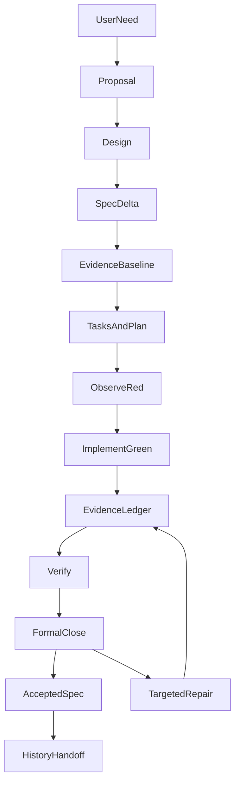

# Why Can't We Call an Agent Feature Finished After Writing the Spec?

As Coding Agents become capable of carrying out requirements analysis, interface design, implementation and testing in sequence, an old engineering question becomes more visible: **who determines whether the work is actually complete?**

Suppose we ask an agent to add a research-data source while preserving source identity, supporting recovery after failure and respecting existing data-access permissions. It may add modules, write tests and finally report “done.” That message still leaves open whether the implementation meets the original requirement, whether failure paths were tested, which revision tests ran against, whether permissions changed, and what another agent should know remains unproven.

We moved from asking “How do we make an agent write a good Spec?” to “How does a change travel from discussion through implementation and verification to a traceable closure?”

The workflow builds on **OpenSpec**, uses design and test-driven ideas from **Superpowers**, and adds durable evidence, closure and historical handoff for long-lived multi-agent development.

## 1. Separate What the System Currently Is from What We Want to Change

One useful idea in [OpenSpec](https://github.com/Fission-AI/OpenSpec) is to distinguish accepted specifications from proposed changes. We retain that separation.

```text
openspec/
  specs/
    capability/
      spec.md
  changes/
    add-capability/
      proposal.md
      design.md
      specs/
      tasks.md
      plan.md
      evidence.md
      verify.md
```

This directory listing is illustrative. Not every change must create every optional file.

Accepted specs under openspec/specs describe **the currently accepted behavior contract**. Changes under openspec/changes describe **behavior we intend to modify**.

The two are not interchangeable. A capability proposed in a change is not already implemented. Completed code does not mean its specification has been formally accepted.

We use delta requirements: **ADDED** introduces behavior, **MODIFIED** changes existing behavior, **REMOVED** deletes requirements, and **RENAMED** changes a name.

Those categories determine valid checks. An ADDED requirement does not yet appear in the accepted spec; that is normal. MODIFIED and REMOVED requirements should refer to existing requirements, or else the delta may be misclassified or the accepted spec incomplete.

In long-running projects, this distinction prevents a coding agent from treating last month's proposal as a statement about today's implementation.

## 2. A Spec Workflow Is About Facts Produced at Each Stage, Not File Order

Our internal superpowers-bridge schema expresses ETF Agent's development process; the open-source kit discussed later extracts only its portable evidence-checking mechanisms.



The two closure exits mean that successful formal acceptance under the declared scope may synchronize accepted specs and archive the change; unverified or failed outcomes retain their status and direct work toward specific gaps.

Brainstorming may precede a defined requirement, and a useful retrospective can be recorded afterward. The workflow should not mechanically manufacture artifacts merely for completeness.

### Proposal: Define the Problem, Not a Promise of Implementation

A Proposal states the problem, scope, non-goals, major risks and acceptance route.

We distinguish ordinary changes from boundary-sensitive ones, as well as local implementation acceptance, independent external acceptance and permission needed for real model calls.

A purely deterministic view generator may be verified with local tests. A research feature dependent on real-provider response quality needs different evidence for real effectiveness.

This prevents a recurring management failure: implementation tasks finish, but acceptance scope was never agreed, so new unrelated work keeps being added to the same change during closure.

### Design: Record Decisions Rather Than Restating Requirements

Design documents key tradeoffs: existing ownership, why a smaller modification is insufficient, which facts must persist, and how failures recover.

If a model receives incomplete research results, an appropriate fix might be repairing the data adapter—or allowing research to continue conservatively within authorized evidence. Adding a new validator that decides “enough evidence exists” is not automatically justified merely because writing one is easy; the judgment may be semantic and lack independently certifiable Runtime facts.

We actively seek counterexamples during design review. When an approach proposes a new interceptor, state store, adapter or process, ask **which invariant it protects, and which old mechanism it replaces**.

Reasonable design is not proof of effect, but recording these decisions helps later agents avoid layering the same complexity again.

### Tasks: One Work Unit, Not Four Duplicate Checkboxes

We once mechanically expanded every Scenario into RED, GREEN, REFACTOR and VERIFY tasks. It looked disciplined but turned tasks.md into an enormous procedural checklist.

We now group work by **shared responsibility, implementation seam and test set**. One unit may cover several behavioral assertions and share an observed RED → GREEN → optional refactor → verification sequence.

Split units only when ownership, failure modes or acceptance paths are genuinely independent.

tasks.md owns work status. plan.md, when needed, describes execution order, test entry points and traceability. Commands and observations should not be copied into five different files.

## 3. Evidence Ledger: Don't Reconstruct Test Outcomes from Model Memory

This is the most important part of the workflow.

Every substantive change maintains evidence.md. Before implementation it records a baseline, or explicitly states **not collected**. As actual RED, GREEN and integration checks execute, their observations are appended.

For example:

```text
Evidence: EV-01
Task: 1.1
Phase: GREEN
Command: targeted test command
Result: actual pass and test scope
Revision: source revision at execution
Artifact: locatable test output
Origin: observed-run
```

The point is not that the fields look professional. **Every conclusion must trace back to execution that actually happened at the time.**

We distinguish several evidence states:

| State | Supported interpretation |
| --- | --- |
| observed-run | Execution was actually observed on the recorded date, environment and revision |
| reused-historical | Prior-version evidence was reused; do not pretend today's revision was rerun |
| blocked | Acceptance branch did not run because a specific prerequisite was absent |
| not collected | No corresponding observation exists; do not silently replace it with zero or success |

RED is not a box to tick. It must be a genuine failed execution **because the intended behavior is absent**. A database that never started, a missing test file or a syntax error is not a meaningful behavioral RED.

Documentation-only or inspection work may use an actual CHECK instead of manufacturing false RED evidence.

This distinction is crucial when agents hand work to each other. Yesterday's GREEN does not become today's GREEN just because a new agent read its report.

## 4. Generate Verify from Evidence Instead of Copying Evidence into Verify

Once the evidence ledger existed, a new inefficiency emerged: results were duplicated across five or six files.

tasks.md marked status. plan.md copied commands. evidence.md recorded outputs. verify.md repeated them. When a test revision changed, the copies drifted apart.

We assigned one primary responsibility per artifact:

| Artifact | Primary ownership |
| --- | --- |
| proposal.md | Problem, scope, critical decisions and acceptance route |
| design.md | Alternatives, architecture choices and risks |
| specs/ | Observable desired behavior |
| tasks.md | Work units and completion status |
| plan.md | Essential execution steps and trace mapping |
| evidence.md | Baseline, observed runs, revision identity and limitations |
| verify.md | Completion judgment and remaining gates based on evidence |

A meaningful implementation change made verify.md a generated **projection** of the ledger:

```bash
npm run spec:verify -- --change example-change
npm run spec:verify -- --change example-change --check
```

This generator does **not execute tests**. It projects existing tasks and observations while preserving original dates, revisions and execution origins. It never overwrites hand-authored Verify. If inputs change and the generated view becomes stale, checking reports that mismatch rather than presenting the old view as current.

Structural linting became stage-specific:

```bash
npm run spec:lint -- --change example-change --stage plan
npm run spec:lint -- --change example-change --stage apply
npm run spec:lint -- --change example-change --stage verify
```

plan checks minimum operability such as task IDs. apply verifies real RED/GREEN or CHECK evidence for completed tasks. verify checks finished states, evidence and conclusions.

This is a **read-only structural checker**, not a substitute for running tests or assessing a model's answer quality. We did not turn it into an all-purpose engine that rescans every archived change and recomputes every documentation mapping.

## 5. When Is a Change Formally Closed?

Formal spec:close is independent of checking off Tasks:

```bash
npm run spec:close -- --change example-change
```

It runs the gates required by the declared validation route. Local contracts, genuine integrations, paid-model validation and product release are different facts; a PASS in one cannot certify the others.

A provider-free route can establish bounded local deterministic behavior, mock behavior and exercised call contracts. It cannot establish long-term live model answer quality or production release.

Before the first closure, spec:close:doctor may summarize static blockers **read-only**, without paid model calls. “Static ready” is not formal completion.

Conversely, **once successful formal closure already exists, documentation cleanup alone should not rerun the entire acceptance suite**. Without changed behavior, a concrete failure or a real contract conflict, reuse the existing receipt, synchronize the accepted delta and archive.

This preserves evidence discipline without entering a loop of “we just verified everything, but a new summary document means we must verify everything again.”

### Three Often-Confused Outcomes

| Situation | Correct handling |
| --- | --- |
| Implementation tasks are all checked, but formal closure did not run | Preserve formal close: not-run; do not claim formal completion |
| Local contracts passed, but real provider testing is missing | Report local pass; keep real-world quality unknown |
| Work is complete with a successful closure receipt, but archiving remains | Reuse the original closure; do not rerun acceptance for maintenance alone |

When authorization, privacy or monetary execution invariants are at risk, rejection and acceptance checks are still essential. But those checks need an explicit protected subject. A local failure must not automatically erase all independent useful work from the run.

## 6. Why We Simplified the Spec Closing Process

In early October 2026 we revised Spec closure and archiving. The problem was not missing evidence; it was that **evidence already existed while closing documents kept reproducing it**.

The previous workflow pressured engineers to maintain Verify manually and generate low-value historical notes for archival completeness.

We made two decisions:

1. Allow Verify to be generated from observed Tasks and Evidence, while preserving hand-written files and detecting stale projections.
2. Make History handoff explicitly distinguish none, candidate and history. Not every formatting fix, repeated closure or test rerun deserves a permanent engineering-history essay.

The change left traceable RED/GREEN, targeted tests and local closure records in the source repository. It concentrated maintenance of the same behavior and supported verification in the relevant test environment. We did not quantify a reduction in development hours or present local closure as live model or release acceptance.

**The engineering workflow itself must pass a complexity review.** If a process adds forms without explaining which invariant it protects or which uncertainties it reduces, it may need to be merged or deleted.

This workflow uses [method 4, “Planning a multi-phase delivery”](/en/principles#method-4) to distinguish the intended design from the current implementation stage, and [method 5, “Choosing verification and diagnosing failure”](/en/principles#method-5) to constrain each closure claim to execution evidence from the relevant revision. They are design and verification methods, not a demand that every small change pass the same heavyweight gates.

## 7. Extracting the Portable Part: OpenSpec Evidence Kit

The workflow above describes ETF Agent's own `superpowers-bridge` schema, project-specific verification and `spec:close`. Copying those parts wholesale into another repository would also copy application assumptions. In October 2026, we extracted a narrower, independently installable subset as [OpenSpec Evidence Kit](https://github.com/hpoenixf/openspec-evidence-kit) ([v0.1.0](https://github.com/hpoenixf/openspec-evidence-kit/releases/tag/v0.1.0), MIT): **structural checks for tasks and observations, a generated Verify view, and read-only inspection of recorded completion**.

It uses Node 26.11.1–26.x, with no runtime dependencies, database, or model calls. OpenSpec itself is optional: the package also works with an ordinary local directory. Its separately written [`evidence-driven` schema](https://github.com/hpoenixf/openspec-evidence-kit/tree/main/schema/evidence-driven) is an optional OpenSpec adapter, not a republication of our internal schema or closure machinery.

### From one task to an inspectable observation

Consider this **fictional format example**. A change named `cache-fix` already has `tasks.md` and `evidence.md`. After an inspection, its author records the local artifact `result.txt`:

```text
# tasks.md
- [x] 1.1 [check-only] Inspect the cache result file

# evidence.md
## Observation Log
| Date / phase | Evidence ID | Task | Command | Actual result | Artifact | Revision | Origin |
| --- | --- | --- | --- | --- | --- | --- | --- |
| 2026-01-01 CHECK | EV-01 | 1.1 | inspect result.txt | passed: illustrative check | result.txt | demo-revision | observed-run |
```

The point is not a ceremonial table. It is a **stable task ID, an ordered observation, a local artifact and the original revision**. A completed ordinary task requires an ordered `RED → GREEN` sequence by default. The explicit `[check-only]` marker selects `CHECK`, `[baseline-green]` selects `BASELINE → VERIFY`, and `[tests-after]` records a later `VERIFY`. Imported `reused-historical` evidence does not satisfy a fresh completed task.

With the files under `openspec/changes/cache-fix/`, the project can run:

```bash
npm install --save-dev github:hpoenixf/openspec-evidence-kit#v0.1.0
npx --no-install spec-evidence lint --change cache-fix --stage plan
npx --no-install spec-evidence lint --change cache-fix --stage apply
npx --no-install spec-evidence verify --change cache-fix
npx --no-install spec-evidence verify --change cache-fix --check
npx --no-install spec-evidence status --change cache-fix
```

`plan` checks task labels and duplicate IDs. `apply` checks recorded phases and local artifact existence for checked tasks. `verify` requires complete tasks and usable observations before generating `verify.md` with a digest of its inputs; `verify --check` detects a stale generated view without rewriting it. The writer preserves handwritten verification files and refuses paths outside the selected change or through symlinks.

`status` deliberately does less: it reads task state and an **authored** `completion.json`, if present. It may report `recorded-complete` when all tasks are checked and the typed record is valid, preserving its original timestamp, revision and verification lane. It neither reruns the old checks nor requires vanished temporary artifacts merely to inspect the record.

### Why this is not another acceptance authority

The responsibilities remain separate: **test runners execute checks; developers or agents record observations; the CLI validates recorded structure; the consuming project decides acceptance**. `observed-run` is an authored provenance label, not proof that the command actually ran. A recorded completion is not a fresh verification of current code or permission to release.

This makes the kit suitable as a small local or CI check rather than a replacement for product-specific test execution, model-quality evaluation or formal closure. The [repository](https://github.com/hpoenixf/openspec-evidence-kit) includes offline examples and the evidence format. Its optional schema follows the [OpenSpec](https://github.com/Fission-AI/OpenSpec) ecosystem, while its [NOTICE](https://github.com/hpoenixf/openspec-evidence-kit/blob/main/NOTICE.md) attributes relevant Superpowers influences.

## 8. Which Projects Benefit?

[GitHub Spec Kit](https://github.github.com/spec-kit/) also connects specification, plan, tasks and implementation. We did not create a new universal standard beyond these methods. We adapted their ideas to long-lived Agent projects, adding durable multi-turn execution evidence, unambiguous completion states and timely acceptance convergence.

For a small copy edit, the full process is unnecessary; a clear diff and focused content check may suffice.

For changes crossing module interfaces, data authorization, persistence recovery or real-model evaluation, evidence and explicit stage gates are valuable.

Three lessons transfer especially well:

1. **Specs, code, tests, closure and publication are different facts.** No checkbox should stand in for all of them.
2. **Evidence originates during execution, not in a closing summary reconstructed from memory.** Preserve each observation's time, revision and scope.
3. **Validation exists to establish credible conclusions, not to continue forever.** Maintain a fact in one authoritative place, and stop repeating work without substantive change.

We do not want a Coding Agent that perpetually says “not rigorous enough.” We want one that can say clearly **what was proven, what remains unknown, and why work can now end**.

---

Originally also published on the [personal blog](https://hpoenixf.com/blog/026-agent-spec-evidence-workflow). Further work is in the [GitHub engineering collection](https://github.com/hpoenixf/eff-agent-article); stars welcome.
