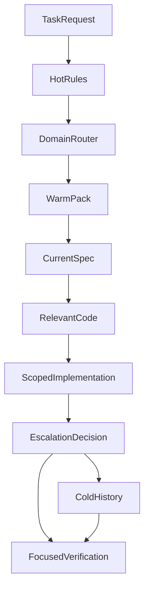
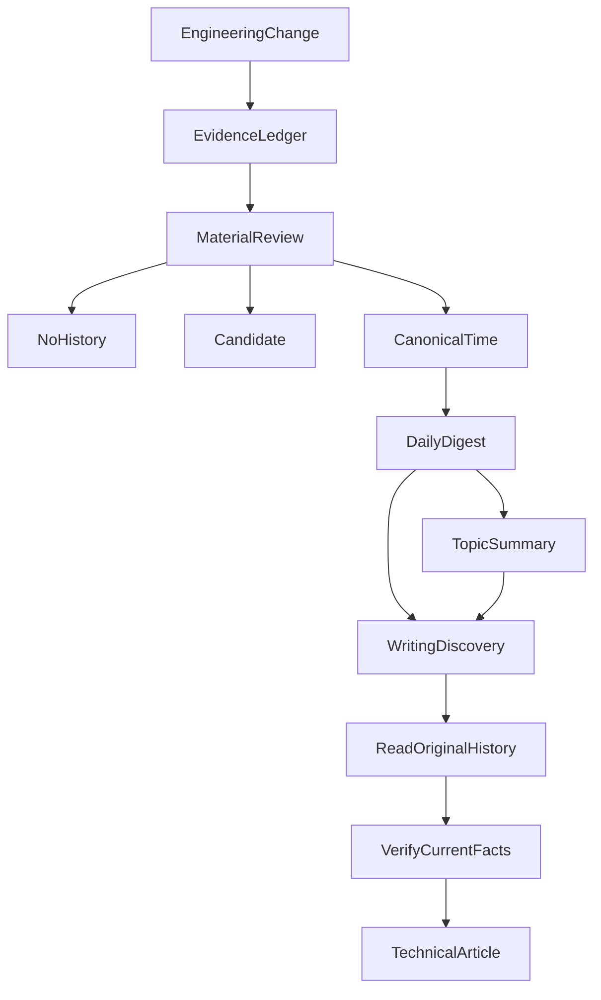

# Documentation Isn't Meant to Be Read in Full: On-Demand Knowledge, Engineering Memory and Retirement

As a project grows, its documentation almost always expands. It begins with a README, then acquires architecture designs, contracts, test strategies, incident reports, agent work instructions, and months of dated history.

That growth is useful. The problem is that a Coding Agent may interpret “documentation matters” as “read every document before doing any work.”

Imagine a task to fix one frontend interaction, and an agent that first reads the investment model, every Runtime document, the entire project history and every archived Spec. It has consumed a great deal of context, but it may not be closer to solving the UI issue.

More dangerously, the context now mixes currently binding rules, retracted proposals and outdated handoffs. **More context does not guarantee more accurate engineering facts.**

In October 2026, we encountered the opposite problem: an old evaluation implementation had been retired, but development instructions still told agents to run its command. Excessive reading can add noise; obsolete instructions can cause a removed mechanism to be rebuilt.

Engineering knowledge therefore has to answer three questions: **what should this task read, what can each source establish, and when should old knowledge stop directing current work?** On-demand loading, long-term memory and retirement are stages in the same knowledge lifecycle.

## 1. Turn AGENTS.md Back from an Encyclopedia into a Map

The easiest solution is to place all important knowledge in AGENTS.md. That prevents omissions, but incurs a fixed context cost regardless of whether the current task needs it.

When several subagents independently investigate, review and test, the redundant fixed reading cost scales with the number of roles.

We redefined the root work instruction accordingly: **global guidance stores cross-task invariants and navigation; domain documents own detailed knowledge**.

The authoritative source of investment data, permissions and confirmation boundaries should be discoverable to every task. A particular MCP provider's fallback for a missing field does not need to occupy every frontend context.

A simplified route table:

| Task area | Primary reading entry |
| --- | --- |
| Frontend interaction | Frontend task pack and relevant UI contracts |
| MCP and data sources | MCP task pack, current interface contracts and adapters |
| Investment computation | Core investment invariants and current calculation contracts |
| Agent Runtime | Runtime architecture, relevant Spec and tests |
| Historical regression | Current call path, then only necessary historical records |

Knowledge is not deleted; **when it enters context** changes.

## 2. Hot, Warm and Cold: Three Reading Temperatures

We introduced Hot/Warm/Cold routing for development context:

The chart does not mean every task must enter Cold. Ordinarily the agent reads the Hot entry and matching Warm pack, finds current specs and code, and expands into history only for cross-domain issues, ownership disputes or difficult regressions.

### Hot: Small Constraints That Cannot Be Ignored

Hot holds fundamental work invariants, bootstrap instructions and entry navigation. It tells an agent what sort of project it is in, what it must never violate and where to look next.

It is not an encyclopedia of every module's current status.

### Warm: Knowledge Matched to the Task

Warm contains domain-oriented packages—for frontend, MCP, Memory, governance, testing and observability.

The agent first reads a primary pack matching the task and expands along the actual code call path and change scope. A cross-domain task may load a second pack. There is no requirement to read every domain manual from scratch.

### Cold: Important but Not Loaded by Default

Cold mainly contains superseded Specs, archived history, large evaluation outputs and obsolete experiments.

Cold does **not** mean worthless. It means temporally specific or useful only for targeted diagnosis.

When investigating a recovery regression, reading its earlier design and original evidence may be justified. An ordinary component styling change generally does not need that history.

Anthropic's [Effective Context Engineering for AI Agents](https://www.anthropic.com/engineering/effective-context-engineering-for-ai-agents) also discusses context selection. Our application of the same underlying idea targets **a development agent reading project files**, not an assumption that making every repository document permanent context increases accuracy.

### What Was Actually Measured?

In an August 2026 context-governance iteration, two resident Agent instruction files fell from **442 lines to 164 lines**, and the routing structure and focused tests were recorded.

That measures the file size of the resident entry guidance at that time. It does **not** prove that paid token usage fell proportionally or that long-term engineering speed improved by a known percentage.

The more meaningful design change was moving from “read all background first” to “select the domain, read precise current contracts, expand only if needed.”

## 3. After Finding a Document, Determine What It Can Prove

Loading context is only the first challenge. **When documents disagree, which one owns the current fact?**

Imagine a proposal choosing approach A, a later design review choosing B, and code implementing only part of B. Weeks later, a new agent finds the original proposal. Treating “once suggested” as “already implemented” leads to wrong changes.

So we distinguish document responsibilities instead of merely sorting files by module:

| Material | Primary question it answers |
| --- | --- |
| Work instructions and domain model | What invariants and domain concepts must be respected? |
| Accepted Spec | What behavioral contract is currently accepted? |
| Active Change | What behavior is being changed now? |
| Current code and configuration | What does this revision actually execute? |
| Tests and execution evidence | What was observed on which version and environment? |
| ADR and architecture docs | Why were responsibilities divided this way? |
| History | What happened at the time, and which lessons may be reusable? |
| Handoff | How far had execution progressed when work was transferred, and what was next then? |
| Reusable methods and Skills | How might a future task approach the problem, rather than what state a particular revision is in now? |

This is not one universal hierarchy in which one document category always overrides all others. Authority depends on the question.

For runtime behavior, examine real wiring and code. For an accepted contract, consult the accepted Spec. For why approach A was rejected, consult design records or History.

[Diátaxis](https://diataxis.fr/start-here/) distinguishes tutorials, how-to guides, reference and explanation by reader needs. Our categories share its concern for purposeful documents but emphasize **contract authority, version time and execution state** during ongoing development rather than adopting its four forms unchanged.

Once an agent understands what a source is authoritative *for*, search results are less likely to disguise old decisions as current instructions.

## 4. History Should Not Become Another Giant Event Log

Continuous multi-agent development creates another form of documentation bloat.

Every fix, test and formal closure seems to deserve a retrospective. Retaining all of them verbatim leads to repeated entries: RED today, GREEN tomorrow, regression the next day, Close afterward, and a follow-up correction later. Future agents must wade through all of this to identify the one event that changed engineering judgment.

We created several levels of history.

### Candidate: A Cheap Buffer for Potentially Valuable Material

When a task suggests a reusable lesson but evidence is incomplete or the topic is not independently valuable, it may leave a concise Candidate.

Candidate is **not formal history**. Nor must every task generate one. Formatting work, repeated checks or maintenance with no new judgment can create no Candidate at all.

### Time: What Actually Happened Then

An official Time entry is a traceable historical narrative containing context, key judgment, actual outcome and evidence limits.

It is not promoted automatically because “tests passed.” The questions are: Is there a new, non-obvious engineering decision? Can future engineers use it? Is there enough evidence? Does existing History already cover the lesson?

Time owns the historical event, not the current code or accepted specification.

### Daily: Preserve Only Meaningful Changes Within a Day

Daily is not a mirror of every Time document. It compresses several rounds of research, repair, regression and closure on the same topic into a small number of short entries.

If a topic receives four test runs but the enduring lesson remains “distinguish tool transport failure from unavailable source data,” Daily can record that one evolving judgment, its result boundary and a representative Time link—not duplicate all four runs.

### Type: Read the Cross-Time Evolution of a Topic

Daily answers “What happened today?” Type answers “How did the important judgment about this topic evolve over time?”

It retains a core decision, several meaningful stages, representative events and reusable checkpoints.

Another Close operation or change in test counts does not automatically create a new historical phase. Updates are warranted by a genuine new topic, change in core judgment or a better representative case.

The knowledge production and reading pathway is:

The branches are intentional. Material with no long-term relevance need not be promoted. Potential lessons with inadequate support may become Candidates. Material demonstrating a reusable engineering judgment may become Canonical Time.

Daily and Type are **compressed navigation layers**, not competing copies of authoritative facts.

## 5. Four Real Counterexamples: How Obsolete Knowledge Outlives Its Code

Knowledge layers are useful only if obsolete mechanisms can actually leave. Cleanup and historical review in October 2026 exposed several reasons why deleting source code and waiting for the remaining documents to expire is insufficient.

### A Command Was Retired, but Current Instructions Still Required It

New testing paths had replaced an old model-evaluation mechanism. The repository nevertheless retained commands that only printed a retirement notice, while current development instructions still told agents to run them.

For a coding agent, this is an actionable instruction. It may try the command, then decide that restoring the missing capability is a prerequisite for its new task. Deleting the implementation does not remove the old mechanism's authority.

Retirement must follow actual consumers through commands, tool guidance and current development docs. Obsolete entry points and compatibility branches with no real consumers can leave. Useful historical records do not need to disappear with them.

### A Historical Proposal Could Restore a Superseded Structure

A market-data processing path once needed a fix for incomplete data. A design and some tests were produced. Later, a simpler data-access architecture made that older processing path unnecessary.

The proposal still said, in effect, “the system should add this capability.” Copying it back into the current specification could instruct a future agent to rebuild the superseded structure.

Retirement does not mean marking unfinished work complete or erasing its failures. Preserve why the design was proposed, what was tested and what remained unfinished, while explicitly removing it from current implementation requirements. **History can explain an old decision without restoring that decision's authority.**

### A Test Adapter Invented Actions and Kept the Old Protocol Alive

After the tool-calling protocol changed, some tests still used the older format. A compatibility layer filled in authorization requests, evidence references and completion signals that the tests did not explicitly supply.

A passing result no longer clearly distinguished behavior performed by the current agent from behavior invented by the helper. Keeping those tests green could also preserve obsolete production compatibility.

The adjustment was to describe model actions explicitly and verify them through the real execution boundary. Useful authorization, evidence and recovery assertions remained; the translator supplying hidden behavior was removed. The relevant question was whether the tests protected required behavior or merely an old implementation—not how many tests imported the obsolete module.

### A History Checker Reported Correct Removals as Missing Requirements

An automated specification check once reported intentionally removed requirements as omissions in the current contract. It had misinterpreted additions versus removals and the time at which requirements applied.

Restoring those supposed omissions would reverse a valid architectural change. We corrected interpretations we could establish as wrong and retained unresolved historical issues. Old failed observations were not rewritten to make the checker green.

All four cases call for the same maintenance work: update current instructions, preserve and migrate necessary behavioral checks, retire obsolete implementation requirements, and retain original facts. That does not require another permanent approval system. It does have to be part of the actual change; otherwise the next agent may reconstruct the old design from documentation and tests.

These cases establish only the problems and adjustments in their respective records. They do not prove that all outdated repository knowledge has been eliminated.

## 6. Handoff and History Are Different Types of Memory

Long-term Agent collaboration also requires a special distinction for **Handoff**.

History explains why something was designed a certain way and what happened previously. Handoff preserves **executable task state at the moment of transfer**.

A useful Handoff identifies the current task and specification, branch/worktree at that moment, modified files, actual test receipts, remaining blockers, next concrete command and protected areas outside the task's scope.

A dated Handoff is not the current state forever. The receiver must inspect the current worktree, task queue and Evidence Ledger again. “Run X next” from two weeks ago does not establish that running X is still correct today.

This supports two different needs:

- **Short-term continuity:** work can resume after one agent pauses.
- **Long-term reuse:** months later, another agent can understand a design decision unrelated to its present task.

Making one document own both creates a long, ambiguous and constantly edited file.

## 7. Why We Didn't Put All Documentation in a Vector Database First

As repository knowledge grows, a natural proposal is to embed everything and let the agent semantically search.

That can improve discovery. It cannot solve the central authority problem: semantic similarity does not tell us whether a document is an old Proposal, withdrawn design, current contract or experimental snapshot.

Engineering tasks also come with structured clues: module, error code, Spec name, path, task ID and test command. For those targets, simple routing and exact reads are relatively cheap and interpretable.

We therefore started with navigation, task packs and compressed history. Semantic retrieval can be added where cross-domain discovery is demonstrably difficult, but should initially own **candidate discovery**, not the current authority of its results.

This is a scope decision, not an objection to RAG as a technique.

## 8. Better Preservation Requires Stronger Stopping Rules

The system still needs maintenance. Routes can become stale, task packs must follow interface changes, major decisions must update current docs, and history promotion needs judgment.

Both additions and removals need stopping rules. A routine fix can remain in its task evidence without becoming a global rule. A retired mechanism requires obsolete instructions and dependencies to leave with it, rather than only its implementation.

We avoid generating History for every Change, editing Daily after every test or updating Type whenever a topic is mentioned.

Technical writing follows the same funnel: find promising topics in Daily/Type, read a small set of representative Time entries to understand the original reasons, then verify against current Specs, code and tests. Earlier articles can help deduplicate themes but cannot replace checking current implementation.

Our resulting responsibility model is:

**Maintain current rules in authoritative locations; load documentation on demand; save actual executions as Evidence; selectively preserve lasting lessons; retire obsolete requirements with their mechanisms; let future agents rediscover and verify lessons from compressed entry points.**

We observed much smaller resident instruction files and implemented routing conventions in historical samples. Cross-project token savings, long-term engineering time and error-rate improvements remain unmeasured; they cannot be inferred from line counts.

Long-lived coding-agent projects need both useful experience to be discoverable and obsolete knowledge to stop directing new work. Current rules guide the present; historical records explain the past. Preserving history does not grant it permanent decision-making authority.

---

*Evidence boundary: The line counts belong to the August 2026 context-governance window; retirement examples come from subsequent engineering records. This consolidation did not rerun those historical experiments or turn their old receipts into new passing results.*

Also published on the [personal blog](https://hpoenixf.com/blog/027-agent-context-document-history). More engineering practice is available in the [GitHub collection](https://github.com/hpoenixf/eff-agent-article); stars welcome.
