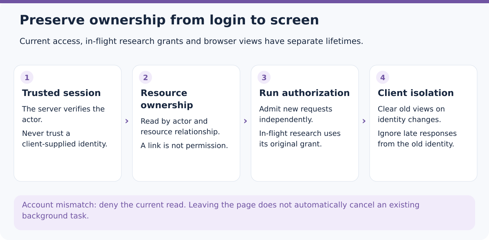
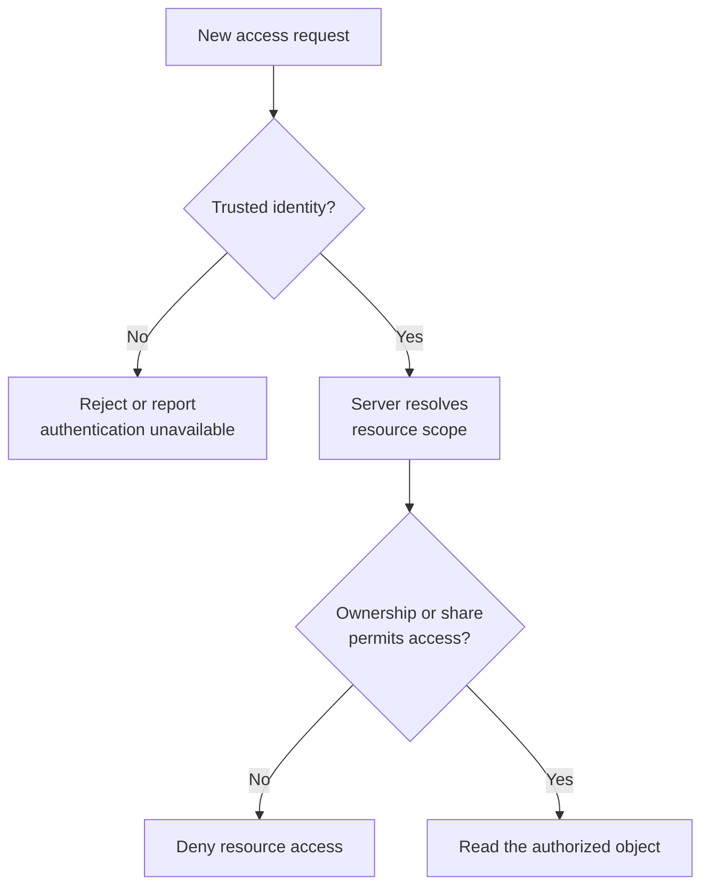
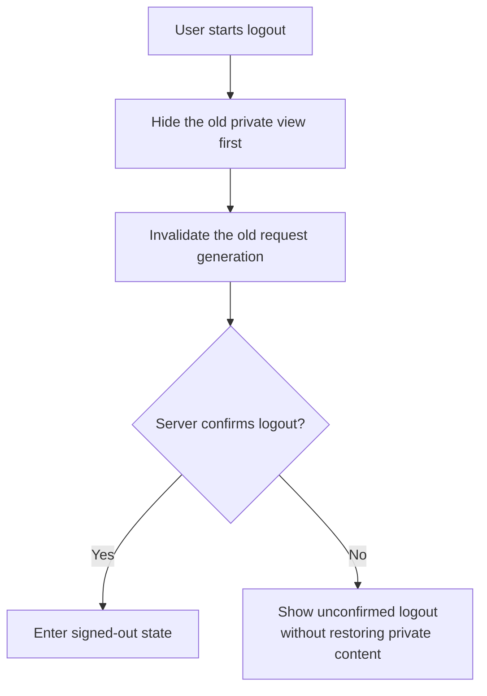

# How Does an Agent Keep Each User’s Research Private?

One user uploads fund materials and asks the Agent to analyze them in the background. Another user logs into the same application and obtains a link to the first user's report. What should the server return?

“They are logged in, so allow access” is clearly insufficient. Hiding the link or filtering a list in the interface does not solve the problem either. A request can reach the server directly, and an old page may still contain private content loaded by the previous user.

An Agent stretches this familiar Web-security problem across time. Research spans multiple tool calls. A user may log out while a background task continues. Opening history or downloading the result later creates new access requests.

**Account integration is therefore not mainly about adding a login page. Each read and effect must establish who is acting, which resource they are accessing, and under which authorization.** The teaching scenario of two users accessing one research task explains ETF Agent's current division of responsibility and its trade-offs.

<picture>
  <source media="(max-width: 640px)" srcset="../../visuals/en/agent-account-identity-private-scope/overview-mobile.svg" />
  
</picture>

*Figure: Identity, resource authorization and browser-view isolation. This overview organizes responsibilities; it is not the execution trace of a particular task.*

[Enlarge the full diagram](../../visuals/en/agent-account-identity-private-scope/overview.svg)

## 1. Trusted identity does not make every resource readable

Start by separating four easily confused objects.

| Object | Question it answers | What it cannot establish |
| --- | --- | --- |
| Account | Who is this principal? | That this browser still holds a valid session |
| Login session | Does this request represent that account? | Access to every report |
| Resource scope | Which scope owns this conversation, material, or artifact? | Trusted identity merely because the client supplied a scope |
| Research authorization record | Which capabilities and materials may this task use? | Authority for a different user or research task |

Scope here means a resource-isolation boundary, not a new business concept the model must interpret. The server derives it from a trusted principal and applies it to resource reads.

The [OWASP Authorization Cheat Sheet](https://cheatsheetseries.owasp.org/cheatsheets/Authorization_Cheat_Sheet.html) emphasizes the same distinction: authentication and authorization differ, and access checks must cover specific requests and objects. A mature authentication library helps verify sessions. It does not automatically build ownership relationships among reports, research materials, and tasks.

ETF Agent's account mode is explicitly enabled, not a relabeling of existing personal data. Logging in does not automatically claim the existing personal scope. In particular, isolating chat records by account does not turn the root investment system's portfolio truth into a multi-tenant ledger supporting everyone's investment accounts.

That limitation belongs near the beginning. Otherwise a team can add `userId` to chat while still reading the same personal holdings underneath, and mistake interface separation for business-data isolation.

## 2. Establish trusted identity once per request, then pass it correctly

One dangerous shortcut is querying the database directly with a browser-supplied `userId` or `scopeId`. Even when the frontend normally sends only the current user's ID, the server cannot treat that convention as a trust basis.

The HTTP entry first obtains session identity through a server-side authentication adapter. Downstream routes reuse that request-scoped identity. Attempts to override the user, scope, or verified identity through query parameters or custom headers are rejected at entry.

Reuse is limited to **the trusted result obtained within the same request**. It is not an indefinitely valid cross-request pass. When the authentication service is unavailable, the endpoint reports unavailability rather than silently falling back to a default personal account to keep the page populated.

Mutating operations also check request origin. This answers a different question from whether the user is logged in: a valid session does not mean the user intended a change initiated from any site. Origin checks do not replace object authorization; each retains its role.



The model is not on the authorization path. It may propose reading material, but “this is my file” cannot establish account identity, and a resource ID in tool arguments cannot prove ownership.

## 3. Apply scope while reading, not after the content has escaped

Suppose Alice's report is identified by `report-x`. When Bob submits that ID, the system should not fetch the complete report globally and depend on the frontend to hide it. Once private content enters a response, log, or model context, hiding the page is too late.

A clearer interface carries both server-resolved scope and target identity. In teaching pseudocode:

```text
identity = verify the current request's session
scope = resolve resource ownership from trusted identity
result = read the requested report within that scope
```

The point is not a particular SQL shape. **Resource identity and trusted ownership must participate together in the access decision.** Unguessable IDs can reduce exposure, but they do not replace authorization.

For an Agent, the chain continues. A conversation's existence does not establish that every Run inside it belongs to the current scope. Permission to read a saved report does not imply permission to fetch its private original sources again. Possessing an old tool-result ID does not make a new task inherit the old task's authority.

The same applies to caches. Identical questions from two users do not justify sharing a private result. Cache keys must reflect the actual isolation boundary, and returned content must preserve ownership checks. Combining private research across users to increase hit rate and filtering the output afterward reverses the order of protection.

Recipient-specific sharing is an explicit exception, not an opening of the whole scope. It can permit a fixed artifact version without turning the recipient into the owner or exposing the original conversation, source materials, and other attachments. Any broader permission needs explicit admission by the responsible capability.

## 4. The subtle distinction: a current request and in-flight research have different lifetimes

Should logging out immediately cancel research already underway? When an administrator changes a source's admission configuration, should an admitted task reapply before its next tool call?

An authentication library cannot make these product decisions.

Earlier project behavior used broader current-permission rechecks: execution, recovery, and publication consulted the account or source status again. The intuition was reasonable—permission changes should affect subsequent work promptly. But acquired material, still-unread authorized material, and recovered task state could then be repeatedly judged by different consumers.

The current design treats a Run—one independent research execution—as a bounded authorization lifetime. The Host records permitted sources and capabilities when admitting the task. Later execution of that same Run uses the record rather than repeatedly narrowing it from an external permission table. Expanding the scope still requires explicit admission through the original authorization path; the model cannot grant itself more access.

**This does not mean permission checks stop.** They continue, but the relevant right depends on the action.

| Operation | Authorization facts it should use |
| --- | --- |
| A new HTTP request reads a private conversation or downloads a file | Current trusted session, target ownership, and applicable sharing conditions |
| Admitted research continues within its original scope | The original Run grant, actual execution state, and resource constraints |
| New research reuses an old report or material lead | Its own new Run admission, not automatic passage through an old cache |
| An explicit request cancels research | The task's cancellation and settlement mechanisms, not a guess about whether the user is online |

Stable same-Run authorization does not guarantee that material exists forever. Missing bytes, file expiry, changed content identity, or an unavailable external tool remain genuine read failures. They should not be mislabeled as revoked permission, nor used to erase other independently permitted results.

This product choice has a cost. A source-permission configuration change does not automatically revoke already admitted research retroactively. Initial admission must therefore control scope, while cancellation, deadlines, and resource limits remain real. **Systems requiring permission changes to take effect immediately in flight cannot directly copy this lifetime.** They need explicit revocation and in-flight settlement rules, rather than two conflicting interpretations at once.

## 5. Logout is also a frontend security boundary

Imagine Alice is reading a report and clicks logout. Before the server confirms it, an earlier session check or report request finally returns. Writing that response into current state can redisplay content that should already have been hidden.

This is not another way of asking whether the backend authenticated the request. The backend may have acted correctly. The mistake concerns **which browser identity receives the late response**.

The current account boundary hides the old private subtree as logout begins, then requests server logout asynchronously. It advances the request generation so earlier identity checks cannot overwrite the new state. An account or session change also clears local hints used to locate the previous conversation; those hints were never server-side permission credentials.



The page also rechecks identity at moments such as regaining focus. The claim is not instantaneous propagation of every permission change to every tab. The point is to preserve separate states for unknown identity, anonymous identity, and unavailable authentication instead of showing old content as if the current identity were verified.

Developers can apply the same principle to data requests: record the account and session generation at dispatch, then check that generation before committing the response to state. Network cancellation can save work, but it cannot replace that final ownership check; a response may already have completed.

The client must not secretly reinterpret logout as cancellation of admitted background research. Viewing rights, login sessions, and task execution have separate state. Stopping research needs an explicit control and outcome, not an inference from closing a browser.

## 6. Prove isolation, not merely successful login

The most informative tests keep the target resource fixed while changing the actor and lifecycle conditions, rather than repeatedly opening a user's own page with the same account.

Start with a small matrix: Alice can read her report; Bob cannot, even with the same ID; after an explicit share, Bob can obtain only the designated version; revocation denies subsequent reads. A resource ID appearing in model output must not change any of those results.

Then add time-dependent cases: an old session requests again after logout; an old response arrives after a new account logs in; an admitted task continues but another new task lacks the same source permission; a valid session requests an object from another scope.

Do not inspect only status codes. Check whether private body text, source excerpts, or tool data reached an unauthorized consumer before denial. Check whether the frontend briefly retained old content and whether the backend confused a disconnected view with task cancellation.

The project has local verification material across account, HTTP, database, and browser seams. That does not establish safety for every access path in a production deployment. Reverse proxies, caches, static file servers, object stores, and email callbacks each need deployment-specific review. A correctly protected application route cannot protect a direct URL that bypasses it.

## 7. Why the public teaching version does not “also support multiple users”

The [fixed Open ETF Agent v0.15.2 README](https://github.com/hpoenixf/open-etf-agent/blob/34124cefc6df289e08518173789210b45a716451/README.md) describes a local, single-user, synthetic-example environment. Its [reader entry](https://github.com/hpoenixf/open-etf-agent/blob/34124cefc6df289e08518173789210b45a716451/src/reader-cli.mjs) opens the run directory selected by the operator and is explicitly loopback-only.

It demonstrates why rereading should not execute research. A local Session, directory, or random identifier must not be mistaken for the account authentication and private scopes described here. Changing the listening address to a public interface does not add those capabilities.

Accordingly, this article does not provide a public command claiming to install the complete multi-user system. The public implementation has the narrower single-user boundary. Account mode, private resources, and named-recipient sharing belong to the full system's engineering design. Later public capabilities must be checked against [current main](https://github.com/hpoenixf/open-etf-agent/blob/main/README.md) and its actual wiring.

## Conclusion: identity is a relationship, not just a field

Two users can use the same Agent without sharing a private context. A trusted session identifies the requester, scope establishes object ownership, task authorization defines what one research execution may do, and the frontend prevents results from reaching an identity that has since changed.

With those relationships explicit, login, logout, sharing, and cancellation no longer need to collapse into an ambiguous “user state.” Each action has its own effect and failure modes.

**The question is not whether a request contains `userId`. It is where the identity came from, which boundary uses it, and whether the final content still belongs to the right person.**

For task versus conversation identity, continue with [conversation admission and task continuation](https://hpoenixf.com/eff-agent-article/en/articles/agent-conversation-admission-task-continuation). For the grant attached to one research execution, see [the model understands; code authorizes](https://hpoenixf.com/eff-agent-article/en/articles/011-model-understands-code-authorizes).
