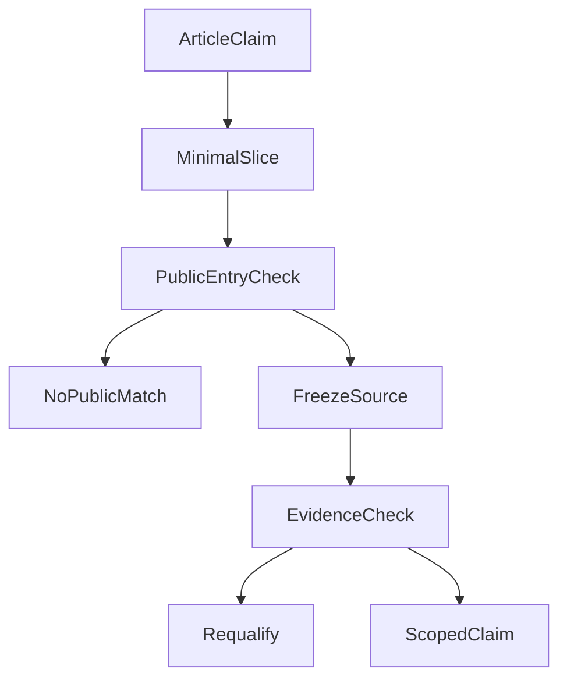

# Does the Code Really Support the Article? An Evidence Contract for Technical Writing

Technical articles can create a comforting impression: the explanation is complete, there is a GitHub repository, and therefore the design must have been verified. But those are three different facts.

Imagine reading an article about an AI agent's long-term memory. It explains how to save preferences, revise them, and respond to a request to forget something. There is a source repository at the end. When you try the example, however, you find that the article discusses automatic learning while the demo only supports explicit saves. The repository has moved on, so you cannot tell which version the article describes. The README says tests pass, but not which claim those tests check.

That does not necessarily mean the article is wrong. More often, **the claims in the article, the actual code, the version being run, and the test evidence are not linked in a way readers can check.**

While organizing the public [Open ETF Agent](https://github.com/hpoenixf/open-etf-agent) project, I tried to make those links explicit. The goal was not to attach a huge testing ledger to every article. It was to let a reader answer three practical questions: **Where is this implemented? How can I run it? What does the result actually establish?**

## 1. Why a GitHub link is not enough

When a project is small, explaining a solution, showing a code snippet, and linking to the repository may be sufficient. As a project evolves, three details become important.

**`main` is not a fixed version.** Today a repository may only support file retrieval. Next month it may introduce a database, and later it may support recovery. If a six-month-old article links only to `main`, the reader may land on a different application and a different command. [GitHub's documentation on permanent links](https://docs.github.com/en/repositories/working-with-files/using-files/getting-permanent-links-to-files) distinguishes a moving branch from a specific commit.

A useful article can provide both: a pinned commit for "what was implemented when this was written," and the current `main` README for "where a new reader should start today." The former preserves history; the latter helps people use the software.

**An article may cover more than the public code.** A long-term memory article might discuss automatic learning, cross-session recall, and safe forgetting. Its public teaching repository might implement only explicit saving, revision, and forgetting. That is a sensible small example. But a module called `Memory` is not, by itself, proof that the entire system described in the article has been open-sourced.

**Passing tests does not prove every claim in the article.** We can test that a forgotten memory is excluded from later model input. That is different from proving that a model can recognize every preference worth saving, or that its long-term summaries are always accurate. A green test result cannot carry those broader claims.

A repository link says where the code lives. It cannot speak for every statement in the article.

## 2. A small, runnable Agent Memory example

The [ETF Agent Memory article](https://hpoenixf.com/eff-agent-article/en/articles/026-agent-memory-forget-durable-effects) explains the lifecycle of application-level memory: writing, recall, and governance. One central design point is that **forgetting is not merely a chat message saying "I've forgotten." It must change whether an old memory is eligible for future model input.**

To make this understandable, we do not need to build a complete account system, vector database, or automatic learning platform. Start with a clearly labeled **synthetic example**:

> When comparing funds, explain the fee basis first.

Now check only three actions: save that preference, revise it, and forget it. Each operation should leave a real receipt. After forgetting, check what can enter future input rather than trusting a successful-looking "deleted" message.

The [pinned Open ETF Agent v0.5 source](https://github.com/hpoenixf/open-etf-agent/tree/05c0dd2dc550f4f7e5da034340ff5c3159768fcf) includes an `explicit-memory` demo. It uses an explicitly selected local synthetic memory library and predefined explicit operation intents. Three separate Runs perform saving, revision, and forgetting, retain local operation receipts, and check what is projected into later input.

This minimal implementation is not a complete account-level Memory service. It does not implement automatic semantic learning or independent live-model decisions about what to store. **It verifies a bounded Runtime behavior, not a complete long-term-memory platform.**

### Try it yourself

Use a fresh demo directory with Node.js 26.11.1–26.x, then run the commands from that pinned v0.5 README:

```bash
git clone https://github.com/hpoenixf/open-etf-agent.git
cd open-etf-agent

git checkout --detach 05c0dd2dc550f4f7e5da034340ff5c3159768fcf
npm ci --ignore-scripts --no-audit --no-fund
npm run build

npm run demo -- --case explicit-memory --memory-library runs/selected-synthetic-library
```

Installing dependencies may access npm, but the demo itself runs offline with synthetic input and requires no model key. Use a new, empty memory library; do not point this historical demo at your personal Memory data. The CLI prints the actual Run output directory so you can inspect the report and operation receipts. The [original verification record](https://github.com/hpoenixf/open-etf-agent/blob/05c0dd2dc550f4f7e5da034340ff5c3159768fcf/docs/verification/v05-demo-receipts.json) provides historical evidence to compare.

The interesting observation is not a polished model answer. It is **which operation actually committed, and which old memory can no longer enter future model input**.

Later public code added a candidate path for read-only consumption of an existing Memory library. That later addition cannot be credited retroactively to v0.5. Each stage must be described within its own actual scope.

## 3. When a feature first appeared is not when it was last verified

Suppose explicit Memory existed in v0.5. Its tests were subsequently repaired, and the behavior was verified again at a newer source snapshot. Which version belongs in the article?

Both points in time matter, but they answer different questions.

In the [Open ETF Agent article-to-code mapping](https://github.com/hpoenixf/open-etf-agent/blob/main/docs/articles-and-code.md), we use these fields:

| Field | Question answered | Memory example |
| --- | --- | --- |
| `since` | Where did this minimal public capability first appear? | v0.5 |
| `verifiedAt` | Which pinned source is the recorded verification tied to? | `e1b8e4e` |
| `target` | Which runnable target was checked? | `explicit-memory` |
| `scope` | Which behavior does the result cover? | Synthetic explicit save, revise, and forget |

Think of `since` as the feature's birth record and `verifiedAt` as a particular checkup.

**Passing a later checkup does not mean the feature was born that day. And a later checkup cannot give an older version capabilities it did not have.**

`verifiedAt` also does not mean "tested again today," or "automatically valid for every new `main` commit." It identifies the exact source behind the registered evidence.

If these identities are mixed together, an article can unintentionally use today's more mature implementation to rewrite yesterday's engineering history.

## 4. Connect the article, code, and evidence without creating a second demo engine

Once the smallest meaningful capability is identified, the next step is to connect it to the writing.

Open ETF Agent maintains a structured [coverage manifest](https://github.com/hpoenixf/open-etf-agent/blob/main/docs/verification/article-coverage.json). Each article has a stable slug, a corresponding existing CLI scenario or test target when one exists, and a stated scope and verification identity.

The manifest does not implement research functionality. **It records which existing execution paths can support which limited public claims.**

Why not build a separate demo application for every article? Because a successful documentation-only demo could simply prove that the new demo works, without exercising the original Runtime path.

The decision looks like this:



There are two possible outcomes at each check. If no public entry point exists, say "no public counterpart." If an entry point exists but the source or receipt no longer matches, do not borrow the old result: requalify or narrow the claim. Only matching code, entry point, and evidence warrant presenting that bounded capability as verified.

Three choices matter here.

### Allow "no public counterpart"

An article might explain a complete expert-management system while the public repository contains only a scripted Child. These are related concepts, not the same capability. Marking the article as having no public counterpart is more useful than borrowing the pass result of a nearby feature to fill a coverage chart.

### Require an entry point and an observable result

A class, function, or specification is not enough to show that a reader can complete a task. Explain the command, accepted input, expected report or receipt, and where to observe success, partial completion, or failure.

For Memory, this entry point is `explicit-memory`. Other capabilities may use a pinned CLI or a dedicated test. The form can differ, but there must be a real place to observe the result.

### Do not give new code a free pass from old evidence

A test passed last week. This week, the relevant source, dependency lockfile, fixture, or verification script changed. The old receipt still exists, but its applicability may have changed.

The project therefore links pinned commits, executable targets, content fingerprints for source and input files, and execution receipts. A content fingerprint identifies the exact bytes involved in a verification. When relevant inputs change, decide whether the previous evidence still applies and rerun as needed.

**Evidence has a result, but also a version, a time, and a scope.**

## 5. What should automated checks do?

A structured mapping lets code handle repetitive, deterministic checks.

[`check-article-coverage.mjs`](https://github.com/hpoenixf/open-etf-agent/blob/main/scripts/check-article-coverage.mjs) checks the article entries, executable targets, historical version lineage, and recorded receipts. It also renders the Chinese and English mapping tables. Importantly, it distinguishes two operations:

```bash
# Check existing mappings and pinned evidence; do not rerun every example
node scripts/check-article-coverage.mjs

# Explicitly rerun bounded existing CLI and test targets
node scripts/check-article-coverage.mjs --smoke
```

The first command asks whether the existing evidence still refers to the objects it claims to cover. The second performs actual execution. A successful metadata check is not a new execution result.

Likewise, `verified` in this manifest means that a specific, limited Runtime behavior has corresponding verification. It is not automatic semantic peer review of the whole article.

Programs are good at checking whether files, commands, versions, and structures match. Whether the architecture explanation is sound, the English translation is accurate, or a model actually understands a user's intent requires different forms of review or observation.

**Let code check deterministic facts; do not let one green status replace engineering judgment.**

## 6. If the code is right, is the live article up to date?

Not necessarily. Getting an article from source Markdown to the reader's screen is another handoff.

Open ETF Agent's implementation, article collection, and canonical reading site live in separate repositories. The code can change before its article is updated. An article can be merged while the public site still serves an older pinned snapshot.

So we need to distinguish:

| Object | What to verify |
| --- | --- |
| Code repository | What did a particular pinned version implement? |
| Article repository | What do the Chinese and English source editions say? |
| Canonical reading site | Which deployed edition can the reader actually open? |

Recent article maintenance has involved old blog links, English reading routes, and diagram compatibility. Those changes added no Runtime capability, but they directly affected whether readers could reach the right content.

The current arrangement uses [eff-agent-article](https://github.com/hpoenixf/eff-agent-article) as the single article source, then pins a specific commit through the existing blog publishing workflow for the bilingual pages under `hpoenixf.com/eff-agent-article/`. This lets us distinguish "source committed," "build and deployment finished," and "the live page actually changed."

Not every personal blog needs a multi-repository publication system. Explicit source identity becomes worthwhile when the number of articles, versions, and publishing destinations makes manual copying easy to get wrong.

## 7. Four small steps for an ordinary open-source project

1. **Pin the commit behind a technical claim.** Preserve the historical source, and also link the current README for new readers.
2. **Keep one small runnable example for a key mechanism.** It need not be the entire product, but its input, command, observable output, and limits should be clear.
3. **Describe test results as behavior.** "Another process can read back the original report after the first exits" is more useful than "all tests pass." Label synthetic examples as synthetic.
4. **Revisit articles when the code changes.** Keep still-applicable evidence; revise claims when scope changes; consider rerunning when verification inputs change.

Only once articles and versions accumulate should these relationships become a shared manifest and repetitive checks become scripts. There is no need to build a verification platform for a single article.

## Conclusion: Trustworthy does not mean all-powerful

A good technical article first explains why a problem matters, why an earlier approach was reasonable, and what new information changed the engineering tradeoff.

Pinned source and verification evidence let readers check **the part of the explanation that code can actually establish**. They do not replace the explanation.

Version pinning, reproducible execution, file fingerprints, and provenance are established engineering techniques. The Open ETF Agent practice applies them to a narrower question: what runnable capability is this article actually claiming?

**A good article helps readers understand a design. A checkable article also helps them know which part of it they have grounds to trust.**

Readers need not accept the vague statement that an entire Agent has been proven correct. They should be able to determine which version implements a mechanism, what a recorded verification covers, what they can run themselves, and what remains only a design or has not yet been made public.
