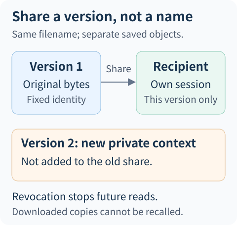
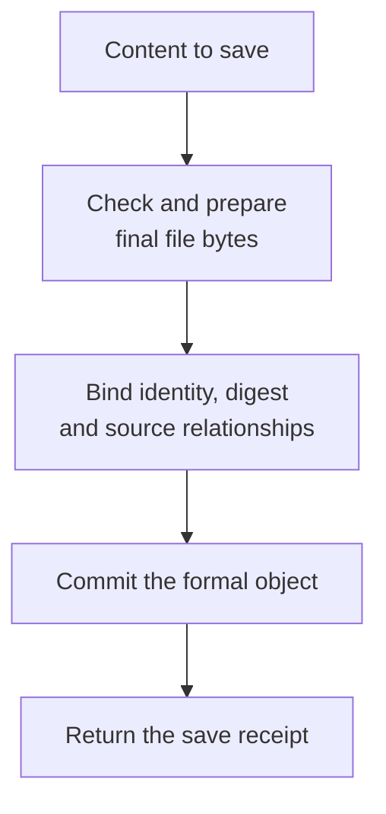
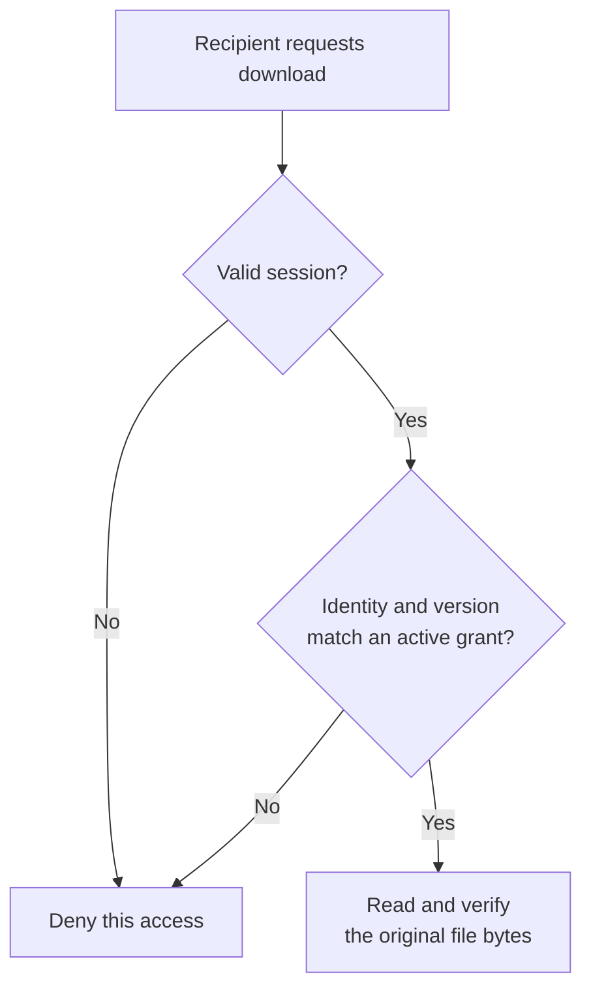

# The Report Is Generated. Why Can't We Just Share It?

Imagine an Agent generates a fund-comparison report and you share it with a colleague. Ten minutes later, you add a condition. The Agent produces another report, still named `comparison.html`.

Which one should your colleague receive when reopening the original link? Can they still download it after you revoke the share? When the generation screen times out, was the file never saved—or was it saved, with only the receipt failing to return?

“Put the file in a directory and return a URL” does not fully answer these questions.

**File delivery must establish three things: which content was saved, who may obtain it, and how far the operation actually progressed.** This article uses ETF Agent's file pipeline to explain that relationship through the teaching scenario above, not through a real user's research content.

## 1. Identify the delivery object: a filename is not a version, and a link is not permission

In a short demo, `report.html` may seem sufficient to identify an output. Once regeneration, background work, or sharing enters the picture, the name becomes ambiguous. It describes the file's purpose, not which content from which generation it represents.

We call a formally saved file an **Artifact: an output that can be durably read again**. Alongside its filename, it retains its account scope, producing task, content type, byte size, content digest, producer, and retention deadline. The digest is normally calculated from the final bytes so that later reads can verify the saved content has not changed.

This is easy to oversimplify. Matching byte digests establish matching content; they do not independently establish the same owner, the same sources, or the recipient's right to download. Authorization and production relationships still need their own records.

The following is a teaching description of those relationships, not an actual API request:

```json
{
  "file": "comparison.html",
  "savedVersion": "the fixed version from the first generation",
  "owner": "the report owner",
  "recipient": "the colleague allowed to read it",
  "permission": "download this version only"
}
```

The second generation may reuse the display filename, but it must have its own artifact identity. The original share remains bound to the first version. A change to the “latest report” cannot silently extend permission to content produced later.

This matters particularly in financial research. A new version might include private holdings, change the comparison period, or correct an earlier conclusion. Permission to read the old version does not mean the owner agreed to distribute that additional information.



*Sharing identifies a recipient and a fixed object. Regeneration does not update that grant, and revocation cannot recall downloaded copies.*

## 2. Saving means committing a verifiable object, not merely writing a file

The model may compose the file directly, or a computational workspace may generate it first. Both producers can use the same save pipeline. A temporary workspace file, however, cannot pass itself off as an already delivered attachment.

The current implementation checks content type, filename, size, and source relationships before saving. When HTML needs normalization, size and digest must be recalculated from **the final, normalized bytes**. Otherwise the producer's digest could describe one representation while the downloader receives another.

The bytes and their metadata are then packaged together, written to a temporary file, and made visible as a formal object through the filesystem commit step. The main problem this prevents is a record claiming that a file was saved without matching content—or metadata pointing to bytes replaced later.



Every step can still fail. The receipt belongs after the formal commit, not after the model says “generation complete.” Downloading is a separate operation: reread by artifact identity and check account scope, task binding, retention, and whether the bytes have changed.

This is a particular local-filesystem implementation, not a global transaction spanning a database and object store. Moving to object storage with separate metadata and byte writes would require reconsidering the commit point, failure observations, and compensation. A local commit cannot be advertised as an atomicity guarantee for arbitrary storage combinations.

The earlier [HTML delivery retrospective](https://hpoenixf.com/eff-agent-article/en/articles/agent-html-evolution-challenges) already described a file being saved while the user still could not obtain it. Reliable storage fixes one segment of delivery; it does not replace access control or an actual subsequent read.

## 3. Why not regenerate immediately after a timeout?

Suppose the filesystem has committed the report, but the caller times out before receiving the save receipt. The interface knows that the request did not return normally. It does not know that the file definitely does not exist.

The save pipeline distinguishes three facts: not committed, committed, and outcome unknown. These come from the operation itself, not from asking the model to interpret an error message.

| Observed fact | What the system may say | What the next step should address |
| --- | --- | --- |
| Confirmed failure before commit | This attempt did not save successfully | Correct the input or initiate an authorized save |
| A trustworthy commit receipt exists | The file was saved | Check access or presentation instead of recreating content |
| Timeout during commit or a missing receipt | The save outcome cannot yet be confirmed | Reconcile using the original operation identity; do not assume absence |

This is why “retry” is not a universal solution. Regenerating may produce two different reports. Saving under a new identity may create duplicate attachments. Merely using the word idempotency does not establish exactly-once behavior for arbitrary generation operations.

Where stable operation identity and exact rereads exist, inspect the existing result first. Where the facts are insufficient, preserve the unknown state rather than inventing a receipt for an old file. Cancellation and late commits likewise belong to the original save operation's cleanup and settlement; another request must not arbitrarily delete a file that “looks redundant.”

The trade-off is deliberate: telling the user that the outcome remains unconfirmed is better than hiding uncertainty behind an automatic rerun.

## 4. Downloading checks the current reader, not the research again

Once the report is saved, an access request asks a new question: **May this person read this saved file now?**

For an owner download, the server resolves account scope from a trusted session and checks the artifact and original task belong to that scope. For a recipient download, both the named recipient identity and the precise share record must match.

Two identities must remain distinct. The file owner's identity determines where to locate the content; the current actor's identity determines who is reading it. Using the owner's storage scope to find the file does not turn the recipient into its owner. Auditing and subsequent access decisions must retain the actual actor.

Another common mistake is treating a historical download as a query for current data. A changed portfolio snapshot does not make yesterday's legitimately saved static report nonexistent. Researching today's portfolio requires currently applicable facts; downloading an old report should faithfully return its historical content and context.

Similarly, a current download check cannot retroactively rewrite the research authorization recorded by the producing task. In this implementation, the same research continues within its original grant, while a new file access checks its own session, object ownership, and share conditions. Separate lifetimes prevent both unauthorized reads and accidental suppression of historical results.

An expired or deleted file, or a failed byte-identity check, is nevertheless a genuine unreadable state. Past research authorization cannot justify reconstructing an allegedly “identical” historical file from a summary.

## 5. Recipient-specific sharing binds a person, a version, and limited rights

Why not simply give the colleague a temporary download URL?

That is a reasonable alternative, not an inherently wrong design. For example, [Amazon S3 presigned URLs](https://docs.aws.amazon.com/AmazonS3/latest/userguide/using-presigned-url.html) provide time-limited access, and their documentation describes them as bearer tokens. They suit those distribution needs. But “anyone possessing the link may use it” and “only this account may use it” are different product semantics.

Our targeted sharing chooses the latter. The record binds the owner, recipient, original task, artifact, and fixed content digest. The recipient must use their own valid session. The server checks expiry and revocation before reading the specified version.



The last step still checks existence, retention, and content identity. An active share does not guarantee the file still exists; an existing file does not guarantee the share is still active.

The grant allows access to the specified file, not the underlying holdings, full conversation, other attachments, or entire research task. Sensitive information already inside the file must be handled when permitting the share. A download-only grant does not automatically redact the content. A share button does not erase source-material redistribution requirements either.

**The cost of sharing a fixed object is that new versions do not automatically reach old recipients.** That sacrifices some convenience but prevents new information from entering an existing share without the owner's knowledge. A product offering continuous access to the latest version needs an explicit continuing grant, not a silent reinterpretation of one-time sharing.

## 6. What about a file not yet generated, or a share already revoked?

Background research can take time. A user may designate a colleague before the file exists: “Let this person view it when it is done.” The system can record a pending binding intent, but it cannot issue a download for nonexistent bytes.

The current pending path first stores the server-confirmed delivery-selection identity. Only after the corresponding result is committed can that intent bind a specific artifact and digest. **Pending binding is not a more permissive authorization state; it has no deliverable bytes yet.** Nor is it a subscription to any future result.

Consider three condition changes:

| Changed condition | Correct result | What must not happen silently |
| --- | --- | --- |
| The owner generates a newer report | The old share still points to the old version | The recipient gains newly added private content |
| The share expires while the file remains retained | Subsequent shared reads are denied | File existence overrides the share deadline |
| The file expires while the share remains active | The report cannot be downloaded | The share extends retention or triggers reconstruction |

Revocation applies to subsequent access. It cannot recall a copy already downloaded to the recipient's device and must not be described as remote destruction. Interrupting an in-flight download is a separate transport policy. Denying future requests does not establish that an existing connection stops immediately.

## 7. Which part can readers reproduce with the public code?

Complete account-specific sharing is not implemented in the public teaching version corresponding to this article. The public code is useful for observing a narrower foundation: **reports and attachments have fixed identities, and rereading returns saved bytes rather than invoking the model again.**

In the [fixed Open ETF Agent v0.15.2 source](https://github.com/hpoenixf/open-etf-agent/tree/34124cefc6df289e08518173789210b45a716451), [Artifact storage](https://github.com/hpoenixf/open-etf-agent/blob/34124cefc6df289e08518173789210b45a716451/src/artifacts.mjs) stores objects and report revisions separately. A revision binds the report, attachments, and source snapshots. The [read-only entry](https://github.com/hpoenixf/open-etf-agent/blob/34124cefc6df289e08518173789210b45a716451/src/reader-cli.mjs) opens a selected run directory without making another model call.

Following that version's README, the steps below use Node.js 26.8.1–26.x. They are a cross-check of the fixed version's documented commands and actual entry points, not results newly executed in this writing environment.

```sh
git clone https://github.com/hpoenixf/open-etf-agent.git
cd open-etf-agent
git checkout 34124cefc6df289e08518173789210b45a716451
npm ci --ignore-scripts --no-audit --no-fund
npm run build
npm run demo -- --case document-compare

# Replace the placeholder with the actual run directory printed above.
npm run serve -- --run runs/run-YOUR_ID
```

The example uses synthetic materials and scripted model responses. The output directory contains `report.md`, `manifest.json`, and run records. The reader is local-only; exposing it to the Internet does not provide the multi-account sharing described here. For later versions, consult [current main](https://github.com/hpoenixf/open-etf-agent/blob/main/README.md) rather than mixing commands from different snapshots.

## Conclusion: define “which version, for whom” before designing the share button

Return to the two `comparison.html` files. Reopening the old share should return the originally authorized version. New content requires explicit new sharing. After a timeout, first establish whether the original operation committed. After revocation, block future access without promising to recall offline files.

This design does not turn the filesystem into a research judge or make a download endpoint reevaluate the whole research. It fixes the delivery object, access relationship, and operation facts separately.

**Generation determines what was written. Artifact management determines which version remains. Access and sharing determine who may receive it now.** Connecting those responsibilities turns a report into a result the user can keep using.
