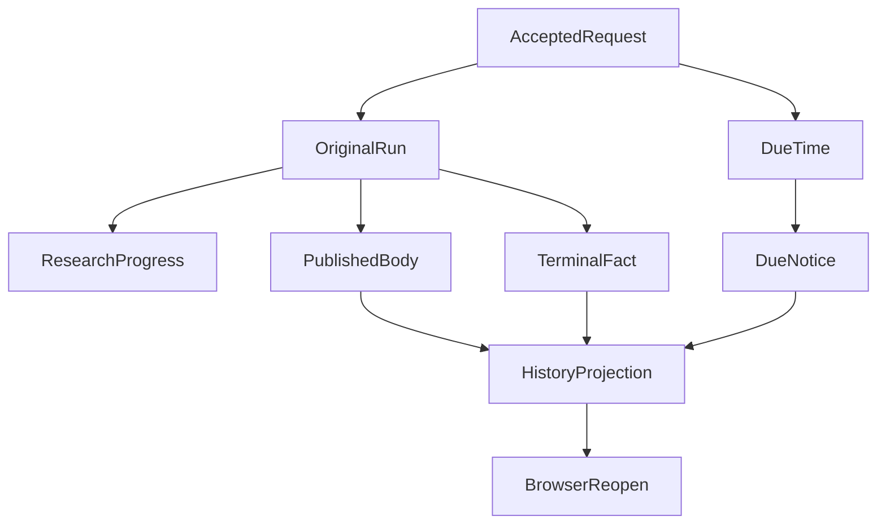

# The User Has Left, but the Research Is Still Running: How an Agent Delivers on Time

“Please analyze the risks in my portfolio and tell me the result in ten minutes.”

Ten minutes is not necessarily long for a research agent, but it is long enough that a user may close the chat. The research might finish early, deliver only a useful part by the deadline, or still be running when the promised time arrives.

The obvious solution is to move the Run into the background and send a completion notification. We already had Native Research, progressive answers, SSE, durable recovery, and conversation history. What was missing was more specific: **the ability to honor a delivery promise even when execution, published content, and the notification deadline happen at different times.**

The key is preserving three distinct facts: **when useful content was published, when the user was promised a notification, and when the research finally ended.** They can occur in different orders and must not overwrite one another.

## 1. A research request with a time commitment

First turn “run it in the background” into questions with observable answers:

- If research finishes in three minutes but the user says “tell me in ten minutes,” should the notification be early?
- If there is only a committed partial answer at ten minutes, is the task completed or still running?
- If the full answer arrives at minute twelve, may the system retroactively mark the deadline as met?
- If the user returns to the page, can the UI restore the result without invoking the model again?

The normal Entry model still interprets the user's timing intent. The Host accepts a bounded proposal tied to the original user message, settled Entry and Run. A model saying “finished” cannot write a completion fact, and the client cannot submit an internal timing receipt directly.

| User commitment | Delivery semantics | If research finishes early |
| --- | --- | --- |
| “Tell me **after** ten minutes” | `at`: notify at the target time | Save and expose the answer early, but hold the target notification |
| “Tell me **within** ten minutes” | `by`: aim to deliver by the target | Notify when a valid final result is ready |
| “Update me at ten minutes even if unfinished” | Report the observed state at the deadline | A committed partial, running, or missed state is not a completed report |

The target is the original server-accepted message time plus the admitted delay; identity also binds the original content hash. Reload, reconnection and recovery read the accepted record rather than restarting ten minutes. A timing proposal adds neither a model request nor execution budget.

## 2. An early answer does not imply an early notification

The first subtle distinction is that **a saved answer can already be readable while its scheduled notification is not yet due.**

In a controlled browser acceptance run on October 22, 2026, content for an `at` request was saved and readable at 05:43:27 UTC. The target time was 05:44:57 UTC. The system did not send the final timed notice before the target. In a separate `by` case, the final notice was delivered before the target because the work had already completed.

A handler that always sends a notice on `Run completed` would treat those two different user promises as identical. Calling the model again when the timer expires would be another mistake: it can spend more requests and create a second version of a report that was already finished.

Instead, the due-time notification refers to the previously committed result. Publication remains responsible for admitting and storing the answer; the notification does not copy, rewrite, or recertify the research.

A subtler case is research completed before its deadline but a notice delayed by an outage. Its `by` completion may be met while notification is still late. Notification time cannot substitute for completion time, nor can observing completed now establish when it happened. Historical records without a trustworthy completion time remain unknown.

The notice keeps target, actual completion, earliest notification and observed times separate. For `at`, notification becomes due at the later of target and completion; `by` permits notification on completion. An `at` with only a lower bound is not a completion deadline, so unfinished work at that instant is not automatically by-style missed. Completion also does not prove the body is currently viewable: History/Publication still reads it independently.

## 3. At the deadline, incomplete is still an honest deliverable

A more common long-running case is research that has not finished by the target.

Stopping the Run exactly at the deadline may waste almost-complete work. Remaining silent until it finishes breaks the user's time commitment. Our design takes a third path: **report what was actually committed at the deadline, then allow the original Run to continue only if its existing authorization, budget, and user constraints still permit it.**

Imagine an agent that has published a readable portfolio-risk assessment but is still checking overlapping underlying exposures. At the target time it can report that a partial result is ready while the full study is unfinished. The word “ready” must be grounded in an actual Publication receipt. A model progress note saying “almost done” is not a published result.

In the controlled acceptance scenario, a committed partial remained available while the due-time notice recorded running/missed. The same Run later completed and produced a separate final notice. **The later completed state did not rewrite the earlier missed deadline.**

This distinction matters: eventual task completion and on-time delivery answer different questions.

Continuation retains the original Run grant but still requires remaining resources, a valid lease and no Stop or terminal restriction. At the next admissible model turn, the model may continue, narrow or finish. A due notice creates no new Run, permission or budget.

If the user forbids late work, the Host tightens the original execution deadline. One easily missed failure path is rejection of optional notification admission: a validated no-late-work restriction still survives. An unavailable notice cannot turn that restriction into permission, and recovery unable to read the original timing authority withholds further execution rather than guessing that late work is allowed.

## 4. Reopening the browser must not repeat the research

The next problem is client-side: what does the page read when the user comes back?

Re-sending the prompt can duplicate Entry, tool calls, cost accounting, and answers. We instead preserve the original Run, Control, Recovery, Publication, and History identities. The client consumes the committed events and content it is currently authorized to view.

The diagram is a simplified read model, not a single database transaction. `ResearchProgress` is a model-authored progress proposal; `PublishedBody` is admitted answer content; `TerminalFact` is an execution fact; `DueNotice` is a timed delivery fact. History relates them using the original Run and account identity.

Reopening needs a read, not execution recovery. Continued work depends on server admission: the legacy foreground profile cancels on disconnect when neither background nor timing acceptance exists; admitted background/timed research may detach only the subscription. The later, default-off concurrent profile gives admitted Runs server-owned execution, but that must not be described as the default for every request. Explicit Stop keeps its separate cancellation path.

A narrower observed path resumed a legally parked Native Run through its original Timer/Control, Checkpoint and lease in a new process, without repeating settled Entry or Child work. That recovery initially refused because first execution had used a policy broader than the grant ultimately persisted. The fix aligned initial execution with that grant, rather than weakening recovery identity checks. “Same Run” must still mean the same permission at cold recovery; this is not a guarantee that arbitrary process crashes can safely rerun work.

For frontend engineering, the lesson is not to add another spinner. The live SSE connection is a transport, not the source of truth. A page can reopen, read stable identities, avoid rendering duplicate notices, and navigate to the originally committed answer.

## 5. Progress, published answers, and notices are different UI objects

These three kinds of information may share a chat screen, but they should not be presented as interchangeable content.

**Research progress** can be proposed by the model through `send_research_update`, such as “I am checking portfolio overlap.” The runtime validates bounded structure, identity, visibility, and event association. The text does not prove the overlap check has succeeded.

**A published answer** is processed through the existing Publication owner. Its useful partials and revisions retain their content, source, numeric, and version contracts.

**A task notice** is a Host projection of the time commitment, committed results, and technical state—for example, “the deadline passed and research continues.” It does not judge the investment quality of the report.

In the client, these objects also need stable event identities, deduplication, and history replay. SSE carries events but does not replace durable state or viewer authorization. [MDN's guide to server-sent events](https://developer.mozilla.org/en-US/docs/Web/API/Server-sent_events/Using_server-sent_events) explains the basic transport; our additional responsibility is replaying the correct account, Run, and notification identities.

These are durable in-app notices, not an implemented browser Push, mobile OS push, email or SMS integration. A notice saved while the user is offline has not necessarily reached them. Another channel needs its own audience, delivery and retry contract; SSE or outbox success cannot establish those effects.

## 6. Test the time commitment, not just text appearing on a page

The test should bind the same Run’s original target, committed body, completion fact, notice identity and model-request count, rather than merely finding a popup. The October 22, 2026 controlled acceptance connected those facts through real Chrome, the original Next page, synthetic Better Auth accounts and disposable PostgreSQL.

Why test the actual page? A borrowed browser fixture had returned 503 for timed notices despite component coverage. The original page then exposed two browser-only import paths returning HTTP 500. Restoring the surrounding frontend convention made these observations possible; the earlier failures were not counted as passes:

- An early readable `at` result with a held notice, and an early `by` final notice.
- A committed partial at the missed deadline and a later distinct final event on the same Run.
- Readable history after leaving, refreshing, reopening, and reloading a 390×844 viewport; Stop did not erase the committed partial.
- HTTP 404 for a different authenticated account attempting to read the original user's conversation or notice.
- Four scripted-model Runs, each with one Entry plus two Main requests; notification retries and UI reads added no model requests.

The limits matter. Scripted model replies make an integration scenario repeatable, not semantically accurate. The fixture timer cadence is not a production delivery-latency SLA, and a mobile-sized Chrome window does not certify every physical device.

The delivery path has been verified under controlled engineering conditions. That alone does not establish real-research delivery latency, long-term service levels, or user satisfaction.

## 7. Why we did not build another Background Manager

For a short task with an online user and no separate timing commitment, a completion callback and notification can be sufficiently simple. For long-lived coordination across services, a platform such as [Temporal’s Workflow Execution model](https://docs.temporal.io/workflow-execution) deserves consideration: execution history reconstructs state, with external work handled through mechanisms such as Activities. The application must still define at/by, body access and whether late work is allowed.

Here, Run execution/recovery, Publication content, Control events and historical delivery already exist. Giving a Background Manager its own task and result records would add conflicts over which record wins, whether notice retries rerun research and what Stop terminates. We add original target and notice facts while retaining existing content and execution identities; Temporal is not integrated.

The cost is concrete: this is not a general-purpose workflow engine. Recovery covers only supported waiting/receipt paths, delivery is in-app, and production notification latency is not guaranteed. Broader coordination or delivery requirements call for corresponding platform and channel contracts, not more notice states that imply unsupported capabilities.

**This acceptance boundary needs a date.** The original timed-delivery verification showed that a study already in progress could honor its `at/by` commitment, preserve partial results, and be reopened after the user left. It did not test concurrent short questions in the same conversation. Later, separate [foreground/background concurrency work](agent-background-research-collaborative-experience.md) implemented and checked independent short replies, targeted corrections to the original research, and out-of-order result ownership. That is separate engineering evidence, not a result retroactively established by this timed-notification test or a verdict on financial research quality.

## Conclusion: a delivery promise must survive the research

Background processes, SSE, database transactions, and recoverable execution are established techniques. The worthwhile engineering decision is how to honor a user promise when these events arrive out of order.

An early result may be readable before an `at` notice. A `by` deadline can arrive with only a partial result, which should be reported honestly. A later final answer remains useful without erasing the missed deadline. A reopened page should read the original outcome instead of starting over.

**Research may continue; the original delivery commitment must not be silently rewritten by execution, disconnection, or eventual completion.**

A useful audit starts with one question: does a single completed field stand for body persistence, execution termination, meeting the deadline and reaching the user? Separating those facts makes lateness, retries and reopening explainable without rerunning research to hide a gap.

---

Further reading: [Scheduled Research](https://hpoenixf.com/eff-agent-article/en/articles/agent-autonomous-scheduled-research), [Progressive Answers](https://hpoenixf.com/eff-agent-article/articles/agent-progressive-answer-coherence), and [Independent Publication](https://hpoenixf.com/eff-agent-article/en/articles/019-agent-answer-publication) cover neighboring concerns. This article focuses on delivery times, continued research, and client replay.

Explore more at the [ETF Agent engineering collection](https://github.com/hpoenixf/eff-agent-article). If the work is useful, consider giving the collection a Star.
