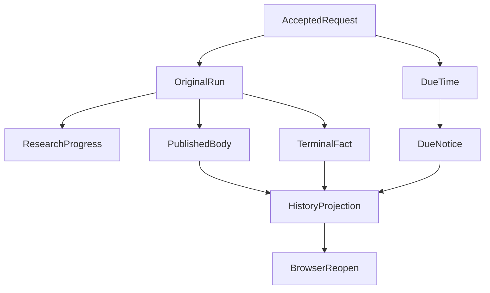

# The User Has Left, but the Research Is Still Running: How an Agent Delivers on Time

“Please analyze the risks in my portfolio and tell me the result in ten minutes.”

Ten minutes is not necessarily long for a research agent, but it is long enough that a user may close the chat. The research might finish early, deliver only a useful part by the deadline, or still be running when the promised time arrives.

The obvious solution is to move the Run into the background and send a completion notification. We already had Native Research, progressive answers, SSE, durable recovery, and conversation history. What was missing was more specific: **the ability to honor a delivery promise even when execution, published content, and the notification deadline happen at different times.**

The contribution here is not a new background queue. It is the decision to preserve three distinct facts: **when useful content was published, when the user was promised a notification, and when the research finally ended.** They can occur in different orders and must not overwrite one another.

## 1. A research request with a time commitment

The earlier interaction followed a familiar path: accept a question, let the model use tools, publish useful answer parts, and eventually finish. Disconnecting the browser did not necessarily stop the original Run, and the user could later reopen committed history.

That solved some lost-connection problems. It did not answer these questions:

- If research finishes in three minutes but the user says “tell me in ten minutes,” should the notification be early?
- If there is only a committed partial answer at ten minutes, is the task completed or still running?
- If the full answer arrives at minute twelve, may the system retroactively mark the deadline as met?
- If the user returns to the page, can the UI restore the result without invoking the model again?

We chose not to infer these states from the model's prose. The original Conversation and Run owners accept a bounded, trusted time fact, while the existing execution, publication, and history paths keep their original responsibilities.

| User commitment | Delivery semantics | If research finishes early |
| --- | --- | --- |
| “Tell me **after** ten minutes” | `at`: notify at the target time | Save and expose the answer early, but hold the target notification |
| “Tell me **within** ten minutes” | `by`: aim to deliver by the target | Notify when a valid final result is ready |
| “Update me at ten minutes even if unfinished” | Report the observed state at the deadline | A committed partial, running, or missed state is not a completed report |

The clock is anchored to the originally accepted user message. Reloading the browser, retrying transport, or receiving later model text cannot reset that commitment. The model can decide how to conduct research; it cannot rewrite the Host clock or committed state.

## 2. An early answer does not imply an early notification

The first subtle distinction is that **a saved answer can already be readable while its scheduled notification is not yet due.**

In a controlled browser acceptance run on October 22, 2026, content for an `at` request was saved and readable at 05:43:27 UTC. The target time was 05:44:57 UTC. The system did not send the final timed notice before the target. In a separate `by` case, the final notice was delivered before the target because the work had already completed.

A handler that always sends a notice on `Run completed` would treat those two different user promises as identical. Calling the model again when the timer expires would be another mistake: it can spend more requests and create a second version of a report that was already finished.

Instead, the due-time notification refers to the previously committed result. Publication remains responsible for admitting and storing the answer; the notification does not copy, rewrite, or recertify the research.

This is why `at` and `by` are more than two labels. The completion time and delivery time have separate durable meaning.

## 3. At the deadline, incomplete is still an honest deliverable

A more common long-running case is research that has not finished by the target.

Stopping the Run exactly at the deadline may waste almost-complete work. Remaining silent until it finishes breaks the user's time commitment. Our design takes a third path: **report what was actually committed at the deadline, then allow the original Run to continue only if its existing authorization, budget, and user constraints still permit it.**

Imagine an agent that has published a readable portfolio-risk assessment but is still checking overlapping underlying exposures. At the target time it can report that a partial result is ready while the full study is unfinished. The word “ready” must be grounded in an actual Publication receipt. A model progress note saying “almost done” is not a published result.

In the controlled acceptance scenario, a committed partial remained available while the due-time notice recorded running/missed. The same Run later completed and produced a separate final notice. **The later completed state did not rewrite the earlier missed deadline.**

This distinction matters: eventual task completion and on-time delivery answer different questions.

Continuation is bounded. A user prohibition on late work, exhausted Run resources, or an invalid lease/grant can stop further dispatch. Where continuation is still legal, the model may choose to continue, narrow the question, or finish in a subsequent admissible turn. The deadline does not create a new Run or a fresh budget.

## 4. Reopening the browser must not repeat the research

The next problem is client-side: what does the page read when the user comes back?

Re-sending the prompt can duplicate Entry, tool calls, cost accounting, and answers. We instead preserve the original Run, Control, Recovery, Publication, and History identities. The client consumes the committed events and content it is currently authorized to view.

The diagram is a simplified read model, not a single database transaction. `ResearchProgress` is a model-authored progress proposal; `PublishedBody` is admitted answer content; `TerminalFact` is an execution fact; `DueNotice` is a timed delivery fact. History relates them using the original Run and account identity.

We also observed a narrower recovery case in which a legally parked Native Run resumed in a new process through its original Timer/Control, Checkpoint, and lease, then completed without re-running already settled Entry or Child work. That demonstrates reuse of existing recovery machinery, not a universal guarantee for arbitrary production process crashes.

For frontend engineering, the lesson is not to add another spinner. The live SSE connection is a transport, not the source of truth. A page can reopen, read stable identities, avoid rendering duplicate notices, and navigate to the originally committed answer.

## 5. Progress, published answers, and notices are different UI objects

These three kinds of information may share a chat screen, but they should not be presented as interchangeable content.

**Research progress** can be proposed by the model through `send_research_update`, such as “I am checking portfolio overlap.” The runtime validates bounded structure, identity, visibility, and event association. The text does not prove the overlap check has succeeded.

**A published answer** is processed through the existing Publication owner. Its useful partials and revisions retain their content, source, numeric, and version contracts.

**A task notice** is a Host projection of the time commitment, committed results, and technical state—for example, “the deadline passed and research continues.” It does not judge the investment quality of the report.

In the client, these objects also need stable event identities, deduplication, and history replay. SSE carries events but does not replace durable state or viewer authorization. [MDN's guide to server-sent events](https://developer.mozilla.org/en-US/docs/Web/API/Server-sent_events/Using_server-sent_events) explains the basic transport; our additional responsibility is replaying the correct account, Run, and notification identities.

This is why the article maps principally to **A24, Conversation Events and Historical Delivery**, and relates to **A25, Client Interaction and Reading**. A24 owns delivery and replay facts; A25 presents them in a comprehensible interface. Neither requires inventing an “Async Frontend Manager,” and this is not the same responsibility as A09's recurring task scheduling.

## 6. The real browser test changed what we could claim

Early unit and component tests covered many branches, but an earlier browser fixture borrowed from another feature still returned HTTP 503 for the timed-notification route. That did not prove the real timed application page worked.

The final bounded acceptance used Chrome, the original Next page, synthetic Better Auth accounts, disposable PostgreSQL, and the original Account/Conversation/Control/History integration. It found two frontend-only import paths that returned HTTP 500. After restoring the existing import convention, the actual page displayed the target notices and results.

Observed outcomes included:

- An early readable `at` result with a held notice, and an early `by` final notice.
- A committed partial at the missed deadline and a later distinct final event on the same Run.
- Readable history after leaving, refreshing, reopening, and reloading a 390×844 viewport; Stop did not erase the committed partial.
- HTTP 404 for a different authenticated account attempting to read the original user's conversation or notice.
- Four scripted-model Runs, each with one Entry plus two Main requests; notification retries and UI reads added no model requests.

The limits matter. Scripted model replies make an integration scenario repeatable, not semantically accurate. The fixture timer cadence is not a production delivery-latency SLA, and a mobile-sized Chrome window does not certify every physical device.

On October 22, 2026, the archived change completed its declared provider-free engineering close: 476 of 476 selected tests across 19 files passed. This supports the stated engineering path, not long-term SLA or overall user satisfaction.

## 7. Why we did not build another Background Manager

A new Background Manager that stores its own task, answer, retry, and notification states might look cleaner initially.

But the system already has execution and recovery under Run, committed content under Publication, control events under Control, and delivery/history under A24. Duplicating these facts raises new questions: which owner wins after a conflict, whether retrying a failed notice reruns the model, and what exactly Stop is allowed to terminate.

We therefore extend the existing seams rather than creating a second execution or answer authority. The general idea is adjacent to [Temporal's Workflow Execution model](https://docs.temporal.io/workflow-execution), where durable history and recoverable work matter, but we neither integrated Temporal nor built an equivalent general-purpose workflow engine.

A separate limit remains: **allowing research to continue after leaving the page does not mean the same chat can already answer several new questions in parallel.** Keeping a long study in the background while the foreground stays responsive, accepts targeted corrections, and presents out-of-order short replies belongs to a different concurrent-conversation design. Its implementation cannot inherit the success status of these timed-notification tests.

## Conclusion: a delivery promise must survive the research

Background processes, SSE, database transactions, and recoverable execution are established techniques. The worthwhile engineering decision is how to honor a user promise when these events arrive out of order.

An early result may be readable before an `at` notice. A `by` deadline can arrive with only a partial result, which should be reported honestly. A later final answer remains useful without erasing the missed deadline. A reopened page should read the original outcome instead of starting over.

**Research may continue; the original delivery commitment must not be silently rewritten by execution, disconnection, or eventual completion.**

That is what makes this work different from recurring schedules, progressive answer composition, and Publication mechanics.

---

Further reading: [Scheduled Research](https://hpoenixf.github.io/eff-agent-article/en/articles/agent-autonomous-scheduled-research), [Progressive Answers](https://hpoenixf.github.io/eff-agent-article/articles/agent-progressive-answer-coherence), and [Independent Publication](https://hpoenixf.github.io/eff-agent-article/articles/019-agent-answer-publication) cover neighboring concerns. This article focuses on delivery times, continued research, and client replay.

Explore more at the [ETF Agent engineering collection](https://github.com/hpoenixf/eff-agent-article). If the work is useful, consider giving the collection a Star.
