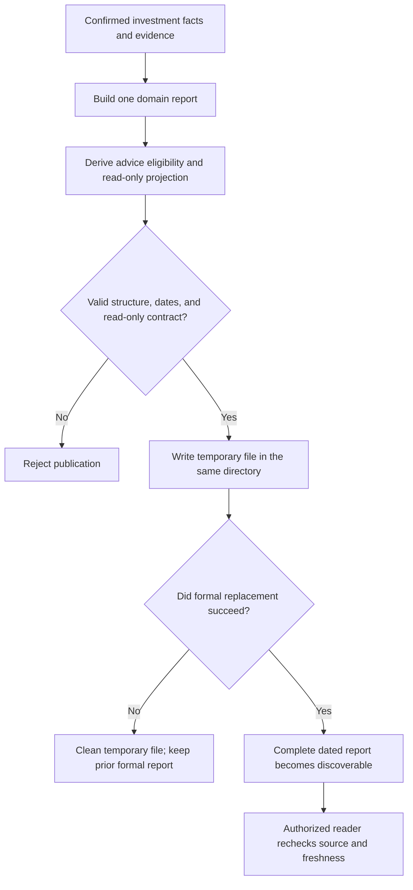

# Why Can't a Portfolio Report Be Written While It Is Still Being Calculated?

A portfolio report is generated in the morning with holdings, cash, market evidence, and fund contribution advice. A lightweight summary is generated later that same day. In the evening, an Agent opens what appears to be the morning's formal report—but it may now be reading the afternoon summary.

The file is not necessarily corrupt. Its JSON may be perfectly valid. The failure is that **the bytes no longer belong to the morning's run**. That is a report-identity and discovery problem, not a language-model hallucination.

ETF Agent encountered this type of same-day overwrite in a controlled temporary-directory and SQLite experiment. Formal report A was already represented in history. Lightweight report B then used the same dated filename and replaced A's file. A's historical path consequently pointed to B. The fix did not involve telling the model to be more careful. It separated the discoverable formal report from auxiliary output.

To understand why, first consider what a portfolio report is supposed to represent.

## 1. One report is not a collection of unrelated latest results

Portfolio research obtains holdings, cash, market prices, constraints, advice, and quality observations at different points in time. If each result is independently published as a "latest" file, a reader may accidentally combine Monday's holdings, Tuesday's valuations, and Wednesday's proposed amounts.

The private root investment system therefore uses one versioned `portfolio-report@1` contract as its canonical read model. This is not free-form investment commentary written by a model. It is a deterministic, structurally validated **domain snapshot**.

| Section | What it records | What it does not imply |
| --- | --- | --- |
| `actual` | Recorded holdings, cash, pending commitments, and presentation projections | Recommended transactions already occurred |
| `evidence` | Market sources, valuation coverage, data health, and limitations | Every investment conclusion is correct |
| `dca` | Contribution advice, constraints, and unallocated amounts | Funds have been debited |
| `plan` | A read-only projection from current facts | Holdings changed or a strategy was activated |
| `advice` | Eligibility tiers for general and amount-specific advice | The model may execute transactions |
| `quality` | Warnings and structural validation | Financial meaning and source truth are certified |

This design gives readers **one coherent publication unit while keeping the meanings of its sections distinct**. Recorded fund shares remain historical facts even when the corresponding NAV becomes stale. An exact purchase amount that depends on that stale NAV may have to be withdrawn. The producer must not erase the shares or leave a seemingly executable number in place.

The neighboring article on [deterministic fund allocation](./agent-deterministic-fund-allocation) explains how calculation rules determine eligible amounts. Report production has another job: assembling, validating, and publishing those domain results as a single identified snapshot.

## 2. "Today's report" contains several different dates

The following is an **illustrative excerpt**, not a complete `portfolio-report@1` document. Required sections are intentionally omitted to focus on identity and time.

```json
{
  "schemaVersion": "portfolio-report@1",
  "reportId": "synthetic-run-a",
  "evidenceVersion": "evidence:synthetic-run-a",
  "generatedAt": "2026-09-14T03:00:00+08:00",
  "reportDate": "2026-09-14",
  "snapshotDate": "2026-09-13",
  "plan": { "readOnly": true, "stateChanged": false }
}
```

At least four different time concepts appear in this process:

- **Generation time**, `generatedAt`, is when this report was produced.
- **Report date**, `reportDate`, is the `Asia/Shanghai` calendar date derived from that timestamp under the current contract. It determines the formal daily filename.
- **Portfolio baseline date**, `snapshotDate`, tells us which day's recorded investment state is being represented. A newly generated report does not magically update its baseline holdings.
- **NAV and source dates** belong to individual funds or evidence items. A top-level report date does not replace them.

The `reportId` associates the report with a particular production run, while `evidenceVersion` records its evidence identity relationship. Neither field is proof that the values are correct, and neither is automatically a cryptographic hash of the file's bytes.

If a reader shows only "today" and hides the older snapshot and NAV dates, a user could mistake an old valuation for a current executable amount.

## 3. Determine what the evidence permits before building the snapshot

The domain producer starts from recorded fund shares, confirmed investment facts, cash, and market evidence. During report assembly it determines valuation reliability and advice eligibility, then places the results into the appropriate sections. Being displayable must not automatically make a value eligible for trading advice.

Consider this **synthetic teaching scenario**, not a real account or a measured investment outcome:

| Fund | Recorded position | Valuation state | What the report should preserve |
| --- | --- | --- | --- |
| Alpha | 100 confirmed shares | NAV is within the applicable freshness window | Shares remain visible; amount advice is possible only if other rules permit |
| Beta | 80 confirmed shares | NAV is stale | Shares and the old date remain; ineligible precise amounts are withheld |
| Gamma | 50 confirmed shares | Only a labeled estimate exists | The estimate may be displayed under its own qualification, not silently promoted to an official NAV |

When a necessary budget or projection input is unavailable, the current producer can mark the read-only projection `unavailable` instead of inventing future share changes. When a fund loses amount eligibility, the corresponding unallocated budget must remain explicit rather than be silently redistributed.

The key distinction is between **what is recorded, what is projected, and what can currently be recommended as an amount**. The report does not write projections into the investment ledger. User confirmation and ledger mutation belong to a separate domain responsibility.

## 4. What does atomic publication actually protect?

After assembly, a decoder checks the report's version, required identities, date consistency, major sections, and the explicit `plan.readOnly = true` and `plan.stateChanged = false` flags. A structurally invalid candidate cannot be published as a formal report.

For a valid candidate, the current local-file writer follows a narrow sequence: **write a temporary file in the destination directory, rename it over the dated formal file, then return the path and report identity**.



*Diagram: domain production and read-side handoff. Atomicity here refers to visibility of the formal file replacement, not a transaction spanning the entire chain.*

A controlled interruption test throws immediately before the rename operation. The previous formal report remains readable and the incomplete temporary file is cleaned up. The important guarantee for a consumer is that it should not discover **half of the new report**.

This does not establish a distributed transaction across disks, databases, and messaging systems. File writing, renaming, and the subsequent report-history-store write are separate operations. Power-loss durability, concurrent-writer coordination, and deployment-specific filesystem guarantees require their own analysis.

## 5. The real lesson: an atomic replacement can preserve the wrong identity

The same-day collision is instructive precisely because the individual write steps can all succeed:

1. Formal run A writes `portfolio-2026-09-14.json`. A history record retains A's payload and file path.
2. Lightweight run B writes the same dated filename and atomically replaces A's file.
3. History still contains A's payload, but A's `sourceJsonPath` now points to B's bytes. Each object can be internally valid while **the relationship between them is wrong**.

The current fix writes lightweight results to a separate `lightweight/` subdirectory. Formal readers discover dated files directly under an approved canonical report root; they do not recursively treat helper output as root investment authority. B can no longer overwrite A's formal report through this lightweight path.

There is another distinction worth preserving: **a dated filename identifies the formally discoverable report for that date, not an immutable version for every run**. A later valid formal publication on the same date can still replace the canonical file. Historical run retrieval must bind to the appropriate saved record and verified content, not assume that an old path will always hold the original bytes.

Atomic replacement answers "old complete file or new complete file?" It does not, by itself, answer "are these the bytes from the run I intended to read?"

## 6. An Agent consumes the report through an authorized read-only path

After publication, the Agent does not scan arbitrary files or convert its own prose into ledger writes. The current private read path discovers reports inside configured approved roots, checks schema, date, and source-path conditions, builds a bounded read-only projection, and exposes it through existing investment-data MCP reading.

The reader has separate obligations. A structurally valid report may be too old for current advice. Recorded holdings may be describable even when a particular amount is ineligible. An estimated valuation must remain labeled rather than becoming an official NAV simply because a document was parsed successfully. The read projection retains `reportId`, `evidenceVersion`, and source identity, but the word "atomic" does not override those checks.

Three different decisions must therefore remain separate:

| Decision | Responsible part | What remains unknown |
| --- | --- | --- |
| Is the JSON complete and free from partial-file replacement? | Domain report producer and local file writer | Whether sources are true and fresh |
| Which values may this caller consume for this question? | Authorized reader and investment-domain policy | Whether the model will interpret them correctly |
| How should the user-facing answer be written and delivered? | Research model and answer-publication mechanism | Whether the user authorized a real financial action |

This is distinct from [saving and sharing Agent artifacts](./agent-artifact-version-access-sharing) and [publishing Agent answers](./019-agent-answer-publication). Those mechanisms govern research deliverables and user-facing text. This portfolio report instead gives the research system **a bounded, identified view of investment facts**, without creating another chat publication system.

## 7. Four failure cases to test before calling a report producer complete

The meaningful tests go beyond "the JSON file was created":

1. **Interrupted publication:** If a candidate fails before the final replacement, is the previous report still complete?
2. **Multiple same-day producers:** Can a formal run, a lightweight run, or a historical record accidentally resolve to one mutable path?
3. **Mismatched dates:** If the report was generated today from an older portfolio snapshot and NAVs, does the reader retain those distinctions instead of advertising current executable advice?
4. **Insufficient evidence:** When amount eligibility fails, are recorded shares, general research, an `unavailable` projection, and unallocated funds handled independently?

The private repository contains controlled tests and engineering records for structural validation, interrupted replacement, same-day output isolation, advice gating, and read-only consumption. Those checks support the mechanism described here; they are not statistics about real-world investment accuracy or production-grade crash recovery. The public [Open ETF Agent teaching repository](https://github.com/hpoenixf/open-etf-agent) does not expose this complete private root ledger and portfolio-report producer.

**A good atomic report is not JSON that can never be wrong. It is a report whose consumers can identify the producing run, understand the source dates, distinguish projections from recorded facts, and know what to recheck after publication or replacement.**
