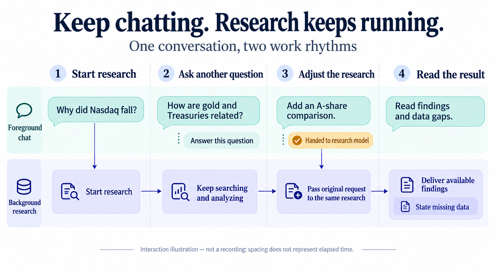
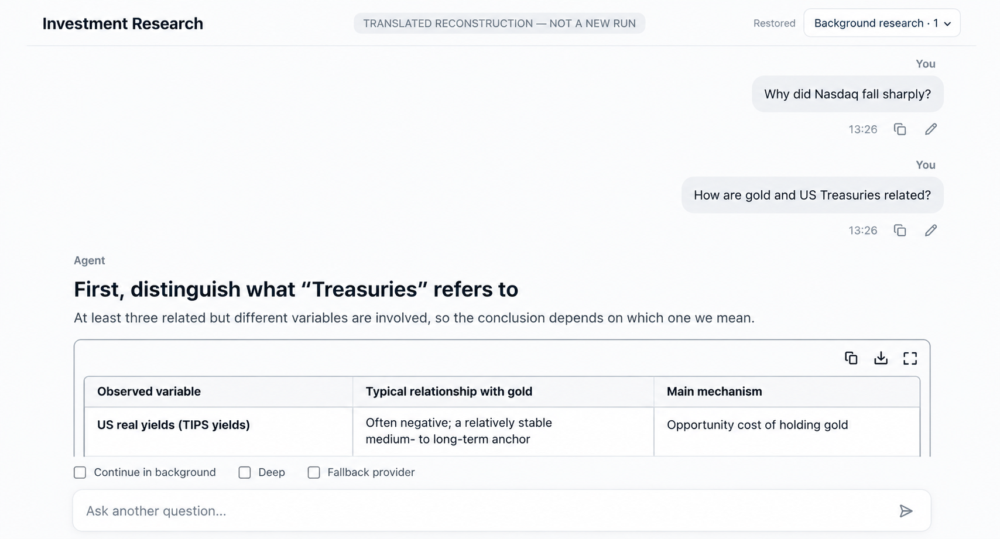
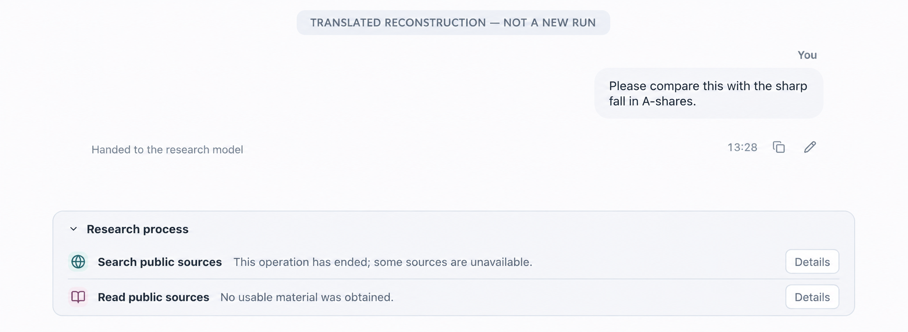
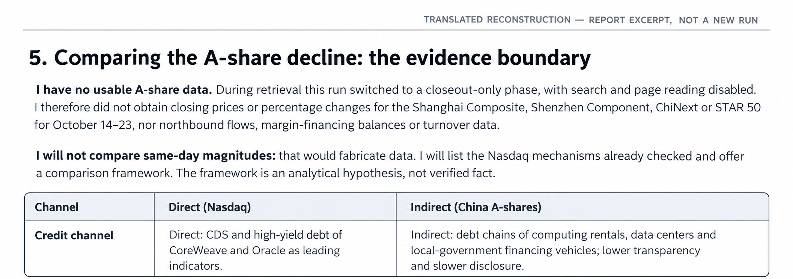

# Keep Chatting: Taking the Stop Button Out of the Way—Adding Async Background Research to an Agent in a Day

While using ETF Agent for research, I first asked, “Why did Nasdaq fall sharply?” Then I asked about the relationship between gold and US Treasuries. Partway through, I added, “Please compare this with the sharp fall in A-shares.”

Those three messages call for different behavior. The first starts research. The second can receive an independent answer. The third belongs to the research already in progress. A chat interface with one global “generating” state has trouble accommodating the latter two naturally.

This change addresses that interaction: research continues in the background, the foreground accepts new questions, and additional requirements reach the intended task. A background research control sits at the top right. The gold-and-Treasuries answer appears in the main conversation, while the A-share request receives a “Handed to the research model” receipt.

“Taking the Stop button out of the way” means users no longer have to stop the previous job just to keep chatting. They can still stop a task explicitly, using the control beside that research.

*Interaction illustration: independent questions receive separate answers; explicit adjustments go to the original research. Spacing does not represent elapsed time.*

The project already had tool calls, a research loop, answer publication, history, and recovery. That is the foundation behind “in a day.” This article describes connecting concurrent interaction to an existing agent. Building the research capabilities themselves took substantially more groundwork. Even with that foundation, we had to revisit message ownership, execution lifetimes, and result handoffs.

## 1. Personal agents are starting to work beyond a single exchange

[ChatGPT Pulse](https://openai.com/index/introducing-chatgpt-pulse/), introduced in 2025, presents personalized asynchronous research as a product capability: conversations, memory, and feedback inform updates prepared in the background and delivered later. The [Claude Cowork product page](https://claude.com/product/cowork) emphasizes delegation, visibility into progress, and the ability to redirect work while it is running.

Their implementations differ, but both address the relationship between ongoing work and immediate conversation. After a user gives a goal, the task may take a while. During that time, the user will still have other questions and may change the original requirements.

For a personal agent, this creates a concrete interaction requirement: distinguish “what I want to discuss now” from “what you are working on for me.” Long-term memory can retain preferences, and tools can expand execution capabilities. But if one research task monopolizes the input box, the user still has to work one task at a time.

Our existing background capability initially answered a different question: could research continue after the page stopped subscribing to updates? The frontend still organized input around a single `busy` state and the current Run—the identity of one execution. New messages during research tended to follow the existing correction path. Execution could outlive the page, but interaction still revolved around one current task. That was the starting point for this design.

*The research control remains at the top while the main reading area shows another answer. This is an English reconstruction of the relevant original screenshot, not a new run; unrelated sidebar conversations are omitted.*

## 2. Decide what can happen in one conversation

During design, we considered letting new messages preempt old answers, queuing short questions for serial execution, and introducing a persistent foreground agent to coordinate all the work.

Preemption preserves a single-task state, but asking a casual conceptual question would disrupt research already delegated. Serial processing reduces ordering problems, yet users still wait for the previous answer. A persistent foreground agent introduces another growing context and lifecycle that must coordinate with the existing research, control, and recovery mechanisms.

We chose to let one conversation contain several executions with independent identities. Short interactions have their own execution scope, while long research follows the existing research loop. The frontend continues accepting input, and each result remains associated with the message that initiated it.

That choice affects execution lifetime. HTTP connections and event streams deliver progress to the page; server-side records own accepted tasks. Switching conversations, collapsing a panel, or asking another question does not mean stopping research. A real stop must identify a particular task and go through its existing control mechanism.

It also limits what this change needs to add. We reused the existing Run, research adjustment, stop, continuation, recovery, and answer-publication mechanisms. We did not introduce a separate background-task ledger or results manager. The main additions are associations between original messages and tasks, available actions at the interaction entry point, and task-based page views.

Keeping those ownership boundaries has practical consequences. Refreshing can retrieve the original result. Stopping can reach the original execution. An adjustment can enter the original research. Every additional copy of “background state” would otherwise need a reconciliation rule when it disagreed with the underlying execution record.

## 3. A background task does not make the next message an adjustment

This is where interface state can easily obscure intent.

“Nasdaq research is running” and “the user is asking about gold and Treasuries” are both known facts. The former does not determine the meaning of the latter. Sending every new message to the research just because the page is busy conflates independent discussion with task adjustment.

The existing entry model still interprets ordinary input. We give it an appropriate action set based on current tasks and available capabilities:

| Input and context | Handling |
| --- | --- |
| Ordinary question, no active research in this conversation, and sufficient capacity | Answer directly or enter research |
| Background research exists and another research task cannot currently start | Answer directly, or propose inspecting, adjusting, or stopping existing research |
| User explicitly selects background research or Deep | Enter the existing research-preparation path directly, skipping ordinary route classification |
| Adjustment submitted inside a specific research panel | The target is already known; use the existing adjustment mechanism directly |
| Stop clicked for a specific research task | Send it directly to the control mechanism; no model interpretation is needed |

The coordinating operations in this table are called Coord in the implementation. Coord is one decision outcome of the existing entry point, not a new persistent agent. Ordinary questions without background work do not need an extra model classification just to support this feature. When background work exists, the entry point receives only the necessary task overview.

Natural-language references still need interpretation. If “change that one” has no clear target, ask a normal clarifying question. If the user requests another independent research task while background capacity is full, explain that it cannot be accepted. Do not silently reinterpret it as an addition to the old task.

Explicit background research and Deep also mean different things. The former chooses an execution mode; the latter expresses a preference for research depth. Actual resources remain governed by the existing budget mechanism. An explicit research request should not be downgraded to a short answer by the ordinary classifier, but neither should the system force unnecessary tool calls merely to look “deep.”

## 4. An additional requirement needs its original text and a handoff identity

Both the main conversation and a research panel can submit adjustments. They must converge on the same mechanism. Otherwise, one requirement can produce two revision records, and refreshes or retries make it hard to determine how many times it was delivered.

An ordinary message is saved through the existing path before reaching the entry model. If the model interprets it as a research adjustment, it proposes only the operation and target. The content actually handed to research comes from the saved user message. The model need not rewrite a “cleaned-up requirement” that might lose restrictions in paraphrasing.

The handoff record associates the source message, this entry decision, and the target Run. The source message stays in its original conversation position, and the research adjustment receipt references it instead of duplicating it as another user message.

This handles a familiar network problem: the server saved the adjustment, but the client never received confirmation. A retry should retrieve the same receipt. It must not invoke the entry model again and add another revision to the research.

A subtler case is a message containing both a question and an adjustment: “Narrow the research scope, and explain the Sharpe ratio.” The explanation can be delivered normally; the adjustment is reported according to its actual outcome. If the target task happens to finish before the adjustment can apply, the independently generated explanation should remain available.

*The additional message and handoff feedback stay in the conversation, while research has its own status. Translated reconstruction of the original screenshot, not a new test.*

“Adjustment received” and “Handed to the research model” therefore need different meanings. The first means the requirement was saved. The second means a subsequent model request actually included it. Whether the model adequately fulfilled it still has to be judged from the result.

## 5. Concurrent answers each use the context available when submitted

Once several questions can run concurrently, context can no longer be treated as a shared, continuously changing chat transcript.

Suppose two short questions arrive almost together, and the second answer finishes first. The page can display it immediately, but that must not make the first answer appear to have used the second. The input sent to a model was fixed when its request was submitted. Display order cannot change that input retroactively.

We use bounded history snapshots. A short interaction can see the committed history obtained for its request and permitted for use, plus the necessary overview of background tasks in the conversation. Uncommitted background analysis and complete tool traces do not all enter the short-question context simply because they appear on the same page.

Conversely, every casual foreground remark does not automatically enter the running research. Only explicitly handed-off adjustments reach subsequent model requests through the existing correction mechanism. In a separate live mechanism check, three short answers did overlap with background research. Their answer bodies did not appear in the background model input, while the original text of a targeted adjustment did. These are deliberately separate paths.

That also explains why references such as “What about the second option?” need care. If the referenced answer has not finished, that result is not available for interpretation. Ask or explain that there is no result yet, rather than deriving an understanding from a future page order that did not exist when the model ran.

A personal agent needs continuity, but that continuity must rest on messages that actually happened and results actually obtained.

## 6. Concurrency capacity and research budgets are different resources

The initial design configuration allowed three short interactions and one background research task. We explicitly discussed making these deployment settings, rather than constants scattered through the frontend and entry model.

At the same time, an initial limit of one background task must not hardwire the data model to “the only background task.” Task overviews, control targets, and result views remain organized as collections of Runs. That preserves identity relationships for later expansion. Actually allowing multiple concurrent research tasks still requires separate validation of capacity contention, recovery, and interleaved delivery; changing one number is insufficient.

There are three distinct resource limits here:

- How many tasks an account or personal scope can accept concurrently.
- How many requests, how much time, and how many tool resources a particular research Run has left.
- How many model requests the provider can currently accept.

All three affect whether work can proceed, but they measure different things. Permission to start one background task does not guarantee that a provider has a free slot right now. Raising the concurrency ceiling does not replenish an existing research budget.

Scope capacity must also span browser tabs, conversations, and service instances. Counting cards on one page, or keeping a counter in one process, is insufficient for actual admission. We therefore extended existing concurrency admission with persistent occupancy by task class, so the server can coordinate contention.

We did hit a bug here. In the first live concurrency observation, short-interaction capacity was available, yet a request was immediately rejected because of database lock contention. “Try the lock; return on failure” had turned brief transaction contention into apparent admission unavailability. The fix retained the existing transaction and client deadlines, allowing short transactions to serialize within a bounded interval. It waits for the admission-check lock; it does not quietly put user tasks into a research queue.

A short interaction that transitions into research also needs a handoff within the same Run. Background admission must commit before the original short-interaction occupancy is released. Releasing first and then requesting background capacity leaves inaccurate capacity records if the transition fails. Creating a new execution instead introduces duplicate-request and billing risks.

Stop buttons and explicitly targeted adjustment controls do not depend on short-interaction slots. Users must be able to control accepted research even when chat capacity is full. A natural-language request such as “Stop the previous one for me” still needs a short-interaction slot because a model must interpret it. That is a practical reason to retain direct controls.

## 7. The frontend must organize content by task, not by “the last answer”

With concurrency, adjacent questions and answers in a message array need not belong to the same execution. Convenient assumptions such as “the last assistant message” or “the latest Run” no longer hold.

The current view associates the original question, answer, tool progress, and controls through the Run. A later question can finish first and still be visibly tied to its own prompt. Late tool progress can update only the region belonging to its research task.

One concrete history handoff bug involved temporary answer rows. The page created a temporary row after sending a request. A later history read replaced it with the persisted message, but subsequent streamed content still targeted the temporary message ID. The body update could no longer find the correct row. The fix locates the current message carrying the answer through the original Run, while preserving the answer body's own publication identity.

Another problem occurred at completion. The completion signal had arrived, but the database result view had not yet caught up. If the frontend stopped observing immediately, the page could remain blank or appear to be running. We reused bounded, read-only follow-up reads to wait for the original durable record. Reading the result did not launch another model research task.

History reads themselves can also arrive out of order. An earlier request may return after a newer snapshot. Always trusting “the last response received” lets the old snapshot overwrite newer content. Page read sequence numbers prevent this overwrite, while the body and tool records continue to reflect server-returned facts.

When testing an asynchronous page, we deliberately make later questions finish first, let history replace temporary rows before streaming finishes, and return old reads last. Sending and completing everything in order rarely exposes these handoff problems.

The interface itself stays simple. A background control sits at the top, its expanded panel scrolls independently, and progress updates in place. The main conversation and background panel use the same research result rather than keeping separate copies of the body. Closing the panel changes only the view; the original task continues according to its own state.

## 8. Interrupting one request is different from stopping the whole research task

Adjusting ongoing research has another layer of complexity that the frontend cannot show: when a requirement arrives, the model may already be generating, or a tool request may already have been sent.

A new requirement cannot rewrite a request already submitted to a provider. The existing correction mechanism first saves the requirement, prevents outdated subsequent actions at permitted transition points, retains useful completed work, and includes the full requirement in the next model input. Eligible in-flight requests may be cooperatively interrupted, but whether the external request actually stopped and how much usage it incurred must remain recorded according to the actual state.

A later, separate live ETF comparison exposed a bug at this boundary. The adjustment had been saved and had interrupted the current model request. But an adapter reduced the interruption reason to a generic cancellation error. The runtime then entered a closeout-only phase. Research still had resources available, yet it lost the route for further retrieval and delivered only a partial result.

The failure crossed the boundary between one request and the entire task. The correction mechanism needed only to yield the current request, while the runtime treated it as a broader termination.

The current repair preserves the interruption reason recorded by the original correction mechanism, then continues research through existing admission for subsequent requests. A real user stop, deadline, or resource limit still takes precedence, and unknown usage from the old request is not erased. Engineering regression checks for this path have passed; full live-model acceptance on the original question is still in progress. That status is recorded separately from the experience shown in the earlier screenshots.

The design also distinguishes three actions that can all sound like “keep going”:

| Action | Handling |
| --- | --- |
| Add or change requirements while running | Handoff within the original Run, retaining its authorization and resource scope |
| Recover the same execution | Follow the original identity and checkpoint, preserving effects known to have happened, not happened, or remaining unknown |
| Explicitly request more work after research ends | The existing continuation mechanism checks eligibility and creates a related new execution |

If the original research ends before an adjustment reaches it, report that the adjustment could not apply. Do not automatically turn it into continuation or quietly redirect it to another research task. A late adjustment must not restart work after the user explicitly stopped it.

## 9. What this experience achieved, and what is still missing

Returning to the original example, the foreground explanation of gold and Treasuries can be read independently, and the A-share comparison request reached the original research. But the report did not obtain the A-share market and fund-flow data needed for a same-day comparison. It ultimately provided an analytical framework with explicit limitations.

*The adjustment was handed off, but the full data comparison was not completed. This English reconstruction translates the original report excerpt; it is not a new run or independent verification of the report's financial claims.*

That gap needs to remain visible. Interaction continuity is observable; whether research adequately answered the question still requires examination of retrieval and subsequent execution. The two are connected but have distinct failure modes.

While attempting to record another demonstration for this article, we also encountered full background capacity. The system explicitly returned that the new task was neither accepted nor queued. It did not replace the original task. An input box that keeps accepting new intent does not imply unlimited parallel execution.

The architecture discussion settled on concrete choices: the original task continues to own execution and results; the entry point interprets how new messages relate to it; control handoffs preserve original text and identity; and the frontend uses those same identities to organize content arriving at different speeds. Together, these support delegation, side questions, and adjustments within one conversation.

The next issues are the data gaps and whether research can complete the remaining work after an adjustment arrives. For the user, those issues should appear in the relevant task's progress and result, without requiring them to stop the entire conversation.

---

Further reading: [Async Research: Delivering on Time After Users Leave](agent-asynchronous-research-time-bound-delivery.md) discusses delivery timing and rereading results. [Keeping Progressive Answers Coherent](agent-progressive-answer-coherence.md) explains how an answer develops over time. This article focuses on intent, execution, and views in a concurrent conversation.

<!-- agent-article-sync:guidance:start -->
## October 26, 2026: Qualification and the Sidecar Boundary

The partial research outcome in the original demonstration remains a historical fact. A later **bounded real-path concurrent conversation qualification** has been completed and archived, confirming original foreground/background run identities and targeted correction behavior. This does not certify a complete source-grounded fund report with computation, artifacts and durable History.

The separate Sidecar reference chat aims to open a recoverable side conversation from Main. Only an **initially disabled Stage A integration baseline** is present; its A/B/C acceptance tasks remain open. Qualified ordinary concurrent interaction neither makes Sidecar available nor grants a second Main authorization or Publication owner.

## Further reading and discussion

Read this article in [English](https://hpoenixf.com/eff-agent-article/en/articles/agent-background-research-collaborative-experience) or [Chinese](https://hpoenixf.com/eff-agent-article/articles/agent-background-research-collaborative-experience) in ETF Agent Engineering Notes. If these engineering notes are useful, consider starring the [GitHub collection](https://github.com/hpoenixf/eff-agent-article) to follow future articles.
<!-- agent-article-sync:guidance:end -->
