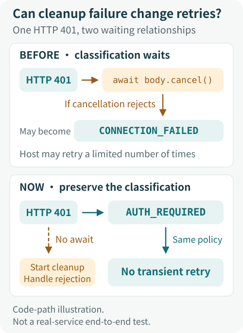
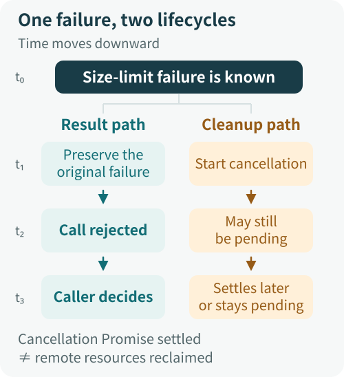
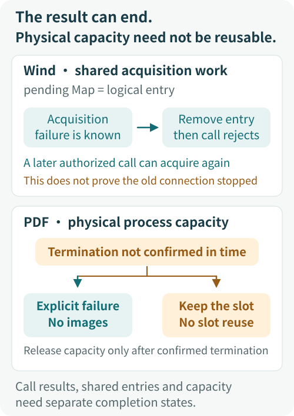

# The Failure Is Already Known. Why Hasn't the Call Returned? Cleanup and Result Ownership

A web response has already exceeded its size limit. A remote MCP server has already returned 401. What should happen next?

The intuitive sequence is simple: stop reading, release resources, then tell the caller that the response was too large or authentication is required. So the code runs `await cancel()` before throwing the original error. It looks responsible: a failure does not excuse leaving cleanup unfinished.

The problem is what “finished” requires. If cancellation never completes, the known failure cannot reach the caller. If cancellation itself fails, the caller may receive a different error and retry under the wrong classification.

**An `await` does more than order execution. It gives the awaited operation a say in when the result reaches the caller and which failure the caller receives.** Whether cleanup should have that authority depends on what the interface promises to complete.

We will trace this problem through ETF Agent's Web, MCP, and resource-management paths. The examples come from engineering fixes and controlled reproductions, with code simplified for teaching. They explain actual dependencies, rather than recounting production incidents, and do not imply that the public teaching repository contains the same implementations.

## 1. How Can a Reasonable-Looking await Prevent a Failure from Returning?

### Web size limits: the error exists, but the call is not finished

A size-limited web reader needs to bound bytes both before and after decompression, so a small compressed response cannot expand into an oversized body. Once a limit is exceeded, no more data is needed. Cancelling the read makes sense.

The old path's problem fits into three lines:

```ts
const failure = new Error("response too large");
await reader.cancel();
throw failure;
```

Whether execution reaches `throw failure` depends on the Promise returned by `cancel()`.

- **fulfilled**: the cancellation Promise completes successfully, then the size-limit error reaches the caller.
- **rejecting**: the cancellation Promise rejects, diverting execution before the throw; the cancellation error may replace the size-limit error.
- **pending**: the cancellation Promise has not settled, so execution stays at `await` and cannot deliver the error that follows.

Both failure modes have controlled counterexamples in the actual web-reading paths. The decoded-size limit branch directly awaited cancellation. A cancellation rejection entered the outer parsing-error handler, turning “response too large” into “invalid content format.” A separate encoded-byte limit path already used `.catch(() => undefined)`, but still stalled on pending cancellation.

The reason is that `.catch` can handle a rejection, but cannot make a pending Promise settle:

```ts
await reader.cancel().catch(() => undefined);
throw failure; // Still unreachable if cancel remains pending.
```

If the underlying cancellation never settles and there is no independent outer path for returning a result, the call can remain unfinished indefinitely. The failure is known, but cleanup's completion time keeps it trapped inside the function.

### MCP 401: cleanup failure can also change what happens next

An older remote MCP discovery flow had a less obvious version of the problem: after receiving HTTP 401, it cancelled the response body before classifying the failure as `AUTH_REQUIRED`.

With this ordering, classification comes after cleanup:

```ts
if (response.status === 401) {
  await response.body?.cancel();
  fail("AUTH_REQUIRED");
}
```

The 401 is already an established HTTP fact, but the classification function has not run. If cancellation rejects, an outer layer may see only a generic connection exception and classify it as `CONNECTION_FAILED`. If cancellation hangs, the authentication failure also fails to reach the caller promptly.

Error classification here is more than message text. The existing Host makes a limited number of retries for `TIMEOUT` and `CONNECTION_FAILED`; authentication failures are not treated as those transient errors. A cleanup exception can therefore turn “fix the authentication” into “try connecting again.”

The current fix preserves the existing HTTP decisions, permission constraints, and retry rules. It only stops response-body cancellation from blocking the original classification. The HTTP response determines what 401 means; the outcome of cleaning up its body should not reinterpret it.

<figure class="diagram-frame diagram-static">
  
  <figcaption>Figure 1: A cleanup exception can change the upper layer's retry decision, not just its error message. The old path shows only the cancellation-rejection branch. <a class="diagram-original" href="../../visuals/en/cleanup-result-ownership/http-classification.svg" target="_blank" rel="noopener noreferrer">Open the full-size diagram</a></figcaption>
</figure>

## 2. How Did Cleanup Acquire Authority It Should Not Have?

These paths usually contain no extra policy decision or conspicuous `deny`. The authority is hidden in what must be awaited.

### Waiting dependencies determine when a call returns

As long as the caller must wait for cleanup to finish, cleanup can delay the result. Putting it in `catch` leaves that ability intact. Moving it to `finally` does too: an asynchronous function must finish executing `finally` before it completes, so a wait there remains part of its return path.

JavaScript's [`Promise.prototype.finally`](https://developer.mozilla.org/en-US/docs/Web/JavaScript/Reference/Global_Objects/Promise/finally) has a similar contract. A Promise returned by its callback is awaited; if the callback throws or returns a rejected Promise, it also changes the downstream outcome. Running regardless of success or failure does not guarantee leaving that success or failure unchanged.

### Exception propagation determines which failure the caller receives

A size-limit violation, authentication failure, or connection timeout happens first; a cancellation error follows. Which one should become the caller's primary failure depends on the interface's semantics.

When rejecting an oversized response, the byte count is already enough to make the decision. A cleanup error can be recorded as a separate observation, but there is no reason for it to turn that decision into a format error. For an interface that promises “the resource is closed,” however, failure to close may be the primary failure. An error should not be swallowed mechanically just because it occurs inside `catch`.

### The failure received also affects retries and fallback

The MCP example shows how replacing an error changes control flow. The reranking path for the local TEI service has a related boundary.

Reranking is an optional retrieval step. After reading an oversized response, the adapter should return that failure so the upper-level Retriever can follow its existing rules: preserve candidates and citation identities, and fall back to deterministic ordering. The old size-limit branch had already issued `abort`, but still awaited `reader.cancel()`. Issuing an abort signal does not automatically settle another Promise.

After the fix, this cancellation Promise no longer delays the adapter's original size-limit error, and the adapter releases the read lock it holds. This does not imply that the entire old retrieval operation could hang forever: the Retriever already had an independent deadline. The precise change is that the adapter can return control at the known failure, without making its caller wait for a separate outer deadline to intervene.

### A shared wait can carry one failure into later calls

Wind MCP connection acquisition combines concurrent requests for the same endpoint into one `pending` Promise to avoid duplicate connections. Acquisition already has a timeout: the connection and a timer compete through `Promise.race`.

But the timer winning only means that this race has ended. It does not mean the entire enclosing function has finished. After catching a connection failure, the old path continued to await `client.close()`. Only afterward could it enter `finally` and delete the endpoint's `pending` entry.

The sequence could therefore be:

1. Connection acquisition times out. The primary failure is known.
2. Execution enters `catch` and waits for close, which remains pending.
3. `finally` has not run, so the shared acquisition entry remains.
4. A later call for the same endpoint finds that old entry and keeps waiting on the same acquisition, which has failed internally but has not delivered its failure.

**The timeout covered only the race. Cleanup then added another, unbounded wait.**

The current path starts closing and handles any close failure without awaiting the close Promise. It then throws the original acquisition error and removes the failed shared entry. A later permitted call can therefore acquire a connection again. This does not add automatic retries or prove that the old connection has terminated remotely.

## 3. How Should Result Settlement and Resource Cleanup Be Separated?

Start by separating three facts that are often conflated:

- **The failure is known**: the code has enough information, such as a byte count that exceeds the limit.
- **The call has settled**: the caller's Promise has fulfilled or rejected, allowing the caller to proceed.
- **The resource has been reclaimed**: the relevant conditions for releasing the resource have been confirmed.

Knowing the first does not mean the second has happened. The second does not automatically prove the third.

For an interface whose job is to read a response that meets its limits, exceeding the limit is enough to reject the result. It should still make a best effort to clean up its response body, but it does not need to make completion of the underlying cancellation an additional prerequisite for reporting the size-limit failure. The current fix can be illustrated as follows:

```ts
// Teaching example: illustrates error-path control flow, not a new cleanup framework.
function startCleanup(cleanup: () => Promise<unknown>): void {
  try {
    void cleanup().catch(() => {
      // Record cleanup failure separately if needed; do not overwrite the primary failure.
    });
  } catch {
    // Also handle cleanup implementations that throw synchronously.
  }
}

if (tooLarge) {
  const failure = new Error("response too large");
  startCleanup(() => reader.cancel());
  throw failure;
}
```

This example distinguishes three actions: starting cleanup, handling cleanup rejection, and not waiting for cleanup to finish. Using `void` without a rejection handler can leave an unhandled Promise rejection. Adding `.catch` while keeping `await` still waits. Synchronous throws need separate protection as well.

If the cleanup function blocks synchronously before returning its Promise, this pattern cannot make it non-blocking. It removes the wait for Promise settlement; it does not automatically isolate the execution cost of arbitrary code.

<figure class="diagram-frame diagram-static">
  
  <figcaption>Figure 2: Observe call settlement separately from cleanup-Promise settlement. Neither alone proves that remote resources have been reclaimed. <a class="diagram-original" href="../../visuals/en/cleanup-result-ownership/lifecycles.svg" target="_blank" rel="noopener noreferrer">Open the full-size diagram</a></figcaption>
</figure>

The two lifecycles describe two completion conditions. They do not require a new, centralized cleanup manager. The current fix stays within the existing call paths: deliver the result promptly and treat the cancellation Promise's later behavior separately.

[WHATWG Streams' underlying cancellation semantics](https://streams.spec.whatwg.org/#underlying-source-api) already distinguish the consumer no longer needing data from the completion of underlying cleanup. Cancellation failure is expressed through the Promise returned by the cancellation operation; it does not turn an already-closed stream into an errored stream. Even if the stream is closed locally, whether the remote service has stopped computing still requires different evidence.

### Waiting for cleanup is valid when the completion contract requires it

Some interfaces promise that, by the time they return, child tasks have ended and related resources are no longer occupied. Waiting is then part of the contract rather than an unnecessary burden.

For example, Python's official documentation explicitly states that [`asyncio.wait_for`](https://docs.python.org/3/library/asyncio-task.html#asyncio.wait_for) waits for the task to actually be cancelled after a timeout, so the total wait may exceed the configured timeout. This chooses stronger cancellation-completion semantics. Waiting alone does not make it a design error.

Another option is to give cleanup its own bounded waiting window. This suits an interface that wants to confirm reclamation where possible without blocking indefinitely. But it must define what expiry means: it can mean “cleanup outcome unknown,” not automatically “resource released.” That window also adds to call latency.

The key review question is therefore: **When this API returns, does it promise that the operation's result is known, or that resource reclamation has also been confirmed?** Answer that first, then decide whether to await cleanup, give it a bounded wait, or separate it from result delivery.

## 4. What Should an Owner Be Responsible For?

Here, an Owner is an existing component that has the evidence to make a particular decision and is responsible for it. Clear responsibility boundaries do not require routing every error through a larger Manager.

In the paths above, responsibilities can be separated according to the facts each component holds:

- The reader knows the byte count and decides whether this response exceeds the limit.
- MCP discovery knows the HTTP facts and delivers the correct authentication- or connection-failure classification.
- The Host decides whether to retry under the existing policy; the Retriever decides how to fall back when optional reranking fails.
- The lifecycle of a task execution, or Run, has the overall execution facts and decides whether to continue, wrap up, or terminate.

Cleanup handles the resources it is authorized to dispose of. Being on another component's return path should not give it incidental authority to rewrite that component's decisions.

### Wind's logical slot can be released; PDF's physical slot may not be ready

“Release the slot as soon as a failure occurs” sounds like a general rule. But different slots represent different promises, and need different rules.

Wind's `pending` entry identifies the connection acquisition currently shared by calls for one endpoint. Once that acquisition has failed, the shared wait should end. Removing the entry does not confirm the old connection's physical state.

The concurrency slots for PDF image rendering constrain actual worker processes. If an old process is still running when its slot is given to a new one, the reported concurrency can remain within the limit while real resource usage overlaps.

That rendering path therefore takes a different approach: terminate the worker, confirm that the child process has closed and the process group is gone, then return capacity. If it cannot confirm those conditions within the established deadline, it returns “cleanup unconfirmed,” delivers no image, and keeps the corresponding slot occupied. Later requests may be unable to obtain that capacity. The cost is real, but it preserves what the resource limit means.

This is compatible with separating results from cleanup. **A failure can reach the caller within a bounded time while resource capacity remains marked unavailable.** The call result, the shared waiting entry, and physical capacity cannot be collapsed into one “done” flag.

<figure class="diagram-frame diagram-static">
  
  <figcaption>Figure 3: Both are called slots, but they represent different promises. Ending the wait for a result does not make unconfirmed physical capacity safe to reuse. <a class="diagram-original" href="../../visuals/en/cleanup-result-ownership/slot-contracts.svg" target="_blank" rel="noopener noreferrer">Open the full-size diagram</a></figcaption>
</figure>

### Entering finally does not confer ownership of shared resources

There is another question to check: who is entitled to perform cleanup?

Controlled counterexamples in an existing Run resource path showed the following behavior: a second attempt to enter the same Run was rejected by the execution lease, or an old executor's lease had expired, yet the outer Factory still cleaned up shared PDF references and cursors in `finally`. That executor was exiting, but the valid executor was still working.

This error has nothing to do with awaiting cleanup. Even instantaneous cleanup would remove the wrong resources.

The fix puts the basis for shared cleanup back in the existing Session. Only an executor that passes the lease-fencing check and successfully obtains a terminal or cancellation outcome proceeds with the corresponding shared-resource cleanup. The Factory can still reclaim the exclusive workspace it allocated for this invocation; a borrowed workspace remains the caller's responsibility.

The fencing check verifies that the executor's authority is still valid, preventing a stale executor from continuing to affect its successor. Creating a resource first does not mean an object retains disposal authority forever. Reaching `finally` does not give it ownership of every resource in the Run, either.

### A local result and termination of the entire Run also have distinct boundaries

Cleanup should not overwrite an already-established durable result, and a local module should not independently declare the entire Run finished on the strength of one failure. The first protects the result as a fact; the second protects the scope of the decision.

[When Every Module Can Say “No”](./agent-veto-authority-and-run-termination.md) discusses the division of responsibility among local refusals, stage budgets, and Run termination. This article looks one layer deeper: even without an explicit veto, a waiting dependency can let a local cleanup step block result delivery.

The current Run path still contains awaited cleanup calls. Their exceptions do not overwrite persisted results. That is a different claim from saying that every Run return path is now unaffected by cleanup delays, and the two should not be merged into a claim that Owner boundaries have solved cleanup everywhere.

A meaningful Owner boundary must at least answer three questions: which facts support my decision, which resources may I dispose of, and am I still entitled to dispose of them now?

## 5. How Do You Verify That the Fix Works?

The easiest problems to miss often hide behind overly cooperative test doubles. If every `cancel()` and `close()` succeeds immediately, error paths always look straightforward.

Exercise the same operation-level failure path with three cancellation behaviors:

| Cancellation behavior | Key question to verify |
| --- | --- |
| pending | Can the primary failure reach the caller while cancellation is still pending? |
| rejecting | Does the caller still receive the original failure and classification? |
| fulfilled | Does normal cleanup preserve behavior that was already correct? |

RED→GREEN should demonstrate a specific behavioral change: run the same negative case against the old code, observe the assertion fail, then make the fixed code satisfy the same assertion. A short watchdog detects that the original failure has not yet been delivered; it is not a production latency promise.

The historical negative cases do not make every cell in the matrix red. The Web encoded-size branch already absorbed cancellation rejection; its failure was the wait on pending cancellation. The decoded-size branch also exposed error replacement. In the MCP HTTP-failure matrix, the fulfilled control already passed; pending and rejecting distinguished the fix. Wind's old path also already protected against close exceptions. The important new counterexample was a hanging close that prevented acquisition from settling.

These differences explain why positive controls matter. Tests must detect the new problem while also showing that behavior which was already correct has been preserved.

### Assert while cleanup is still pending

There is an important sequencing detail in a pending test: control a cancellation Promise that the test can release, observe the primary failure first, then release cancellation. Do not settle the cleanup Promise early just to let the test exit, and only afterward assert that the operation has finished.

For Wind, also start a later valid acquisition while the old close remains pending, and verify that it does not keep reusing the failed shared wait. Let the old connection complete late, then verify that it cannot overwrite the cache established by a later successful acquisition. Cancelling one waiter should not cancel a connection that other waiters are still sharing.

For PDF, the capacity assertion goes in the opposite direction: until termination is confirmed, later work must not use that same capacity. A cleanup rejection should return cleanup-unconfirmed and retain the occupied slot.

Also check that cleanup starts as expected, the original failure is preserved, read locks are released, and permissions, byte limits, and existing retry rules are unchanged. These observations explain the fix better than a total count of passing tests.

### Keep claims at the layer the passing tests establish

The MCP HTTP-failure tests run through a real installed SDK, but the responses and response streams are constructed by the tests. Wind's connection and close behavior is controlled by an SDK test double. These tests can check waiting dependencies, classification, and shared state in the corresponding call paths. HTTP classification and the Host's retry rules are tested separately; the 401 discovery path and the Host have not yet been combined to verify the complete retry chain.

More importantly, **the primary failure reaching the caller does not mean resource reclamation has succeeded.** Calling cancellation, aborting a signal, and releasing a read lock each prove their respective local fact. Determining whether a remote request has terminated or resources continue to accumulate requires independent observation of cleanup completion and evidence from the relevant running environment.

This is also the cost of separating results from cleanup. Cleanup no longer holds up the result path, but unfinished cleanup still exists. If prolonged uncertainty about reclamation affects capacity, keep tracking it rather than treating a Promise that is no longer awaited as work that no longer exists.

Returning to the opening `await`, a code review can follow three questions:

1. If cleanup stays pending forever, can the already-known failure still reach the caller?
2. If cleanup rejects, can it rewrite the primary failure, change the retry classification, or prevent later calls from proceeding?
3. After removing the wait, are unconfirmed physical resources, external effects, or shared ownership being mistakenly treated as released?

**Let results settle promptly and accurately while preserving the true state of cleanup.** Keeping these responsibilities separate gives callers the authority they should have, without letting resource constraints quietly disappear behind a `void`.
