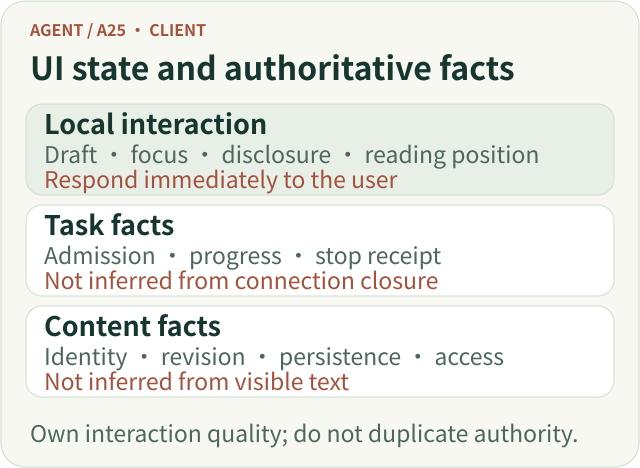
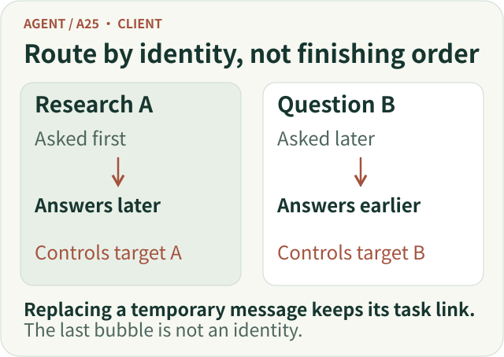
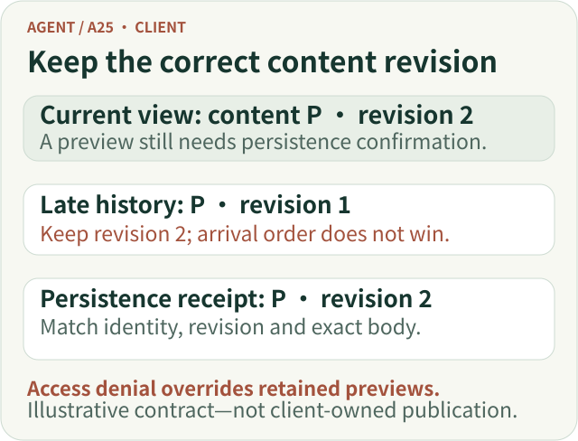
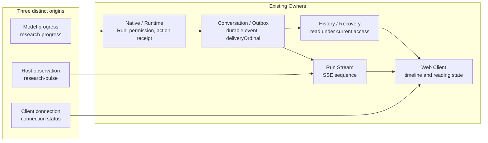

# An Agent Client Is More Than an SSE Renderer: Presenting Research Progress Truthfully

A user starts a fund comparison and text begins to appear. They then ask a short, separate question, refresh the page, open a citation when they return, and eventually decide to stop the comparison that is still running.

Each action is ordinary on its own. The problems emerge when they form one interaction: which question should a late answer appear under? Can a history response overwrite content already seen? After clicking Stop, should the interface say “Stopping” or immediately announce “Stopped”? And when research lasts several minutes, who is actually saying “Still researching”?

**The central job of an Agent client is to keep user actions, task progress and research results correctly associated.** SSE is one transport for updates. Receiving strings in a browser does not mean a research task has been presented correctly.

We follow three steps: establish task and content identity, handle user actions and reading, then examine progress and reconnects during long research. The first half develops general client-side judgments; the second uses ETF Agent's concrete mechanisms to explain the trade-offs.

## 1. The Client Needs Its Own State—but Cannot Declare Facts Owned Elsewhere

Start by separating transport from application semantics. SSE carries server events to the browser over a persistent connection, while `EventSource` provides event reception and reconnection behavior. The application still defines task ownership, answer revisions and whether an operation took effect. Those questions remain if the transport changes to polling or WebSocket.

A clear organization separates two kinds of state: **the client maintains interaction state; the server supplies task and content facts.** Drafts, dialogs, scroll position, the selected task and pending actions belong to the first category. Task creation, durable answers and current access to material belong to the second.

Clicking Send can immediately show that a message is being submitted. Whether a research task has been created depends on admission. Clicking Stop can disable repeated clicks and show a pending request; the request itself does not prove that the original research has stopped. The client can open a citation detail and manage focus, but that interaction cannot decide which material the current user is entitled to read.

| Visible interaction | What the client owns | What the interaction cannot establish |
| --- | --- | --- |
| Compose and send | Preserve the draft; present submission and failure states | The message was admitted or a task was created |
| Control a task | Target the specific task, send the action and display its receipt | Sending the request means the action has finished |
| Update the answer | Reconcile revisions of the same content and preserve reading continuity | Visible text has already been durably saved |
| Reopen history | Read the original result under current access rights | Cached content still carries permission to read it |
| Inspect a citation | Present authorized material, its version and limitations | A citation certifies the conclusion |

In the existing architecture, answer publication, conversation events and historical delivery, source access and citation eligibility each have their own responsible owners. The client consumes those facts and organizes an operable reading interface; it does not reassess publication eligibility or certify research conclusions.

*Responsibility sketch: respond promptly to interaction while reading task state and content eligibility from their original facts.*

[Open the full-size vector figure](../../visuals/en/a25-client/m-boundaries.svg)

## 2. Associate the Answer with Its Run, Then Reconcile Revisions

When answers can finish out of order, “the last message” is no longer an identity. A Run is one admitted task execution, not the entire conversation. A short question may finish first while the original research continues; each must find its answer through its own Run.

ETF Agent's concurrent interaction work encountered a case where a temporary answer row was replaced by the persisted History message, while later stream updates still targeted the old temporary ID. The repair was not to create another copy of the answer, but to follow the original Run to its current message identity.

*Identity sketch: completion order can change; questions, answers and control targets must not become misaligned.*

[Open the full-size vector figure](../../visuals/en/a25-client/m-identity.svg)

The same answer may also be revised repeatedly. If the page already shows revision two of answer P and an earlier History request returns revision one, the old content must not replace the new just because it arrived later. Conversely, a reader who explicitly opens historical revision one should not be silently upgraded to the latest version.

**Reconciling a current view and browsing a historical version are different actions.** If a preview is visible before its persistence receipt arrives, the client may retain it temporarily within the same Run and reading scope while it verifies the result. Only matching durable facts can confirm persistence. Explicit access denial takes priority over preview retention.

*Reconciliation sketch: compare revisions of the same content object; explicit access denial takes priority over preview retention.*

[Open the full-size vector figure](../../visuals/en/a25-client/m-revisions.svg)

## 3. Keep Actions and Reading Continuous

### Preserve the reading position when updates arrive

As long research produces answers and progress updates, two details can interrupt reading:

- New progress should not force-scroll someone who is reading an earlier answer to the bottom. Preserve their reading position and offer an entry point to the new update.
- When a temporary assistant message identity is replaced by its persisted identity, the same Run's “Research process” disclosure should not reset. A different Run should keep its own reading state.

### Follow the receipt for each send, amendment and stop

When a user starts an amendment from a specific research panel, the client already knows the target and should carry the exact Run and context forward. It should not make the model guess what an explicit UI action means. Clarification is needed only when the user starts from a global input and the target is genuinely ambiguous. This keeps “adjust the original research” distinct from “ask a new question,” even when the wording is similar.

Receipts should describe what actually happened. “Requirement received” establishes admission. “Passed to the research task” establishes a later handoff. “Report updated accordingly” needs support from the result. Collapsing those stages into “Done” creates misleading reassurance.

An acknowledgment for an earlier message must not clear a newer draft. Clicking Stop can first show a pending request; it cannot announce that the task has stopped. The page should respond promptly, while final status follows the receipt for that particular action. Stopping generally affects subsequent work; it does not undo actions that already occurred or delete a saved answer.

### Keep citations and focus aligned with the content

After an answer revision, citation details must remain bound to the correct version. A citation opens an inspection path; it does not certify the claim.

Keyboard and touch interaction are part of this reading chain too. A disclosure should expose its expanded state; a dialog should handle focus entry, closing and return to its trigger. Users do not need to learn internal Runtime terminology, but the task, content and next action must remain aligned.

## 4. Distinguish Three Signals During Long-Running Research

| Signal | Producer | What it can express | What it cannot prove |
| --- | --- | --- | --- |
| Model progress `research-progress` | Proposed by the model through the original Native Tool, then admitted by Runtime | “AI progress (not independently verified)”: what the model believes it is doing | That sources were fully read, calculations are correct or research is a certain percentage complete |
| Transient Host status `research-pulse` | Emitted by the original Run/Stream from currently observable facts | “System status”: a recent observation or an explicit unknown | That the model is thinking right now or the task will finish |
| Client connection status | Observed locally by the browser | “Connection status”: reconnecting or temporarily unable to obtain updates | That the server has stopped, cancelled or completed |

### When no new message arrives for a while

A model request or tool call may take a while, leaving the page without a new model-authored update. The easiest mistake is to keep showing “Researching,” or to call the model again periodically just to produce “Still working.”

We chose a more conservative approach. While the original Run's viewing stream remains attached and no meaningful visible status has arrived, the Host may emit a transient observation about every 30 seconds. If it cannot establish the current stage, it says “Current execution status unknown” rather than guessing what the model is thinking.

This Host pulse differs from model progress:

- It comes from facts the system can currently observe, not from model-authored prose.
- It enters the original Run Stream event queue; it does not create a second sequence owner.
- It is transient and is not written to the Outbox or History. Reconnecting does not replay heartbeats the user missed.
- It does not trigger another model request or consume additional research budget.

The HTTP `: heartbeat` sent every ten seconds therefore remains transport maintenance. The user-visible `research-pulse` is a system-status observation. They must not be treated as the same event.

Stop, park, human-interaction wait, cancellation, termination or the end of the viewing connection must fence off later transient status. A browser connection notice says only that the client cannot currently obtain updates; it does not infer that the server has stopped.

## 5. From Model Proposal to Visible Row: Four Facts and Two Orders

In ETF Agent, a model-authored update follows the existing execution and delivery path through four stages:

1. **Proposed:** The model submits bounded text through a controlled tool. This is still a model-authored statement.
2. **Admitted and settled:** The original Runtime checks the Run, permission, display eligibility and terminal state. The original action path settles the effect and obtains a stable `updateId`.
3. **Durably committed:** Conversation/Outbox stores the event and assigns its durable order, `deliveryOrdinal`.
4. **Displayed live:** The attached Run Stream sends it over SSE, and the client projects it as a timeline row.

The page should show the stage supported by the available receipt. A missing step remains pending rather than being inferred from the interface.

Deduplication must also follow effect identity. Two `kind=progress` events with different `updateId` values are two independent statements. A retry is the same effect only when it uses the same identity and the same sealed request. If `runId + kind` remains the unique slot, “what we checked first” and “what we discovered next” collapse into the last sentence. History overwritten under the old contract cannot be reconstructed by a newer protocol.

Two orders must also remain distinct:

- **Durable order:** the original Conversation assigns `deliveryOrdinal` to committed model progress. History uses it to restore genuine records after reopening.
- **Live order:** the current Run Stream event queue assigns `sequence`. It orders events only within that connection. A new connection after reconnecting may start its sequence again, so it cannot be treated as a global history cursor.

The transient Host status described earlier uses only live ordering, so it has no durable record to replay after disconnection.

Each order serves a concrete promise: ordered delivery within the current connection, and restoration of durable events after reopening.

## 6. The Hardest Race: History Arrives Later but Describes an Earlier State

Consider a race that was explicitly tested. The browser starts a History request. SSE then delivers and displays a new progress row. The History response arrives later, but does not contain that row.

Its absence may mean the snapshot began before the event was committed. It may also mean that the original identity or current permission no longer allows the content to be displayed. **Absence alone proves neither “this never happened” nor “this remains permanently valid.”**

Replacing the entire view with History would erase legitimate live progress. Trusting every SSE message ever displayed would risk leaving revoked content on screen.

The implemented approach is narrower. After the original SSE send guard succeeds, the transport may issue a short-lived, process-local receipt for that exact conversation, scope, Run, durable ordinal and payload. If a later History response omits the row, the client performs a bounded check of **that exact receipt already shown to the user** with the original authority. It cannot query arbitrary text or guessed IDs, and it does not create a second permission Owner.

| Verification result | Current-view behavior |
| --- | --- |
| Original identity and content still match | Keep the row |
| Explicitly no longer current, or receipt invalid | Remove only that row; leave independent answers and other Runs alone |
| Unknown, timeout or network failure | Retain the already-visible row only within the current Run and reading generation, pending a later genuine History observation; do not turn it into permanent permission |

A receipt comes from the current process and may no longer be verifiable after a server restart. That does not necessarily mean the content was revoked; a later authorized durable History read can independently display the original event. A late verification result also cannot cross cancellation, termination, account switching or a newer reading generation to resurrect an old row.

There is another easily missed provenance problem. A second research turn may really include the first turn's answer in its model request. That alone does not prove that every source, version and attachment carried with the answer has the same display eligibility. A source ID by itself, or the fact that History returned some text, is not enough to prove complete lineage.

The repair stayed with the original History → actual request fitting → new Run source association. Only when the original identity, version and actual inclusion in the current request were established by their existing Owners could the corresponding progress be displayed. Other materials remained unknown. The lesson is that **a statement about the research process can itself depend on source identity; saved history does not prove that this request used it completely and legitimately.**

Most importantly, optional progress verification must not hold an independent answer hostage. Even if one progress row cannot yet be confirmed, an independently authorized formal answer should still be delivered. Progress serves the research; it must not become another termination authority.

## 7. Progress Collaboration: A Distinct Capability, Not New Execution Authority

Two concepts need to be distinguished: a **capability** describes what the user can do or understand; an **Owner** has final authority over a particular fact or effect. In ETF Agent's architecture, a module is not merely a file or directory. It is a complete capability and the final owner of its effect.

Progress deserves its own domain semantics: signal origins, event identity, ordering, visibility and presentation rules. But it does not have an independent effect outside the original Run lifecycle that needs to own admission, persistence, recovery and termination. It is therefore a cross-cutting capability, not another Progress Manager.

The existing responsibilities remain:

| Existing responsibility | What it owns | What Progress does there |
| --- | --- | --- |
| Model / Native Tool | Research strategy and controlled tool proposals | Proposes a short update; does not send SSE directly |
| Runtime / original Action Owner | Run identity, permission, terminal fences and action settlement | Checks the current Run and display eligibility; issues the original action receipt and `updateId` |
| Conversation / Outbox | Durable events, idempotent identity and historical delivery | Persists admitted model progress with a `deliveryOrdinal` |
| Run Stream | The current connection's event queue and `sequence` | Sends both model progress and transient Host status |
| History / Recovery | Reading and restoring facts under original identity and current access | Restores genuine durable progress on reopen; does not invent missed transient heartbeats |
| Web Client | Interaction, timeline and reading state | Labels origins and reconciles visible content for the same Run |

This is one capability crossing existing Owners, not a new module taking over the chain:

*Figure 1. Progress is a capability contract across existing Owners; model progress, system observations and client connection state do not share the same authority.*

These Owners already govern admission, event identity, persistence, terminal fences and history on reconnect. A new Progress Manager would duplicate their decisions or centralize responsibilities that are already clear. An independent module becomes worth reconsidering only if Progress gains its own lifecycle, cross-product subscribers, or independent retention and query policies.

## 8. How the Mechanisms Evolved, and What Was Verified

The mechanisms accumulated as concrete problems emerged; the entire design was not needed at the outset:

| Stage | Problem encountered | Resulting design choice |
| --- | --- | --- |
| October 10, 2026 | Long research lacked a sense of elapsed time and a way to express progress | Reminders enter the next authorized model request; the model proposes updates through `send_research_update`; asynchronous delivery stays with the original task and notification path |
| October 25 | Same-kind updates were overwritten across Native pending state, event collection, Memory/PostgreSQL identity and Web projection; earlier updates waited behind later slow tools | Retain each admitted update's independent identity and deliver it promptly, in order, through the original event chain |
| November 2–3 | All three updates had appeared, yet late History could erase a row; prior display did not establish permanent access | Separate live delivery, persistence and current readability; add bounded verification of the original receipt |

The initial 3/5/8-minute milestones were soft reminders. Later fixed thresholds were consolidated under the existing reminder Owner; they are not current hard limits. Time reminders do not cause extra model calls, or turn progress text into a formal answer or a completion decision.

### What was actually observed

Validation interleaved the original Native, Conversation, HTTP/SSE, isolated PostgreSQL, History and browser paths in one local controlled journey. A scripted model and synthetic material covered ordered display of multiple progress updates, long waits, History readback and recovery, concurrent Runs, uncertain connection state, narrow viewports, keyboard operation and non-forced scrolling. In one foreground wait lasting more than 95 seconds, the page displayed three Host unknown-state observations about 30 seconds apart. A separate controller test confirmed that Host pulses did not trigger additional model requests.

These observations support identity, ordering, readback and presentation within the tested path. They do not establish real-model text quality, production database or latency behavior, or increased user confidence. They are not evidence of a production deployment; screen-reader and speech-output acceptance remain untested.

### What the public teaching code demonstrates

The fixed Open ETF Agent v0.21 cited here provides local, single-user, ordinary sequential human interaction: questions and answers remain associated with the original task, the user explicitly continues the same Run, and the persisted report can be read back. It is not the private product's complete Web client and does not expose the Progress timeline or SSE delivery path described here. Readers can inspect the [public README](https://github.com/hpoenixf/open-etf-agent/blob/main/README.md) and [fixed v0.21 source](https://github.com/hpoenixf/open-etf-agent/tree/427315b5554b1c9af8fa50b8ab622747045e691a) for that public version’s scope. The [ordinary human-interaction contract](https://github.com/hpoenixf/open-etf-agent/blob/427315b5554b1c9af8fa50b8ab622747045e691a/docs/human-interaction.md) demonstrates how another cross-cutting capability reuses the original task rather than creating a second executor.

## 9. If We Started Again, We Would Begin with Less

The most reusable outcome of this engineering history is not a Progress subsystem that everyone should copy. It is a way to add mechanisms only when the user-facing commitment requires them:

1. **For short tasks, deliver the answer.** Do not create ceremonial progress events for every ordinary question.
2. **When long waits appear, start with conservative status.** Reuse the original Run and stream; if the system does not know the current stage, say unknown rather than inventing a percentage.
3. **Only when multiple model updates need to be retained, assign independent effect identities and durable order.** Do not mistake a “latest stage” slot for complete history.
4. **Only when a real SSE/History race appears, add bounded verification of the original receipt.** Keep verification within the original authorization and History Owners; do not create a second permission system or history ledger.
5. **Keep progress optional and degradable.** An unknown or undisplayable progress row must not block an independently authorized answer, file or report.

Return to the fund comparison. The short answer appears under its own question. The original research labels the source of each update. Late history does not casually replace a newer revision. Stop and amendment actions have precise targets and receipts, while citations and scrolling stay aligned with the reader.

**A trustworthy client keeps tasks, content and actions connected correctly.** Progress is one part of that interaction: say unknown when appropriate, and keep delivering independently authorized answers.

## Further Reading

- [Agent Client Interaction Panorama: From Asking a Question to Understanding Results and Continuing Research](./agent-client-interaction-panorama.md) explains the user journey of asking, waiting, intervening, reading and reopening.
- [Background Research and Concurrent Foreground Interaction](./agent-background-research-collaborative-experience.md) discusses continued conversation, amendments and targeted controls during long research.
- [Research Is Still Running, but the User Has Left: Delivering Real Results on Time](./agent-asynchronous-research-time-bound-delivery.md) separates research execution, publication and notification time.
- [After an Agent Asks: Durable Human Response Adoption](./agent-durable-human-interaction-response-adoption.md) explains response receipt, adoption and resuming the original task.
- [Agent Citation System Design: Source Issuance, Version Binding and Independent Review](./ai-citations-do-not-prove-reliability.md) distinguishes source identity from support for a conclusion.
- [MDN: Using server-sent events](https://developer.mozilla.org/en-US/docs/Web/API/Server-sent_events/Using_server-sent_events) describes SSE transport and reconnection, not an application-level recovery contract.
- [W3C WAI-ARIA APG: Disclosure Pattern](https://www.w3.org/WAI/ARIA/apg/patterns/disclosure/) and [Dialog Pattern](https://www.w3.org/WAI/ARIA/apg/patterns/dialog-modal/) describe the interaction conventions for disclosures and modal dialogs.
