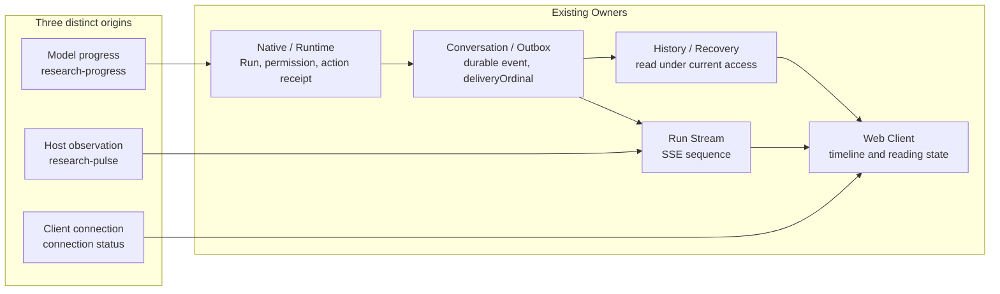

# An Agent Client Is More Than an SSE Renderer: Presenting Research Progress Truthfully

A user starts a fund comparison and text begins to appear. They then ask a short, separate question, refresh the page, open a citation when they return, and eventually decide to stop the comparison that is still running.

Each action is ordinary on its own. The problems emerge when they form one interaction: which question should a late answer appear under? Can a history response overwrite content already seen? After clicking Stop, should the interface say “Stopping” or immediately announce “Stopped”? And when research lasts several minutes, who is actually saying “Still researching”?

**The central job of an Agent client is to keep user actions, task progress and research results correctly associated.** SSE is one transport for updates. Receiving strings in a browser does not mean a research task has been presented correctly.

Long-running work adds another challenge: the client must explain something that is not yet finished. It needs to distinguish the model's account of its own work, what the system can observe about execution, and the browser's current connection state. Otherwise, the interface may look busy while the user cannot tell which statements are worth trusting.

This article follows ETF Agent's engineering evolution over time. The private product's full Web Progress implementation and the public teaching repository's CLI capabilities have different scopes; that distinction is made explicit below.

## 1. The Client Needs Its Own State—but Cannot Declare Facts Owned Elsewhere

“Do not build another state machine in the frontend” can sound like “the frontend should not have state.” In practice, the opposite is true. Drafts, dialogs, scroll position, the selected research task and pending button actions all need explicit local state.

The problem is **using that local state as a substitute for the task's actual state**.

Clicking Send can immediately show that a message is being submitted. Whether a research task has been created depends on admission. Clicking Stop can disable repeated clicks and show a pending request; the request itself does not prove that the original research has stopped. The client can open a citation detail and manage focus, but that interaction cannot decide which material the current user is entitled to read.

| Visible interaction | What the client owns | What the interaction cannot establish |
| --- | --- | --- |
| Compose and send | Preserve the draft; present submission and failure states | The message was admitted or a task was created |
| Control a task | Target the specific task, send the action and display its receipt | Sending the request means the action has finished |
| Update the answer | Reconcile revisions of the same content and preserve reading continuity | Visible text has already been durably saved |
| Reopen history | Read the original result under current access rights | Cached content still carries permission to read it |
| Inspect a citation | Present authorized material, its version and limitations | A citation certifies the conclusion |

In the existing architecture, answer publication, conversation events and historical delivery, source access and citation eligibility each have their own responsible owners. The client consumes those facts and organizes an operable reading interface; it does not reassess publication eligibility or certify research conclusions.

*Responsibility sketch: respond promptly to interaction while reading task state and content eligibility from their original facts.*

[Open the full-size vector figure](../../visuals/en/a25-client/m-boundaries.svg)

## 2. Why Did Progress Take So Long? The Problem Changed from “No Updates” to “Can This Update Be Trusted?”

The original request was straightforward. Research can last minutes; the model needs to know time is passing, and the user needs feedback. The first design, on October 10, 2026, separated three things:

- Host time reminders enter the next already-authorized model request; the system does not call the model just to report elapsed time.
- The model may propose short updates through a controlled tool, `send_research_update`.
- User-defined asynchronous delivery times remain with the original task and notification path.

That answered whether progress could be expressed. It did not insert model-authored progress into the formal answer, and reaching a time threshold did not automatically mean the task had completed.

The next problem was persistence. An October 25 inspection found that same-kind progress could be overwritten in the Native pending map, public event collector, Memory/PostgreSQL event identity and Web projection. An earlier update could also be delayed until unrelated slow work later in the same model turn finished. The HTTP SSE comment heartbeat sent every ten seconds kept the transport alive, but was not visible to the user and said nothing about which research stage had actually happened.

The design question therefore became: **can multiple authorized model updates each survive and appear in order before a later slow operation finishes?**

Implementation and browser verification on November 2–3 exposed the next problem. Even after all three updates appeared, a late History snapshot could make one disappear. Having displayed a row once did not give it permanent permission to be read after reconnecting. Live delivery, durable persistence and current access had to be treated as separate facts.

The important change was not “add another SSE message.” Progress moved from a replaceable stage label to process information with identity, ordering and current-access constraints.

## 3. Progress Is an Independent Capability, Not a New Runtime Owner

Two concepts need to be distinguished: a **capability** describes what the user can do or understand; an **Owner** has final authority over a particular fact or effect. In ETF Agent's architecture, a module is not merely a file or directory. It is a complete capability and the final owner of its effect.

Progress deserves its own domain semantics: signal origins, event identity, ordering, visibility and presentation rules. But it does not have an independent effect outside the original Run lifecycle that needs to own admission, persistence, recovery and termination. It is therefore a cross-cutting capability, not another Progress Manager.

Start by distinguishing the three kinds of signal that may appear on screen:

| Signal | Producer | What it can express | What it cannot prove |
| --- | --- | --- | --- |
| Model progress `research-progress` | Proposed by the model through the original Native Tool, then admitted by Runtime | “AI progress (not independently verified)”: what the model believes it is doing | That sources were fully read, calculations are correct or research is a certain percentage complete |
| Transient Host status `research-pulse` | Emitted by the original Run/Stream from currently observable facts | “System status”: a recent observation or an explicit unknown | That the model is thinking right now or the task will finish |
| Client connection status | Observed locally by the browser | “Connection status”: reconnecting or temporarily unable to obtain updates | That the server has stopped, cancelled or completed |

Each continues to use its original responsibility:

| Existing responsibility | What it owns | What Progress does there |
| --- | --- | --- |
| Model / Native Tool | Research strategy and controlled tool proposals | Proposes a short update; does not send SSE directly |
| Runtime / original Action Owner | Run identity, permission, terminal fences and action settlement | Checks the current Run and display eligibility; issues the original action receipt and `updateId` |
| Conversation / Outbox | Durable events, idempotent identity and historical delivery | Persists admitted model progress with a `deliveryOrdinal` |
| Run Stream | The current connection's event queue and `sequence` | Sends both model progress and transient Host status |
| History / Recovery | Reading and restoring facts under original identity and current access | Restores genuine durable progress on reopen; does not invent missed transient heartbeats |
| Web Client | Interaction, timeline and reading state | Labels origins and reconciles visible content for the same Run |

This is one capability crossing existing Owners, not a new module taking over the chain:

*Figure 1. Progress is a capability contract across existing Owners; model progress, system observations and client connection state do not share the same authority.*

Why not create a Progress Manager? Once it becomes a real module, it must answer who admits progress, who assigns stable identity, who persists events, who decides whether updates can continue after termination, and who adjudicates history on reconnect. Existing Owners already own those facts. A new manager would either duplicate their decisions or centralize authority that is currently clear.

An independent module may become justified later if Progress acquires a lifecycle outside the Run, cross-product subscribers, its own retention and query policies, or a shared event-service role. **What needs to be independent today is the capability's semantics, not another execution authority.**

