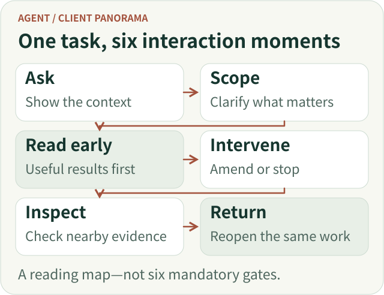
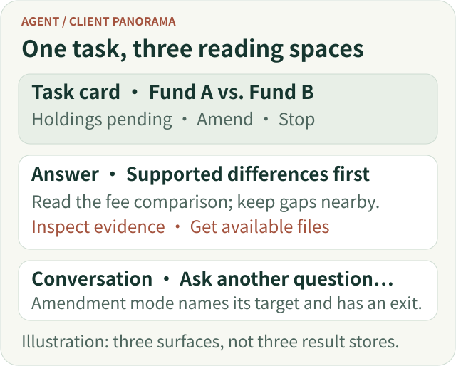
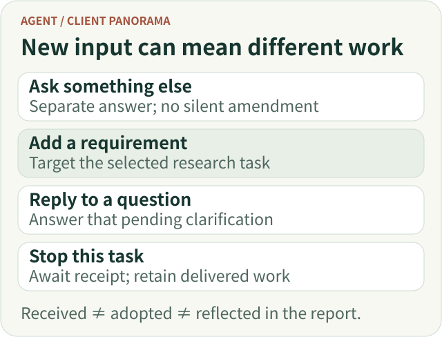
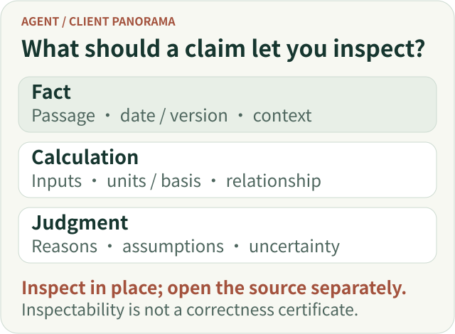
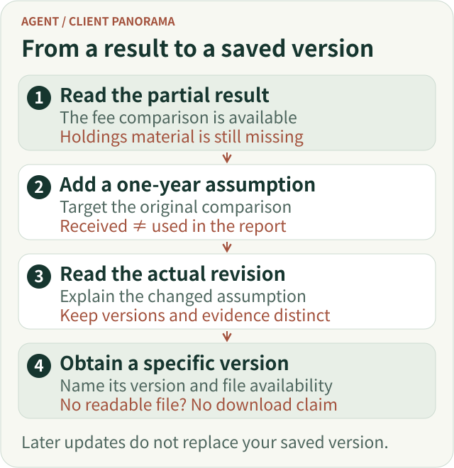
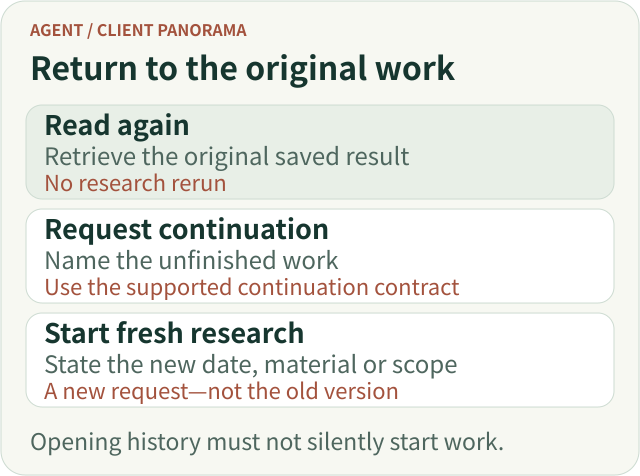
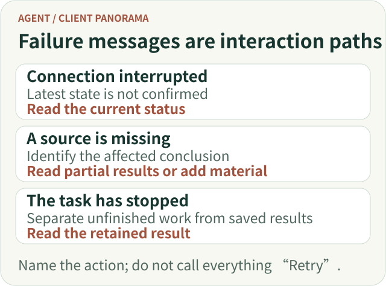

# Agent Client Interaction Panorama: From Asking a Question to Understanding Results and Continuing Research

A report appearing on screen does not mean a user's work is finished.

They may still be unsure whether the system understood their constraints, whether they can ask another question while waiting, whether their amendment was adopted, where a number came from, or where to return after closing the page.

**An Agent client organizes a collaboration that people can understand, influence and resume.** A good experience does more than make results appear. Throughout the process, users can tell what they asked for, what they can do now and how to judge the next step.

A teaching scenario will connect the discussion:

> “Compare the two funds I selected, focusing on holdings overlap and fees. Give me the key differences first. I may leave for a while and come back to read the rest.”

This scenario uses no real fund data and draws no investment conclusions. ETF Agent's existing work on concurrent conversation, progressive answers, source inspection and asynchronous delivery provides the engineering background. The article develops the interaction choices further. Example wording and layouts express design proposals, not a claim that every detail is already implemented.

The complete journey is **express a need → confirm the scope → research and read partial results → amend or stop when necessary → inspect and obtain the result → reopen after leaving → ask a follow-up**. These activities can overlap. Users should not have to reach the final step before receiving any value.

*Journey overview: these actions can overlap. They are not six mandatory gates for every question.*

[Open the full-size vector figure](../../visuals/en/a25-client/p-journey.svg)

## 1. Start with a question, not a configuration form

For this comparison, users initially want to express what to compare and what matters. The entry point should help them do that, not require them to understand research depth settings, tool combinations or model configuration.

The basic interface can remain a chat composer, provided that selected objects and materials are visible. For example, the area around the input can show the two fund names, selected documents and scope of the request. Users can remove an incorrect document and see which personal information will be used for this task.

**Visible context matters more than invisible assumptions about intent.** If the system silently carries over a fund, date or account from an earlier conversation, users may not notice that the analysis has already departed from their request.

Material ingestion also needs accurate feedback. A completed upload establishes that transmission ended; whether the file can be read, or only partially read, is a different matter. “Analysis complete” is not an appropriate label merely because an upload finished. On failure, preserve the question and identify the unusable material separately.

Accuracy does not require turning every question into a mandatory form. Display known objects and constraints alongside the message. Clarify only conditions that materially change the answer and cannot reasonably be determined.

### Three surfaces, one continuous task

A conversation, task card and report answer different questions. Conversation preserves what the user asked and changed. The task card answers what is happening and which interventions are available. The report explains the findings and provides a stable place to inspect their basis. They need not become three independent pages, nor three separately edited copies of the result.

Consider a compact task card above the conversation: “Fund A vs. Fund B · holdings comparison pending,” with “Read available results,” “Add a requirement” and “Stop” beside it. The report remains the reading destination. When the user switches to an unrelated question, the card keeps the original task discoverable without covering the new answer. This is a proposed information layout, not a claim about a new shipped screen.

On a phone, show the task name, its consequential gap and the next useful action before secondary controls. A detailed process log can sit behind disclosure; a source panel can replace, rather than sit beside, the reading area temporarily. Closing it should return the reader to the same claim. The narrow layout should preserve the task relationship, not imitate the desktop's number of columns.

*Teaching layout, not a product screenshot. The task card supports intervention, the answer supports judgment, and conversation expresses intent.*

[Open the full-size vector figure](../../visuals/en/a25-client/p-workspace.svg)

## 2. Ask only about conditions that change the research

Suppose the two funds' holdings disclosures have different dates. The system may need to establish whether the user wants the latest available material for each or a comparison aligned to a specific date. That difference can affect the validity of the comparison and is worth clarifying.

By contrast, asking separately about preferred length, tables and risk notes need not always block the task. Presentation preferences with sensible defaults can be applied initially and adjusted later.

A useful clarification explains both why it matters and which paths are available. For example:

> “The two holdings disclosures are from different dates. I can compare the latest available disclosure for each and label that difference, or use a common comparison date that you specify.”

This is easier to answer than “Select a date range,” because the consequence of the choice is visible.

After replying, users should be able to see the adopted research scope. They should not have to reread the entire conversation to confirm that the system is still comparing the right objects.

A task that genuinely depends on the reply can show “Waiting for you to confirm the comparison date.” A task with independent work available can deliver the parts that do not depend on that choice. Whether work can continue follows from the task, not from one universal waiting screen.

## 3. While waiting, help users understand progress—not watch execution logs

Once research begins, an obvious interface is a changing status area: searching, calling a tool, analyzing, generating.

That may show that the system is active, but it does not necessarily help a user decide whether to keep waiting.

For this comparison, useful progress describes which relevant material is available, what consequential information remains missing and whether part of the question can already be answered. “Fee documents are available; the holdings comparison still needs a comparable disclosure for the other fund” is more connected to the task than a series of tool-call entries.

The wording must reflect the evidence behind it. “Obtained” requires an actual acquisition fact. A plan or self-description cannot become a claim of completed verification. When remaining time cannot be estimated reliably, explain what the system is waiting for rather than invent a progress bar that keeps approaching 99 percent.

The page can use two levels of detail. By default, show brief progress, important blockers and available results. Let interested users expand a more detailed process view. Model switching, request retries and tool parameters do not need to lie on every reader's path.

**An earlier useful answer is a better goal than an earlier sentence announcing that analysis is about to begin.** ETF Agent's progressive-answer work likewise distinguishes the first useful answer from the first text output: answer an important, supported subquestion early, then extend or revise the same answer instead of producing a new miniature report at every stage.[1]

Waiting can therefore gradually become reading. When the fee material supports an explanation of differences, the user can read it. Missing holdings material remains an explicit gap; it need not prevent every independent result from appearing.

### Let the first result change the available actions

Before a result exists, “View progress” may be useful. Once a supported fee comparison is readable, “Read the fee comparison” is a more meaningful action. If a consequential date choice is pending, put that question near the affected section instead of replacing the entire report with a waiting screen.

This creates a small but important progression: waiting has a reason, partial results have a destination, and unresolved conditions have a response point. Do not add a percentage merely to make the card look active. When there is no reliable progress estimate, an honest missing condition is more actionable than an invented completion ratio.

## 4. Users should still be able to speak while research continues

A fee term catches the user's attention, and they ask, “How is that different from a subscription fee?”

That question does not necessarily amend the comparison. Requiring the user to stop the research before asking it turns collaboration back into serial waiting. Injecting every new message into the research can change the original task unintentionally.

The interface should therefore distinguish at least four actions: asking an independent question, adding to the original research, answering a pending clarification and stopping a particular task.

Four permanently visible input boxes are unnecessary. A general composer, an “Add a requirement” action on a research card and a reply entry beside a clarification can express most of the distinction. In amendment mode, the composer should name its target—for example, “Adding to: Fund A vs. Fund B”—and allow the user to leave that mode.

If the user says, “Include the fees for holding them for one year,” the interface can echo the requirement and describe its current stage. Received does not mean used; used does not mean the report has already been updated. Facts that depend on a later result should not be declared successful in advance.

ETF Agent's existing concurrent-interaction work follows a similar division: independent short questions get independent answers, explicit amendments go to the original research, and Stop targets a particular task. Keeping the conversation available does not promise unlimited concurrency. When capacity is unavailable, state that the new task was not admitted; do not silently merge it into another research task.[2]

The Stop button does not need to disappear. It should belong to its task and explain its scope. Collapsing a panel, changing conversations and closing the page should remain distinct from an explicit stop. A product that truly supports continued execution after leaving should say so. A product that does not support it must not imply otherwise.

*Interaction sketch: carry an explicit target when it is already known; do not make users repeatedly explain what they are changing.*

[Open the full-size vector figure](../../visuals/en/a25-client/p-intents.svg)

## 5. When results appear, prioritize understanding over animation

As partial answers arrive, the user's concern changes from “Is it still working?” to “What does this mean for my question?”

In the teaching scenario, the page can lead with supported differences, followed by the comparison basis and missing material. Qualifications must remain intact. “The material currently available indicates…” should not become an unconditional final judgment merely to shorten a summary.

The answer should not simply reproduce the order of execution. Users generally do not need to understand two funds through “first search, second read, third supplement.” They need to understand the fee comparison, what holdings overlap can establish and which matters remain unresolved.[1]

A stable reading path helps. Process details can be expandable, source inspection can sit near the relevant conclusion, and downloads or subsequent actions can sit beside the deliverable. On narrow screens, there is no need to reproduce several desktop panels side by side. First ensure that the answer, task state and essential actions can be read in sequence.

Streaming updates should respect reading position. Someone looking back at an earlier section should not repeatedly be pulled to the bottom by incoming text. A “New content” indicator supports their current activity better than taking over scrolling.

Revisions do not need a modal announcement every time. Changes that affect judgment can have a short explanation—for example, “The holdings comparison now has supporting material for the previously unresolved section.” Such wording must reflect an actual change, not appear repeatedly just to make the system feel active.

## 6. Inspecting a claim should not first force the user out of the report

Suppose a user reads that the funds have similar exposure to a particular risk. They may simply want to check the supporting material, whether disclosure dates were considered, and whether the sentence states a recorded fact or a further interpretation.

If clicking a citation immediately opens a long webpage, they must find the relevant paragraph or table and then return to locate the original claim. A link exists, but the inspection journey is unfinished.

A better first step is to show the relevant material within the current reading context. Put the retained passage, source date or version, reading location and necessary limitations together. Keep “Open original source” as a separate, explicit action. The current webpage may have changed, so it should not be conflated with the material used during the research.[3]

Different conclusions also need different inspection paths.

A **factual statement** calls for original material and context. A **calculated result** calls for the actual inputs, units, measurement basis and calculation relationship—not merely a source title. An **analytical judgment** calls for its basis, assumptions and remaining uncertainty. It should not be presented as something the original source explicitly stated.

When an original passage was not retained, say so. Do not fill the gap with newly generated text that resembles a quotation. Fetching new material or requesting additional analysis should be a recognizable separate operation, not a hidden side effect of opening details.

Likewise, one unavailable citation need not erase an otherwise lawful answer. But unavailable material and revoked access are not interchangeable. Show the correct limitation, and do not continue exposing material from an old cache when current access no longer permits it.[3]

These entry points must also be operable. An in-place disclosure works for short details; a side panel or dialog can work for longer material. Hover alone is not enough. Keyboard users should be able to open, read and close details and return to their original position. W3C's disclosure and modal-dialog patterns provide different conventions; the component should choose a coherent interaction pattern.[4][5]

Inspection gives users a basis for judging the claim. Displaying a source does not authorize the interface to declare the research correct.

*Inspection sketch: opening retained material and requesting new research are distinct actions. A readable source does not certify the conclusion.*

[Open the full-size vector figure](../../visuals/en/a25-client/p-inspect.svg)

## 7. Delivering a result includes explaining how to obtain it

Some users only need to read the answer in chat. Others need to take a report away or retain a version they can reopen later.

Copying text, downloading a file and saving a result should not collapse into an ambiguous “Done” action.

Copying obtains the text currently available for copying. Downloading requires an actual readable file. Saving or bookmarking should explain what is retained. For a report still being updated, users particularly need to understand which version they are obtaining and whether later revisions alter the saved content.

Where attachments are supported, show their names, formats and availability near the result. If the answer is readable but one attachment failed to generate, identify the missing attachment separately. The entire research need not be presented as worthless. Conversely, successful file storage does not establish that the user can open it.

Not every client needs these features on day one. For chat-only reading, a reliable history entry may be enough. Add version-aware downloads, bookmarks or sharing when actual delivery and circulation needs justify them. Sharing also needs its own access boundary: “I can see it” does not mean “anyone with the link can see it.”

*One handoff, not a shipped-screen claim: receiving an amendment does not mean the report changed. Announce only actual revisions and offer downloads only for readable files. Later updates must not silently replace the version the user already obtained.*

[Open the full-size vector figure](../../visuals/en/a25-client/p-handoff.svg)

## 8. Returning should reconnect the user to the original work

Users may close the page before the holdings comparison finishes. A product that promises background research should explain whether the task will continue, where the result will be found and how a required reply will be surfaced.

On return, the priority is not replaying a typing animation. It is restoring understanding: what task is this, how far did it get, which results are readable, what is missing and does it need a decision from me?

The page should read the original task's saved results, not quietly submit its question again. Otherwise the user believes they are opening history while the system starts another research task, potentially changing both content and cost. ETF Agent's asynchronous-delivery work separates leaving, reopening, notification and execution; reading history does not depend on generating the report again.[6]

A notification should not become a second report either. It can accurately state what happened and return the user to the corresponding task and result. Sending a notification does not establish that the user has read the answer.

When a user specifies a time, wording matters. “Remind me in ten minutes” and “Give me the result within ten minutes” express different commitments. Whether early completion should trigger notification, and what to say when the time arrives before completion, should follow the original agreement. If partial results exist, point to them. Otherwise report the actual state; “Nearly finished” is not a deliverable.[6]

Finally, reopening remains a current access request. An account change, permission change or material withdrawal must not allow an old link to restore expired reading rights. The interface can simply explain that the material is not currently accessible; it need not describe the internals of the authorization system.

### Make the return point recognizable

A returning user should see the original question, the latest available result, any consequential change since the earlier view and any request that still needs a reply. A date or “Updated” label alone does not explain whether the holdings section was completed, a conclusion changed or only a file became available. State the actual change when it is known; otherwise present the saved version without inventing a change summary.

For notifications, use the same task name and link to the corresponding result or pending question. “Research has an update” is less useful when the user has several tasks. Dismissing a notification should not stop the task, and reading a report should not silently resolve an unanswered clarification.

*Return-path sketch: restore understanding of the original task before asking whether to continue or start fresh. Reopening does not silently execute work.*

[Open the full-size vector figure](../../visuals/en/a25-client/p-return.svg)

## 9. When something goes wrong, explain the impact and the next action

A research product cannot eliminate every failure. It can avoid painting all of them as the same red banner.

After a network interruption, users need to know that task updates are temporarily unavailable—not that research necessarily failed. When a document cannot be obtained, they need to know which comparison is affected, not read an opaque tool error. When a task stops, they need to know which results remain available.

A useful error message answers three questions where possible: what happened, how existing work is affected and what can be done next. Recovery promises without supporting evidence should not appear in button labels.

“Retry” deserves particular care. Rereading the page, resubmitting a request that was not admitted, continuing the original task and starting new research are different actions. A button should make the relevant action understandable. Duplicate execution should not hide behind something that looks like a harmless refresh.

For actions that may change external data or incur costs, the previous attempt may already have taken effect. A missing receipt is not proof that nothing happened. That uncertainty needs explicit handling, not unlimited automatic retries.

Local failures should not become global failures. A supported fee comparison can remain readable while missing holdings material is identified separately. But preserving a “Completed” label must not involve silently deleting the requested holdings analysis from the task.

*Failure-interaction sketch: explain the effect on current results, then offer an actually supported next action. Do not promise recovery through an unsupported button.*

[Open the full-size vector figure](../../visuals/en/a25-client/p-recovery.svg)

## 10. Follow-up questions should preserve their subject without silently changing their evidence

After returning and reading the report, the user may ask, “How would that conclusion change if we only considered holding for one year?”

The question has a specific subject: the previous comparison and its conditions. The client can support a follow-up on a passage, table or whole result and show which content is referenced. Sending an isolated “Why?” forces the system to guess again.

Distinguish three kinds of follow-up: explaining the earlier conclusion, recalculating under a changed assumption using the same material, and researching with newer material. An explanation preserves the original report's time frame and evidence. Changing the holding period to one year needs an explicit new assumption and calculation; the new answer must not masquerade as the original conclusion. Obtaining newer material requires the new source dates and comparison conditions to be clear. Make these distinctions explicit when they matter to the result; do not force every follow-up through a version-selection form.

Feedback should also target something specific. A suspected numerical error is different from a complaint that the report is too long. A revised answer should not silently inherit an evaluation that referred to an older version.

Nor should a thumbs-up automatically move facts from the report into long-term memory or prompt a claim that the system has learned an investment preference. Feedback, correction and long-term retention are different operations with different boundaries that users should be able to understand.

At this point, research becomes more than a one-time generation. Users can ask, correct the course, inspect the answer, leave and return, then continue the discussion with its context intact.

## 11. Build one complete path before multiplying the interface

A complete journey does not require every product to launch with a task center, notification center, source sidebar, report library and elaborate console.

For simple questions, a composer, a readable answer, necessary sources and clear failure states may be enough. Tasks that span waiting and leaving justify a stable task entry and historical continuity. Users who genuinely need to converse during research justify explicit concurrent interactions. Results that need circulation justify files and version-aware delivery.

Let actual breaks in the user journey drive these additions—not a desire to display every backend capability.

Acceptance can follow the same teaching task. Can the user confirm the comparison objects? Do they understand what is missing? Does an amendment target the right research? Can they inspect evidence near a conclusion? Can they return to the same result after leaving? An error-free page is only the starting point; independently completing those actions is closer to the interaction goal.

Return to the original scenario. The user delegates a comparison, asks about a term, adds a holding period, leaves for a while, and returns to read the report and inspect its sources. They do not need to know how many model requests occurred or which execution components were involved. They need to understand what happened at each step and retain the ability to continue, adjust or stop.

**Making complex research collaborative without passing the system's complexity on to the user is the central purpose of an Agent client interaction panorama.**

## References and further reading

[1] ETF Agent, [Keeping Progressive Research Answers Coherent](https://hpoenixf.com/eff-agent-article/en/articles/agent-progressive-answer-coherence).

[2] ETF Agent, [Background Research and Concurrent Foreground Interaction](https://hpoenixf.com/eff-agent-article/en/articles/agent-background-research-collaborative-experience).

[3] ETF Agent, [Agent Citation System Design: Source Issuance, Version Binding and Independent Review](https://hpoenixf.com/eff-agent-article/en/articles/ai-citations-do-not-prove-reliability).

[4] W3C WAI-ARIA APG, [Disclosure Pattern](https://www.w3.org/WAI/ARIA/apg/patterns/disclosure/).

[5] W3C WAI-ARIA APG, [Dialog (Modal) Pattern](https://www.w3.org/WAI/ARIA/apg/patterns/dialog-modal/).

[6] ETF Agent, [Research Is Still Running, but the User Has Left: Delivering Real Results on Time](https://hpoenixf.com/eff-agent-article/en/articles/agent-asynchronous-research-time-bound-delivery).

For implementation boundaries, see the companion article, [An Agent Client Is More Than an SSE Renderer: Presenting a Research Task Correctly](./agent-client-interaction-and-reading.md). Sources consulted on November 2, 2026.
