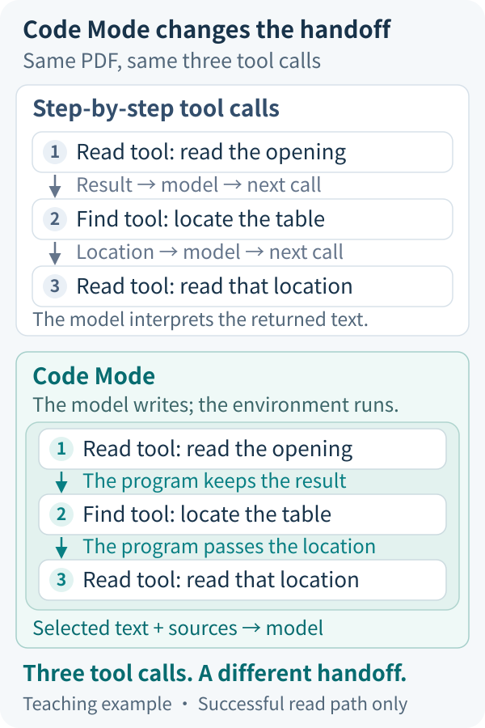
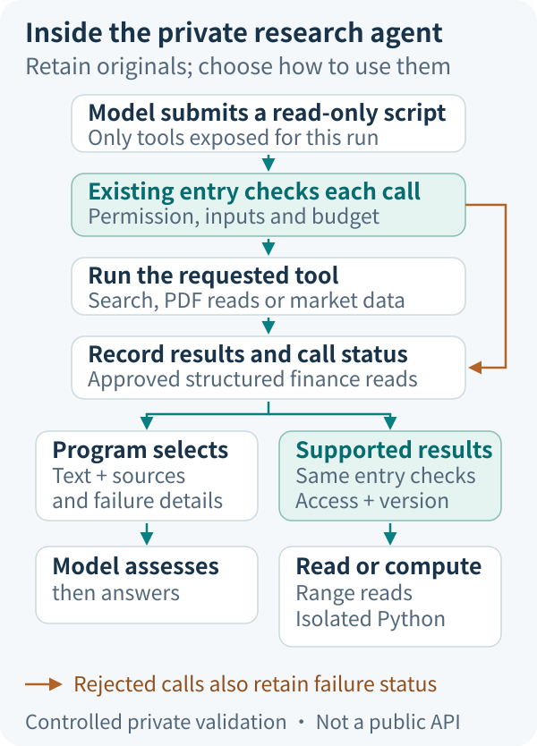

<div><a id="is-claude-code-s-code-mode-worth-bringing-to-a-research-agent"></a><a id="is-claude-codes-code-mode-worth-bringing-to-a-research-agent"></a></div>

# Understanding Code Mode: Letting an Agent Connect Tool Calls with Code

An agent researching a question usually needs tools for searching, reading files, or querying market data. The model decides what to call, the tool performs the operation, and its result returns to the model.

**Code Mode adds another way to carry out this process: the model first writes a short program, an execution environment runs it, and several tool calls connect inside the program before the relevant results return to the model.**

This code serves the task at hand. It might locate a particular table in a report and read the original text. It can retain the position returned by an earlier step, decide whether to keep reading, and select fields to return.

We will follow one question throughout: **given an already selected public VOO report, how do we find its one-, five-, and ten-year before-tax returns as of the end of 2025?** We will examine the execution process first, then our experiments in ETF Agent. Those experiments also show that making a sequence programmable and making a real task faster or cheaper are separate achievements.

## 1. How ordinary tool calls reach the answer

Suppose the agent already has the correct report, but the reading tool returns only part of it at a time. It reads the beginning, does not find the returns table, and proceeds to locate and read it. The process has four steps:

1. **The model asks to read the beginning of the report.** The reading tool returns the cover, fees, and investment strategy, but not the target table.
2. **The model asks to search for the table heading.** The search tool returns a position marker indicating where the table may be.
3. **The model asks to read that position.** The reading tool returns the table's text, together with its file, page, and source.
4. **The model interprets the text and answers.** It checks the reporting period, the before-tax basis, and the meaning of each column before composing its response.

The first three steps contain two kinds of work. Choosing the report and deciding which column answers the question require an understanding of the task. Passing the position returned by the search tool into the reading tool can usually be expressed as a straightforward program.

Ordinary tool calling can also run in parallel. Two independent reports can be read in the same round. The difficulty here is a dependency: **the position for the next read becomes known only after the search returns.** In the step-by-step path above, that position goes to the model, which then places it in the next tool call.

If this part is simply passing a position along, could a program do it directly? That is what Code Mode contributes to this example.

<div><a id="what-claude-code-hands-to-a-program"></a><a id="let-the-model-write-the-call-sequence"></a></div>

## 2. What changes with Code Mode

The model can express the first three steps as a program like the one below. It reads the file, locates a heading, then uses the returned position to read the original text.

This is **teaching pseudocode**. Function names and fields are simplified to explain the execution relationship; they are not runnable project APIs. Read-error handling has also been omitted.

```javascript
async function findReturnTable(report) {
  const first = await pdf.read({ report, maxChars: 3500 });
  const match = await pdf.find({
    report: first.reportRef,
    text: "Average Annual Total Returns"
  });

  if (!match.found) {
    return { status: "not_found", searchedPages: match.searchedPages };
  }

  return await pdf.read({
    report: first.reportRef,
    position: match.position
  });
}

const evidence = await findReturnTable(selectedReport);
```

The model submits code like this to the execution tool. The execution environment runs it and returns `evidence` to the model. `selectedReport` is the report already chosen at the start of the task.

`first.reportRef` identifies the file that was actually read. `match.position` is a position marker produced by the search tool; think of it as a bookmark. Once the program has that bookmark, it continues reading directly. The model does not need to take a separate turn to copy it into another call.

Three participants have distinct jobs while this program runs: **the model writes the program, the execution environment runs it, and the tools perform the actual reading and searching.** The program still returns text acquired by the tools, along with its source. The model then checks whether the table answers the question. A heading match alone does not establish that the answer is correct.

Notice that the example still makes three tool calls. What changes is where the intermediate results go: the program consumes the first two, and the material needed at the end goes back to the model. If there is no match, the program returns the searched range. The model can then choose a different keyword, widen the read, or look for another report.



*Figure 1: In this returns-table lookup with three tool calls, the difference is who connects the intermediate steps. The model still interprets the original text after the program finishes. A task that needs only one ordinary read does not need to follow this entire chain.* [Open full diagram](../../visuals/en/agent-code-mode-read-only-tool-orchestration/execution-comparison.svg)

Claude Code's Code Mode follows this pattern: the model generates JavaScript, and an execution environment runs it through the `REPL` tool. As of November 28, 2026, the official documentation still describes it as experimental and off by default. Its code can connect calls, execute them in parallel, and select what to return. [Official explanation](https://code.claude.com/docs/en/code-mode) · [Tools reference](https://code.claude.com/docs/en/tools-reference)

## 3. Separate the things it might save

Three measurements are easy to confuse.

**First, how often the model must take over between operations.** In the step-by-step path, the model reads a search result and initiates the next read. The program can pass the position directly, removing that mechanical handoff. If the program fails or a result needs interpretation, the model still has more work to do.

**Second, how many actual calls reach the tools and data sources.** A program containing three tool calls still requires the system to execute those calls. Wrapping them in one program execution does not automatically reduce downloads, queries, or tool charges. It also does not mean the entire user task needs only one model request.

**Third, how much content returns to the model.** A program can return just the relevant page, keeping the cover, navigation results, and unrelated text out of the model's context. But generating the program also has a cost, and its filtering rules can be wrong. Any measurement of total tokens, cost, and latency must include these overheads.

Code Mode can also express loops, parallel queries, and field selection. Its value depends on whether the task actually contains actions that a program can perform. If the main work between calls is deciding whether a source is trustworthy or whether two financial measures are comparable, the model or established business rules still need to handle it.

<div><a id="start-with-one-chain"></a></div>

## 4. Why not build a “find and read” tool instead?

For our example, a developer could write a `find_and_read` tool in advance. The model supplies the report and keyword, and the tool locates and reads the passage internally. The model would not have to generate code each time.

That is a reasonable choice too. The three approaches suit different conditions:

| Approach | Who determines the call sequence? | When does it fit? |
| --- | --- | --- |
| Ordinary tool calls | The model examines a result and chooses the next step | One read is enough, or every step needs fresh interpretation and judgment |
| Fixed composite tool | A developer writes the sequence in advance | A stable process repeats, such as locating and reading text in the same report |
| Code Mode | The model generates a program for the current task | Combinations change often, but many intermediate actions can be expressed clearly with conditions, loops, and variables |

Today the task might involve one report. Tomorrow it might traverse several reports that have already been selected. Another task might pass identifiers returned by one query into a market-data tool. When combinations vary, Code Mode can express those different call relationships. The system also acquires a program it must manage: arguments may be wrong, a loop may run too long, a tool may time out, or the program may discard important content.

We previously replayed a candidate `find_and_read` with a fixed call sequence. The VOO returns-table task went from three outer read calls to one. Both paths fetched the PDF once and recorded two charges against the read budget. The SPY fee on the first page still required only one ordinary read. The composite tool removed handoffs without reducing the internal work or budget charges. This separately verified candidate was not included in the real-model comparison on the same version described later. Its replay does not establish a released capability or an efficiency gain in actual model use.

For a stable, recurring “locate, then read” process, I would consider a fixed composite tool first. Managing a generated program becomes more attractive when variation in the combinations is itself a requirement.

<div><a id="keep-the-receipts-and-give-the-model-evidence"></a></div>

## 5. How we made it work in the private implementation

Before introducing Code Mode, the private edition of ETF Agent could already call ordinary tools in parallel and pass acquired data to isolated Python for computation. We wanted to add another capability: **after receiving an actual tool result, a program could choose a branch, organize subsequent calls, and return the material the model needed.**

We took that idea from a PDF prototype into the existing research execution path, then verified later rereads and computation. Four questions shaped the implementation.

### Can the same program decide whether to continue or stop?

A fixed `find_and_read` follows steps written in advance by a developer. To check that a program could compose calls more flexibly, we also tested a conditional example. When the first read returned a state indicating that the material was sufficient, the program returned immediately, making one tool call in total. When more material was needed, the same program made two further independent reads in parallel, combined their results, and returned after three calls in total.

This used an actual isolated JavaScript executor, synthetic tool responses, and a model-call sequence arranged by the test. It verified that a program could read a state, take a different branch, and await subsequent results. Whether a real model would write and choose such a program for a task required a separate comparison.

It also clarified the division of work with Python. Programmatic orchestration continues acquiring material. Once the data is available, the existing Python tool can perform the computation; Code Mode does not require a second analysis environment.

### How can a program keep using the existing tool rules?

The early prototype could call the reading interface directly, which was enough to observe the script and PDF behavior. For integration with the research runtime, we chose to reuse the existing tool executor. The current private entry point is `run_tool_program`: the model submits JavaScript, the program sends requests through tool proxies, and the original executor handles the actual calls.

Every search, read, and admitted market-data query inside the program therefore still needs checks for tool availability, valid arguments, and sufficient budget, and leaves an execution record. Here, budget means the call allowance for the current task. The program also has limits on execution time, memory, call count, and returned data. This describes how the current private implementation is connected. The ability to run JavaScript does not imply unrestricted access to networks, files, or data sources.



*Figure 2: The program organizes calls; the existing executor checks and records each one. Selected results go to the model, while structured original results connected to the reread path remain available for later verification. The diagram shows the private implementation; this section explains the scope of its verification.* [Open full diagram](../../visuals/en/agent-code-mode-read-only-tool-orchestration/runtime-and-evidence.svg)

During integration, a controlled regression test exposed a cleanup problem: the program had returned while one of its reads was still pending. Closing the script environment cancelled that unfinished call while the original executor was still handling it, so the next model step did not receive the result. We changed the cleanup order so that the executor could finish handling the internal calls' states before returning the program result. Content already acquired legitimately needed to survive, and any state that remained uncertain needed to stay explicitly uncertain.

This example shows why a successful script return is not the end of the job. The operations it started belong to the same research run and must finish under the existing execution and recovery rules. Orca 0.5.22 provides a narrower public reference: `run_script` exposes only four local read-only tools, with the host checking each call. [Orca design](https://github.com/echoVic/orca-agent/blob/v0.5.22/docs/superpowers/specs/2026-11-18-code-mode-design.md)

Claude Code also retains tool-specific permission rules and hooks, but its auto-mode classifier cannot see argument values computed during execution, and its shell sandbox does not automatically cover JavaScript and other calls. Access and isolation still depend on the execution environment. [Permissions and isolation](https://code.claude.com/docs/en/code-mode#permission-checks)

### Can the next turn inspect the originals after a small result is returned?

After we extended the same entry point to fund price history and instrument profiles, a program could acquire data in parallel, select fields, and return a small result. That raised a more practical question: when the model wants to inspect the original rows in the next turn, a source link alone is insufficient.

The existing result-reread path primarily recognized reads initiated directly by the model. Reads inside a program already had source and execution records, but they did not yet have an original result that later steps could retrieve correctly. Small results could still return their values directly. Once a large result exceeded what a single response could carry, the gap became more obvious: the model received neither all the content nor a usable reference to the original result.

We connected the program's authorized structured financial reads to the existing result store and checked the in-memory and PostgreSQL paths separately. After that change, the same research run could reread a selected range from the version acquired earlier, without calling the supplier again. Another research run under the same account could not use the old reference to bypass the original authorization.

We then added a Python handoff. We selected the same two rows of synthetic NAV data from an ordinary read and a programmatic read, and passed them to actual isolated Python executions. Both paths produced the same result while retaining their respective original input identities. An invalid reference was refused before computation began. This verified the handoff between local PostgreSQL, original-result rereading, and isolated computation. The financial data was synthetic, so it does not establish the quality of real research.

That separates two easily confused objects: **a source reference identifies where data came from; an original-result record identifies the specific data acquired in this run.** A program can return selected content to the model while the system retains a way to retrieve the original material. For a PDF, the original text context, file version, and page numbers also matter. A failed search or a truncated read must not become a claim that the report does not disclose the information.

### How does a program learn which arguments the current tool accepts?

Tools with the same name or a similar purpose can accept different arguments from different suppliers. One may require `ticker`, while another requires `symbol`. Giving the program a tool name alone can still leave it guessing the wrong field.

The private implementation therefore provides `describeTool(name)`. A program looks up a tool definition already available in the current turn, then constructs its request using the actual parameters. In controlled tests, the same script used two definitions to make valid requests. Hidden tools were unavailable, oversized definitions returned an explicit status, and other legitimate reads could continue. This queries existing tools; knowing a name does not create additional permission.

The code has been merged into the private main branch, but `run_tool_program` requires explicit, reviewed enablement. A broader scope that includes market-data reads also needs a separate review. The material checked here provides no evidence that production accounts have enabled it, so merging the code does not mean it is live by default.

The public edition needs a separate check. In the Open ETF Agent v1.0.6 revision examined for this article, we found no equivalent Code Mode entry point. The practice above comes from the private implementation; the earlier pseudocode explains the mechanism. [Public revision checked](https://github.com/hpoenixf/open-etf-agent/tree/89205ac08ddfa53cefefcce5b6d0bfd78e5eb219) · [Current main](https://github.com/hpoenixf/open-etf-agent/tree/main)

Once the engineering path is connected, the next question is whether the model uses it well when choosing tools for itself.

## 6. What our experiments actually showed

With the call relationships established, the measurements are easier to interpret. We first measured returned data on fixed execution paths, then let a real model choose its own tools. Those experiments answer different questions.

<div><a id="two-pdfs-and-three-ways-to-read-them"></a></div>

### Fixed paths: less returned data, but simple questions need no detour

This section preserves the comparison data from the [earlier offline experiment record](https://github.com/hpoenixf/eff-agent-article/blob/83ecfe73859fcb531feb2e8ed391ab69c7d0d88f/en/articles/agent-code-mode-read-only-tool-orchestration.md#two-pdfs-and-three-ways-to-read-them). The experiment used two public issuer PDFs: VOO's summary prospectus dated April 28, 2026, and SPY's fact sheet as of September 30, 2026. The file bytes were frozen. Both paths used the same reading interface with actual PDF text extraction, and the keywords and read limits were identical. [VOO source entry point](https://personal1.vanguard.com/pub/Pdf/sp968.pdf) · [SPY source entry point](https://www.ssga.com/library-content/products/factsheets/etfs/us/factsheet-us-en-spy.pdf)

The step-by-step path read the first 3,500 characters, located the target, and read it back, returning all three results to the caller. The program path made the same three calls but returned only the final result. A separate direct-read comparison used the first short read for fee questions and increased the single-read limit to 22,000 characters for the returns table.

| Target and physical PDF page | Step-by-step output | Program output | Single-read output |
| --- | ---: | ---: | ---: |
| VOO annual operating expenses of 0.03%, page 2 | 14,303 B | 5,327 B | 7,449 B, short read |
| SPY gross expense ratio of 0.0945%, page 1 | 15,521 B | 5,611 B | 8,404 B, short read |
| VOO before-tax returns table, page 6 | 14,279 B | 5,316 B | 17,401 B, expanded read |

The table measures tool-result JSON bytes returned to the caller, excluding internal audit fields. The step-by-step and program paths acquired the same target pages and original text. Each made three internal tool calls and fetched the PDF bytes once. No model was called in this comparison, so the numbers cannot be translated directly into model cost or response time.

The two fee questions are especially useful counterexamples. Their answers were already in the first short read, so an ordinary call could finish the task. Even if a program ultimately returns fewer bytes, there is no reason to force the task through two extra locate-and-read steps.

The VOO returns table on page 6 presents a more useful tradeoff. One expanded read can obtain the table with fewer tool operations. Targeted reads can also obtain it and return about 5.3 KB at the end. Choosing between them requires considering tool-operation overhead, returned content, and subsequent interpretation together. A single column cannot settle the choice.

<div><a id="what-the-model-does-when-code-mode-is-available"></a></div>

### Real-model runs: making the tool available does not ensure useful adoption

We then had the same real model answer the VOO returns-table question and the SPY fee question. Each question ran once with ordinary tools and once with Code Mode available, using the same permissions and run budget. The model calls were real, while the search and PDF tools used frozen public samples and recovery used local in-memory storage. This was not a complete online research benchmark.

| Question | Model requests with ordinary tools | With Code Mode available | What the model actually did |
| --- | ---: | ---: | --- |
| VOO returns table | 17 | 17 | Called one program, but its internal search failed because the budget was exhausted; ordinary reads ultimately obtained the target text |
| SPY fee | 9 | 10 | Used ordinary tools throughout and did not call a program |

These request counts include attempts that failed in transport; they do not count how many effective research judgments the model made. All four answers obtained the requested values and included the corresponding issuer citations, but the two pairs did not show fewer model requests. Of the 53 requests overall, nine had transport failures and no usage records, so the evidence also cannot support a comparison of complete token usage or cost.

This result does not invalidate programmatic orchestration. It shows that once the execution path works, we still need to verify whether the model chooses an appropriate path, writes the program correctly, and obtains the evidence the task requires. A fixed composite tool also needs to enter a comparison on the same version and questions before we can judge which approach fits better.

## 7. How to decide whether your agent needs it

Choose a task from actual run records and examine what the model does between two tool calls.

If it merely copies a position, identifier, or cursor from one result into the next call, that segment is worth trying as a program. First ask whether it can become a clear, stable composite tool. Consider exposing Code Mode when these combinations change frequently with the task.

If the model needs to interpret new material, choose a reporting period, distinguish share classes, or reconcile conflicting definitions, retain the corresponding judgment process. Making the call sequence more compact does not automatically perform that research.

Returning to the original VOO question, Code Mode can let a program carry out “read the beginning, find the heading, then read at that position.” Once the model receives the text, it still needs to ask whether this is the report and statistical basis the user needs, and whether the evidence is sufficient. We have reason to make a viable execution path the default only when comparisons of task outcomes, complete cost, and waiting time support that choice.
