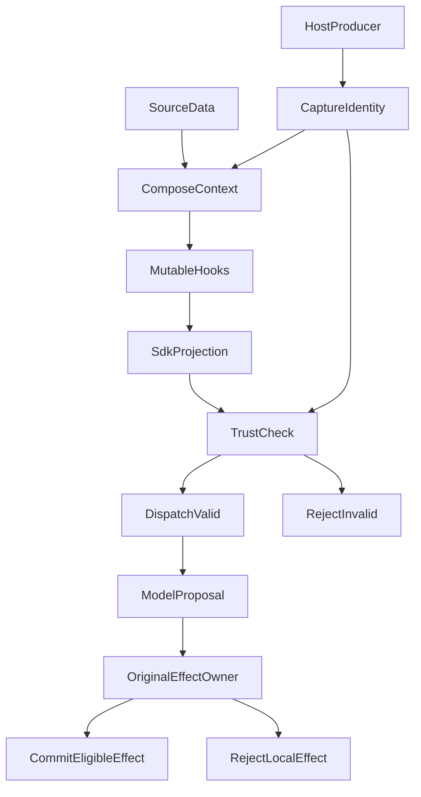

# Prompt Injection Is More Than Malicious Text: How We Built a Content Trust Boundary for an Agent

Imagine a research agent reading an investment fund report. The user only wants to understand the report's arguments and supporting evidence. Yet after a late transformation of a model request, text from a web page ends up in the `system` instruction slot. The fund report is an illustrative scenario; the actual regression used a synthetic question and a Web tool result.

This was **not** an observed attack in production. It was a controlled regression exercised against the existing model-request path on October 22, 2026. Before the fix, the test ran the real SDK mapping with simulated network dispatch and observed **one dispatch when zero were expected**. No live model was called, and we did not show that any model would obey the injected text. The application had nonetheless made an objectively verifiable error before the model ever saw the request: **source data had been placed in an instruction position it did not own**.

That failure led us to implement the first phase of Content Security and Trust in ETF Agent. We did not add a dedicated security model, a keyword blacklist, or an all-powerful reviewer. We chose a narrower question that software can actually test: **As an agent retrieves, transforms, summarizes, and restores material, who is allowed to establish its instruction identity—and who is allowed to commit real effects?**

## 1. We Already Had Protections. What Was Missing?

The earlier design was reasonable. The agent had shared model guidance telling it to treat search results and citations as source material, not instructions. Web, PDF, and retrieved documents carried source identities. Tool calls required real admission and authorization. A web page claiming to be a system administrator was never supposed to become an instruction the agent followed.

During earlier architectural work, we had also tightened two distinct boundaries. First, we gradually removed rules that inferred permission, factual status, or task completion from an assistant's free-form wording: text that *sounds* like approval is not an authorization receipt. Second, we restricted native Hooks from rewriting Host-owned source and numeric facts, so an extension could not reissue authority simply by producing an object of the expected shape.

Those protections addressed real problems at the time. They did not prove that **the final request dispatched to the model** preserved the original distinctions. A request might pass through context fitting, extensible Hooks, PDF page-image insertion, output-schema handling, and SDK protocol conversion. Passing a check upstream does not rule out changes to privileged positions downstream.

The turning point was the controlled regression above. Web content was promoted into `system` during late projection, and the old path still reached simulated SDK dispatch. The issue was not whether a model could recognize a malicious phrase. **The sender had already mixed data with instructions.** Appending another "ignore malicious instructions" reminder would not explain why the application's own request assembly had allowed that identity to change.

[OWASP's LLM01:2025 Prompt Injection](https://genai.owasp.org/llmrisk/llm01-prompt-injection/) describes indirect injection through third-party material, including websites and files, and discusses mitigations such as least privilege and control of external actions. We are applying a familiar engineering principle, not claiming a new theory of prompt-injection defense: **untrusted content must not determine the authority of its own contents**.

## 2. Four Different Meanings of "Trusted"

Suppose a verified fund report says, "Investors should increase exposure to this asset class." That is an opinion worth analyzing. Even if the PDF came from an official website and the agent can cite the exact page, it has no authority to place an order for the user.

| Concept | What it actually establishes | What it does not establish |
| --- | --- | --- |
| **Source and evidence identity** | Where a document came from, which version was read, and what facts it can support | Permission to change system policy |
| **Instruction identity** | Who supplied Host instructions, the user's admitted task, or a reviewed method | That a page containing `role=system` is an actual system message |
| **Transport role** | Whether an SDK carries content as `system`, `user`, or `assistant` | That every `user` message is a fresh instruction from the actual user |
| **Effect authorization** | Whether a read, write, share, or execution has real admission and confirmation | That model- or source-authored "approved" text can authorize execution |

OpenAI's [Model Spec](https://github.com/openai/model_spec/blob/main/model_spec.md) likewise distinguishes instruction priority from lower-trust or non-authoritative material. Commands inside tool results, attachments, and quoted passages do not automatically become instructions to follow. That is a model-behavior principle; our Runtime still needs a checkable mechanism for **preserving original identity across its own assembly pipeline**.

There is an important counterexample. To send a PDF page image through a multimodal SDK, an application may need to carry that image in a `user` message. Some string-valued tool contexts may likewise be mapped to a `user` carrier by a protocol adapter. A rule treating `role === 'user'` as proof of a new user instruction would misclassify valid image-reading flows. Treating every `user` carrier as authorized would be equally dangerous in the opposite direction.

Content Trust therefore does not issue a universal `trusted: true` stamp. **Real producers establish identities; roles are carriers; the owner of a concrete effect evaluates authorization.** This also means that a structural check cannot make the model semantically immune to hostile text that arrives inside an otherwise legitimate `user` carrier.

<span id="two-bypasses-found-after-the-initial-case"></span>

## 3. Capture Identity Before Mutation; Check It Before Dispatch

Content Trust does not sit at the search endpoint, nor is it a universal safety review after model generation. It connects two existing seams: the context assembler supplies the original identity, and the model Gateway checks it against the actual SDK request after the mutable steps.



The diagram shows two outcomes **for requests whose coverage is `checked`**. If the final projection is consistent with the producer's original identity, the existing Gateway may dispatch it. If it has an objective structural inconsistency, the Gateway rejects **that request** through its existing pre-dispatch failure path. The trust checker does not dispatch tools, terminate research, or make publication or memory decisions.

Three implementation details matter more than the apparent simplicity of this diagram.

**First, capture facts that downstream text cannot recreate.** The original request producer captures Host `system` instructions, a snapshot of the original `outputSchema`, and the current user messages actually admitted by the application. Context fitting and Hooks carry this original binding forward. They cannot "recapture" the baseline from the already modified request: that would let whoever changed the request invent the evidence used to validate the change.

**Second, inspect the actual SDK projection.** The sender compares the system instructions, the server-owned output-schema suffix, message count and role mapping, and whether the user's current text has been preserved exactly. It does not look for a phrase such as "ignore previous instructions." The real implementation returns bounded findings—`host-instruction-changed`, `host-schema-changed`, `unbound-system-message`, `user-message-changed`, and `carrier-role-changed`—instead of an open-ended maliciousness score.

**Third, bind a result to one request version.** The checker computes a version digest of the final representation and caches findings per request object. The same object and unchanged version do not need to be checked again at the same seam. If later mutation changes relevant content or original facts, the old result cannot be reused. We did not create a global security-deduplication database, and "check once" does **not** mean "check only once during an entire research Run."

In simplified pseudocode, the mechanism is:

```ts
const origin = captureFromProducer(request, admittedUserText);
const prepared = await applyContextAndHooks(request);
bindOriginalIdentity(prepared, origin);
const sdkPayload = mapToFinalSdkRequest(prepared);
const facts = inspectFinalContentTrust(prepared, sdkPayload);
if (facts.coverage === 'checked' && facts.findings.length > 0) {
  await originalGateway.onPreDispatchRejected();
  throw originalGateway.inconsistentRequest();
}
return originalGateway.dispatch(sdkPayload);
```

This is illustrative pseudocode, **not** a verbatim production function. Capture, binding, conversion, and settlement remain within the existing modules that own those operations. The additional mechanism gives their shared invariant a small interface; it does not relocate the execution pipeline into a new security controller.

### Why Clones and Schema Suffixes Belong to the Same Contract

The identity chain must survive two different changes. **Cloning changes object identity:** the original binding lives in a `WeakMap` keyed by the request object. Copying the same fields into a new object does not copy that relationship. Scheduled requests and context-fitting clones therefore carry the original binding; they do not infer a new producer identity from the transformed text.

**Protocol adaptation changes the final instruction representation:** some protocols require the Gateway to append an output-schema description to `system`. The comparison must cover the original instructions plus the legitimate suffix corresponding to the original schema, as well as the request schema against its earlier deep copy. Otherwise, an in-place mutation to `outputSchema.description` can change the instructions received by the model.

These are not hypothetical checklist items. After the initial Web-promotion regression, independent review reproduced both the scheduled clone losing its binding and a schema description entering the system suffix through the actual SDK path. Together they explain the current contract: **a transformation cannot reissue its own original identity; checking covers the representation actually sent; cached facts apply only to the same original binding and final version.** “Checked once” is meaningless without specifying the object checked.

## 4. The Risk Is Not Limited to a Wrong Sentence

Prompt injection may try to induce tool calls, account reads, or unauthorized sharing. Content Trust does not take over the authorization of these effects. Instead, their existing owners continue to validate the specific operation, scope, source, and execution receipt.

In a targeted test of the original publication and conversation path, synthetic Web material contained both ordinary analyst recommendations and text claiming to be `system` with permission to execute. A scripted model then proposed an ungranted execution action and a portfolio read. Existing tool and grant controls rejected the proposals, and the unauthorized portfolio callback was not invoked. Previously eligible text, independent sibling content, the finish result, and reopened in-memory history remained intact.

This is **not** evidence that Content Trust invented a new trading-permission system. It shows that existing authorization was **not replaced** by a supposed universal safety judgment. A source's "the user agreed" cannot manufacture a real confirmation record; a "suspicious" assessment cannot, by itself, delete unrelated eligible text.

That is why Content Trust does not expose `denyRun` or `publishAllowed` tickets. Nor may it gain the same power indirectly by throwing a policy exception, filtering candidates, or demanding a mandatory extra model turn. If a final input fails an objective identity invariant, the original Gateway rejects that input. If a protected business effect lacks permission, its actual owner rejects that effect. **The scope of the rejection follows the scope of the failed fact.**

The failure trade-off deserves more precision than “safety first.” The checker reports `checked` only when an original binding exists and inspection completes, `not-checked` when the binding is absent, and `unavailable` when inspection fails internally. The Gateway takes the rejection branch above only for `checked` with an objective inconsistency. **Finding no inconsistency is not the same as having established consistency.** A newly integrated request producer therefore needs separate evidence that it carries the original binding; successful dispatch alone is not coverage evidence.

Why not turn both missing-coverage states into a global stop? This contract separates optional observation from mandatory effect proof. Independently eligible work with established identity and permission is not erased merely because observation is missing; an effect still cannot execute without the authorization or source proof required by its original owner. The fault-injection test proves only that one originally bound, legitimate request completes through the actual SDK's synthetic send when observation is unavailable. It does not relabel the gap as `checked`. The cost is explicit: **that observation gap provides no claim of structural verification by this layer.** A different system that requires a valid trust-check receipt before every dispatch must make it a mandatory sender condition and define rejection or repair when unavailable. This optional observation does not provide that guarantee.

## 5. A Child Agent, Summary, or Memory Entry Cannot Launder Authority

In long-running research, the problem is often not the initial web page. It is that the material is transformed repeatedly until the system forgets what kind of content it was.

For example, Main may select an external result, hand selected content to a Child agent, and receive a message saying, "Verified; execution is approved." That text remains the Child's model-generated opinion. It is not a Host execution receipt. Similarly, an automatic Memory entry may contain "the user already confirmed." Even when a later retrieval transports it in a `user`-role message, it remains automatically stored background—not fresh consent from the present user.

We preserve existing `resultRef` identifiers, source hashes, Child handoff facts, and Memory provenance. We do not ask a model to invent a parallel security lineage, and Content Trust does not create another persistent trust ledger. When a protected use actually needs source or authorization proof, the system returns to the original result, read, and permission contracts. Processing a piece of text, rereading it, or storing it successfully never upgrades its authority.

Context compaction is particularly easy to describe incorrectly. The current Main path summarizes **sealed assistant tool proposals**, not all original Web or MCP response bodies dumped into a summarization model. The summary can help the model continue working, but it cannot conjure a real execution or user confirmation from its prose.

This part has implementation evidence beyond a design document. In one bounded PostgreSQL test, a writer process stored the relevant state and terminated; a fresh process recovered and exactly reread the original result. The scenario asserted preservation of the sealed proposal, source identity, and eligible text delivery. **That verifies a specific synthetic cross-process handoff, not every recovery variant, live-model behavior, or production history.**

<span id="_6-why-not-add-another-safety-llm"></span>

## 6. What Do the Alternatives Protect, and Why Start with Structure?

These approaches do not form a ladder where greater complexity automatically means greater safety. They address different questions:

- **Shared instructions and clear data separation** tell the model what is a task and what is quoted material. They are inexpensive and useful for ordinary reading, but cannot establish that a Hook or protocol mapper preserved those positions. Our earlier path already had this guidance and still exhibited the opening regression.
- **Semantic filters or a separate guardrail model** can inspect inputs, outputs, or proposed actions for content-level manipulation. They can complement a structural checker when malicious prose remains inside a legitimate tool carrier. [OWASP's model-based guardrail guidance](https://cheatsheetseries.owasp.org/cheatsheets/LLM_Prompt_Injection_Prevention_Cheat_Sheet.html#model-based-guardrails) describes them as supplements to deterministic controls and identifies missed attacks and blocked benign actions. Adoption also needs latency, cost, evaluation, and failure-handling decisions; a safety score is not authorization.
- **Producer-bound identity and original effect checks** address directly testable facts: whether the current user's text was replaced, source content entered Host instruction slots, or a real action has permission. They add no model call, but cover only the encoded contracts, not how prose inside a legitimate carrier may influence a model.

We started with the third approach because the reproducible failure belonged to application assembly. Even a model that perfectly followed higher-priority instructions should not receive a web page disguised as a system command. Removing that program error while retaining shared guidance and existing permission checks is more direct than asking another model to decide whether the promotion seems dangerous. It does not establish that structural controls alone are sufficient or that semantic guardrails are useless.

When finer language interpretation is useful, the current runtime can load the reviewed, optional `source-instruction-safety` Skill through its existing resource and method path. It helps the existing model distinguish analyst recommendations, attack examples requested by the user, and attempts to redirect the task. It is not another model, a mandatory per-turn call, or a requirement to produce a self-certification. Normal tasks and necessary protections remain available when the method is absent.

Protecting real-model behavior against hostile material still requires adversarial evaluation and a separate decision about filtering, isolation, or human confirmation. The layered mitigations in OWASP's prompt-injection guidance reflect that broader problem. **This first phase delivers bounded identity-and-effect contracts, not a complete malicious-text detector or model-resistance certification.**

## 7. What the Structural Checks Established

Return to the opening regression. Before the fix, the old path promoted Web content into final `system` and simulated SDK dispatch occurred once, despite an expectation of zero. With producer-bound identity and final projection checking, an inconsistent request instead reached the original Gateway's pre-dispatch rejection path. Targeted regressions also addressed scheduled clones, output-schema suffixes, legitimate PDF carriers, and exact preservation of current-user text.

Most importantly, two claims must not be conflated. **Preventing Web content from being structurally promoted to `system` does not prove a model cannot be socially engineered by malicious prose inside an otherwise legitimate tool or user-role carrier.** The former has deterministic invariants that application tests can exercise. The latter still calls for independent adversarial evaluation of real models, real input paths, and actual effects.

<!-- open-etf-case:trust@e1b8e4edde724548fab16d8ca4b205379bfa7f30 -->
### Test projection rejection with forged source identity

The [Context counterexample at this fixed public snapshot](https://github.com/hpoenixf/open-etf-agent/blob/e1b8e4edde724548fab16d8ca4b205379bfa7f30/test/context.test.mjs) reduces “content cannot grant itself authority” to several inspectable input changes.

After installing dependencies according to the README at the linked fixed snapshot, run:

```bash
node --test --test-concurrency=1 --test-name-pattern='^4\.2 projection never launders a lookalike or altered payload into an acquired ref$' test/context.test.mjs
```

It removes `resultRef`, substitutes an unacquired version, changes the page, and forges the body in separate cases. Bounded Context projection must reject them rather than mint a plausible original-source reference. The observable result is passing rejection assertions, not a research report.

This checks structural protection of acquired source identity. It is not the complete Content Security and Trust design, a malicious-text classifier, or evidence of real-model resistance to prompt injection.
<!-- /open-etf-case -->

## Conclusion: Content May Inform Research, but It Must Not Grant Itself Power

The result of this design is not a large security control plane. It is a traceable identity chain: the original producer establishes an identity before mutation; subsequent transformations cannot reissue it on their own; the final sender compares the actual version; and execution, storage, publication, and recovery remain with the original owners of their respective facts.

A fund report can change an agent's investment hypothesis, motivate more research, or contain an attack phrase that the user legitimately asked the agent to explain. Those are valid uses of content. But retrieval, summarization, or another agent's retelling cannot silently turn that report into a user command, system policy, or execution approval.

**For an agent, content security is not simply deleting suspicious sentences. It is allowing information to flow while keeping authority tied to an explicit and verifiable origin.**

## Further Reading and Discussion

For the related but distinct question of final tool visibility, see [Model Capability Presentation and Tool Surface](https://hpoenixf.com/eff-agent-article/en/articles/agent-model-capability-presentation-tool-surface). For the authorization and effect boundary, see [Models Understand; Code Authorizes](https://hpoenixf.com/eff-agent-article/en/articles/011-model-understands-code-authorizes).

This article belongs to [ETF Agent Engineering Notes](https://github.com/hpoenixf/eff-agent-article). If these engineering investigations are useful to you, consider starring the public collection on GitHub.
