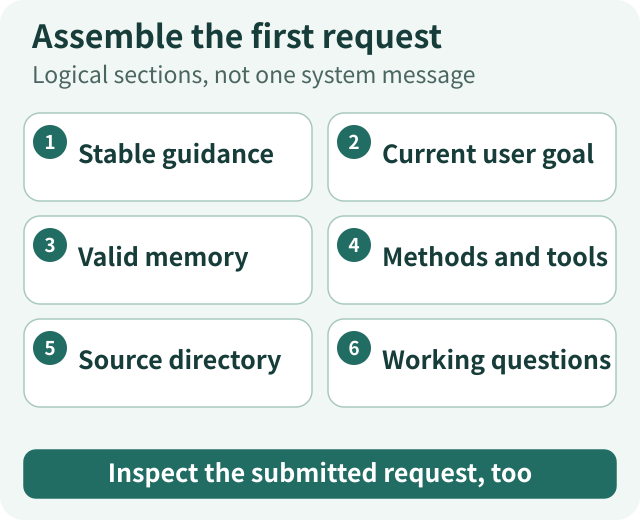
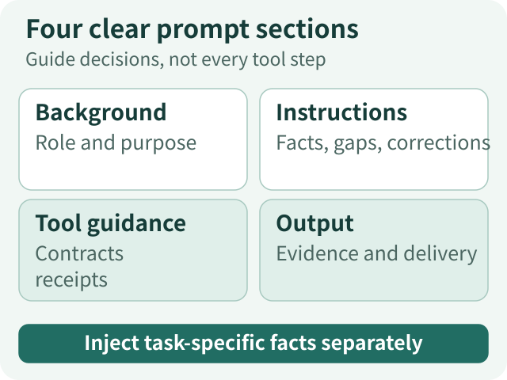
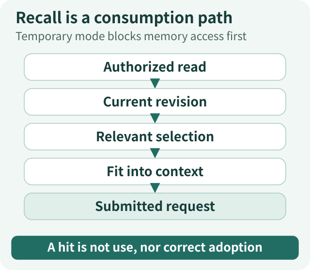
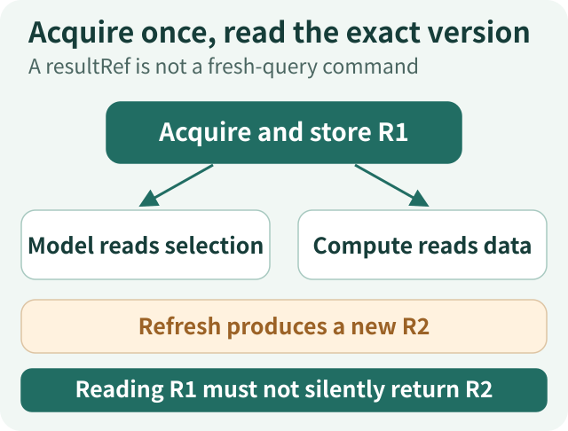
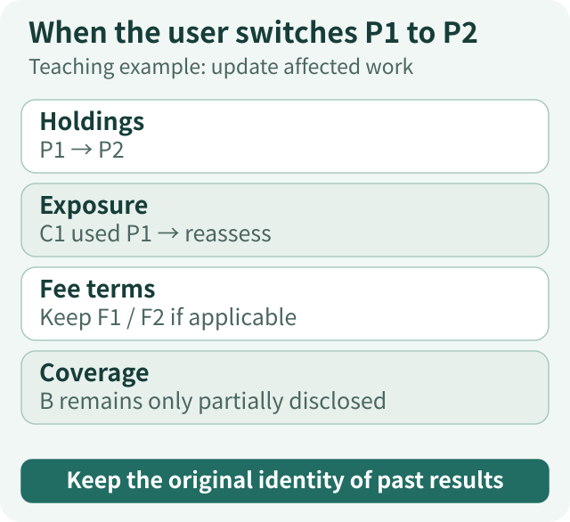
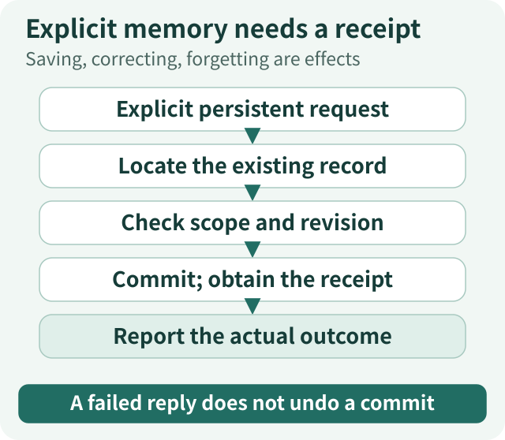
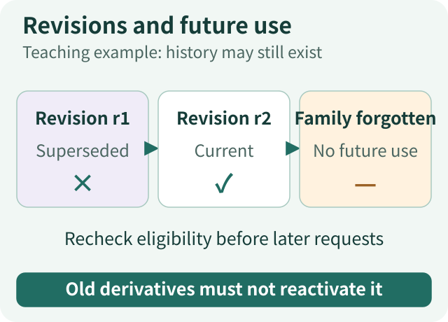
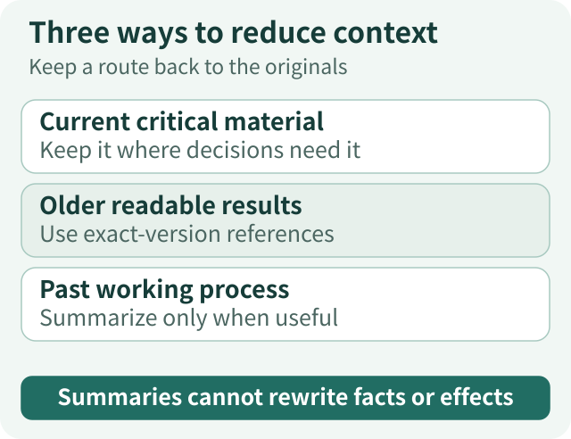
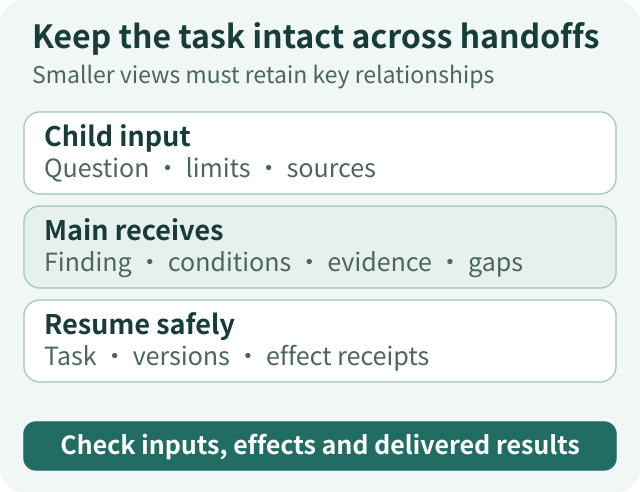

# Agent Context Governance Panorama · Practice: From the First Request to Long-Term Memory

[Panorama series](/en/panorama) · [Principles](/en/articles/agent-context-governance-principles) · [Practice](/en/articles/agent-context-governance-actions)

An agent needs to understand the goal, current evidence, action boundaries, routes to past work and unknown information, and the gap between its current position and completion. Those requirements do not assemble themselves into a useful model request.

Implementation raises more specific questions. What belongs in the system prompt? When should memory be read? Should a large tool-returned table travel with every request? Which material remains valid when the user changes a condition? When the model says “I will remember that,” how can we know it was saved?

**The implementation thread is to construct a current working view before each model invocation from the effective task, admitted material and actual execution records, then feed observations and changes into the next turn.** System instructions provide stable guidance, memory accumulates background across tasks, and tool results and progress support immediate work. They are not one continuously growing string.

We use a teaching task: compare funds A and B on fees and holdings overlap, incorporate uploaded personal holdings, and produce a source-backed report without rebalancing. During research, the user uploads new holdings and explicitly asks that future fund-research reports not default to short answers. The scenario, input aliases and code examples are educational—not production API contracts or one actual execution trace. The engineering material comes from ETF Agent's implementations and articles; this essay is not a claim that its public teaching repository implements every capability discussed.

This is not a checklist of mechanisms every request must activate. Defining a fund fee may need only a direct answer. Comparing particular funds calls for applicable fee terms, disclosures and correctly scoped calculations. Durable state, compaction and subagents become candidates only when multi-turn corrections, large inputs or actual recovery needs justify them. **Start with the smallest path that completes the task, then let observed failures justify extra mechanisms.**

## 1. Preserve the task before choosing the first input



*Figure 1: Logical sections, not one system message. Inspect the submitted request, too.* [Open full-size diagram](../../visuals/en/agent-context-governance-actions/01-first-request.svg)

Do not begin by searching or summarizing away the request. First preserve a route back to the original user text, explicit restrictions, submitted material and task identity. A compact task description can be built from those originals, but must not replace them.

The effective requirements in our example can be expressed as:

```text
Task: compare funds A and B on fees and holdings overlap.
Personal input: the user's uploaded holdings snapshot P1.
Delivery: a report with checkable sources, definitions and limits.
Restriction: research only; no rebalance execution.
Current gaps: share classes, applicable fees and comparable disclosures.
```

This is not a fixed tool plan. Fee evidence may support a conclusion before the holdings question is resolved. Incomplete holdings can lead to broader retrieval or a narrower stated scope. Uncertainty in the original request should remain visible rather than becoming an invented default while writing the task description.

Only then select the first model input:

| Input | Initial treatment | How it changes |
| --- | --- | --- |
| System prompt | Necessary, stable guidance | Changes through reviewed versions, not every webpage or recalled memory |
| Current user request | Goals, constraints and accessible original text | Explicit corrections enter later requests; earlier versions retain their origin |
| Relevant long-term memory | A small amount of current, eligible background, only when admitted | Selected for this task; correction and forgetting affect future eligibility |
| Methods and tools | Relevant methods or discovery routes, plus actually available tool contracts | Reflect admitted capabilities, selected methods and real availability |
| Documents and results | Useful navigation metadata and necessary passages first | Read as needed; preserve versions and coverage |
| Working progress | Initial questions or an explicit not-yet-started state | Updated by actual observations and revisable model assessments |

This separates responsibilities; it does not require six new tables or a context super-manager. Existing conversation, tool, memory, result and execution records can retain their owners while request assembly produces a consistent view.

## 2. Write the system prompt: separate stable guidance from dynamic material

### Concrete guidance without hardcoding the whole research route

The system prompt should explain how to work, not prewrite every step for every question. This compact teaching template uses four sections for background, behavioral principles, tool guidance and output requirements:

```xml
<background_information>
Help the user complete evidence-based research. The current goal,
material and capabilities are supplied with this request.
Understand the question, choose research routes, compare evidence
and organize the result.
</background_information>

<instructions>
Work toward the current user goal. Distinguish goals, constraints
and revisable plans.
Distinguish original sources, computed results, historical memory,
working hypotheses and previous answers.
When information is incomplete or conflicting, identify the specific
gap and its implications rather than inventing facts.
After a user correction, reassess affected work while retaining
evidence that remains applicable.
</instructions>

<tool_guidance>
Choose actions using the tool contracts actually provided;
do not assume unavailable capabilities exist.
Read existing material back through controlled routes. Acquire or
refresh material when new facts are needed.
Ask when the missing input is a user choice; unrelated searches
cannot replace that choice.
Report saving, changing and forgetting according to real receipts.
An unknown outcome remains unknown.
</tool_guidance>

<output_description>
Deliver what the user requested. Attach applicable conditions and
checkable evidence to important judgments.
Distinguish answered parts, unresolved questions and needed inputs.
Adapt presentation to the task; this section does not replace the
formal output protocol in tool parameters.
</output_description>
```

XML is a delimiter here, not a permission mechanism or mandatory format. Markdown headings can serve the same purpose. The application must still place trusted instructions, user messages and tool material in appropriate carriers; a wrapper alone cannot promote outside text into a system command.

Current product capabilities, user names, holdings, today's date and old memories should not be welded into the stable template. They originate elsewhere and are assembled for the task. Share classes and reporting-period rules belong in domain methods such as a relevant Skill. Parameter shapes and tool purposes belong in clear tool contracts.

ETF Agent separates entry-stage guidance from ongoing research guidance. Methods enter through their designated startup or on-demand reading paths. Reading an ordinary Skill body does not automatically reinject it as a system instruction. The point is to preserve origin and purpose, not to elevate every useful text to the highest priority.[3]

### Use representative examples, not a catalog of edge cases



*Figure 2: Guide decisions, not every tool step. Inject task-specific facts separately.* [Open full-size diagram](../../visuals/en/agent-context-governance-actions/02-system-prompt.svg)

A method description can include a typical case: A has complete holdings, while B discloses only its top ten. Known common holdings can be explained, but the result must not be called complete overlap. If the fee terms are complete, that part can still be answered independently. This makes partial answerability concrete without requiring dozens of fixed branches.

Funds and numbers in examples must be marked as illustrative, not treated as this user's data. A small set of representative tasks and counterexamples is more maintainable than turning every failure into a permanent prohibition. Anthropic likewise recommends starting with minimal sufficient guidance and adding clear instructions and representative examples in response to observed failure modes.[1]

Before changing instructions, locate the failure. If material never reached the model, fix the input path. If tools overlap ambiguously, fix their descriptions. If the issue is a domain method, start with that Skill. Only cross-task behavioral gaps deserve stable system instructions. Compare actual requests before and after a change for duplication and correct placement, then compare behavior on related tasks. Shorter text and structural checks are not substitutes for an effectiveness comparison.

## 3. Prepare the first request: admit memory, then expose real capabilities

### Decide whether memory may be read before choosing what to read

Suppose the user previously saved “Keep answers short.” A request for detailed comparison should not receive every historical record indiscriminately, and that old preference must not override the current request.

A first turn can receive a few current preferences or response constraints, with relevant historical discussions retrieved later as needed. Temporary mode should take effect before any memory-library access: no recall, save or automatic learning. Reading everything and asking the model not to use it is not equivalent. Denied access, unavailable reads and an actually empty library should remain distinct.[4]

Candidate selection should first exclude out-of-scope, invalid or forgotten records, then consider relevance, applicable time and capacity. Keyword or vector search discovers candidates; it does not prove they remain eligible. A few clear preferences can be prefetched, while long historical discussions are better retrieved on demand.

A memory fragment should explain what kind of background it supplies:

```text
Memory background: the user has usually preferred conclusions first,
followed by the supporting explanation.
Origin: an explicitly stated long-term response preference.
Use: organize presentation; the explicit depth request for this task applies.
Not loaded: unrelated historical discussions.
```

This is semantic guidance to the model, not a demand to inject every storage field. The backend still retains exact identity, revision, origin and eligibility so a changed record or resumed task can be resolved correctly.

### Tool presentation must neither expand authority nor hide viable routes



*Figure 3: Temporary mode blocks memory access first. A hit is not use, nor correct adoption.* [Open full-size diagram](../../visuals/en/agent-context-governance-actions/03-memory-consumption.svg)

Execution checks whether a call is permitted. The model-visible tool set should reflect this turn's real capabilities. Showing an unusable tool invites repeated failures; removing the lawful readback route merely because search failed hides a viable alternative.

Keep names, purposes, parameters and return semantics clear. Reduce ambiguity before mechanically minimizing tool count. Larger capability sets may use controlled discovery; discovered capabilities still undergo normal admission. “Can query” in a description does not create a grant, and a filename in a directory is not evidence of a completed read.[3]

### Inspect the first working view, not just the prompt file

For the teaching task, the first view might look like this. These are logical sections, not a recommendation to concatenate everything into one system message:

```text
Stable guidance: the current system-prompt version.
Current task: compare A and B; use P1; deliver a report; no rebalance.
Valid memory: conclusions before evidence; do not override requested depth.
Method entry: a brief fund-comparison description; read the body if needed.
Material entry: P1 and the A/B document directory with dates;
                a directory is not the document body.
Tools: admitted, available reading, search, computation, delivery
       and any necessary memory operations.
Working state: fee terms and comparable holdings remain to be checked.
```

Inspect the request that will actually be sent, not only the earliest assembly object. Capacity fitting, extension callbacks and model adaptation can alter tools, material and representation. Does the original task and correction remain? Are tool contracts unchanged? Did newly read content become an empty reference? Are recalled memories still the admitted, current records?

## 4. When information is missing, choose exact readback or a new observation

### Offer both discovery and deeper-reading routes

The model needs understandable next steps. A document catalog can expose product, version, reporting period, section and physical page. Search offers candidate sources. Reading obtains the required body text. A title hit must not be described as having verified the whole report.

A fee lookup may be brief: confirm the share class, find the fee section, read the applicable clause and inspect a footnote if necessary. Holdings overlap can require broader coverage and structured data. Tools should permit deeper reading as the question demands, not impose “first three pages only” or return the whole book every time.

Distinguish the question type. “Why did you make that judgment last time?” calls for the original report, sources and calculation. A new reporting period requires a new acquisition. A missing metric derivable from available data calls for computation. A missing user choice calls for a question.

### Store retrievable versions instead of moving all data through the model

ETF Agent retains authorized result versions and offers `resultRef` plus `read_tool_result` for later reading. The following uses teaching aliases, not executable production references:

```json
{
  "resultAlias": "R_B_1",
  "source": "A holdings disclosure for fund B",
  "dataAsOf": "2026-06-30",
  "representation": "top-10-holdings",
  "readStatus": "excerpt-read",
  "selection": {
    "fields": ["instrumentId", "weight"],
    "offset": 0,
    "limit": 10
  },
  "coverage": "The disclosed top ten only, not the fund's complete holdings"
}
```

The Host issues real references bound to the original result identity. Readback checks scope, version and readability. Refresh produces a new version instead of silently changing what `R_B_1` means. Identical query parameters do not make newly acquired data the original snapshot.[2]

Large tables can go directly to an admitted computation tool. The model selects the result reference and range; computation reads the original data and returns results, definitions, input identity and limits. The model can then inspect specific records when checking anomalies. What disappears is unnecessary copying—not the calculation's basis.

### Carry coverage through to the actual input



*Figure 4: A resultRef is not a fresh-query command. Reading R1 must not silently return R2.* [Open full-size diagram](../../visuals/en/agent-context-governance-actions/04-result-reread.svg)

In one controlled investigation, 50 source records became only 20 in the final model request.[2] A successful tool call was insufficient. Acquisition count, filtering, pagination, byte truncation, record identity and final representation can all affect coverage.

If only B's top ten are available, the model should know it can analyze known common holdings, not complete overlap. Fully reading a partial disclosure does not cover the whole object. An open-web search cannot establish that every relevant source has been found merely by returning several results.

Newly read critical content must not silently disappear during assembly. Older content may become exact readback references, retaining selection, origin and coverage. **Acquired, stored, reference-available and body-submitted are different stages.** None can certify the others.

## 5. New evidence and user corrections must change more than chat history

Suppose fee terms have been obtained and an exposure calculation used P1. The user now uploads P2 and says that the previous holdings are out of date.

Appending the sentence preserves it, but does not clarify which input to use next. A more useful update retains the correction and P2's identity, makes the changed input visible, preserves the fact that the old calculation used P1, and brings affected research questions back into the working state.

| Object | Before | After the correction |
| --- | --- | --- |
| Personal holdings | P1 | The task now uses P2; P1 remains historical |
| Fee clauses | F1 and F2 for checked share classes | Reusable if their relevant conditions have not changed |
| Personal exposure | C1 computed from P1 | Cannot simply become a P2 conclusion; reassessment or recalculation is needed |
| Fund B disclosure | Top ten only | Uploading P2 does not make this disclosure complete |
| Working questions | Synthesizing the comparison | Update personal exposure and retain the complete-overlap gap |

Code can record exact input versions and known dependencies. It cannot necessarily determine every semantic consequence with one generic rule. Defined domain calculations can use domain logic; broader reasoning may still need model or reviewer reassessment. Do not imply that a universal semantic-invalidation system already exists.

### Working notes describe questions; receipts describe execution



*Figure 5: Teaching example: update affected work. Keep the original identity of past results.* [Open full-size diagram](../../visuals/en/agent-context-governance-actions/05-user-correction.svg)

ETF Agent uses `researchNeeds` and `set_research_needs` for revisable research questions. Their intended content can be illustrated as follows:

```text
Fees: terms acquired; comparison is possible for the checked share classes.
Fund overlap: B's complete disclosure for the same period is missing.
Personal exposure: the user switched to P2; the previous calculation needs updating.
Delivery: give the supported fee conclusion first, then assemble the report.
```

A model marking a question resolved is a research assessment. Readable tool results, finished calculations and saved reports have separate factual records. Deleting a question cannot delete a user requirement; writing “saved” cannot replace a save receipt.[5]

Updating notes need not become a compulsory action every turn. Simple tasks and unchanged states can proceed directly. What matters is that important evidence, conflicts, corrections or phase changes produce useful context for subsequent decisions—not an obsolete plan.

## 6. Make memory effective: connect writing, recall, correction and forgetting to later requests

Memory does not happen only at the end. Explicit “remember,” “correct” and “forget” requests can occur at any point. Optional automatic learning may be triggered after a qualifying answer reaches a durable terminal state. These are not the same as “The model saw it, so it was automatically saved.”

### Explicit saving: the model interprets meaning; durable operations establish success

“Future fund-research reports should explain the evidence and definitions rather than default to short answers” expresses a continuing preference. “Explain this one in detail” may apply only now. Repeated wording during one task must not automatically become a permanent preference.

ETF Agent's explicit path searches memory in the current account, then proposes a save, revision or forgetting operation. The Host checks real user origin, target revision and durable operation identity. The logical sequence is:[4]

```text
An explicit persistent user request
→ search and locate an existing record, or establish an available empty result
→ propose a new record, replacement or forgetting
→ check scope, origin, target revision and operation identity
→ commit and obtain a receipt
→ report the receipt's actual outcome
```

The following storage sketch explains the design; it is not the project's literal schema:

```json
{
  "kind": "response_preference",
  "scope": "current account",
  "family": "research-answer-depth",
  "revision": 2,
  "content": "Fund research should explain evidence and definitions, not default to short answers",
  "origin": "explicit_user_request",
  "sourceRef": "original user message M2",
  "status": "active",
  "supersedes": { "revision": 1 }
}
```

A record should reveal who supplied it, where it applies, its current version and why it remains eligible. Model inference cannot become `user_confirmed` by itself. Failed or unknown writes do not justify saying “I will remember it from now on.” The present answer can still follow the explicit request while persistent adoption remains unconfirmed.

### Automatic learning: a candidate, not a hidden system-prompt edit



*Figure 6: Saving, correcting, forgetting are effects. A failed reply does not undo a commit.* [Open full-size diagram](../../visuals/en/agent-context-governance-actions/06-memory-effects.svg)

Experience from ordinary research is not always a user preference. “The user is probably conservative” may be the model's interpretation. A method working once does not make it mandatory for every future task.

Optional learning should propose candidates from admitted sources while separating semantic judgment from durable facts. ETF Agent's general default disables automatic semantic learning but retains explicit memory operations. Observation mode can keep candidates without activating them; automatic mode depends on separate configuration, source and resource conditions.[4]

Working notes are not synonymous with automatic learning. `researchNeeds` holds this task's questions. Autonomous cross-task notes may capture project exploration and decisions, but need an explicit save and readback path; they must not masquerade as user preferences. Turning experience into a Skill requires method review and an applicability decision, not automatic appending of global instructions.

### Recall: relevance is only one condition

On the next detailed request, the system verifies current records before putting relevant revisions into the actual input. A match for revision 1 cannot bypass revision 2. A highly similar forgotten record cannot become eligible background again.

Check the consumption path: **authorized candidates → current eligible records → task-relevant selection → capacity fitting → submitted model request**. Each step can omit material or fail. Empty search results, denied access, timeouts and capacity omissions must not all become “The user has no memories.”

Receiving memory still does not mean the model used it correctly. Evaluate whether the answer respects the current depth request separately; search-hit count is not that evaluation. ETF Agent counts actual dispatch use, not interface browsing, retrieval hits or historical replay as model use.[4]

### Correction and forgetting: prevent old content from returning through other paths

Correction retains revision relationships and makes subsequent selection use the eligible current version. Forgetting withdraws future-use eligibility. Look beyond the source row: old search results, caches, summaries, notes and delayed learning jobs may carry derived content.

The lifecycle design uses source and dependency relationships so later projection can inspect affected derivatives, rather than merely removing a row from the interface.[4] Depending on how reliably dependencies can be located, an implementation may filter, regenerate or withhold affected material. Replacing one keyword is not a general guarantee of complete forgetting.

An existing Run grant does not make old content valid forever. Authorization and content revision are different facts: an account-memory grant does not justify using a subsequently corrected or forgotten revision. New tasks independently obtain their permissions.

One useful test is a committed forget followed by an answer failure. The next task should continue excluding the content according to the real memory state; absence of a “forgotten” message in chat must not roll back the operation. Conversely, saying “forgotten” before a write commits does not establish that effect.

## 7. Reduce long-task context without removing the conditions for continuation



*Figure 7: Teaching example: history may still exist. Old derivatives must not reactivate it.* [Open full-size diagram](../../visuals/en/agent-context-governance-actions/07-memory-lifecycle.svg)

### Separate storage, residence and readback

A system can store a large amount of data without making the model carry all of it. Storage capacity, the automatically injected working set and an explicit read's capacity answer different questions. Reducing automatic injection must not make authorized material permanently inaccessible.

Start with repeated or older tool results that can be read back exactly. References should preserve source identity, version, selection and coverage. Newly acquired critical material, necessary user corrections and evidence currently used should remain visible to decisions that need them.

In one real research observation, Main made 37 native requests and 20 explicit reads; the same read results appeared again in later messages 279 times. Those were repeated payload appearances, not 279 extra external queries. A smaller working set for older readable results later reduced serialized input by more than 30,000 bytes in a controlled comparison. This establishes an assembly change; actual cost still depends on caching, readback and task outcomes.[2]

Do not optimize only for a shorter individual request. Premature removal can cause repeated reading. Keeping everything accumulates noise. Compare quality, elapsed time and total invocation cost for the whole task.

### When a summary is useful, treat it as a lossy working representation



*Figure 8: Keep a route back to the originals. Summaries cannot rewrite facts or effects.* [Open full-size diagram](../../visuals/en/agent-context-governance-actions/08-working-set.svg)

Semantic compaction differs from exact readback. A summary selects and rewrites information, so define what it may process, what must remain and what happens if it fails.

ETF Agent's within-Run Main compaction selects settled older working groups with original support, preserves recent turns and user text, and derives result references from real receipts. Its summary input primarily contains sealed model tool proposals; it does not claim to summarize every original document or hidden thought. The summary supplies working clues. “Already checked” in a summary cannot certify execution.[6]

Before adoption, place the summary and references back into the complete request and check actual gain and input identity. If the result saves too little, cannot fit or mismatches sources, retain the original representation or use the existing capacity path. Summarization itself consumes resources; no-benefit attempts should not be retried indefinitely.

Once adopted, record the replaced interval, sources, versions and request identity so reconstruction can resolve the originals. Within-task compaction and cross-task conversation history are also different: the former serves current execution; the latter supplies background for another task, without restarting the old Run or importing old notes as current progress.

### Delegation and recovery both reconstruct suitable local views

A fee-checking child needs fund identity, share class, its local goal, necessary constraints and admitted sources. It need not inherit all personal holdings, long-term memory and unrelated exploration. It returns findings, conditions, evidence and gaps; Main reconnects those to the overall task. “The fees are lower” is not an adequate handoff.[7]

Recovery is not merely a summary followed by “continue.” It reads the original task and corrections, effective input versions, working state, committed results and resource facts, then resumes at a supported point. Unknown effects are not automatically repeated. Missing local success feedback must not undo committed memory operations or saved reports.

These methods change what the model carries now. They must not reinvent the user's goal, original evidence or actual operations.

### Delegation, compaction and readback start as options

For a two-fund fee and holdings comparison, the default is **Main plus essential tools**. If a short original passage already answers the question, moving it out and fetching it again adds little value. Consider subagents when independent material creates context interference or comparable parallel execution produces benefits. They add model calls, handoffs, result identities and failure paths. Compaction must account for summarization, later reads and recovery costs, not merely a lower token count in one invocation.

## 8. Check one task end to end, not just a checkbox for every module



*Figure 9: Smaller views must retain key relationships. Check inputs, effects and delivered results.* [Open full-size diagram](../../visuals/en/agent-context-governance-actions/09-handoff-and-check.svg)

All components can exist while their handoffs still fail. Use cases such as these to compare actual requests, tool receipts and the final report:

| Test situation | Observable change to inspect |
| --- | --- |
| Same topic, one brief request and one detailed request | Stable guidance remains applicable; current requirements reach the model; old preferences do not override them |
| A 50-record source with a critical record near the end | Record identity and coverage reach the actual input; a partial result is not described as the whole set |
| The user changes P1 to P2 | Correction and new identity enter the next request; recalculation uses P2; older conclusions retain their original basis |
| A persistent preference is saved before a new conversation | A durable receipt exists; the current revision is recalled and submitted, not merely displayed in a settings panel |
| Correction or forgetting with old history retained | New requests no longer automatically use the old preference; derivatives and delayed jobs cannot restore old eligibility |
| Temporary mode | Memory reading, writing and automatic learning do not occur, rather than loading memory and promising not to use it |
| Continuation after compaction or delegation | Goals, corrections, unresolved questions and retrievable evidence remain; a summary does not become execution proof |
| Interruption after a tool settles or a file is saved | Continuation reads original facts; unknown effects remain unknown; completed effects are not blindly repeated |

These checks have different natures. Input identity, scope, versions and operation receipts permit deterministic checks. Understanding a fee exception or genuinely answering the user requires separate model or human review. Passing the first kind cannot substitute for the second.

Observation need not duplicate every private source. Ordinary records can keep request identity, composition, versions, capacity, representation and omission reasons. Read sensitive bodies through controlled routes when needed. Preserve observation gaps rather than inferring that missing logs prove something never happened.

Final delivery must answer the initial task: which personal input was used, what fee definitions apply, what portion of holdings overlap is covered, which questions remain unresolved, and whether the report can actually be obtained. Memory helps expression and continuity; system instructions stabilize judgment. Neither replaces the delivered result.

### Evaluate task quality alongside the cost of each mechanism

Keep user questions, fund-data versions, model settings and review criteria comparable when testing Main-only against optional readback, compaction or delegation. Examine whether the final report answers the question, computes numbers correctly, uses sound evidence, states disclosure limits and reaches the user. Measure calls, tokens, latency and failures as well. Without valid paired real-world observations, this remains an evaluation design, not evidence that multiple experts are better or cheaper.

Also measure the **normal-path tax**: when an advanced mechanism never activates, do routine requests still carry its tool descriptions, state and coordination logic? Persistent cost without observable task benefit argues for consolidation, conditional activation or retirement. Authorization, source authority and prevention of duplicate side effects are mandatory safeguards, not costs to waive in a simple optimization.

## Conclusion: connect the mechanisms through one task

Receive the task and preserve the original request. Assemble stable guidance and the current goal. Select eligible memory within admitted scope and expose usable tools and source entry points. Discover, read and compute around specific gaps. Let evidence and user corrections change subsequent inputs and progress. Carry out real memory operations when persistent accumulation is requested. Reduce context selectively as work grows, and keep delegation and recovery attached to the original facts.

This is how system prompts, memory, retrieval, references, working notes, compaction and subagents work together. Implementation is not a checklist of components; it is the repeated inspection of whether each information handoff still supports the same effective goal.

**Start with the next actual model request: does it know what to do, have the needed evidence, know how to retrieve past work and investigate unknowns, and contain memory and progress that remain valid?** Connecting those questions to real inputs and real results turns context governance into maintainable engineering.

## References and further reading

[1] Anthropic, September 29, 2025, [Effective context engineering for AI agents](https://www.anthropic.com/engineering/effective-context-engineering-for-ai-agents). A reference for system prompts, representative examples and context engineering. The template here is an educational example, not a quotation.

[2] [Why tool results do not always belong in model context](https://hpoenixf.com/eff-agent-article/en/articles/tool-results-outside-model-context). Versioned results, coverage, readback and the two input observations discussed here.

[3] [Model-facing tool presentation](https://hpoenixf.com/eff-agent-article/en/articles/agent-model-capability-presentation-tool-surface) and [Model, Runtime, MCP and Skill boundaries](https://hpoenixf.com/eff-agent-article/en/articles/agent-model-runtime-mcp-skill-boundaries). Responsibilities for methods, tools and final requests.

[4] [The full Agent Memory lifecycle](https://hpoenixf.com/eff-agent-article/en/articles/026-agent-memory-forget-durable-effects). Explicit effects, optional learning, current revisions, dispatched consumption and forgetting.

[5] [Why AI agents also need Thinking, Fast and Slow](https://hpoenixf.com/eff-agent-article/en/articles/agent-thinking-fast-slow-research-needs). Revisable research notes and task routing.

[6] [Within-Run compaction](https://hpoenixf.com/eff-agent-article/en/articles/agent-main-run-context-compaction) and [cross-Run history compaction](https://hpoenixf.com/eff-agent-article/en/articles/agent-conversation-history-compaction-source-boundaries). Different inputs and responsibilities for two kinds of historical processing.

[7] [Subagents: context isolation and specialization](https://hpoenixf.com/eff-agent-article/en/articles/agent-subagent-context-specialization). Local views and research handoffs.

---

Both essays stand on their own. [Principles](/en/articles/agent-context-governance-principles) develops the overall model; [Practice](/en/articles/agent-context-governance-actions) explains implementation.

Explore the public engineering examples in [Open ETF Agent](https://github.com/hpoenixf/open-etf-agent). If the series helps your work, a Star is welcome. The repository documents the actual scope of its public implementation.
