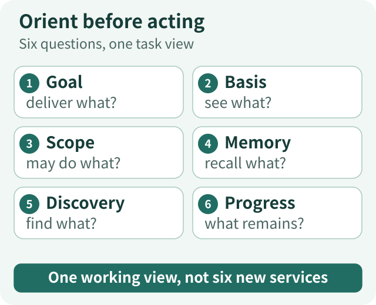
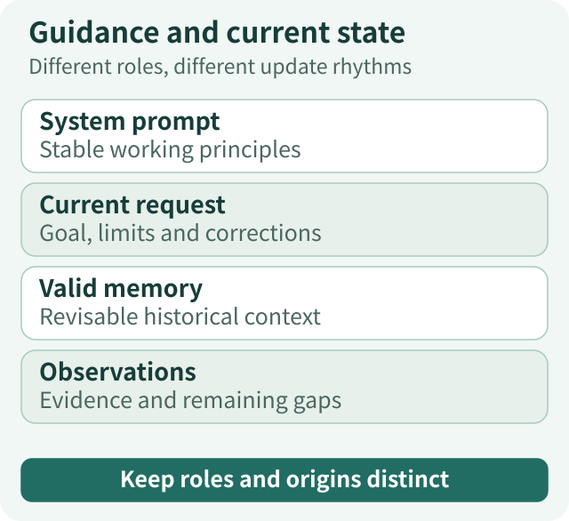
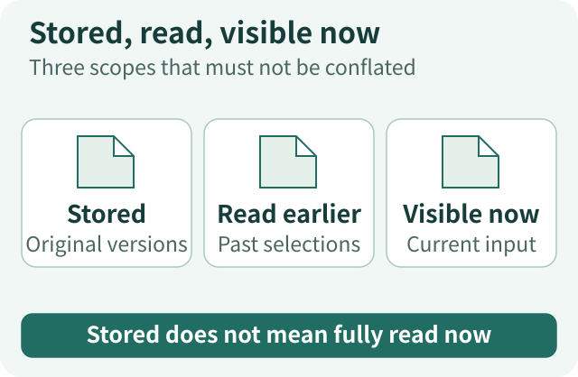
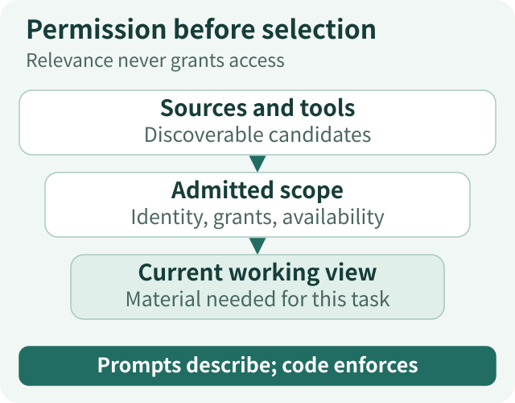
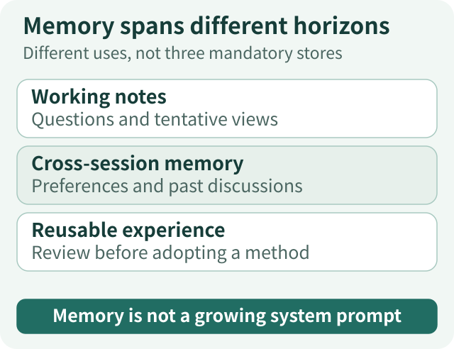
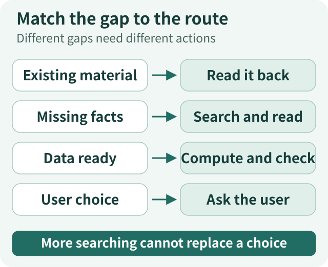
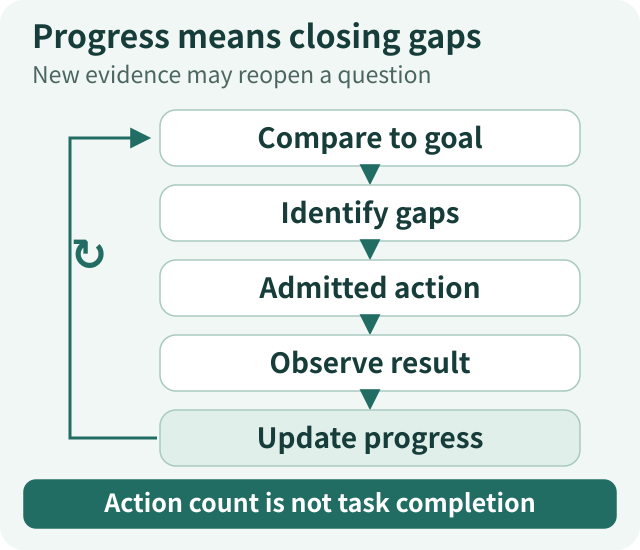

# Agent Context Governance Panorama · Principles: Keep Every Decision Aligned with the Goal

[Panorama series](/en/panorama) · [Principles](/en/articles/agent-context-governance-principles) · [Practice](/en/articles/agent-context-governance-actions)

A model may know how to compare funds without knowing whether this user cares about fees or overlapping holdings. It may have just read a report without knowing whether the next invocation will still contain the original passage. It may remember that the user usually prefers short answers while missing an explicit request for depth this time.

These problems cannot all be explained by saying that the model is not intelligent enough. The system must connect general knowledge with the circumstances of the task in front of it.

**Context should let the model understand, at this particular step, the goal it is pursuing, the evidence it can reason from, the actions it may take, and how to build on work already done.** System instructions, tool descriptions, current material, memory and progress all contribute to this task view. They must cooperate without becoming an undifferentiated block of background text.

In *Effective context engineering for AI agents*, Anthropic expands the engineering focus from prompt wording to selecting and maintaining the information available at each inference.[1] Our goal-oriented question follows that direction: not “What else can fit in the window?” but “What must the model know now to make a useful next decision?”

A teaching task runs through this article. A user wants to compare funds A and B on fees and holdings overlap, incorporate a newly uploaded personal-holdings snapshot, and receive a report with checkable evidence—without executing a rebalance. During research, the user supplies updated holdings and asks for conclusions first, followed by analysis. This is a synthetic design example, not actual investment advice.

## The overall map: context helps the agent orient itself

*Figure 1: Six questions, one task view. One working view, not six new services.* [Open full-size diagram](../../visuals/en/agent-context-governance-principles/01-task-map.svg)

| Question facing the agent | What context contributes |
| --- | --- |
| What should I accomplish? | Preserve goals, constraints and delivery requirements so methods and plans serve the task. |
| What have I actually seen this time? | Present current evidence, origin, dates and coverage; distinguish known information from different kinds of unknowns. |
| What may I access and do? | Explain the lawful and available action space; needing something does not grant permission. |
| Where can I find past work? | Make original requests, experience, material and outputs retrievable, creating an accumulation that can be corrected. |
| Where can I find what is still unknown? | Offer routes for discovery, reading, computation and questions, turning gaps into possible actions. |
| How far have I progressed? | Compare results with the goal rather than measuring progress by action count. |

These are not six mandatory new services or a form the model must complete every turn. They explain a single capability: **understanding the current situation well enough to choose what comes next.**

Some parts of that situation are stable; others change continually. The system prompt provides working principles across tasks. The current request defines the immediate goal. Memory supplies selected historical background. Observations and progress evolve as execution proceeds. Putting information with different purposes and update rhythms into one giant prompt makes understanding, maintenance and correction harder.

## 1. Direction: the system prompt defines how to work; the user defines this task

### A system prompt is neither a biography nor a complete workflow

“You are a professional, rigorous researcher” expresses an aspiration. It does not explain how to handle incomparable data, conflicting sources or a partially missing input. At the other extreme, “Call tool A, read the first three pages, then call B after two failures” turns research into a program that adapts poorly to change.

Between these extremes, a system prompt is better used for **stable, transferable working principles**: distinguish facts from assumptions, retain the conditions attached to a conclusion, identify specific evidence gaps, use available tools to obtain necessary material, and do not treat your own prose as proof that an external operation succeeded.

Those principles do not choose the first report to read. They influence how the model uses whatever it finds. Domain methods can add share classes, fee definitions and reporting periods in an appropriate Skill, rather than making every unrelated question carry the full research methodology.

The division matters: **system instructions give stable behavioral direction; a Skill supplies an applicable method; the user request establishes the current goal; tool feedback describes actual conditions.** Systems may use different message formats. Moving a memory or webpage into a high-priority position must not give it instructional authority it never had.

### Goals, methods and plans are not substitutes

*Figure 2: Different roles, different update rhythms. Keep roles and origins distinct.* [Open full-size diagram](../../visuals/en/agent-context-governance-principles/02-guidance-and-state.svg)

The goal of comparing funds is not to complete three searches. It is to explain fee differences and overlapping exposure under applicable conditions, then deliver a source-backed report. Checking the share class is a method. Looking up fees before reading holdings is a provisional plan.

Suppose the fee terms are sufficient, but the holdings disclosures cover different periods. The model can answer the fee question first, look for comparable disclosures, or explain that only known common holdings can be examined. The plan may change. The requested comparison must not quietly turn into “Here are some market news articles I found.”

When the user says “Use the new holdings,” that is not optional historical trivia. It changes the input required for subsequent analysis. The correction must reach later decisions. The original message can remain in external storage, but the effective conditions used for the current decision cannot remain stuck on the old version.

To decide whether guidance deserves permanent residence, ask whether it is needed across tasks and whether it changes decisions. Also ask whether the prompt repeatedly makes the model guess something already established by parameters or code. Minimal sufficiency is about clear responsibilities, not mechanically reducing word count.

## 2. Evidence: stored, previously read and currently visible are different scopes

*Figure 3: Three scopes that must not be conflated. Stored does not mean fully read now.* [Open full-size diagram](../../visuals/en/agent-context-governance-principles/03-visible-scopes.svg)

A file in a library is not necessarily text the model has read in this request. A table seen in the previous turn may no longer retain its original values after context reduction. A tool returning a title or reference does not mean that the relevant clauses entered the current input.

In a controlled ETF Agent investigation, a source contained 50 records, but an intermediate limit allowed only 20 into the actual model input. The model had not forgotten the remaining 30; it had never received them.[2] Adding “Please analyze all holdings completely” cannot repair that input-path gap.

Context therefore needs more than content. It needs enough information to assess applicability: which document and version, what data period, and whether the representation is a full document, selection or summary. A report acquired today may disclose holdings from the previous quarter. Reading an entire top-ten holdings table still does not reveal the fund's complete portfolio.

Unknowns also differ. Not yet searched, searched without a result, access denied, source temporarily unavailable and conflicting records imply different next actions. Collapsing them into “No relevant information” removes the basis for choosing those actions.

The model's own earlier judgments also need to retain their identity. “I think overlap is high” can be a hypothesis to test. Repeating it in history does not create an independent source of fact.

**This part of context tells the model what its judgments can rest on and how far that support extends.** Accurate input does not guarantee an accurate answer, but it is an important prerequisite for checking one.

## 3. Boundaries: needing information does not grant access

*Figure 4: Relevance never grants access. Prompts describe; code enforces.* [Open full-size diagram](../../visuals/en/agent-context-governance-principles/04-permission-and-selection.svg)

A fund comparison may require public documents and personal holdings. Reading, calculating, saving a report and trading are different capabilities. “This analysis needs it” cannot automatically authorize any of them.

Context must make this action space understandable. Tool names and descriptions explain purpose. Current availability indicates whether a route is workable. Grants establish which sources and operations can be used. Actual authorization remains an application decision, not something established by the model saying that the user agreed.

**Admitted scope and relevance to this turn are separate questions.** A document may be authorized without needing to appear in every request. Content already in context does not thereby become an instruction. A fund report's recommendation is material to analyze, not an instruction from the user to execute a transaction.

Local failure must not be incorrectly widened into global prohibition. Losing the ability to search need not remove lawful access to stored results. Missing evidence for a full overlap calculation need not prevent an explanation of fee differences. Tool presentation and failure feedback should expose the remaining routes instead of returning an unscoped “failed.”[3]

This is why prompt guidance and deterministic execution must cooperate. One helps the model understand the boundary; the other enforces it. Formatting, attribution and tool contracts all help, but no textual format alone provides a complete security guarantee.

## 4. Memory: let the past accumulate without turning it into a new bias

### Memory is more than moving chat history outside the window

Application-level memory is information the system chooses to retain and permits later tasks to reuse. It is neither knowledge in model parameters nor simply a shorter summary of an entire conversation.

In the example, “The user prefers conclusions before explanation” may be useful across tasks. “We still lack B's complete disclosure” is working state for this research. “Last time we used a particular quarterly report” is a historical event. A fund's applicable current fees or NAV must still come from an appropriate source. All may be useful later, but they differ in purpose and lifetime.

Three horizons help explain this accumulation without requiring three databases. **Working memory within a task** helps the current research continue. **Cross-session user or project memory** avoids repeated explanations and preserves enduring background. **Reusable experience** may become a method candidate and, after review, part of a Skill. Neither one success nor one failure should directly become a system rule governing every task.

### System instructions guide; memory supplies background

*Figure 5: Different uses, not three mandatory stores. Memory is not a growing system prompt.* [Open full-size diagram](../../visuals/en/agent-context-governance-principles/05-memory-scales.svg)

The system prompt may say, “Respect the current request and retain conditions attached to facts.” Memory may add, “This user usually prefers short answers.” When the user asks for detailed analysis now, memory can help organize the response, not veto the request.

This does not mean that the latest text always overrides everything. Safety constraints, current user instructions, historical preferences and external documents have different responsibilities. Conflicts must be assessed by origin, scope and purpose. A user can correct an old preference; that preference cannot determine a product's current fee.

Memory is therefore not an ever-growing hidden system prompt. Recalled information should retain its user or project scope, source, time, revision and purpose. It enters the task as background to interpret. Storage does not turn it into verified fact or extra permission.

### Writing, recall and forgetting all matter

“State the fee basis first in future fund comparisons” and “State the fee basis first this time” have different persistent implications. A guess made during ordinary conversation is different again. The model may interpret the meaning, but durable records must establish whether anything was actually saved, for whom, and whether it replaced an earlier record.

We separate writing, recall and lifecycle management. Explicit saves need real operation receipts. Recall checks scope and record eligibility before relevance to the current goal. Correction, expiry and forgetting must alter future-use eligibility rather than merely changing a label in the interface.[4]

Consider a teaching example. The user first saves “Keep answers brief,” later changes it to “Research reports should explain their evidence and definitions,” and finally asks to forget that preference. The system should not inject both versions and ask the model to choose. Nor should an old summary make the brief-answer preference active again after forgetting. Forgetting governs future automatic use; it cannot retract content already sent elsewhere, and it need not pretend that historical records never existed.

Memory's value depends on helping the current task, not the size of the library. Saving, retrieving a match, including it in the request and using it correctly are four different steps. A good memory system retains important information while keeping irrelevant, invalid or withdrawn information from distorting judgment.

## 5. Discovery: classify the gap before choosing recall, search, computation or a question

*Figure 6: Different gaps need different actions. More searching cannot replace a choice.* [Open full-size diagram](../../visuals/en/agent-context-governance-principles/06-information-paths.svg)

Memory and history solve some problems, but not every missing answer is hidden in the past.

For a fee clause already acquired, read the original result back. For an unfound disclosure version, search external sources. When the data is complete but the overlap metric is missing, compute it. When the missing input is which account the user wants analyzed, ask the user. More internet searches will not make that choice for them.

Context should therefore expose **the relationship between a question and a route to information**. A catalog identifies potentially useful material. Metadata helps assess versions and periods. Reading tools expand the original text. Computation processes acquired data. Neither an unexplained opaque address nor a complete dump of every document supports purposeful discovery well.

Just-in-time acquisition lets the model deepen understanding: find a report, read a section, discover a period mismatch, and revise the query. Result references retrieve an existing version; acquiring new material produces a new observation. Reading an old result must not silently become a new external query.[2]

Each step has a cost. Coarse catalogs can cause repeated exploration; excessively small selections increase round trips; prefetching everything can introduce irrelevant material. A practical balance is to provide the goal and a little essential background first, with clear discovery and deeper-reading routes for the rest.

**Context need not preload every answer, but it should make important gaps understandable and give them authorized routes toward resolution.**

## 6. Progress: know what has happened—and what is still missing

“Twelve tools have been called” does not establish that research is close to completion. Twelve searches might still fail to find comparable data. One accurate reading could resolve the decisive fee question.

A more useful progress note would be:

> Both fee clauses have been acquired and the share classes checked. B still has only partial holdings disclosure, so complete overlap remains unconfirmed. The user uploaded new personal holdings, so the previous exposure calculation needs updating. The report body has not yet been saved.

This brings available results, unresolved gaps, affected work and delivery status back to the same goal. The model can choose to deliver fees first, update the calculation, continue looking for disclosure or explain the limits of the available conclusion.

ETF Agent's `researchNeeds` stores a bounded set of revisable working questions whose states the model can update as evidence changes.[5] But “This question is resolved” is a model assessment; “The tool returned readable material” and “The report was saved” are execution facts. Working notes cannot override the original request or substitute for actual receipts.

Progress can also move backward. A changed input can require recalculation. New counterevidence can reopen a question. This is not necessarily a defect; it may show that research has correctly absorbed new information.

**The goal is the reference point, working notes are a revisable understanding, execution records describe actual events, and delivery is what reaches the user.** These are related, but should not become one ambiguous `completed` field.

## 7. Continuity: change material, windows or executors without losing the task

*Figure 7: New evidence may reopen a question. Action count is not task completion.* [Open full-size diagram](../../visuals/en/agent-context-governance-principles/07-goal-feedback.svg)

Once goals, evidence, boundaries, memory, discovery and progress are clear, context governance is no longer a one-time preparation step.

When personal holdings change, the system preserves the correction's origin and the new input identity so the model can reassess affected calculations. Fee terms may remain applicable, so there is no need to reacquire everything. New evidence may change whether a previous conclusion holds. Correcting a memory must also prevent subsequent requests from automatically carrying the old revision.

The ongoing process is: **compare with the goal, identify a gap, choose an admitted action, obtain an observation, update evidence and progress, then decide again.** It is feedback, not endless mechanical message appending.

As the window grows, older material can become exact readback references and old exploration can become a summary. The connections among current goals, important corrections, unresolved questions and evidence must remain. Summaries support continuity of understanding; original sources and execution records stay outside the window.[6]

Delegation constructs a local task view. A fee-checking child needs product identity, share class, the fee question and relevant constraints—not necessarily all personal holdings. Its handoff should contain findings, conditions, evidence and remaining questions so Main can reconnect the work to the overall goal. “Lower fees” is not enough.[7]

Resuming after interruption requires durable records of the effective task, original inputs and actual progress. An unknown operation cannot be treated as never executed merely because a summary lacks a success statement. A saved report need not be regenerated just because the process changed.

Together these methods protect something more useful than preserving every character forever: **the next step can still proceed from an accurate understanding of the situation.** The relationships being preserved matter more than any single representation inside the window.

## Conclusion: context as a sustainable understanding of the task

Return to the fund comparison. System guidance stabilizes how the agent treats facts and gaps. The request defines this task. Valid memory supplies suitable background. Current evidence supports judgments. Tools and information entry points enable discovery. Progress makes the remaining work visible. Together, they establish the conditions for the next action.

Evaluate a context design through concrete changes: does a user correction affect subsequent analysis? Can past material be recovered at the original version? Does a forgotten preference disappear from future inputs? Does the model recognize partial disclosure? Does the work converge toward the requested output?

Shorter requests, more memory and richer tools describe local changes. The real question is how those conditions help a task reach an accurate, clear result.

**Good context governance does not require an agent to know everything at all times. It lets the agent know what to rely on now, what remains missing, and how its next step can move closer to the goal.**

## References and further reading

[1] Anthropic, September 29, 2025, [Effective context engineering for AI agents](https://www.anthropic.com/engineering/effective-context-engineering-for-ai-agents). A conceptual reference for context engineering; this article's goal-oriented organization synthesizes engineering practice.

[2] [Why tool results do not always belong in model context](https://hpoenixf.com/eff-agent-article/en/articles/tool-results-outside-model-context). External results, actual input coverage and exact readback, including the controlled 50-to-20 example.

[3] [The agent has the tool—why can the model not see it?](https://hpoenixf.com/eff-agent-article/en/articles/agent-model-capability-presentation-tool-surface). Tool purpose, admission and final model-visible capabilities.

[4] [The full Agent Memory lifecycle](https://hpoenixf.com/eff-agent-article/en/articles/026-agent-memory-forget-durable-effects). Application memory writing, recall and lifecycle; not knowledge in model parameters.

[5] [Why AI agents also need Thinking, Fast and Slow](https://hpoenixf.com/eff-agent-article/en/articles/agent-thinking-fast-slow-research-needs). Task routing and revisable research questions.

[6] [Within-Run context compaction](https://hpoenixf.com/eff-agent-article/en/articles/agent-main-run-context-compaction) and [cross-Run conversation-history compaction](https://hpoenixf.com/eff-agent-article/en/articles/agent-conversation-history-compaction-source-boundaries). Historical reduction at different scales and the boundaries of source authority.

[7] [Subagents: context isolation and specialization](https://hpoenixf.com/eff-agent-article/en/articles/agent-subagent-context-specialization). Local tasks, exploration and evidence handoff.

---

Both essays stand on their own. [Principles](/en/articles/agent-context-governance-principles) develops the overall model; [Practice](/en/articles/agent-context-governance-actions) explains implementation.

Explore the public engineering examples in [Open ETF Agent](https://github.com/hpoenixf/open-etf-agent). If the series helps your work, a Star is welcome. The repository documents the actual scope of its public implementation.
