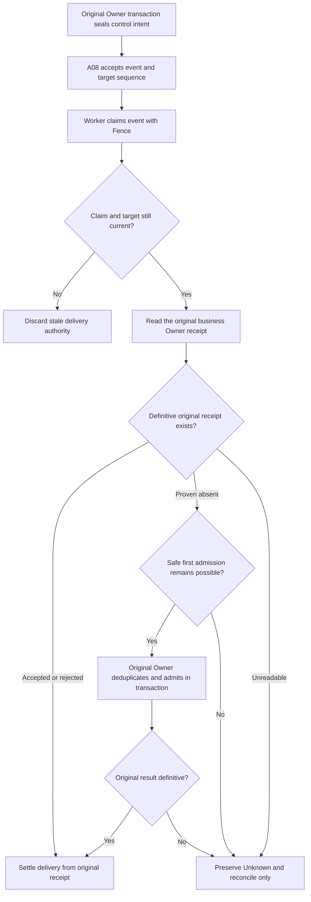

# Why an Agent Cannot Execute a Stop Command Immediately: A08 Durable Control-Event Handoffs

A background research task is still running when the user selects Stop. Another worker later takes over and discovers a command waiting in the database. Can it simply execute the stop again? What if the previous worker had already stopped the original task, but disconnected just before recording its delivery acknowledgment?

This is the reliability problem ETF Agent has had to make explicit: **reliably delivering a command is not the same fact as committing the business effect requested by that command.** Treat delivery as success and you may overlook an effect that never happened. Treat a missing acknowledgment as proof of non-execution and you may stop, wake, or dispatch a protected action twice.

A08 owns a narrow durable-control channel: command identity, ordering, claims, eligibility and delivery settlement. It does not acquire authority to terminate a Run, admit a correction, create a scheduled Task or resume a Child. Those effects remain with their original Owners.

## 1. Why an ordinary event bus is not durable control

The word *event* describes several genuinely different things in an Agent system.

| Event kind | Final Owner | What the result actually proves |
| --- | --- | --- |
| Lifecycle Hook | A29 | Which callback was selected and ran, and its local result |
| Durable control command | **A08** | Admission, claim, delivery and settlement against the original business receipt |
| Conversation progress or publication event | A24 | Content version, sequence, delivery and History readback |
| Call trace or passive audit observation | E04 and other observation capabilities | What was captured, what is missing and what remains unknown |

An ordinary tool completion does not have to produce all four branches. Its Tool Result may go directly back to research. A persistent wake or stop command exists only when a real control need has been established. A Stop suggestion from a Hook cannot unilaterally terminate a Run; a sent SSE frame cannot certify user visibility or a committed effect.

We did not create an omnipotent EventBus that decides research, budgets, publication and memory. A08 owns the handoff that genuinely needs to survive a process boundary.

## 2. Seal command identity before a worker claims it

A durable command needs more than the string `"stop"`. It carries the authorized subject, original producer, target identity and revision, plus stable identities for deduplication and ordering.

In the current implementation, the producer's `producerKey` is paired with the original event fingerprint. Replaying the same intent and exactly the same content yields the original fact. Reusing that key for changed content is an identity conflict, not an invitation to overwrite history. An accepted event receives an `eventId`, and the delivery command uses `commandKey = control:eventId`. A sequence and target revision preserve the order of commands accepted for the same target even if workers scan the queue in different orders.

Why distinguish an *intent* from an accepted *event*? Some original domain facts must be committed atomically with an intention to deliver control. `stageInTransaction` allows both to roll back together if that original transaction fails. A later Relay turns the already-recorded intent into an eligible event; it does not execute a model, tool or domain effect. A future timer intention is not admitted prematurely, as doing so could occupy the target's sequence and delay a user correction that is valid now.

Backpressure also needs precise accounting. Unfinished intents, pending/claimed/unknown events and reserved capacity can all occupy bounded Scope space. An unknown effect cannot be erased merely to make the queue count look smaller.

## 3. Claims and fences: possession is not perpetual authority

Two workers can inspect the same queue concurrently. A08 selects eligible work in a short database transaction and records a worker identity, expiration and incrementing `fence`. The target revision and compatible consumer are also checked; a command for a superseded target must not retain operational force.

**A claim valid at dequeue time may no longer be valid when the domain effect is admitted.** External I/O, scheduler pauses and storage retries can outlive the lease. The original business Owner therefore checks the same command identity, worker, fence, target and live expiration inside its own transaction before admitting an effect.

This does not turn A08 into a second authorization authority. A claim only says which sealed command a worker may presently deliver. The original Owner still determines whether identity, permissions, resource constraints and domain state permit the requested effect.

## 4. Read the business receipt before deciding to redeliver

A valid handoff follows this flow. *Unknown* does not mean merely a temporary network failure; it means the original business effect cannot yet be proved to have happened or not happened.

The original Owner's `readReceipt` may return `null` only when the authoritative store positively establishes that the receipt does not exist. A database read failure must throw rather than masquerade as null. Deferral followed by a new admission can be safe only when no uncertain dispatch has occurred and the original Owner can prove its admission transaction rolled back. If admission began and the result disappeared, or an earlier claim is marked `ownerUncertain`, the event must remain unknown. Subsequent delivery attempts reconcile the original receipt first; they must not assume it is safe to invoke `admit` again.

Exhausted delivery attempts or unsupported commands can be quarantined. Quarantine records a bounded disposition. It is neither a successful domain effect nor permission to discard the underlying uncertainty.

## 5. A synthetic lost-ACK incident

Imagine that the original Run Owner atomically admits a stop request and records an `accepted` domain receipt. The worker crashes before changing A08's claimed delivery status to acknowledged. After the lease expires, another worker may claim the same `eventId` with a new fence.

The correct action is to **query the original receipt under the same `commandKey`**. If the original accepted fact exists, only the delivery record is settled. In another failure branch, neither the original transaction outcome nor its receipt can be checked. Even if the caller saw a timeout, A08 preserves unknown until the domain Owner can independently reconcile the outcome.

| Observable situation | What can be established | Appropriate next step |
| --- | --- | --- |
| Original Owner has `accepted`; A08 has no ACK | Domain admission occurred; delivery settlement is behind | Reuse the receipt and settle delivery without repeating the effect |
| Original Owner proves absence and no uncertain effect existed | Eligibility for a first admission can be checked | Attempt admission with a live fence in the original transaction |
| Owner store is unreadable or commit status is ambiguous | Domain outcome is not established | Preserve unknown; do not invent another action |
| Target revision changed or claim expired | Old delivery authority is invalid | Reject the stale claim, without deciding for the new revision |

This is a teaching reconstruction of current contracts, not a disclosed real user's Stop log. The difficult failure falls precisely between two durable facts: the original effect has been admitted, but the delivery ACK has not committed. Adding a single global `completed` flag does not remove that sequencing problem.

## 6. How A08 cooperates with HIO, Tasks and Recovery

A37 HIO owns a human interaction request and response identity. When the user reply needs to resume the original research, Correction or Recovery still makes the legitimate continuation decision; a durable control command is used only where a real handoff requires it. A09 owns confirmed schedules, Task creation and cancellation. Receiving `timer_due` does not let A08 mint research budget. A06 decides whether a Run continues, enters bounded finalization or reaches a technical terminal state. An A08 ACK is never a substitute for A06's Run outcome.

A common objection is, "Why not put all this state in one table?" The number of tables is not the governing question. **The real danger is giving one effect two final decision-makers.** Shared identities and lock ordering can be useful; letting a delivery component declare the underlying business effect successful is not.

## 7. What exists today—and what still needs evidence

As of October 24, 2026, main contains a ControlEventRepository, ControlEventService, original-Owner transactional identity checks, intent Relay, claim/fence logic, receipt coordination, unknown/quarantine states and bounded backpressure. The control mechanisms connect to selected scheduled-task, correction and research-control paths. This article describes implemented handoffs, not a proposed universal EventBus.

That does not prove every target, deployment or cross-process failure has passed one unified end-to-end qualification. A real control command's intended Run, Task or Child effect must still be checked against the domain receipt. Correct model questioning and readable published reports are also outside the claim established by A08's queue state.

**Reliable control does not mean only that a message was sent at least once. It means failure still leaves us able to distinguish "the event arrived," "the original effect was admitted," and "the outcome is not yet known."**

---

## Further reading

[Durable human response adoption](https://hpoenixf.github.io/eff-agent-article/en/articles/agent-durable-human-interaction-response-adoption) explains A37's admission boundary; [scheduled research](https://hpoenixf.github.io/eff-agent-article/en/articles/agent-autonomous-scheduled-research) describes A09's long-lived Task obligations; and [asynchronous delivery](https://hpoenixf.github.io/eff-agent-article/en/articles/agent-asynchronous-research-time-bound-delivery) explains A24's notifications and History.

Read more in [ETF Agent Engineering Notes](https://github.com/hpoenixf/eff-agent-article), and Star the repository to follow the series.
