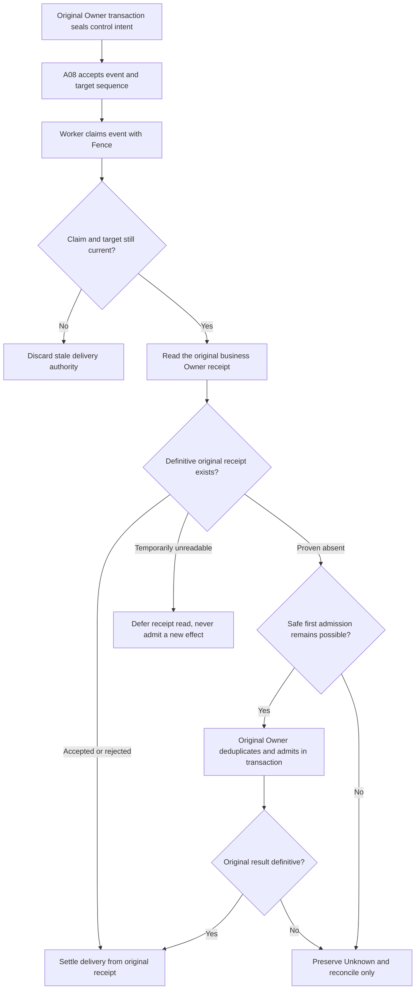

# Why an Agent Cannot Execute a Stop Command Immediately: A08 Durable Control-Event Handoffs

A background research task is still running when the user selects Stop. Another worker later takes over and discovers a command waiting in the database. Can it simply execute the stop again? What if the previous worker had already stopped the original task, but disconnected just before recording its delivery acknowledgment?

This is the reliability problem ETF Agent has had to make explicit: **reliably delivering a command is not the same fact as committing the business effect requested by that command.** Treat delivery as success and you may overlook an effect that never happened. Treat a missing acknowledgment as proof of non-execution and you may stop, wake, or dispatch a protected action twice.

A08 owns a narrow durable-control channel: command identity, ordering, claims, eligibility and delivery settlement. It does not acquire authority to terminate a Run, admit a correction, create a scheduled Task or resume a Child. Those effects remain with their original Owners.

This article first explains the original system's A08 handoff design, then uses the [public Open ETF Agent implementation](https://github.com/hpoenixf/open-etf-agent) to inspect a narrower path: SQLite-backed claims, cancellation and restart recovery for the same Run. That slice runs independently; it is not a port of A08's multi-Owner control-event bus. The distinction matters throughout the comparison.

## 1. Why an ordinary event bus is not durable control

The word *event* describes several genuinely different things in an Agent system.

| Event kind | Final Owner | What the result actually proves |
| --- | --- | --- |
| Lifecycle Hook | A29 | Which callback was selected and ran, and its local result |
| Durable control command | **A08** | Admission, claim, delivery and settlement against the original business receipt |
| Conversation progress or publication event | A24 | Content version, sequence, delivery and History readback |
| Call trace or passive audit observation | E04 and other observation capabilities | What was captured, what is missing and what remains unknown |

An ordinary tool completion does not have to produce all four branches. Its Tool Result may go directly back to research. A persistent wake or stop command exists only when a real control need has been established. A Stop suggestion from a Hook cannot unilaterally terminate a Run; a sent SSE frame cannot certify user visibility or a committed effect.

We did not create an omnipotent EventBus that decides research, budgets, publication and memory. A08 owns the handoff that genuinely needs to survive a process boundary.

## 2. Seal command identity before a worker claims it

A durable command needs more than the string `"stop"`. It carries the authorized subject, original producer, target identity and revision, plus stable identities for deduplication and ordering.

In the current implementation, the producer's `producerKey` is paired with the original event fingerprint. Replaying the same intent and exactly the same content yields the original fact. Reusing that key for changed content is an identity conflict, not an invitation to overwrite history. An accepted event receives an `eventId`, and the delivery command uses `commandKey = control:eventId`. A sequence and target revision preserve the order of commands accepted for the same target even if workers scan the queue in different orders.

Why distinguish an *intent* from an accepted *event*? Some original domain facts must be committed atomically with an intention to deliver control. `stageInTransaction` allows both to roll back together if that original transaction fails. A later Relay turns the already-recorded intent into an eligible event; it does not execute a model, tool or domain effect. A future timer intention is not admitted prematurely, as doing so could occupy the target's sequence and delay a user correction that is valid now.

Backpressure also needs precise accounting. Unfinished intents, pending/claimed/unknown events and reserved capacity can all occupy bounded Scope space. An unknown effect cannot be erased merely to make the queue count look smaller.

## 3. Claims and fences: possession is not perpetual authority

Two workers can inspect the same queue concurrently. A08 selects eligible work in a short database transaction and records a worker identity, expiration and incrementing `fence`. The target revision and compatible consumer are also checked; a command for a superseded target must not retain operational force.

**A claim valid at dequeue time may no longer be valid when the domain effect is admitted.** External I/O, scheduler pauses and storage retries can outlive the lease. The original business Owner therefore checks the same command identity, worker, fence, target and live expiration inside its own transaction before admitting an effect.

This does not turn A08 into a second authorization authority. A claim only says which sealed command a worker may presently deliver. The original Owner still determines whether identity, permissions, resource constraints and domain state permit the requested effect.

The public v0.7 slice puts this principle in a local implementation that readers can inspect. [`session.mjs`](https://github.com/hpoenixf/open-etf-agent/blob/5f70dc0b4760ad70ef211f4823828ab2fee5c525/src/session.mjs) claims a Run in a short SQLite transaction. A competing claimant receives `LEASE_BUSY` while the lease is valid. Once the lease expires and a new claimant takes over, the fence increases: the previous claimant cannot wake up and write another checkpoint or reserve another tool unit. This protects database-write eligibility, not remote side effects. Invalidating a database fence cannot retract a request already sent elsewhere. The [store cases](https://github.com/hpoenixf/open-etf-agent/blob/5f70dc0b4760ad70ef211f4823828ab2fee5c525/test/session.test.mjs) check these separate moments rather than treating lock acquisition as permanent execution authority.

## 4. Read the business receipt before deciding to redeliver

A valid handoff follows this flow. *Unknown* does not mean merely a temporary network failure; it means the original business effect cannot yet be proved to have happened or not happened.



The original Owner's `readReceipt` may return `null` only when the authoritative store positively establishes that the receipt does not exist. A database read failure must throw rather than masquerade as null. When a receipt read is temporarily unavailable before an uncertain admission, A08 defers another read without initiating a domain effect. A subsequent admission is safe only when no uncertain dispatch has occurred and the original Owner can prove its admission transaction rolled back. If admission began and the result disappeared, or an earlier claim is marked `ownerUncertain`, the event must remain unknown. Subsequent delivery attempts reconcile the original receipt first; they must not assume it is safe to invoke `admit` again.

Exhausted delivery attempts or unsupported commands can be quarantined. Quarantine records a bounded disposition. It is neither a successful domain effect nor permission to discard the underlying uncertainty.

## 5. A synthetic lost-ACK incident

Imagine that the original Run Owner atomically admits a stop request and records an `accepted` domain receipt. The worker crashes before changing A08's claimed delivery status to acknowledged. After the lease expires, another worker may claim the same `eventId` with a new fence.

The correct action is to **query the original receipt under the same `commandKey`**. If the original accepted fact exists, only the delivery record is settled. In another failure branch, neither the original transaction outcome nor its receipt can be checked. Even if the caller saw a timeout, A08 preserves unknown until the domain Owner can independently reconcile the outcome.

| Observable situation | What can be established | Appropriate next step |
| --- | --- | --- |
| Original Owner has `accepted`; A08 has no ACK | Domain admission occurred; delivery settlement is behind | Reuse the receipt and settle delivery without repeating the effect |
| Original Owner proves absence and no uncertain effect existed | Eligibility for a first admission can be checked | Attempt admission with a live fence in the original transaction |
| Original receipt temporarily unreadable, before admission | No evidence yet permits a new domain effect | Defer another read; do not treat failure as null |
| Original admission began but its commit outcome is ambiguous | The domain effect may already have happened | Preserve unknown; reconcile under the original identity |
| Target revision changed or claim expired | Old delivery authority is invalid | Reject the stale claim, without deciding for the new revision |

This is a teaching reconstruction of current contracts, not a disclosed real user's Stop log. The difficult failure falls precisely between two durable facts: the original effect has been admitted, but the delivery ACK has not committed. Adding a single global `completed` flag does not remove that sequencing problem.

The public code also gives “do not redeliver an unknown effect” an executable recovery position rather than a single completion flag. In the same [`runtime.mjs`](https://github.com/hpoenixf/open-etf-agent/blob/5f70dc0b4760ad70ef211f4823828ab2fee5c525/src/runtime.mjs) loop, `proposal-sealed` means a proposal already exists, so restart does not need another model request to regenerate it. `result-committed` means the original tool receipt is durable and only needs consumption. By contrast, a `tool-dispatched` position without a verifiable original result retains `TOOL_OUTCOME_UNKNOWN`; a new process does not authorize another dispatch. The same Run keeps its original question, authorization bindings, absolute deadline and consumed budget. This is not A08's delivery-ACK protocol, but it makes the same judgment observable: **recovery must follow facts already established, not a wish that retrying will succeed.**

## 6. How A08 cooperates with HIO, Tasks and Recovery

A37 HIO owns a human interaction request and response identity. When the user reply needs to resume the original research, Correction or Recovery still makes the legitimate continuation decision; a durable control command is used only where a real handoff requires it. A09 owns confirmed schedules, Task creation and cancellation. Receiving `timer_due` does not let A08 mint research budget. A06 decides whether a Run continues, enters bounded finalization or reaches a technical terminal state. An A08 ACK is never a substitute for A06's Run outcome.

A common objection is, "Why not put all this state in one table?" The number of tables is not the governing question. **The real danger is giving one effect two final decision-makers.** Shared identities and lock ordering can be useful; letting a delivery component declare the underlying business effect successful is not.

## 7. What exists today—and what still needs evidence

As of October 24, 2026, main contains a ControlEventRepository, ControlEventService, original-Owner transactional identity checks, intent Relay, claim/fence logic, receipt coordination, unknown/quarantine states and bounded backpressure. The control mechanisms connect to selected scheduled-task, correction and research-control paths. This article describes implemented handoffs, not a proposed universal EventBus.

That does not prove every target, deployment or cross-process failure has passed one unified end-to-end qualification. A real control command's intended Run, Task or Child effect must still be checked against the domain receipt. Correct model questioning and readable published reports are also outside the claim established by A08's queue state.

**Reliable control does not mean only that a message was sent at least once. It means failure still leaves us able to distinguish "the event arrived," "the original effect was admitted," and "the outcome is not yet known."**

## 8. Observe Cancellation and Recovery Without Creating a New Task

The [current main README](https://github.com/hpoenixf/open-etf-agent/blob/main/README.md) is the ongoing project entry point. The commands below pin the public v0.7 commit so that the implementation matches this explanation. Qualification used Node.js 26.11.1. Package metadata supports 26.8.1–26.x, but not every patch version has been tested. Initial installation may access npm. The examples use synthetic material and a scripted model fixture, with no remote model calls; SQLite persistence, separate processes and report files are real.

```bash
git clone https://github.com/hpoenixf/open-etf-agent.git open-etf-agent-control-demo
cd open-etf-agent-control-demo
git checkout --detach 5f70dc0b4760ad70ef211f4823828ab2fee5c525
npm ci --ignore-scripts --no-audit --no-fund
npm run session -- start --session runs/control-example --case durable-report
```

`start` prints the actual `runId`, `directory`, report `receipt` and `rootUsage`; the session directory contains `session.sqlite`. Replace `run-YOUR_ID` below with the returned ID, then read the same Run through separate commands:

```bash
npm run session -- inspect --session runs/control-example --run run-YOUR_ID
npm run session -- resume --session runs/control-example --run run-YOUR_ID
```

The default example completes before `start` returns. Its `resume` is therefore **terminal readback**: retain the same Run, original report receipt and consumed budget, and check existing artifacts rather than write another report. [`session-cli.test.mjs`](https://github.com/hpoenixf/open-etf-agent/blob/5f70dc0b4760ad70ef211f4823828ab2fee5c525/test/session-cli.test.mjs) checks that behavior; it does not, by itself, establish continuation after an in-flight interruption. Nor should you cancel a completed Run and interpret the unchanged outcome as failed cancellation. Cancellation removes continuation eligibility from an active root and its active children; it does not rewrite completed history.

To observe the branches with real timing pressure, run the existing focused process cases:

```bash
node --test --test-concurrency=1 --test-name-pattern="after result commit|cancel during pending model|dispatched-without-result" test/durable-runtime.test.mjs
```

These [process cases](https://github.com/hpoenixf/open-etf-agent/blob/5f70dc0b4760ad70ef211f4823828ab2fee5c525/test/durable-runtime.test.mjs) cancel while a scripted model request is still pending, check that its late proposal dispatches no tool, and verify that another process still reads a cancelled Run. Other cases actually terminate the process after result commit or synthetic external-effect dispatch, await its exit, and open the same database under a different PID. A committed receipt is consumed; an unconfirmed effect remains unknown. The meaningful result is preserving those different exits, not making them all completed.

Cancellation must also preserve effects that already happened. The [public verification record](https://github.com/hpoenixf/open-etf-agent/blob/5f70dc0b4760ad70ef211f4823828ab2fee5c525/docs/verification/v07-observations.md) preserves a controlled counterexample in which cancellation lost an already-saved report receipt. The [corrected case](https://github.com/hpoenixf/open-etf-agent/blob/5f70dc0b4760ad70ef211f4823828ab2fee5c525/test/durable-review.test.mjs) keeps the cancelled outcome while returning the original receipt, without another model invocation. **No further execution does not mean nothing happened earlier.**

This public path controls only the selected local Session and its supported synthetic profiles. The CLI will not replace a live-model binding with a fixture and call that recovery. It does not provide the article's complete HIO, scheduled control, multi-tenant system or reconciliation for arbitrary external side effects. It already lets a local developer answer a concrete question: after a process changes, which actions may continue, which facts may only be reread, and which unknown outcomes must stop honestly? For how packages publish complete contributions before execution and resource release through the existing Runtime, continue with [Extension Host](https://hpoenixf.com/eff-agent-article/en/articles/020-agent-extension-host-smartphone). Package lifecycle and Run cancellation or recovery remain separate responsibilities.

---

<!-- open-etf-case:control@62b70d1a512ad97fc560ed0bf84351cc091ae048 -->
### Check durable cancellation while a model request is pending

The [process-level cancellation case at this fixed public snapshot](https://github.com/hpoenixf/open-etf-agent/blob/62b70d1a512ad97fc560ed0bf84351cc091ae048/test/durable-runtime.test.mjs) places the boundary after a model request reserves budget but before its result returns.

After installing dependencies according to the README at the linked fixed snapshot, run:

```bash
node --test --test-concurrency=1 --test-name-pattern='^7\.3 cancel during pending model is durable and late proposal cannot dispatch$' test/durable-runtime.test.mjs
```

It waits for a real child process to reach `model-pending`, cancels durably through another Session connection, and checks that the late proposal dispatches no tool. A new process reads the same Run as `cancelled`, with model usage still 1.

The model behavior is synthetic. This checks durable Run cancellation and rejection of a late proposal, not the article's complete A08 delivery, deduplication, and business-owner adoption system.
<!-- /open-etf-case -->

## Further reading

[Durable human response adoption](https://hpoenixf.com/eff-agent-article/en/articles/agent-durable-human-interaction-response-adoption) explains A37's admission boundary; [scheduled research](https://hpoenixf.com/eff-agent-article/en/articles/agent-autonomous-scheduled-research) describes A09's long-lived Task obligations; and [asynchronous delivery](https://hpoenixf.com/eff-agent-article/en/articles/agent-asynchronous-research-time-bound-delivery) explains A24's notifications and History.

Read more in [ETF Agent Engineering Notes](https://github.com/hpoenixf/eff-agent-article), and Star the repository to follow the series.
