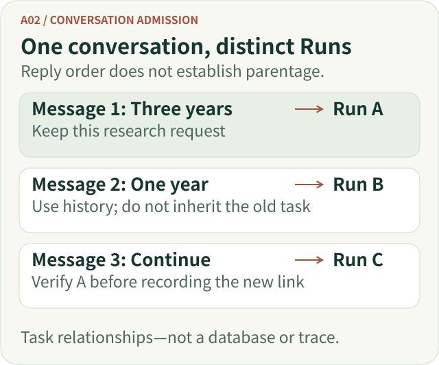
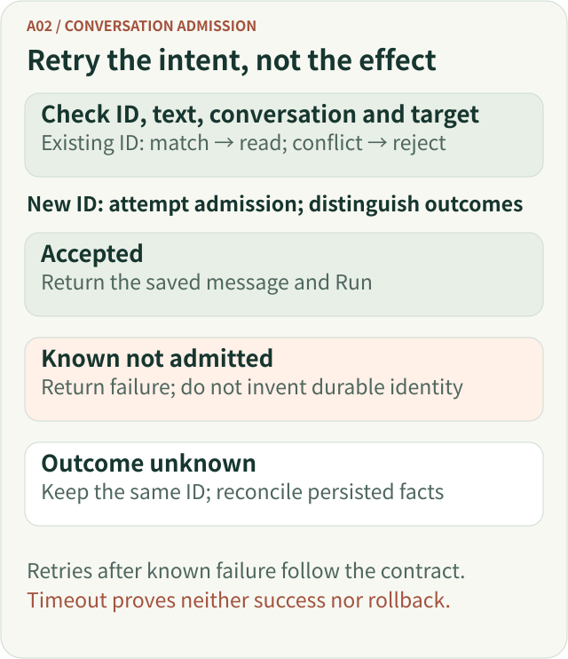
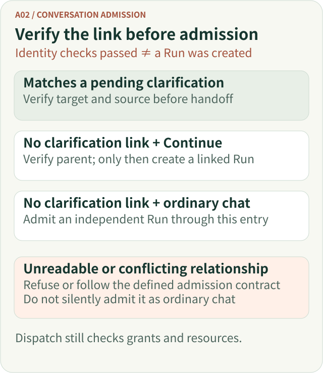
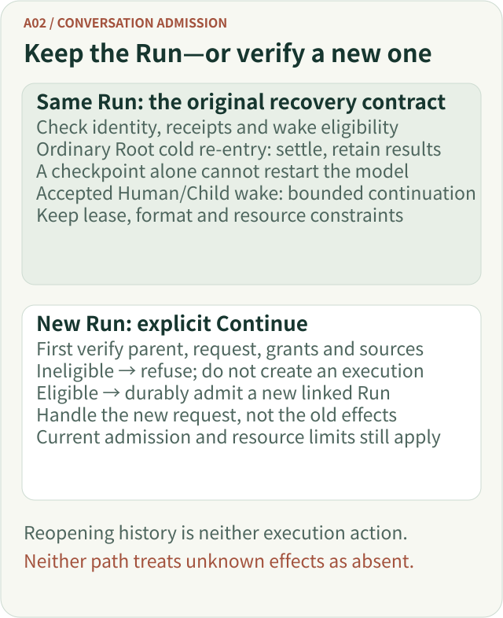

# Keep Chatting Is Not Keep Executing: Agent Conversation Admission and Task Continuation

A user says, “What if we look at just the past year?” That sounds like a straightforward follow-up. For an Agent, however, three different questions arise: **Is it a new user message? Does it require a new execution? May it reuse the previous research's permissions and results?**

Mixing these up can seem harmless until a client retries after a timeout, a long research task is interrupted, or the user switches topics. Then the system may repeat work, inherit the wrong permissions, or hand the model a continuation that has lost the original research question.

This article draws on ETF Agent's conversation admission and task continuation. The principle is **conversation continuity helps people keep talking; execution identity tells the system precisely which task is running. Only explicit, verified lineage can justify inheriting what is needed to continue an earlier Run.**

## 1. First, separate three easily confused objects

Consider this **illustrative teaching scenario**, not a production trace:

> First: Compare Fund A and Fund B over three years, including the time basis of their data.
>
> Second: What if we look at just one year?
>
> Third: The previous report stopped halfway. Continue that comparison.

All three messages appear in one chat, yet they do not necessarily belong to the same execution.

| Object | What it retains | What it does not imply |
| --- | --- | --- |
| **Conversation** | Visible messages, history, and associated Runs | Only one execution may exist in the conversation |
| **Message** | Submitted original text and a stable ID, such as `clientMessageId` | Every network submission creates a new Run |
| **Run** | One admitted execution, its authorization, budget, progress, and outcome | The next message automatically inherits that Run's rights |

A Conversation may contain several Runs. Neither message order nor reply order proves parent-child task lineage.

Two more concepts matter. A **history reference** lets a new question consume eligible earlier context; **task continuation** explicitly associates a new Run with a particular old one as the same research task. A historical answer may help the model resolve the pronoun “that,” but it does not itself authorize old private sources or replay a previous tool call.

This is why attaching every new message to the latest Run is unsafe: the last research may still be working in the background while the user asks an independent question.

Here is a task relationship diagram. Each message retains its execution identity; only an explicitly verified parent establishes continuation for a new Run. This is not a database schema.



[Open the full-size vector figure](../../visuals/en/a02-conversation/relationships.svg)

*Figure 1. A continuous conversation does not imply one continuous execution. Run B can use permitted history without inheriting Run A; Run C needs verified parentage.*

## 2. Establish a new message's identity before interpreting its meaning

Suppose the browser submits a message but loses the HTTP response. If the server uses matching text alone to identify retries, it can create duplicate research. If every repeated sentence is deduplicated, an intentionally repeated question may disappear.

A safer design assigns a stable ID to the **submission intent**. Retrying keeps the same ID. The server verifies that ID against the previously admitted original text, conversation, and continuation binding.

| Admission condition | Required outcome |
| --- | --- |
| New ID; valid conversation and subject | Attempt durable admission of a message and a new Run |
| Same ID, same original text, same fixed relationship | Read the existing message and Run instead of creating another |
| Same ID, different text | Reject the conflict; do not overwrite the original |
| Same ID, different explicit parent Run | Reject the conflict; do not reattach the task |
| Unknown admission receipt | Reconcile using the **same** ID before attempting more work |

The last row is important. A database timeout does not mean a transaction definitely failed. Some outcomes mean “not admitted”; others mean “the caller cannot tell.” Only durable reconciliation can resolve the latter.

Conversely, a request known to have been rejected or rolled back without admission cannot return a nonexistent durable identity. Whether the original ID may be retried after correction follows the admission contract; that is a separate branch from reconciling an unknown outcome.



[Open the full-size vector figure](../../visuals/en/a02-conversation/admission.svg)

*Figure 2. The message idempotency gate. Losing a network response is not proof that the persistent write failed.*

This is closely related to idempotent APIs in distributed systems. Amazon's Builders' Library, [*Making retries safe with idempotent APIs*](https://aws.amazon.com/builders-library/making-retries-safe-with-idempotent-APIs/), discusses how the same request ID with different parameters must be recognized as a conflict. Agents have another dimension: the task relationship and corresponding context must also remain consistent.

## 3. An ordinary follow-up, a clarification, and explicit Continue take different routes

The model interprets the user's intended question. The Host verifies whether a requested relationship to a previous execution actually exists. Conversation admission does not infer permission to inherit a Run by reading the semantics of a chat message.

This diagram separates three verified relationships. Preliminary message-identity checks are not final durable admission. A Run is created only after the relationship and eligibility checks; model and tool dispatch still obey the original authorization and resource rules.



[Open the full-size vector figure](../../visuals/en/a02-conversation/routes.svg)

*Figure 3. The Host chooses a verifiable task relationship; the Runtime still applies authorization, resource, and execution rules.*

### 3.1 Ordinary follow-up: use history without inheriting the task

“What if we look at just one year?” may use the authorized conversation history to identify the two previously discussed funds. It can still be a separate Run: the **current user's original text** becomes the new goal, and current Host constraints govern that execution.

The older design risk was equating “uses history” with “continues the old task.” An October 2026 change separated the two. Ordinary chat may access approved history without asserting `continuationOfRunId`. A `parentRunId` recorded to identify a context source is not a permission-inheritance switch or proof that the tasks are the same.

In financial research, this distinction is crucial. The model may learn that the last report covered three years, but the report's data version, permissions, and validity period cannot become current simply because the user's wording is conversational.

### 3.2 Clarification: reply to a question that was actually registered

Suppose the last Run asks, “Compare cumulative or annualized returns?” and durably records a pending clarification. The user's answer, “Annualized,” can be associated with that **verified pending record**.

The system must first know that an actual question is outstanding and who owns it. A sentence that sounds like a clarification is not enough to create that fact.

If the pending state cannot be read or verified, no confirmed choice may be invented. A permitted fallback must obey the real admission contract, not turn ordinary chat text into a business approval.

### 3.3 Explicit Continue: derive a new Run from earlier research

A product may expose an explicit **Continue** action for an interrupted comparison. It must identify the exact parent Run. In the fuller system, `continuationOfRunId` expresses this declaration; a historical `parentRunId`, the latest message, or an inferred wish to “keep going” is insufficient.

Even a supplied parent ID must be verified: the same Conversation and scope, an eligible durable terminal state, recorded Main execution, and the originally granted source and tool limits. Completed and partial results have applicable conditions; narrowly specified transport disconnections and lost execution ownership can also qualify. Generic failures, user cancellation, and arbitrary still-running tasks do not qualify simply because someone presses Continue.

**Continue creates a linked new Run; it does not reopen the parent's phases, budget, or tool receipts.** Inheritance has two parts. The parent's source, tool, capability and policy grant is rebound to the new Run without repeating source admission against changing permission tables. Deny restrictions along the explicit same-task ancestry are retained together: omitting an old restriction from “continue” does not re-allow it. A historical-context `parentRunId` does not select this deny chain.

Provider-disclosure consent is separate. The current inheritance function removes the parent's disclosure receipt; the new Run's original admission owner handles consent for that invocation. Inheritable source authority does not make every recipient's transmission permission copyable. Account/conversation isolation, scope activation, budgets and cancellation still apply independently.

An eligible explicit Continue with recorded Native Main execution enters Main with the prepared original task and bounded context, rather than asking generic Entry to classify it again. This preserves a verified research relationship instead of making the model reconstruct it from “continue.” The model may still change focus based on new questions or evidence; old progress assessments do not become certified facts.

One contract boundary remains inconsistent: the Recovery specification says unreadable parent restrictions cause rejection before dispatch. Current Conversation/Factory wiring instead uses an existing trusted parent-identity ceiling to deny personal data and search while allowing independently permitted work; without that ceiling it refuses. Unknown restrictions do not become unlimited authority, but not every such read failure guarantees zero dispatch. A caller requiring that stronger promise needs the specification and implementation aligned first.

## 4. Which earlier materials may the new Run take along?

Once the relationship is valid, the model needs useful context. That does not justify dumping the entire chat database into its input.

| Historical material | How a new Run may use it |
| --- | --- |
| Original user request | Carry forward the original goal only after identity and content-hash checks |
| Published previous answer | Use visible, capacity-bounded historical conclusions and qualifications |
| Historical summaries and open questions | Use as provenance-bound working hints, not verified current facts |
| Saved calculations and source material | Read via result and source validation, with bounded scope and historical labeling |

History compaction may omit earlier replies; a working summary may lose essential detail. The conversation admission component should not repair those gaps by making up a coherent narrative. It maintains the task relationship, while context projection decides what evidence may enter the next request. The research model then adapts its answer to what it has.

A counterintuitive failure came from withholding all history to deny personal data: the original question for the same public-only task disappeared too. Once narrow interrupted-parent eligibility allowed a new Run to reach Main, controlled validation found only “continue,” without the original question. More prompt instructions could not repair the broken handoff.

The current path binds original user text, content hashes, scope/conversation and grants along explicit parent links, then reads permitted body content through canonical History. Unrelated private turns in the same conversation, caller-cached answers and forged original text do not come along. A public-only task identity is not a classifier proving arbitrary text contains no personal details. If the body is unavailable, only the verified task survives, without an invented old conclusion. Focused regressions also covered another Continue and the ancestry of an accepted clarification, rather than treating a successful first handoff as universal continuity. These are controlled code/scripted-Gateway observations, not production incident statistics or a newly executed test.

A second counterexample involves conflicting parent projections: a research record may show a partial result while the Conversation projection lacks the matching interruption reason. The admission path cannot just trust whichever one allows progress. A focused regression expects refusal with no extra execution. It does not assume that normal producers emit those deliberately inconsistent synthetic states.

## 5. One example, end to end

The following JSON is **illustrative, not the real HTTP contract or database schema**:

```json
{
  "conversationId": "conv-8",
  "clientMessageId": "msg-103",
  "content": "Continue the interrupted fund comparison using its original time basis",
  "continuationOfRunId": "run-102"
}
```

The Host first reads `run-102` within the authorized conversation. The durable status and interruption reason, original user request, Main activity, and permissions must make it an eligible parent. If admission succeeds, `msg-103` is associated with a **new** `run-103` that records the direct parent link. Verified original-task text and bounded historical materials can then be assembled into the new model request. Its new operations still obey the applicable Run-level constraints.

Change one condition and the outcome changes:

- **Retry `msg-103` with identical text and parent:** return the existing identity, not another `run-103`.
- **Retry `msg-103` but change its parent to `run-099`:** reject conflicting identity rather than reassigning research.
- **Use a parent the user explicitly cancelled or one from another conversation:** an explicit Continue request cannot bypass eligibility; the old answer remains under its existing visibility rules.
- **Use an eligible parent whose saved results lack valid source versions:** the task link and material eligibility are separate questions. Missing historical data must not be presented as current market evidence.

**A successful continuation proves a task relationship, not the accuracy of a financial conclusion.** Fund NAV, comparison windows, benchmark definitions, and their effective dates still require independent research checks.

## 6. "Resume" hides two fundamentally different operations

There are at least two meanings of “continuing” an Agent task.

**Same-Run recovery and settlement (Recover / Resume):** The original recovery contract handles the **same Run**, using its durable identity, lease, dispatched calls and persisted receipts. The name does not promise to restart the old model loop. The published [interruption boundary](./agent-disconnect-is-not-crash-recovery-contract.md) distinguishes ordinary Root cold re-entry without an accepted control wake—which performs bounded settlement and retains committed results—from a lawful Human/Child wake already accepted by its responsible control component, which may continue within supported checkpoints and the original resource limits. Neither may assume that an external call with an unknown outcome did not occur.

**Cross-Run Continue:** A user explicitly chooses to continue earlier research. The system verifies the parent identity and eligibility, then creates a **new linked Run**. It may use eligible historical materials, but does not restart the parent's executor or replay completed tools.



[Open the full-size vector figure](../../visuals/en/a02-conversation/recovery.svg)

*Figure 4. Same-Run handling preserves identity; further dispatch depends on the original recovery and wake conditions. Continue verifies the parent before creating a new identity. Ineligibility does not create a task first, and unknown effects remain unknown.*

These paths cannot safely share an ambiguous `resumePrevious()` interface. One is governed by the execution-recovery contract, the other by message identity, task lineage, and new-Run admission.

## 7. What can readers reproduce in public code?

The [Open ETF Agent public repository](https://github.com/hpoenixf/open-etf-agent) contains a durable Session example. Using its fixed public commit [`34124cef`](https://github.com/hpoenixf/open-etf-agent/tree/34124cefc6df289e08518173789210b45a716451) and [Session implementation](https://github.com/hpoenixf/open-etf-agent/blob/34124cefc6df289e08518173789210b45a716451/src/session.mjs), install Node.js 26.8.1–26.x and run:

```bash
git clone https://github.com/hpoenixf/open-etf-agent.git
cd open-etf-agent
git checkout --detach 34124cefc6df289e08518173789210b45a716451
npm ci --ignore-scripts --no-audit --no-fund
npm run build
npm run session -- start --session runs/a02-boundary-demo --case durable-report
```

Copy the actual Run ID from the output:

```bash
npm run session -- inspect --session runs/a02-boundary-demo --run RUN_ID
npm run session -- resume --session runs/a02-boundary-demo --run RUN_ID
```

After `start` completes normally, this `resume` sequence demonstrates **a repeated terminal call and readback of the original result**: the fixed [Runtime terminal branch](https://github.com/hpoenixf/open-etf-agent/blob/34124cefc6df289e08518173789210b45a716451/src/runtime.mjs#L145-L160) reads the saved outcome rather than executing again. It does not demonstrate checkpoint recovery after a process interruption, or the full multi-turn HTTP Conversation / Continue experience. These commands and the fixed source were reviewed, not re-executed; no fault injection was performed for this article. The public educational project uses local SQLite and an offline scripted Gateway. It lets readers examine fundamental identity and execution contracts without claiming that the richer private system's Web-based admission and cross-Run continuation are shipped in that CLI. The moving public entry point is [main](https://github.com/hpoenixf/open-etf-agent/tree/main), with further details in the [module guide](https://github.com/hpoenixf/open-etf-agent/blob/main/docs/module-guide.md).

<div><a id="_8-a02-does-not-decide-what-the-model-should-do"></a><a id="8-a02-does-not-decide-what-the-model-should-do"></a></div>

## 8. Conversation admission does not decide what the model should do

For short question answering without protected tool effects, retaining recent messages and letting the model interpret references may be enough; explicit task continuation is not required for every sentence. To resume saved steps within the same nonterminal execution, use its original checkpoint and effect receipts rather than a new chat message.

Here, long research may already be terminal, and the user should decide whether to continue. A new Run with an explicit parent fits that need. The cost is maintaining trusted ancestry while handling missing context, inherited authority, fresh recipient consent and resource limits separately. It supports cooperation between conversational continuity and execution continuity, not automatic unlimited work.

Conversation admission should answer narrow, verifiable questions: Has this original message already been admitted? Which trusted conversation owns it? What task relationship can be established? Which conflict must be refused?

It does not decide whether research is semantically sufficient, issue tool grants, replay earlier side effects, or erase a legitimate published answer when historical material becomes unavailable. Research judgment belongs to the model; permissions and budgets to their original Host owners; execution termination, context fitting, and publication to their respective owners.

For the next multi-turn Agent review, ask: **Can retry after a lost response create another Run? Can an ordinary follow-up inherit an unrelated task? Can explicit Continue prove the parent's original text, authorization, and interruption reason?** If not, repair identity and handoff contracts before introducing a more elaborate Planner.
