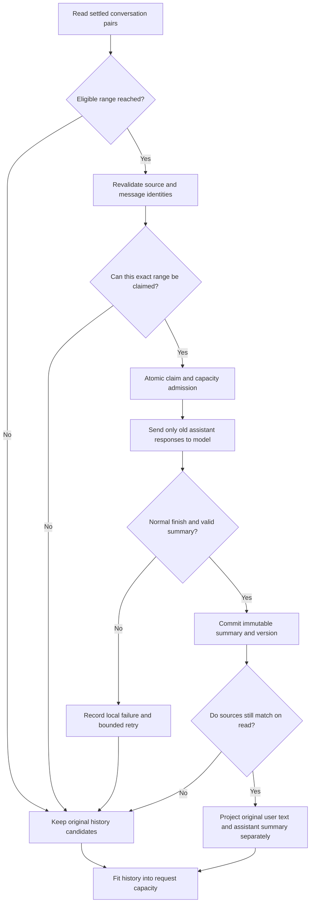

# Why an Agent Cannot Simply Summarize Its Conversation History: Cross-Run Compaction, Source Binding, and Immutable Summaries

A user has talked with a research agent for dozens of turns. They first asked about fund fees, later corrected their investment horizon, and eventually compared NAV figures from different dates. Before their next question, the conversation history is already long. The obvious shortcut is to ask a model: “Summarize everything so far.”

But what if the summary describes *last week's NAV* as *the current NAV*? What if it drops the instruction not to infer a default risk preference? The next Run may begin with a fluent but misleading account of the user's actual history.

**Cross-Run conversation compaction is not about making a model remember everything. It is about fitting older assistant responses into subsequent context without granting lossy summaries the authority to rewrite original user messages, source identity, or business facts.**

## 1. Three Kinds of History That Should Not Be Confused

A research agent usually has at least three different ways to reduce context pressure:

| Mechanism | What it handles | What it cannot replace |
| --- | --- | --- |
| Externalized tool results | Rereadable PDFs, market tables, and analysis outputs | The growing history of previous questions and answers |
| Main compaction within a Run | Older settled model/tool work units during one research execution | Conversation history spanning separate Runs |
| **Cross-Run conversation compaction** | Verified, completed user–assistant message pairs belonging to one Conversation | Long-term Memory or replaying and recovering old Runs |

A **Conversation** is a durable thread that a user can reopen. A **Run** is the execution lifecycle associated with a request. A **message pair** consists of the original user message and completed assistant response linked to the same Run.

Those relationships must be established before treating a piece of history as eligible for compaction. A summary is not a new revision of the answer. Original messages, published content, tool receipts, and permissions retain their own authoritative records.

## 2. Not Every Line in a Chat Transcript Is Eligible

The system first projects complete question–answer pairs from a durable conversation snapshot. The code considers Runs with technical states `completed`, `partial`, or `clarify_pending`, but still requires the associated assistant **message** to have completed. Both messages must belong to the current Conversation, have valid identity links, and contain nonempty text.

This deliberately excludes:

- an assistant message that is still streaming;
- a message that cannot be linked to a valid Run;
- tool calls, internal traces, and unsettled effects;
- content belonging to another Conversation.

This check does not decide whether a financial claim is correct. It establishes that the input is a particular set of settled conversation material. Content correctness still depends on source evidence, deterministic business calculations, and subsequent research.

## 3. Why the Oldest Ten Pairs Become Eligible After Thirty

The current implementation uses a fixed-window policy that is easy to inspect. It requires at least **30** eligible pairs before creating the first compaction target. Each target covers exactly **10 pairs**, and at least the **20 most recent pairs** remain outside background batch compaction.

For 30 pairs with zero-based indices:

| Pair range | Current treatment |
| --- | --- |
| 0–9 | First compaction candidate; only a durable successful receipt makes its summary eligible |
| 10–29 | Recent 20 pairs retained as original material |
| Upon reaching 40 pairs | Pairs 10–19 become the second eligible target |

This is not “summarize the entire conversation when it reaches 30 turns.” The threshold merely **plans** a target range; it does not establish that a model has successfully produced a summary. Between 31 and 39 pairs, the unselected raw tail can contain more than 20 pairs.

Why choose complete blocks of ten? A fixed range gives storage and reading a stable identity without arbitrarily splitting an exchange based on fluctuating token counts. The trade-off is a conservative policy; it does not prove that fixed groups of ten achieve the best possible compression ratio.

## 4. The Claim Binds Original User Messages, but the Summarizer Never Receives Them

A compaction job is identified by its Conversation, Scope, `fromPair/toPair` range, **20 source message IDs**, a source hash, model identity, and prompt version. The hash is calculated from the full sequence of ten original question–answer pairs, including user messages and assistant responses.

The summarization model, however, receives only the **ten assistant responses**, each associated with its `assistantMessageId`. Original user text does not become something the model may freely paraphrase.

These facts serve separate purposes:

- **Source binding** covers both sides of the exchange so that a later reader can establish that the summary matches the exact historical range.
- **Lossy generation** covers older assistant replies only, preventing a model-generated reconstruction from replacing what the user actually wrote.
- **Subsequent projection**, subject to the request's capacity limit, carries original user messages separately alongside the summary of those replies.

For example, this is a conceptual representation, **not an executable API payload**. Actual IDs and user data are deliberately omitted:

```json
{
  "sourceRange": { "fromPair": 0, "toPair": 9 },
  "sourceBinding": {
    "messageIdCount": 20,
    "digestAlgorithm": "SHA-256",
    "promptVersion": "conversation-compaction@3"
  },
  "summaryInput": { "assistantMessageCount": 10, "includesUserText": false },
  "nextRunProjection": {
    "originalUserMessageCount": 10,
    "assistantHistorySummary": "Two funds were compared using last week's NAV; this is not current NAV"
  }
}
```

The important distinction is not the serialization syntax. **A summary claiming “the user requested X” does not acquire the identity of a user request. Only the original user message has that identity.**

## 5. Compaction Is More Than an Ordinary Text Generation Call



There are four separate decisions behind this diagram.

**First, claim the exact range, not simply the result that finishes first.** The range must begin on a multiple of ten, contain precisely ten pairs, and include twenty unique source message IDs. Claim handling compares the source hash, model, and prompt version. A completed or running claim for that same identity must not start a competing summary. Atomic database operations and locks enforce this; a scheduler's earlier snapshot is not enough.

**Second, insist on a normal model finish.** The summarizer must not call tools or turn truncation, an error, or an abnormal finish into a successful summary. The current contract requires a plain-text result with exactly one normal stop, nonempty content, and a **6,000-character** limit.

**Third, bound failure without disrupting delivered answers.** A failed range with the same version may be attempted at most **twice**. On failure, the original source remains available. Background compaction cannot roll back an already-delivered answer. The implementation has process-local admission and PostgreSQL shared-admission design and tests; it does not rely on the model usually being fast.

**Fourth, make successful summaries immutable.** A completed summary cannot simply be overwritten. Older prompt versions retain their identity. New jobs use `conversation-compaction@3`; projection can still recognize valid completed `@2` entries, but must not reinterpret a mixed-input `@1` entry as an assistant-only summary.

## 6. Three Failure Cases Tell Us More Than the Happy Path

**Case A: the model emits text and also calls a tool.** The prose may look like an excellent summary, but the response violates the plain-text-and-normal-finish contract. The compaction is recorded as locally failed, not committed as successful. Natural-language output alone does not prove that conversation history was safely compacted.

**Case B: the source changes while an old summary remains stored.** Suppose a message in pair 3 changes content or identity. Recomputing IDs and the hash for range 0–9 no longer matches its stored summary. Projection must not pass the old summary off as current source-backed history; valid original messages may still enter the request under the capacity policy. The protection comes from source identity, not the model's recollection of an earlier answer.

**Case C: a summary is stored, but the next request cannot fit it.** Before using a summary, the next Run validates its range, status, version, and source. History assembly then uses a conservative UTF-8-byte budget. If the full candidate containing original user messages and assistant summary does not fit, it tries a bounded projection of original message pairs. Older history may still be excluded if there is not enough room. **Preserving the original durable record does not mean the model saw every original sentence in this turn.**

That difference matters in financial research. Even when the system retains an earlier risk-preference correction, it cannot claim that the next model actually consumed that correction merely because it still exists in storage. Missing current evidence must be acquired through the research process rather than invented by history compression.

## 7. What the Evidence Establishes—and What It Does Not

As of **October 27, 2026**, the repository contains the cross-Run compaction implementation, source-hash and version rules, durable job claiming, summary projection, and focused test code addressing duplicate claims, bounded retries, immutable completion, and cross-connection competition.

Those artifacts support this description of the **mechanism**. They do not establish long-term production summarization fidelity, better financial answers, a measured token-saving percentage, or a newly rerun complete PostgreSQL acceptance suite. The existence of test code is not evidence that every environment passed during the preparation of this article.

Like Main compaction within a Run, this design keeps a lossy summary in the role of source-bound working material. It cannot become permission, original user intent, or financial evidence. But the two forms of compaction have different identities and lifecycles and should not be described as one mechanism.

## Conclusion

For a complex agent, history management is not primarily about removing words. It is about deciding **which material may be lossy, which originals cannot be rewritten, and whether today's summary can still prove which messages it came from yesterday**.

That leads to an intentionally more explicit design: exact pairs, fixed older ranges, assistant-only summarization, source hashes, atomic claims, immutable successful records, and bounded replay.

When designing your own conversation compaction, first test whether an invalid summary leaves original facts intact. Improve prompt phrasing and compression rate only after that. Admitting that a particular history item did not fit this request is safer than pretending that the model remembered it.

## Further Reading and Discussion

[Main context compaction within a Run](../../en/articles/agent-main-run-context-compaction.md) covers checkpoints in one research execution; [externalized tool results](../../en/articles/tool-results-outside-model-context.md) explains on-demand rereading and context fitting. This article addresses the distinct identity and durability requirements of conversation history **across** Runs.

The [ETF Agent Engineering Notes](https://github.com/hpoenixf/eff-agent-article) repository collects more independently readable engineering case studies. If these mechanisms are useful, consider starring the repository.
