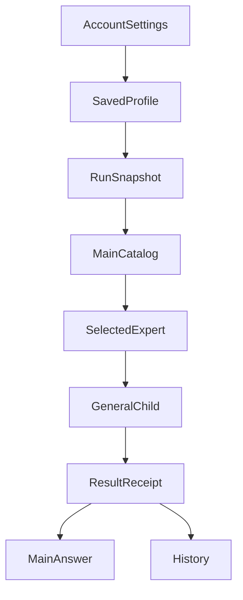

---
readingBrief:
  takeaways:
    - "A personal expert is a versioned research method, not an independent authority platform; Main sees a catalog and only the selected Child receives full instructions."
    - "Each Run freezes its method identity; edits affect future Runs, and historical contributions come from original execution receipts rather than the latest profile."
    - "A Child may revise its current task description as evidence changes, but cannot rewrite prior requests, change expert identity, expand access or claim unperformed collaboration."
  appliesTo:
    - "Adding user-defined methods to existing Subagents with concurrent edits, recovery, exact selection and execution-backed contribution displays."
  notFor:
    - "Seeking arbitrary executable expert packages or independent long-lived assistant workspaces, or equating selection with improved investment-research quality."
---
# A Custom Expert Should Be More Than a Prompt Field

*An ETF Agent engineering case study: from reusable personal research methods to recoverable Subagents*

What is the easiest way to let users create their own AI experts?

Build a settings page with a name, description, and Prompt. Save the fields to a database. When the user selects that expert again, append the Prompt to the model request.

For a demo, that looks sufficient. But once we integrated custom experts into ETF Agent's research system, we faced much harder questions. If a user edits an expert while a research task is running, should that task immediately adopt the new instructions? How can the model discover experts without loading everyone's full Prompt into Main's context? Which revision should an interrupted task use when it resumes? If an expert says "access all data," does that actually grant any new access?

These questions determine whether a custom expert remains a disposable prompt or becomes a maintainable product capability.

We chose not to create another Runtime for each expert. Instead, users save a research method with a durable identity and revision; the existing generic Subagent performs the work. Along the way, we found concrete integration failures: instructions reached the wrong request layer, History failed to recognize an expert that the Child had actually used, and a browser test rendered a blank page because two React instances were present.

This article is specifically about **user-defined experts**: storing them, selecting them, executing their methods, and recovering their identity. Web/PDF/Python packages and multi-Agent conversations are supporting infrastructure, not a second architecture tour.

## 1. Why Not Just Add Another Role Prompt to a Child?

ETF Agent already had Web, PDF, and Python Subagents and six built-in investment methods. The first group represented ways of working with sources and computation. The second represented research perspectives such as Markowitz, Taleb, Bernstein, Bogle, Marks, and Fama-French.

Developers maintained these methods, but a user's own preferences might not fit the built-in catalog. One person wants to check fund fees and tracking differences every time. Another first looks through funds to their underlying holdings. Someone else requires falsification conditions for every claim. Putting every personal preference into the system Prompt would affect unrelated tasks; asking users to repeat their preferences in every conversation prevents methods from accumulating.

An earlier delegation API expressed execution specialization, investment perspectives, and personal configuration through separate fields: `type`, `perspectiveId`, and `subagentProfileId`. Each made sense when introduced. As "expert" became a product concept, though, callers had to understand an increasing number of combinations.

We did not add a new `custom` execution type or merely hide the parameters in the UI. The normal Child selection contract was unified around:

```json
{
  "agentId": "user/<profile-id>",
  "task": "Check overlap among underlying fund holdings using the supplied disclosures"
}
```

The ID above is a shape example: the part after `user/` is a server-issued Profile UUID. Omitting the ID selects `builtin/general`. A normal Child binds one expert definition, while execution, model routing, and authorization remain in the existing infrastructure.

**The user saves *how to research*, not a second Agent with independent authority.** That distinction informed the rest of the design.

## 2. Store a Method, Not an Execution Platform

We deliberately kept the initial personal expert small:

| Field | Purpose |
| --- | --- |
| `name` | Name shown when the user manages and identifies the expert |
| `description` | Helps Main decide which tasks fit this expert |
| `instructions` | Full research method delivered to the selected Child |
| `enabled` | Whether new research Runs can discover the expert |

For example, a user might define a "Fund Holdings Overlap Reviewer." Its description would say that it examines shared underlying exposures across several funds. The instructions would require checking disclosure dates, separating fund names from underlying companies, and preserving uncertainty rather than inventing precise exposures.

This is an illustrative configuration, not a certified finding about real funds. The point is that the most valuable content often consists of **reusable questions, ordering rules, and research constraints**, not a theatrical persona.

The server assigns a stable `profileId` and stores a `revision`, content hash, and account ownership. Updates use `expectedRevision` so conditional writes can reject conflicting edits. Deletion is soft deletion: the profile stops appearing in new Runs, but past research is not rewritten as though it never used that expert.

Storage has bounded capacity, too. The current contract allows up to 20 saved Profiles and 8 enabled Profiles. These are limits on account configuration and catalog size, **not** individual inference budgets.

If saving fails, a version conflicts, or capacity is exceeded, the UI must preserve unsaved edits. An error message must never be mistaken for a successful write. In a controlled browser check, two pages edited the same Profile: the newer revision was saved, while the stale update was rejected without losing its draft. This used synthetic identity and in-memory persistence, not an authenticated production session.

## 3. The Path from Settings to a Research Result



The diagram describes custody of facts, not a rigid scheduling pipeline.

### 1. Every new Run freezes its own catalog

At the start of a research Run, the system reads the account's enabled, non-deleted experts and freezes their content and revisions for that Run.

Main receives only a bounded discovery catalog: exact IDs, names, and descriptions. It does not load every expert's `instructions` into its context. The complete method is sent as user-originated method data only to the Child that actually selects that expert.

An empty catalog differs from a failed catalog read. In the latter case the system should report that expert configuration is unavailable. Other permitted research may continue, but an explicitly requested personal expert must not be silently replaced by General.

### 2. The existing General Child performs the work

The Child reuses the established model, tools, source authorization, resource accounting, and result handoff. A personal expert's instructions are not new system instructions. They cannot grant trading, publication, recursive Child spawning, or broader data access.

A prompt telling the model not to escalate privilege does not enforce that distinction. During a controlled request-assembly test of the unified `agentId` path, personal `instructions` had reached the Child's general system layer. We corrected their placement through the existing request assembly: Main receives catalog metadata, while only the selected Child receives the frozen user-originated method. **A prompt's trust level depends on its producer and message role, not merely its wording.** This was a scoped engineering finding, not evidence of an actual user-data leak.

The chosen execution identity includes `agentId`, provenance, version, content hash, and personal Profile revision. An `agentId` is neither a filesystem path nor permission to run code.

The current user-defined Profile is **text-based**. Separately, managed built-in experts such as PDF may contain a `SKILL.md`, references, and sandboxed Python helper scripts. But **users cannot infer from this that arbitrary ZIP uploads and executable custom scripts are available**. The selection interface is shared; package admission and installation are not.

### 3. Main delivers results that actually exist

Once a Child completes, the original execution system records its outcome. Main can read the actual result and synthesize an answer. History associates the recorded execution and binding revision with the personal expert used at the time.

During migration, the Child already used `agentId`, but an older History reader still expected legacy binding fields and could omit that attribution. The fix was not to guess from a display name or decorate history with the account's newest Profile; History reads the original Child admission, frozen method, and execution receipt. Later renaming, disabling, or soft-deletion cannot rewrite which revision was used.

"Created," "selected," "admitted," and "delivered" are four different states. Displaying an expert's name in the UI is not evidence that it completed any research.

### 4. Past Runs must not silently switch revisions

Consider a simple counterexample.

In the morning, a fund research Run starts with revision 1 of a Profile. In the afternoon the user publishes revision 2, with stricter disclosure-date rules. That evening, the interrupted research resumes.

If recovery simply reloads the latest configuration by `profileId`, one Run may quietly use two research methods under the same displayed name. We therefore retain the original Run's frozen content: **new edits apply to future new Runs; an existing Run continues with its existing binding.**

This matters both for consistent execution and for explaining why an answer was produced.

## 4. Comparing Octop: Template, Instance, and Execution Need Not Be One Object

Tencent Cloud's open-source [Octop](https://github.com/TencentCloud/Octop) illustrates another direction for expert products. Its templates may contain `manifest.json`, `SOUL.md`, `IDENTITY.md`, Skills, and other files. Instantiating a template copies its content into an independent Agent workspace. Users can continue using and customizing those instances, and publish or share templates through supported mechanisms. Its [Expert Catalog source](https://github.com/TencentCloud/Octop/blob/main/src/octop/infra/agents/experts/catalog.py) shows the distinction between template discovery and workspace seeding.

Octop is oriented more toward the question, "How should a digital assistant work independently over time?" ETF Agent's current personal Profile addresses a narrower question: "How should one research Run precisely reuse a method saved by its user?"

Both are reasonable. An independent instance makes ongoing conversations, files, and work habits natural, but brings more long-lived state to govern. Our design puts personal methods into the original Run/Child system and avoids duplicating model routing, memory, budget, and recovery. In exchange, a personal expert does not yet have a separate permanent conversational workspace.

This comparison reinforced the value of separating three objects:

- **Expert Definition:** which method and content revision are selected;
- **Expert Execution:** what actually happened, under which Run and authorization;
- **Expert Workspace:** which persistent working materials an expert may own, if a long-lived use case justifies it.

We can learn from Octop's discoverable expert cards, example tasks, and template sharing without building a second Agent platform just to support a Prompt settings form. In finance, a shared template must not automatically carry personal holdings, private research history, or the user's source grants.

## 5. From Preferences to Contributions That Actually Happened

Originally we asked whether a user could save an expert. The next question is harder: **after selecting an expert in chat, did that expert actually contribute?**

The account-scoped directory displays identity, purpose, and examples, not full private instructions. A directory card and an explicit `@` selection use the same exact `agentId` path. The user message is preserved; the original message and Entry record the selection, after which Main may delegate to a Child under its existing admission rules. An expert name appearing in arbitrary text is not an authorized invocation.

Four kinds of facts must remain separate:

| What the user sees | What it actually means | What it cannot prove |
| --- | --- | --- |
| Expert directory and method summary | Discoverable account configuration | Tool authorization |
| Explicit choice or saved preset | A selection or suggestion | Child dispatch |
| Child request and stage receipt | Work the original executor performed | Main adopted its view |
| Main answer and History contribution panel | Committed text and visible evidence | Expert consensus |

In a **synthetic** fund research example, the user explicitly selects a PDF specialist to verify fees and applies a preset suggesting a Python specialist for risk calculations. Main might delegate to one, both, or neither as appropriate. A preset containing two names does not prove two Children ran. Once the PDF Child returns real sourced findings, the contribution panel can display its original `taskRef` and permitted result. Main remains responsible for any conclusion about whether to use those findings.

A saved expert preset stores a `presetId`, revision, name, and expert IDs under the existing account owner. Applying it fills editable suggestions. It neither launches a permanent team nor starts Peer messages, Reviewer calls, or additional budgets. Refreshing History must read the original Run's frozen selection and actual execution receipts, not reinterpret past results with today's directory. If the contribution panel fails locally, already published text and permitted downloads stay available.

## 6. Change the Research Description, Not the Execution History

Main's original instruction need not remain an unquestioned premise. Imagine asking a Child to calculate exact overlap between two funds' underlying holdings. After opening the reports, it discovers that one fund discloses only its top ten holdings. Repeating the original task would risk presenting partial overlap as full coverage.

ETF Agent separates **the frozen method identity** from **the revisable description of this Child's current research**. Through an optional `update` on the existing `submit_subagent_result` tool, a Child can revise `task`, `hint`, `relationHint`, and eligible `inputRefs`. An accepted update affects subsequent requests, not the original user message, initial spawn, or any request already dispatched.

The following is a constructed example, not an observed model payload:

```json
{
  "summary": "Only the top ten holdings are disclosed; full overlap is unknown",
  "update": {
    "task": "Calculate overlap only for disclosed holdings and show coverage limitations",
    "relationHint": "Inform Main that partial overlap is not a complete exposure measure",
    "inputRefs": ["an actually authorized result reference from this Run"]
  }
}
```

New materials still require authorization from their original input and source owners. If one new input is refused, that refusal affects the input, not every independently valid update or previously published passage. Task revisions cannot change expert identity, reset budget, expand permissions, erase original facts, or authorize an investment transaction.

Likewise, `relationHint` describes the intended relationship, not an executed dependency graph. It does not wait for another Child, open a sibling's results, or manufacture a Peer conversation. Actual handoff still requires the original task, input, message, and result receipts.

This is adjacent to [the agents-as-tools and handoff distinction in the OpenAI Agents SDK](https://openai.github.io/openai-agents-python/multi_agent/): Main retains the conversation and final answer, while the specialist performs bounded work. ETF Agent's frozen account methods, optional task revisions, and attribution are its own engineering choices rather than capabilities implied by that SDK.

## 7. What Works Today, and What Still Needs Qualification?

As of October 27, 2026, versioned Profiles, exact selection from normal messages, soft Tool/Skill preferences, optional Skill preloading, on-demand calling guides, expert directory and contribution projections, account presets, and Child-authored description updates have scoped engineering implementation and verification evidence.

Isolated PostgreSQL and authenticated browser tests using a scripted model interface verify selected storage, selection, replay, recovery, and presentation paths. They do **not** establish autonomous model selection quality or preference adherence in real investment research. Earlier live-model examples mainly exercised built-in methods or General/Python.

The account does not thereby gain arbitrary executable-package installation, an expert-specific model or budget, or trading permission from a preference. The narrower engineering conclusion is that **versioned personal methods can use the existing Child and result system without a second Expert Manager**.

## Conclusion

A Prompt field is the easy part. The durable design is **stable method identity, revisable research descriptions, and contributions backed by actual execution**. What the user prefers and what the system performed must never become the same fact.

Each method need not bring its own model, permission ledger, budget, and recovery system. The user can accumulate research practices while the Runtime retains which revision was selected, what actually changed, and what actually arrived.

**Expert methods should be reusable; execution facts must remain attributable.**

---

<!-- agent-article-sync:guidance:start -->
## Further Reading and Discussion

[Subagents: From Context Isolation to Specialized Collaboration](/en/articles/agent-subagent-context-specialization) · [Models Understand; Code Authorizes](/en/articles/011-model-understands-code-authorizes) · [ETF Agent engineering articles on GitHub](https://github.com/hpoenixf/eff-agent-article) (Stars welcome).
<!-- agent-article-sync:guidance:end -->
