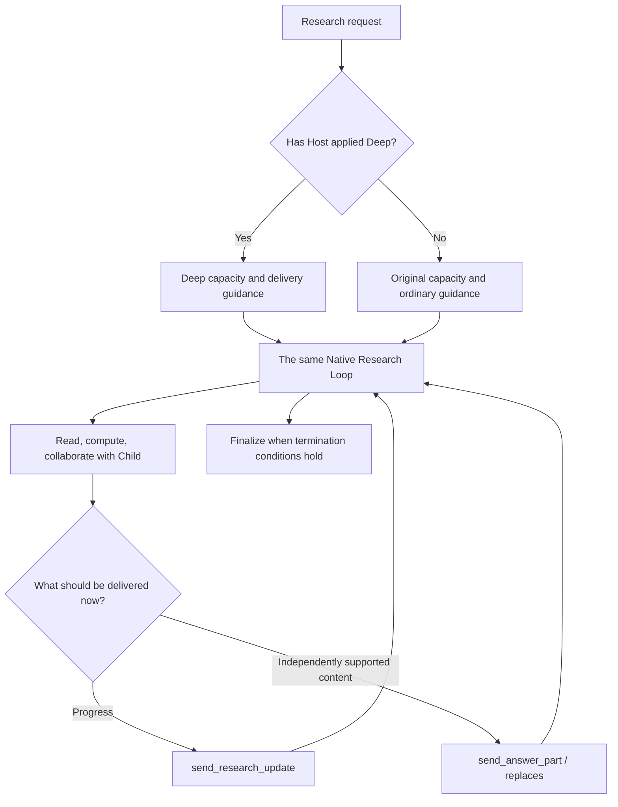

# Deep Research: From Budget Upgrades to Delivery—What We Built and What the Tests Show

An ordinary investment-research question may require checking one fund's fee schedule. A different question can demand portfolio look-through, reports from multiple periods, updated source versions, collaboration among research branches, and one coherent conclusion. Both are called Research, but their resource requirements and delivery cadence are different.

In ETF Agent, we did not build a second agent for the more demanding task. We gave the **same Native Research Loop** an authorized higher resource profile and adjusted guidance according to the mode that had actually taken effect: provide genuine progress as work continues, publish independently supported findings when useful, and be more deliberate when synthesizing conclusions that depend on several pieces of evidence.

This article asks three questions: why ordinary Research was insufficient; precisely what Deep changes in the runtime; and what matched Standard/Deep runs actually showed. The Deep implementation discussed here comes from the ETF Agent engineering repository. It should not be mistaken for a feature already shipped in the public Open ETF Agent repository.

## 1. Why introduce a separate Deep mode?

### Timely ordinary answers and sufficient room for complex investigation

Ordinary Research already had search, reading, computation, Child execution, and the ability to publish a useful section through `send_answer_part` before the whole task ended. That is a reasonable design: a verified fee fact should not be held back by a later unrelated lookup.

Complex conclusions, however, can depend on interconnected premises. Suppose a fund's reported return differs from its index. The comparison period, net-return basis, total-return basis, whether fees are already included, and a later correction notice can all change the interpretation. Several individually correct facts may still be insufficient to support the claim that fees caused most of the gap.

A single default resource ceiling may force such tasks into finalization before essential work is complete. Raising the ceiling for *every* task would also grant unnecessary capacity to questions that only need a few calls. **The first requirement was therefore selective, authorized expansion of one Run—not making every answer longer.**

### More capacity is not a reason to publish a synthesis earlier

Our previous progressive-answer strategy encouraged the model to deliver independently useful findings promptly. It addressed a real experience problem: users should not see an empty answer until all research is finished.

But for tasks that require comparing source versions, calculating across documents, and reconciling disagreements, a model may commit an initial interpretation and keep appending corrections. There is plenty of output, yet the final result can resemble a research log rather than a report organized around the user's question.

We therefore distinguish two kinds of delivery:

- **Research progress:** what is being checked, what conflicts have appeared, and which material gaps remain. It can appear early but does not certify a conclusion.
- **Research output:** a fact, calculation, or bounded analysis that already stands on its own. It can be delivered early; a broad synthesis dependent on unresolved evidence should be more cautious.

This is not a rule forbidding output during the first 70% of execution. Nor is it a server-readable boolean called “evidence mature.” It is a change in the model's research and writing priorities.

## 2. How it works inside the existing runtime

### Four proposal surfaces, one resource authority

Deep can be requested through an explicit user selection, trusted metadata from a registered Skill, an Entry research-mode proposal, or a Main tool call to `enable_deep_research`. These are different ways to express intent, not independent ways to mint capacity.

The frontend's `researchDepthPreference` distinguishes `auto`, `standard`, and `deep`. Auto may permit an eligible recommendation; explicit Standard must not be silently upgraded by a Skill or model. A Direct answer that has already been admitted does not secretly become Research because an upgrade was suggested.

The existing Run Resource Owner decides whether an upgrade is legal. It uses the Run's frozen original allowance, current consumption and reservations, phase, clocks, and external caps. A Child cannot independently upgrade the Root.

We deliberately avoided creating another “Deep budget ledger.” Otherwise the Main, Child, reminder and recovery paths could disagree about how much work is actually permitted.

### A 1.5× target, not free model credits

The current depth profile calculates a target as the admitted total plus half of that total, rounded down. Under the current default baseline:

| Resource axis | Standard | Deep, approved and applied |
| --- | ---: | ---: |
| Main model turns in total | 36 | 54 |
| Root model-request allowance | 57 | 85 |
| Read actions | 72 | 108 |
| Discovery actions | 6 | 9 |
| Publication actions | 48 | 72 |
| Active execution-time ceiling | 60 minutes | 90 minutes |

These are default baselines and target ceilings, not guaranteed capacity for every Run. Already consumed requests, Child reservations, unknown settlements, and external provider or task limits still apply. **Upgrading does not reset usage or start a second budget.**

There is also an eligibility window. Around the 50% reminder stage of the original request or time budget, the system can suggest that Main consider Deep for unresolved work; the suggestion does not itself start another model call. Near the 80% threshold of the original basis, in `finalization-only`, or when deadlines or authority prohibit expansion, the resource owner checks eligibility again at the actual effect boundary. A tool having been visible earlier is not sufficient.

One more distinction matters: a durable approval is not proof that the live Host has applied the new resource profile to running admission and clocks. The runtime distinguishes `standard`, `recorded-pending`, `deep`, and `unknown`. Only actually applied `deep` affects subsequent effective behavior.

### Rebuild each model request; do not mutate an earlier prompt

The current integration does not keep one permanent System Prompt inside the provider. Each model invocation rebuilds the `system` field, relevant history, tool results, and authorized tool surface.

On a new Main turn, the runtime reads the Host's current depth state, refreshes the effective research contract, and asks the Native Request Projector to construct that request. The relevant decision is approximately as follows (**illustrative pseudocode, not a callable repository API**):

```typescript
const cadence = currentHostDepth === "deep"
  ? deepDeliveryCadence
  : ordinaryDeliveryCadence;

const modelRequest = {
  system: composeResearchInstructions(cadence),
  messages: projectCurrentResearchHistory(),
  tools: projectAuthorizedTools()
};
```

Ordinary guidance continues to favor prompt delivery of supported, independently readable findings. Deep guidance asks the model to consider requested coverage, conflicting evidence, and material unknowns before composing a major synthesis. An independently mature section may still be published early. We also removed the unconditional “publish a first answer early” instruction from shared guidance so the two cadences would not conflict in the final request.

Suppose the first five turns ran in Standard and Main requested an upgrade on turn six. Only after Host actually applies it will turn seven's newly assembled request use Deep cadence guidance. There is no old provider-side System Prompt to overwrite; prior research remains available through the projected transcript. The upgrade cannot revise an already committed answer retroactively, nor does it automatically raise reasoning effort.

### Progress and answer content use existing delivery paths

The core research path can be summarized as follows; authorization, deadline, correction, and recovery details are deliberately omitted:



`send_research_update` carries a concise progress or attention assessment, subject to its own receipt and presentation rules. It is not a formal answer. `send_answer_part` publishes a portion of the answer. Publishing one part does not end the research; termination remains governed by the existing completion mechanism. Ordinary assistant text and explicit answer tools still follow the existing Publication authority.

Deep adds no mandatory final Writer and no minimum number of sources before a legitimate part may be published. The model can share a supported section while investigating remaining questions. Unsupported conclusions must retain their limitations instead of being laundered through a progress message.

### More investigation requires room for legitimate revisions

A correction notice or a longer appendix may arrive after an initial section has been published. The existing `replaces` mechanism can revise an authorized current block rather than accumulating a trail of near-duplicate appendices.

Ordinary defaults allow up to two modifications per block and eight across a Research Run. For applied Deep, the unset defaults become **six and twenty-four**. An explicit operator limit still wins, including an explicit zero.

This does not permit arbitrary whole-document edits. Target identity, revision, source permissions, and durable-save checks still apply. A temporary preview visible to the user is not proof that Recovery has saved the corresponding revision. Earlier modification usage is not erased when the mode upgrades, and recovery reconstructs the original Run and publication facts.

The implementation remains intentionally narrow: **Resource Owner governs capacity; the model researches and synthesizes; Publication owns official answer versions; the existing durable path owns recovery.** Deep alters strategy and capacity inside this path rather than cloning it.

## 3. What did the matched runs actually show?

An earlier matched study used two synthetic fund cases. In A, Deep delivered the first useful content later but eventually met 14/14 requirement groups versus Standard's 13/14, and reached terminal state earlier. In B, both met 15/15; Deep began useful delivery slightly earlier but finished later and consumed more known resources. The directions were already mixed, and the sample was small.

On November 10, 2026, we completed another four matched cases: two with **all source material present at Run start** (S1, S2), and two where **a corrected source was registered after the first publication** (D1, D2). Within each pair, the question, source bytes, `deepseek-v4.1-flash` model, provider, and tool composition were held fixed, with fresh Conversations, databases, and workspaces for each mode.

### The four pairs did not produce a Deep sweep

| Task | Final requirements met, Standard → Deep | Earliest version meeting all requirements, Standard → Deep | Conversation completed, Standard → Deep |
| --- | --- | --- | --- |
| S1 · Static sources | **7/7 → 5/7** | 326 s → Not reached | 411 s → 310 s |
| S2 · Static sources | 9/9 → 9/9 | 96 s → **73 s** | **102 s** → 129 s |
| D1 · Publication-triggered update | 8/8 → 8/8 | **123 s** → 183 s | **184 s** → 262 s |
| D2 · Publication-triggered update | 7/8 → 6/8 | Neither reached | 445 s → 329 s |

A “met requirement” here means that every subcondition of a preregistered requirement group was judged satisfied. It does not mean the entire answer contained no other errors. A completion event is not a browser-render timestamp; a first publication is not necessarily the first useful result.

S1 Deep reached terminal state sooner but missed an upper-bound interval and named source support. S2 Deep produced a fully satisfactory version earlier, yet terminated later. D1 Standard formed the satisfactory version and terminated sooner. Neither D2 mode satisfied all requirements, and Deep's first publication was merely a reading notice: the task's requirement to publish a revisable old-version conclusion before inspecting the correction was not demonstrated.

One part of the D2 task wording admits a looser interpretation. If a later accurate restatement of v1 suffices, Deep could be counted as 7/8 instead of 6/8. An unsupported fee-bound inference remains in either interpretation, so Deep still does not reach 8/8. We retain both interpretations rather than silently changing the criterion after the result.

### Why “shorter elapsed time” cannot decide the mode

Across these four pairs, Standard made 82 physical calls and Deep made 69. Known provider-reported list-price subtotals were about USD 0.219 and USD 0.192 respectively. One D1 Deep call lacks a complete protocol and usage record; subscription costs, local services, and actual billing are outside those subtotals.

Crucially, **fewer calls did not translate into better correctness on every case**. In some runs Deep stopped sooner but left requirements unmet. In others, it spent longer to reach the same final requirement coverage.

D1 and D2 also have an experimental-design dependency: the corrected source became available only after a first official publication. Since the mode can change that publication time, it also affects when the next evidence version is ready. This measures a complete publication-triggered feedback workflow, not the isolated causal effect of Deep wording when both modes receive all evidence at exactly the same time.

These runs establish that both modes entered Native Research, consumed their distinct effective allocations, read sources, and delivered saved answers. **They do not demonstrate a universal Deep advantage in financial correctness, latency, or cost.**

### What else has direct execution evidence?

Other live runs captured applied Deep grants, actual Child participation, continued reads after source updates, `replaces` revisions, and durable readback of the resulting answer. These are execution facts: the mechanisms can participate in real long-running research, not merely produce an impressive-looking text response.

Ragas and DeepEval have also been used for post-hoc assessment, but their metrics differ in material scope, claim decomposition, and Judge behavior. Evaluation runs exposed verdict-count mismatches, input-capacity limits, and mismatches between Judge instructions and schema enums. We do not treat a single `faithfulness=1.0` as proof that source provenance, calculations, and reported read scope have all been independently verified.

That distinction locates the real boundary of this implementation: **we can deterministically give a model more authorized room to research; whether it uses that room well must still be established from observed results.**

## 4. Why not introduce a separate Deep graph?

An alternative is a fixed sequence such as plan → search → expert review → final Writer. That may be appropriate when a product's research workflow is tightly standardized.

ETF Agent already had a tool loop, Children, resource and finalization phases, progress events, Publication, checkpoints, and recovery. Adding a parallel Deep graph would require the same permissions, budgets, recovery facts, and answer revisions to be coordinated twice. We instead let **the existing loop adapt to the Run's actual Host-confirmed resource state**, leaving mechanically decidable effects to Host and judgment of evidence sufficiency to the model.

This does not prove the design is final. The new comparisons show that extra capacity and more cautious writing guidance do not automatically produce better synthesis. A future test of delivery cadence itself should make the same evidence available at fixed times and separately investigate the effect of prompt strategy and the effect of the budget profile, rather than attributing their combined treatment to either alone.

For an agent that already has a mature Native Loop, Deep can start as a **bounded, recoverable, measurable mode**. Actual evidence can then determine whether additional planning, review, or final-writing stages are worth their complexity. Ordinary Research retains its value for short questions; Deep offers more opportunities to investigate and revise difficult answers, not a guarantee of a better result.

---

**Implementation and evidence:** This article draws on ETF Agent engineering `main` at [`d8b0432`](https://github.com/hpoenixf/etf-agent/tree/d8b0432a7a09dc474416dce86568428d8068e1a4). The latest four-pair study ran against pinned research source [`ef2cc81`](https://github.com/hpoenixf/etf-agent/tree/ef2cc8143effdfa7b45a66a8371adfbded42a887). Details appear in the [four-pair evaluation report](https://github.com/hpoenixf/etf-agent/blob/d8b0432a7a09dc474416dce86568428d8068e1a4/doc/engineering/normal-deep-four-pairs-20261110.md) and the [earlier A/B paired study](https://github.com/hpoenixf/etf-agent/blob/d8b0432a7a09dc474416dce86568428d8068e1a4/doc/engineering/deep-multi-agent-evaluation-results-20261108.md). Engineering repository links may require the relevant access; the synthetic evaluations involved no real personal holdings or trades.

**Further reading:** [When should research stop?](./agent-research-decisions-evidence-synthesis.md) discusses choosing the next evidence-gathering action. The [long-horizon research panorama](./agent-long-horizon-research-panorama.md) covers continuity across time. This article focuses specifically on Deep resource mode, delivery cadence, and comparative outcomes. The public [Open ETF Agent](https://github.com/hpoenixf/open-etf-agent) repository provides a starting point for exploring the broader Agent project; **do not assume that this engineering Deep implementation is already shipped in that public version**. If the project is useful, consider starring the public repository.
