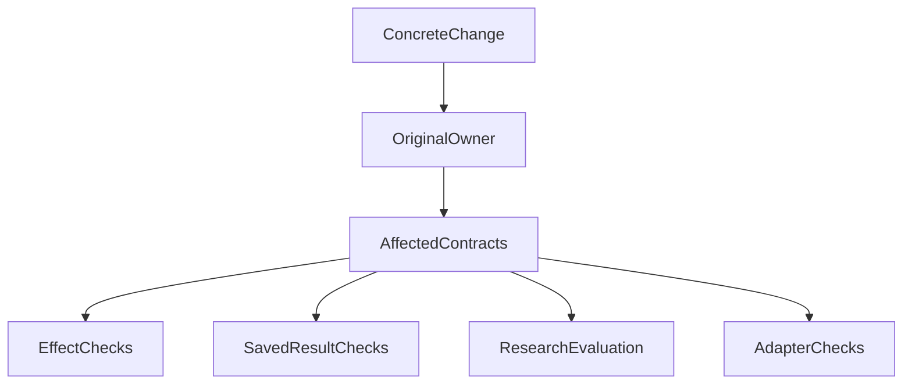

# What Should Stay Stable—and What Should Change—in an Agent Architecture?

A support system routes new tickets to service teams. The team wants a new classification method so that “refund status” is more likely to reach after-sales support than technical support.

The method can change. But an upgrade must not silently rewrite old assignment records, send duplicate notifications for one assignment, or expose one company's tickets to another company's staff.

These requirements sit near the same ticket module, yet need different treatment. Labeling the entire module “core—avoid changes” impedes improvement. Calling it “an algorithm—iterate quickly” can weaken necessary protections.

The ticket system is a teaching simulation, not an actual ETF Agent feature. **Keep specific commitments stable while allowing implementations and methods to evolve. A directory is too coarse a unit for that choice.**

## 1. Reduce the Upgrade to a Clear Commitment

“Upgrade automatic routing” can mean changing classification, adding notifications, or reassigning every old ticket.

For this example, establish a narrower agreement: the new version changes recommended teams for new tickets only. Existing company isolation, assignment confirmation, and notification deduplication remain. Historical tickets show who actually received them at the time. Reassigning existing tickets requires a separate explicit decision.

Those sentences tell developers what may change and reviewers what must not change incidentally.

An interface includes more than function arguments. Consumers may depend on record ownership, whether an action already happened, whether a result can be reopened, or whether retrying after failure is safe. A type signature can stay identical while its promise changes.

## 2. One Module Can Contain Four Different Kinds of Commitment

There is no need to grade the entire repository first. Inspect the commitments affected by this change:

| Kind | Meaning in the ticket example | How it can evolve |
| --- | --- | --- |
| Protections around operations | Company isolation, confirmation, and no duplicate notification on retry | Rewrite implementation while retaining the protection |
| Saved outcomes | The team actually assigned and the method version used | Change presentation without silently rewriting historical meaning |
| Methods to improve | How a question is interpreted and a team recommended | Experiment and assess representative tickets |
| Replaceable external integration | Which classifier is called and how its failures are represented | Replace the service while preserving internal result and failure agreements |

Our architectural discussion calls these protected effects, durable outcomes, evolving behavior, and replaceable adapters. The names distinguish questions. They are not four modules that must be created or four grades of quality.

A rapidly changing classifier still owes users good recommendations. A replaceable integration cannot receive private data without authorization. One edit can affect several rows and should be assessed accordingly.

## 3. Why Should Storage Learn the Business Method Again?

Suppose the new method only distinguishes “refund status” from “system error” more accurately. Ticket identity, recommended team, and method-version fields remain unchanged.

Keep that change inside classification where possible. Storage continues saving the agreed result. Notifications continue consuming confirmed assignments. Neither needs to know which words the classifier examined or how many reasoning steps it used.

If each prompt adjustment requires changes in memory storage, database storage, and recovery readers, internal knowledge may have escaped into callers.

This does not promise that every change touches one file. A new persistent “awaiting human confirmation” state would affect real consumers and require coordinated design. Establish whether data or behavioral agreements change before choosing the scope.

ETF Agent's subtask refactoring arose from similar friction. Handoff rules were interpreted repeatedly by the runtime, recovery codecs, and two stores. Returning domain judgments to the module responsible for them, while retaining storage transactions, addressed ownership. Separately distinguishing changeable methods from stable handoff facts addressed evolution. The [runtime refactoring retrospective](agent-runtime-refactor-one-day-blocked.md) covers the concrete work. Its engineering checks do not substitute for research-quality or maintenance-cost comparisons.

## 4. What Should an Old Result Show After an Upgrade?

A historical ticket really went to technical support. The new method recommends after-sales support. Should reopening the page automatically show the new team?

If the page displays a current recommendation, it can show the new recommendation explicitly. If it displays the actual historical assignment, that fact must remain. Combining both meanings in one field makes the user think a past action changed.

Give the new recommendation its own method version and keep the actual assignment record distinct. Executing a reassignment still follows the existing confirmation and execution path. Recalculation is not execution, and a recommendation is not an operation receipt.

A synthetic financial example makes the same distinction visible. Net profit is 100,000 yuan: asset A contributes 150,000 and B contributes −50,000. Relative to net profit, their contributions are 150% and −50%, totaling 100%.

A new report that silently switches to total positive profit as its denominator to make the figures look tidier changes the question. Another analysis can be offered explicitly with a new method and result. Reopening the old report should not silently replace its basis.

Preserving historical meaning does not mean keeping everything forever. Retention, deletion, and forgetting still follow their respective agreements. The commitment concerns the meaning of results that remain legitimately retained.

## 5. What Cannot Reset When an External Service Changes?

Switching classifiers may help during an outage. First establish whether the routes are independent: different model names may point to the same failing endpoint.

Then establish whether the replacement is permitted to receive the ticket's private data. Previously sent requests, unknown charges, and notification records remain relevant. Changing services must not reset attempts and send the same notification again.

Replacement isolates technical differences. Operation identity, authorization, and accounting stay with their responsible modules. In ETF Agent, a Run and its recovery inherit recorded authorization. An adapter change cannot enlarge the permitted data-recipient scope or introduce a separate in-Run revocation judgment.

When in-flight switching is unnecessary, binding new tasks to the replacement often makes version handling clearer. If seamless switching of active tasks is a product promise, handle the states, versions, and uncertain effects it actually depends on. “Plugin architecture” does not settle those questions.

## 6. Verification Follows Commitments, Not Directories

Andrew Trenk's [“Test Behavior, Not Implementation”](https://testing.googleblog.com/2013/08/testing-on-toilet-test-behavior-not.html) explains why external behavioral assertions should usually survive implementation changes. The complementary point matters here: when a method is deliberately evolving, old output wording should not become the only permitted answer.

For the routing upgrade, divide verification by the change:

| Change | Suitable checks |
| --- | --- |
| Classification method only | Compare recommendations on fixed representative tickets and inspect actual use of the new input and method |
| Assignment submission | Check normal assignments, duplicate requests, unconfirmed actions, and company isolation |
| Historical reads | Reopen old-version records and verify actual assignments and method identities |
| External service replacement | Check responses, failures, settlement of dispatched requests, and eligibility to receive the data |

Every edit need not execute every row. Select necessary checks from the real impact. A claim of better classification requires corresponding content assessment; a successful API response cannot establish it.

The original review diagram remains below: locate the responsible module, identify affected commitments, and choose the corresponding checks. Its four branches may apply separately or together.

Keep these judgments in the existing task and review. They do not require another classification register or approval layer.

## 7. Start the Next Upgrade with an Executable Task

> Use the new classification method for new tickets. Preserve company isolation, assignment confirmation, and notification deduplication. Keep method details inside classification; storage and notifications continue consuming the existing agreement. Save the method version and preserve actual assignments when reopening old tickets. Label new recommendations separately. Assess representative tickets and verify through the real submission entry point that repeated requests do not send duplicate notifications. If interfaces or persistent states must change, identify affected consumers before editing them.

This teaching task identifies the change, protections, historical treatment, and observation points. Developers need not infer the scope from “keep the core stable.”

The reasoning also applies to recovery. Reading saved results does not imply rebuilding a complete execution environment across versions. A promise to resume in place requires maintaining its actual state dependencies. Readers with current consumers cannot be deleted merely because a narrower future promise is planned.

**Room for architectural evolution comes from letting methods change, tying protection to concrete operations, and preserving the meaning of events that already happened.** Establish those distinctions before selecting the code and tests to modify.

## Further Reading and Discussion

- [Runtime refactoring retrospective](agent-runtime-refactor-one-day-blocked.md): the ownership problems behind this reasoning.
- [Code and system evolution](code-cheaper-systems-harder-to-evolve.md): reduce dependencies and exit costs.
- [Memory: Saving, Recall, and Forgetting](026-agent-memory-forget-durable-effects.md): a concrete treatment of method changes and data-use protection.
- [Stability and evolution by interface](/en/principles#method-7): the principle index.

This article is part of [ETF Agent Engineering Notes](/en/catalog). Share examples in the [public GitHub collection](https://github.com/hpoenixf/eff-agent-article), or consider a Star if it helps your work.
